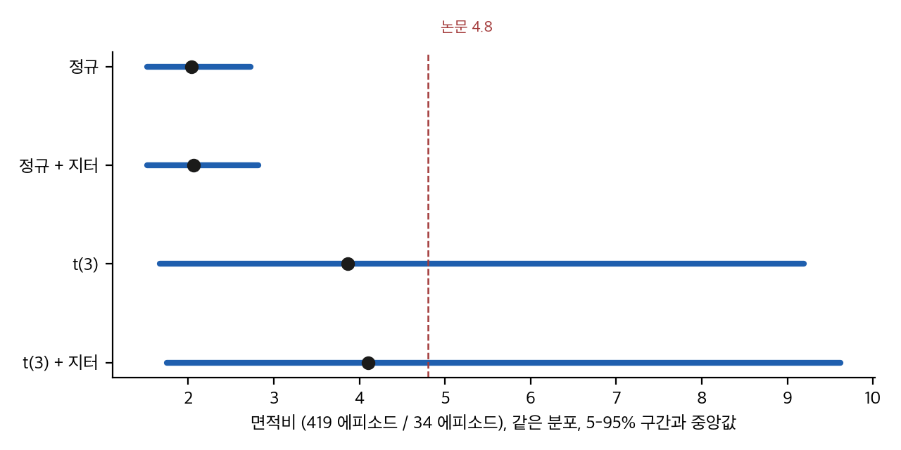

# 03. 표 재계산, 일관성 검사, 토이

모든 계산은 `analysis/recompute.py`(결과 `recompute_results.json`)와 `analysis/toy_hull.py`(결과 `toy_hull_results.json`)에 있고, 단일 프로세스 CPU에서 수 초에서 20초 안에 끝납니다. 논문 표 값은 v1 PDF에서 옮겼고, 그림 5(a)의 막대 값은 막대 위에 적힌 숫자를 읽었습니다(그림 판독 값). 시행 수가 논문에 없는 곳은 "(시행 수 n 가정)"으로 밝혔습니다. 이 문서의 "재현"은 표 값의 재계산이며 학습이나 평가를 다시 돌린 것이 아닙니다.

검사 번호: V = 수치 재계산, K = 서술·표·그림 사이의 불일치 후보(저자 확인이 필요한 항목).

## V1. 표 1 데이터 풀의 합계와 에피소드 길이

- 합계는 모두 맞습니다. 사람 시간 1,478.9, 프레임 144,032,114, 에피소드 1,494,195. 로봇 시간 4,534.8, 에피소드 268,585. 전체 6,013.7 h, 약 604M 프레임.
- 시간 = 프레임/(fps x 3600)에서 역산한 fps: 대부분 30, EgoExo4D 29.9, EPIC 30.0, Xperience 20.0, Galaxea 15.0, RoboCasa 20.0, Galbot 29.9. 본문이 "10–30 Hz"라고 쓴 것과 맞습니다.
- 에피소드당 평균 길이(시간 x 3600 / 에피소드): Ego4D 0.82 s, EgoExo4D 0.90 s, EPIC 1.55 s, HOI4D 8.7 s, EgoDex 8.5 s, Xperience 15.8 s.
- **K1.** 4.2절 Stage 1은 4 s 미만 클립을 버린다고 합니다. 그 하한을 지키면 Ego4D 216.6 h에서 가능한 에피소드는 최대 194,940개인데 표 1은 948,683개(4.9배)입니다. EgoExo4D는 최대 9,270 대 41,414(4.5배), EPIC은 29,069 대 74,788(2.6배). EgoDex, HOI4D, Xperience는 하한을 만족합니다. 에피소드 열이 필터 전 서술 단위일 가능성이 있습니다(가능성이며 확인은 저자에게).
- 비율: 표 1의 시간 비율은 사람 24.6%, 시뮬레이션 5.1%(DigitalWorld 225.3 + RoboCasa 83.6 h), 실로봇 70.3%입니다. 그림 1 도넛은 24.9 / 3.4 / 71.6%입니다. 단위(시간, 프레임, 749개 데이터 그룹의 개수 등)가 적혀 있지 않습니다(**K2**). 그림 3의 원본 5,929 h 대 유지 1,478 h는 24.93%이며, 도넛의 24.9%와 수치가 같은 것은 우연일 수 있습니다.
- 사전학습이 본 샘플 수: 200K 스텝 x 장치 128 x 배치 8 = 2.048억. 프레임 하나를 샘플로 보면 604M 프레임의 약 0.34회분입니다(그룹 가중치 무시). 사람 영상을 전부 한 번 훑지 못할 수도 있는 규모이고, 표본 가중치가 중요한 이유입니다(B.3의 그룹 가중치 값은 미기재).

## V2. 표 3과 표 9 (RoboCasa GR1, 24과제)

- 열 평균 재계산: GR00T-N1.6 47.61(보고 47.6), Qwen3PI 43.92(43.9), FLARE 55.08(55.0), ABot-M0 58.25(58.3), JoyAI-RA 63.17(63.2), ACE-Ego-0 72.83(72.8). 전부 반올림 안에서 맞습니다. 표 3의 5개 행은 표 9의 같은 행과 일치합니다.
- ACE-Ego의 24개 셀은 모두 짝수(2%p 격자)라서 과제당 50회와 정수 성공 수가 맞습니다. Qwen3PI, FLARE, ABot-M0, JoyAI-RA도 같습니다. **K3.** GR00T-N1.6은 24개 중 22개가 50회의 정수 격자에 맞지 않습니다(8.5, 41.5, 78.7 등). 이 열은 다른 출처나 다른 시행 수의 값일 가능성이 있고, 본문은 "과제당 50회"라고만 씁니다.

## V3. RoboCasa: ACE-Ego-0 대 기준선, 과제 쌍체

| 기준선 | 평균 차이 | 승-패-무 | 부호 검정 p | Wilcoxon p | 과제 부트스트랩 95% |
|---|---|---|---|---|---|
| GR00T-N1.6 | +25.2 | 24-0-0 | <0.001 | <0.001 | [21.4, 29.6] |
| Qwen3PI | +28.9 | 23-1-0 | <0.001 | <0.001 | [22.8, 34.8] |
| FLARE | +17.8 | 21-2-1 | <0.001 | <0.001 | [12.9, 22.4] |
| ABot-M0 | +14.6 | 20-4-0 | 0.0015 | <0.001 | [9.1, 19.9] |
| JoyAI-RA | +9.7 | 16-7-1 | 0.093 | 0.033 | [2.3, 17.1] |

JoyAI-RA에게 7개 과제에서 뒤집니다(CupToDrawerClose 36 대 48, MilkToMicrowaveClose 56 대 84, CanToDrawerClose 70 대 90 등). 닫기 계열 과제에서 약하고 선반·상자 계열에서 앞섭니다.

## V4. RoboCasa 풀링 검정 (24 x 50 = 1,200회 가정, 독립 이항)

- ACE 72.8 대 JoyAI-RA 63.2: 차이 +9.6%p, 표준오차 1.89, 95% [+5.9, +13.3], Fisher p < 0.001.
- ACE 72.8 대 DIAL 70.2: 차이 +2.6%p, 표준오차 1.84, 95% [−1.0, +6.2], Fisher p = 0.16. DIAL은 과제별 값과 시행 수가 없어 1,200회를 가정했습니다. 단일 시드의 이항 잡음만 반영하며, 학습 시드와 평가 초기 조건 분산은 들어 있지 않습니다. ACE 한 모델의 과제 층화 표준오차는 1.2%p입니다.

## V5. 절제 차이 (n = 1,200 가정)

| 비교 | 차이 | 95% 구간 | Fisher p |
|---|---|---|---|
| 로봇 사전학습 추가 (65.4 → 68.3) | +2.9 | [−0.9, +6.7] | 0.14 |
| 사람 영상 추가 (68.3 → 72.8) | +4.5 | [+0.9, +8.1] | 0.018 |
| 시간 정렬 청킹 제거 (72.8 → 71.7) | −1.1 | [−2.5, +4.7] | 0.55 |
| URDF 토큰 제거 (72.8 → 70.9) | −1.9 | [−1.7, +5.5] | 0.32 |
| 신뢰도 가중 제거 (72.8 → 69.2) | −3.6 | [−0.03, +7.2] | 0.053 |
| 전체 대 Qwen 초기화 (65.4 → 72.8) | +7.4 | [+3.7, +11.1] | <0.001 |

- 구간이 0을 넘지 않는 것은 "사람 영상 추가"와 "전체 대 Qwen"입니다. 요소 절제 세 개는 1,200회의 이항 잡음 폭(±3.6%p)에 가려집니다. 각 수치는 한 번의 학습 결과이고 시드 분산은 알 수 없습니다.
- **V5b.** JoyAI-RA 대비 +9.6%p 중, Qwen 초기화(구현체 사전학습 없음)가 이미 65.4로 JoyAI-RA(63.2)를 +2.2%p 넘고 기준선 다섯을 모두 넘습니다. 나머지는 로봇 사전학습 +2.9, 사람 영상 +4.5입니다.
- **K4.** 요소 절제는 "190K 스텝 체크포인트"(5.4절), 사전학습은 200K 스텝(표 8)입니다. 전체 모델 72.8이 표 3의 값과 같은 값인데 어느 스텝인지 적혀 있지 않습니다. 그림 5(b)의 "w/o Human Loss"는 본문에서 "라벨 품질 가중 없이 같은 가중을 주는" 설정으로 설명되어 사람 영상 자체를 뺀 것이 아닙니다(그 비교는 표 5의 "로봇만").

## V6. RoboTwin 평균 (표 4, 표 10)

- π0, π0.5, Motus, LingBot, JoyAI-RA, ACE-Ego의 50과제 평균이 모두 보고값과 같습니다(Easy, Hard 모두). 평균은 0.02의 배수라는 정수 조건도 맞습니다.
- **K5.** ABot-M0는 표 10에 20과제 값만 있고(나머지는 "–") 그 20개 평균은 Easy 80.65, Hard 79.25인데 표 4의 평균은 86.06, 85.08입니다. 50과제 평균을 다른 출처에서 가져왔다면 설명이 필요합니다.
- **K6.** 표 4에는 Hy-VLA가 있고 표 10에는 없습니다. 5.1절은 "과제별 전체 비교"가 부록 C.5에 있다고 쓰며 Hy-VLA를 비교 대상으로 나열합니다.

## V7. RoboTwin: 50과제 쌍체

| 비교 | Easy 차이 (승-패-무) | p (부호 / Wilcoxon) | Hard 차이 (승-패-무) | p |
|---|---|---|---|---|
| 대 JoyAI-RA | +0.64 (24-17-9) | 0.35 / 0.47 | +1.34 (28-13-9) | 0.028 / 0.14 |
| 대 Motus | +2.46 (29-14-7) | 0.032 / 0.038 | +3.60 (35-11-4) | <0.001 / 0.002 |
| 대 LingBot | +2.56 (31-10-9) | 0.0015 / 0.004 | +3.94 (30-11-9) | 0.004 / 0.010 |
| 대 π0.5 | +8.38 (40-7-3) | <0.001 | +13.86 (43-3-4) | <0.001 |

- JoyAI-RA 대비 과제 평균 차이의 부트스트랩 95% 구간은 Easy [−1.1, +2.5], Hard [−0.8, +3.5]입니다. 두 설정 모두 0을 포함합니다. Motus 대비 Hard도 [−0.7, +7.4]로 0을 포함합니다.
- ACE가 Easy에서 최고 또는 공동 최고인 과제는 50개 중 25개입니다. 큰 열세는 Click Bell(66 대 81), Click Alarmclock(52 대 64; π0.5 98, Motus 100), Turn Switch(59 대 71)입니다. 5.2.2절의 "개선이 다양한 조작 유형에 고르게 분포한다"는 서술은 이 세 과제를 설명하지 않습니다.

## V8. RoboTwin 풀링 (100 x 50 = 5,000회 가정)과 그림 1

- Easy: ACE 91.12 대 JoyAI 90.48, +0.64 [−0.49, +1.77], p = 0.28. Hard: +1.34 [+0.16, +2.52], p = 0.028. Hy-VLA(90.9/90.1)와는 +0.22 [−0.9, +1.3], +0.52 [−0.6, +1.7]입니다. 풀링 검정은 과제 차이를 무시하므로 V7을 우선합니다.
- 5.2.2절의 "0.64%와 1.34%"는 퍼센트포인트 차이입니다.
- **K7(V8b).** 그림 1 막대: ACE 90.6과 JoyAI-RA 89.3은 표 10의 Hard 값, ABot-M0 86.1은 Easy 값입니다(ABot-M0 Hard는 85.08). 같은 막대 그룹에서 설정이 섞여 있습니다.

## V9. 실로봇 (그림 5a, 과제당 30회, 그림 판독 값)

| 과제 | ACE | π0.5 | GR00T-N1.7 |
|---|---|---|---|
| Pick Tea | 26/30 | 26/30 | 1/30 |
| Scoop Coffee | 25/30 | 20/30 | 11/30 |
| Category Sorting | 26/30 | 23/30 | 25/30 |
| Sweep Cubes | 22/30 | 21/30 | 2/30 |
| Stack Bowls | 24/30 | 23/30 | 22/30 |
| Pack Shoes | 18/30 | 16/30 | 3/30 |
| 합계 | 141/180 = 78.3% | 129/180 = 71.7% | 64/180 = 35.6% |

- 평균 78.3, 71.7, 35.6이 막대 값에서 재현됩니다(모든 값이 k/30 격자에 있음).
- **K8.** 5.3절의 Scoop Coffee(ACE 86.7, π0.5 70.0)와 Category Sorting(ACE 90.0, π0.5 80.0)은 그림 값(83.3, 66.7, 86.7, 76.7)보다 각각 정확히 1회분(3.3%p) 높습니다. 서술의 차이(16.7, 10.0%p)는 그림과 같습니다. 서술 값으로 평균을 내면 ACE 79.5, π0.5 72.8입니다.
- 검정: ACE 대 π0.5 풀링 141/180 대 129/180, Fisher p = 0.18, ACE Wilson 95% [71.8, 83.7], π0.5 [64.7, 77.7]. 과제별 Fisher p는 0.23(Scoop Coffee)이 가장 작고, 6개 모두 비유의입니다. 과제 쌍체는 5승 0패 1무(정확 부호 검정 양측 p = 0.0625). GR00T-N1.7과의 차이(141 대 64)는 p < 1e-15입니다.
- "6.6%"와 "16.7%"는 퍼센트포인트입니다. "5과제 중 앞선다"는 서술은 Pick Tea가 동률이라 맞습니다.

## V10. 5.5절 Sweep Cubes 보강 미세조정

- 1/10 대 4/10, Fisher p = 0.30. Wilson 95% [1.8%, 40.4%] 대 [16.8%, 68.7%]. "4배"는 두 점 추정의 비이며, 10회 시행으로 구분되지 않습니다.
- 면적비 0.296/0.062 = 4.77로 "4.8배"는 맞습니다. 프레임 수는 로봇 시연당 약 1,347, 사람 에피소드당 약 280입니다.
- 그림 5(a)의 Sweep Cubes 73.3%(22/30)는 로봇 데이터만 쓴 10%와 다른 미세조정 설정으로 보이지만, 데이터 양이 본문에 없습니다.

## V11–V12. 신뢰도 가중이 식으로 실제 하는 일

- **V11.** 표 6의 ρ: 위치 6채널 1.0, 그 외 16채널 0.001. Z가 표본별 합이면 위치 채널이 보조 손실 가중의 99.73%를 차지합니다. 사람 영상은 두 손목 xyz의 회귀 감독을 하는 것과 같고, 마스크 M이 활동 플래그를 제외하면 비율은 더 높아집니다.
- **V12.** 식 20–21을 따라 만든 표본 하나의 손실에서 w_data를 1.0, 0.5, 0.25로 바꿔도 값이 같습니다(0.27028). 왼손과 오른손에 서로 다른 w_data를 줄 때만 변합니다(0.27072). 한 표본 안에서 상수인 인자는 표본별 정규화로 약분됩니다. A.5의 "w_data가 각 소스의 전역 품질 상한을 정한다"는 서술이 성립하려면 Z가 표본별이 아니라 배치 단위이거나 w_data가 L_haux 밖의 표본 가중으로 들어가야 합니다. 공개 코드에 사람 손실이 없어 어느 쪽인지 확인할 수 없습니다(04 D7).

## 토이: 볼록 껍질 면적비는 표본 수에 얼마나 민감한가

5.5절은 34개 로봇 에피소드의 껍질 0.062 m²와 419개 사람 에피소드의 0.296 m²(4.8배)를 사람 영상이 "더 넓은 행동 공간을 채운다"는 증거로 듭니다. 같은 분포에서 두 표본이 나왔다고 가정한 모형입니다(에피소드 = 시작점 + 20점 랜덤 워크, 300회 반복, 분산 맞춘 분포).

| 가정 | 면적비 평균 (5–95%) | 4.8 이상인 비율 |
|---|---|---|
| 정규 | 2.05 (1.5–2.7) | 0% |
| 정규 + 사람 쪽 지터 0.03 | 2.12 (1.5–2.8) | 0% |
| t(3) 꼬리 | 4.74 (1.7–9.2) | 32% |
| t(3) + 지터 | 4.64 (1.8–9.6) | 34% |

표본 수만으로도 정규 분포에서 약 2배, 두꺼운 꼬리에서는 평균 4.7배가 나옵니다. 이 모형은 논문의 실제 분포를 모르므로 4.8배가 표본 수 효과인지 더 넓은 분포인지 판정하지 못합니다. 껍질 면적은 이상치와 의사 행동의 추적 오차에 민감한 통계이므로 밀도 기반 측도(분위 타원, 격자 점유율)나 같은 수의 로봇·사람 에피소드로 다시 재는 비교가 필요합니다.

## 그래프 (우리가 그린 것)

- 절제 차이와 구간: `report/figures/own_ablation_ci.png`
- 실로봇 과제별 성공률과 Wilson 구간: `report/figures/own_real_robot.png`
- RoboTwin 과제별 ACE − JoyAI 차이: `report/figures/own_robotwin_diff.png`

## 한 줄 결론

표 값은 서로 대체로 맞습니다(RoboCasa·RoboTwin 평균, 데이터 풀 합계). 흔들리는 곳은 (1) 실로봇 본문과 그림의 3.3%p 차이, (2) JoyAI·DIAL과의 근소한 차이의 통계적 위치, (3) 사람 데이터 효과가 한 점·한 시드의 +4.5%p라는 점, (4) 표 1 에피소드 수와 4초 하한, (5) 신뢰도 가중 식의 w_data 약분입니다. 모두 저자 확인으로 풀 수 있는 항목입니다.
