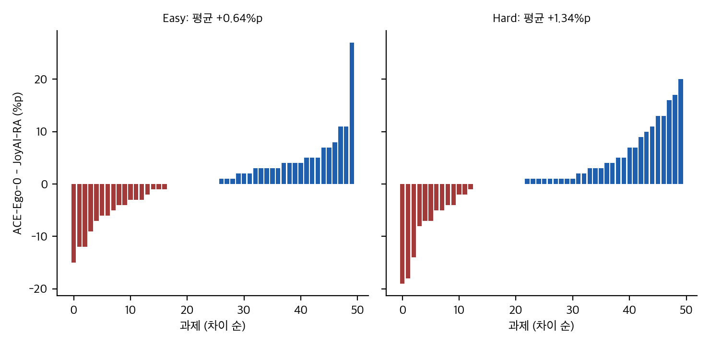
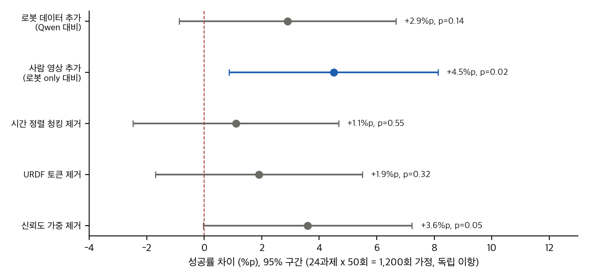
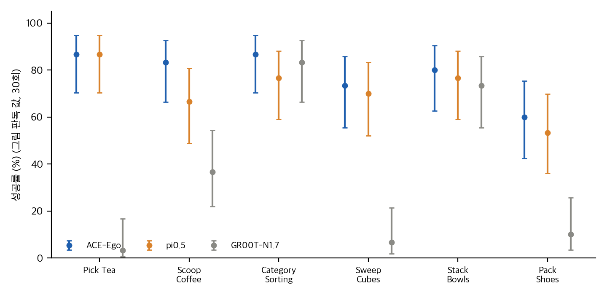
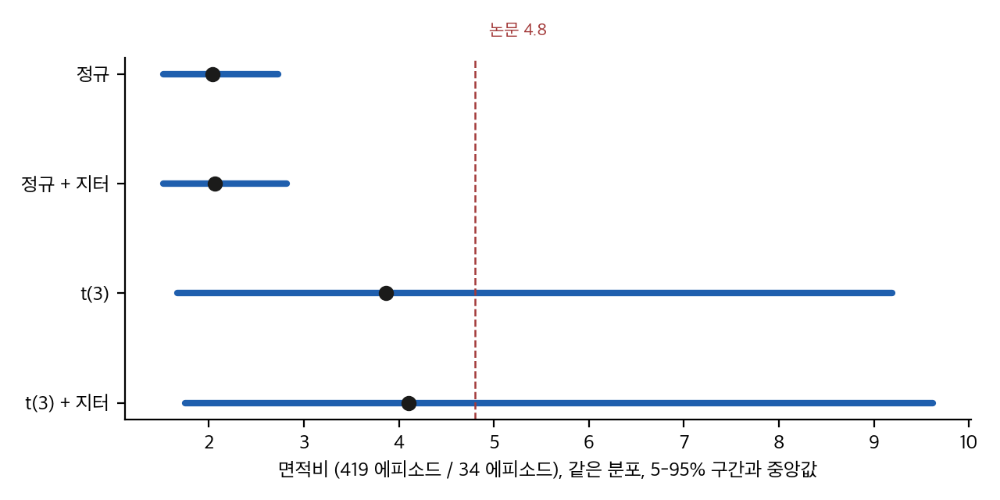

> **논문:** Hao Li, Ganlong Zhao 외. *ACE-Ego-0: Unifying Egocentric Human and Robotic Data for VLA Pretraining.* CoRL 2026 포스터, arXiv:2606.17200 (v1, 2026-06-15).
> 공식 코드(MIT, ACERobotics-VLA/ACE-Ego-0)는 정적으로만 읽었고 실행하지 않았습니다. 논문 그림은 싣지 않고, 우리가 만든 그래프만 씁니다.

## 논문이 묻는 것

로봇 시연은 모으기 비싸고, 사람 1인칭 영상은 싸고 많습니다. 문제는 사람 영상에서 뽑은 행동 라벨(손 궤적)에 추적 오차가 있고, 좌표계와 시간 간격도 로봇 데이터와 다르다는 점입니다. ACE-Ego-0은 두 가지로 답합니다.

1. **정렬:** 로봇 말단 포즈와 사람 손 포즈를 모두 머리 카메라 좌표 행동으로 쓰고, 로봇 URDF 그래프에서 만든 형태 토큰과 물리 시간 기준 청킹(H = round(f·T*))을 붙입니다.
2. **감독 품질 분리:** 로봇 데이터는 주 흐름 정합 손실로, 사람 의사 행동은 손목 위치 채널에 가중을 몰아 준 Huber 보조 손실로만 씁니다.

사전학습은 4.53K시간의 로봇·시뮬레이션 데이터와 1.48K시간의 사람 영상을 섞고(Qwen3-VL-4B + 600M 행동 전문가), RoboCasa GR1 TableTop 72.8%, RoboTwin 2.0 Easy/Hard 91.12/90.62%, ARX 쌍팔 실로봇 6과제 평균 78.3%를 보고합니다.

## 이 글에서 확인한 것

**표 값끼리는 대체로 맞습니다.** RoboCasa(24과제)와 RoboTwin(50과제)의 열 평균은 보고값과 일치하고, 데이터 풀의 시간·프레임·에피소드 합계도 맞습니다. 예외는 표 10에서 ABot-M0가 20과제 값만 있고 그 평균이 표 4의 평균과 다른 점, 표 4에 있는 Hy-VLA가 표 10에 없는 점입니다.

**JoyAI-RA, DIAL과의 근소한 차이는 판단을 유보하게 합니다.** RoboTwin에서 JoyAI-RA에 대한 평균 차이는 Easy +0.64, Hard +1.34%p이고, 50과제 쌍체로 보면 Easy는 24승 17패 9무, Hard는 28승 13패 9무입니다. Wilcoxon p는 0.47, 0.14이고 과제 평균 차이의 부트스트랩 95% 구간은 두 설정 모두 0을 포함합니다.

그래프: RoboTwin 2.0 표 10의 50과제에 대한 ACE-Ego-0과 JoyAI-RA의 과제별 성공률 차이(%p, 차이 순). 우리가 그린 그래프입니다.

RoboCasa에서 DIAL 대비 +2.6%p는 과제별 값이 없어서 24과제 x 50회 = 1,200회(시행 수 n 가정), 독립 이항 가정으로 구간을 냈고 95% [−1.0, +6.2]입니다. JoyAI-RA와는 +9.6%p(과제 16승 7패 1무)로 더 분명합니다.

**사람 영상의 이득은 한 점이고, 사전학습 없는 초기화가 이미 높습니다.** 표 5에서 사람 영상을 더한 효과는 +4.5%p이며, 같은 가정에서 95% 구간은 [+0.9, +8.1]입니다. 요소 절제(시간 정렬 청킹 −1.1, URDF 토큰 −1.9, 신뢰도 가중 −3.6%p)는 1,200회의 이항 잡음 폭(±3.6%p)과 같은 크기입니다. 또 사전학습이 없는 Qwen 초기화(65.4%)가 이미 JoyAI-RA(63.2%)보다 높아서, JoyAI-RA 대비 +9.6%p 중 사전학습 없이 얻는 몫이 +2.2%p입니다.

그래프: 표 5와 그림 5(b)의 RoboCasa 평균 차이와 95% 구간(24과제 x 50회 = 1,200회 가정, 독립 이항). 우리가 그린 그래프입니다.

**실로봇의 본문 값과 그림 값이 1회분 다릅니다.** 5.3절의 Scoop Coffee(ACE 86.7, π0.5 70.0)와 Category Sorting(ACE 90.0, π0.5 80.0)은 그림 5(a)의 막대 값(83.3, 66.7, 86.7, 76.7)보다 각각 30회 중 1회(3.3%p) 높습니다(그림 판독 값). 평균 78.3과 71.7은 그림 값에서 재현됩니다. 그림 값으로 보면 ACE는 141/180, π0.5는 129/180이고 Fisher p는 0.18, 과제 쌍체는 5승 0패 1무(정확 부호 검정 p = 0.0625)입니다. GR00T-N1.7(64/180)과의 차이는 분명합니다. 저자 확인이 필요한 항목입니다.

그래프: 그림 5(a)의 막대 위 숫자를 읽은 값(그림 판독 값)과 과제별 Wilson 95% 구간(과제당 30회). 우리가 그린 그래프입니다.

**사람 영상의 "더 넓은 커버리지" 근거는 표본 수에 민감한 통계입니다.** 5.5절은 로봇 34개와 사람 419개 에피소드의 손 위치 볼록 껍질 면적(0.062 대 0.296 m², 4.8배)을 듭니다. 두 표본이 같은 분포에서 나왔다고 가정한 작은 모형(에피소드 = 시작점 + 20점 랜덤 워크, 300회 반복)에서도 면적비는 정규 분포에서 약 2배, 두꺼운 꼬리(t 분포 자유도 3)에서 평균 4.7배가 나옵니다. 논문의 실제 분포는 알 수 없으므로 이 모형은 4.8배를 설명하거나 부정하지 않고, 밀도 기반 측도로 다시 재 볼 만하다는 것만 보입니다. 같은 절의 1/10 대 4/10(4배)은 Fisher p = 0.30입니다.

그래프: 같은 분포에서 34개 대 419개 에피소드의 손 위치 볼록 껍질 면적비(5–95% 구간과 중앙값). 붉은 선은 논문의 4.8. 우리가 만든 토이입니다.

## 식에서 읽은 것: 신뢰도 가중

표 6의 ρ(위치 6채널 1.0, 나머지 16채널 0.001)와 식 21(표본별 정규화)을 그대로 읽으면, 위치 채널이 보조 손실 가중의 99.7%를 차지합니다. 사람 영상은 사실상 두 손목 xyz의 보조 회귀 감독입니다. 또 한 표본 안에서 상수인 데이터셋 사전 w_data는 정규화에서 약분되어, 부록 A.5가 설명하는 "소스별 품질 상한"으로 작동하려면 Z가 배치 단위이거나 w_data가 표본 가중으로 들어가야 합니다. 어느 쪽인지는 공개 코드로 확인할 수 없습니다.

## 데이터 표에서 확인이 필요한 곳

표 1의 에피소드 수를 시간으로 나누면 Ego4D는 에피소드당 평균 0.82초입니다. 4.2절은 4초 미만 클립을 버린다고 하므로, 같은 시간에서 가능한 최대 에피소드 수(194,940)의 4.9배입니다. EgoExo4D와 EPIC-KITCHENS도 같은 방향입니다. 에피소드가 필터 전 서술 단위일 가능성이 있으며 저자 확인이 필요합니다. 그림 1 도넛(사람 24.9%, 시뮬레이션 3.4%, 로봇 71.6%)은 표 1의 시간 비율(24.6, 5.1, 70.3%)과 같은 단위인지 적혀 있지 않습니다.

## 공식 코드와 논문

공개 저장소는 GR1 RoboCasa 24 추론·평가와 RoboCasa 24·ARX 경량 SFT를 담고, 사전학습, 사람 영상 파이프라인, RoboTwin 평가, 실로봇 배포는 포함하지 않는다고 README가 밝힙니다. 코드와 논문의 차이는 다음과 같습니다.

- 시간 정렬 청킹과 사람 보조 손실은 공개 코드에 없습니다. 공개 SFT는 30스텝 프레임 인덱스 청크와 속도 MSE 하나를 씁니다.
- 행동은 23차원(허리 3차원 포함, 활동 플래그 없음)이고, RoboCasa 입력은 224x224 한 카메라, 고유감각 상태가 행동 전문가에 들어갑니다(논문 22차원, 256x256 머리·손목).
- 흐름 정합 시간은 Beta(1.5, 1.0) 기반으로 뽑습니다(논문 식 7은 U(0,1)).
- Absolute와 Delta 두 체크포인트가 공개되어 있고 표 3의 72.8%가 어느 쪽인지는 적혀 있지 않습니다.
- 학습 하이퍼파라미터(AdamW, 학습률, 워밍업, 전역 배치 128)와 모델 구조 수치는 일치합니다.

## 재현 가능성

논문 수치의 재현은 이 맥(Apple M4 Pro, 24 GiB, CUDA 없음)에서 불가능합니다. 공식 평가는 CUDA와 FlashAttention을 가정하고, 체크포인트는 약 12.3 GB, SFT 데이터는 약 53.4 GB, SFT는 GPU 8장 규모입니다. 신뢰도 가중 손실, 카메라 좌표 행동, 청킹 샘플러는 소형 정책으로 대리 실험할 수 있습니다.

## 저자에게 묻고 싶은 것

표 3의 72.8%는 Absolute와 Delta 중 어느 쪽입니까. 표 1의 에피소드는 4–30초 필터 이후의 클립입니까. 5.3절과 그림 5(a)의 값은 어느 쪽이 기준입니까. 식 21의 Z는 표본별입니까. 평가 시드 수와 비교 방법의 학습 데이터 통제는 어떻게 됩니까.

## 정리

표 값끼리의 일관성은 높고, 사람 영상을 보조 손실로 격리하는 설계는 이식하기 쉬운 아이디어입니다. 다만 근소한 우위의 통계적 위치, 사람 영상 효과가 단일 비교의 한 점이라는 점, 핵심 장치가 공개 코드에 없다는 점은 결과를 읽을 때 함께 두어야 합니다.

## 자료

- [통합 리포트 PDF](report/report_public.pdf)
- [ACE-Ego-0 논문 분석 (arXiv:2606.17200 v1)](analysis/01_paper_analysis.md)
- [02. 선행연구, 구성 요소의 출처, 관련 자료](analysis/02_prior_work.md)
- [03. 표 재계산, 일관성 검사, 토이](analysis/03_analysis.md)
- [04. 논문 ↔ 공식 코드 대조](analysis/04_code_verification.md)
