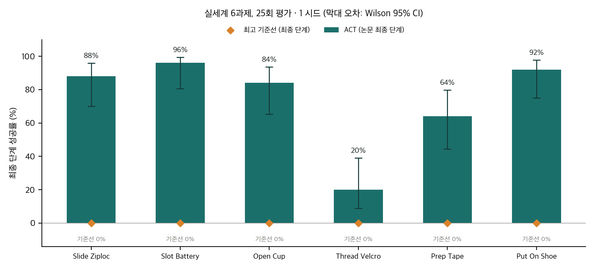

> **논문:** Zhao, Kumar, Levine, Finn. *Learning Fine-Grained Bimanual Manipulation with Low-Cost Hardware.* arXiv:2304.13705 (RSS 2023).
> 논문 그림은 arXiv 비독점 라이선스 때문에 싣지 않았습니다. 그림과 영상은 [프로젝트 페이지](https://tonyzhaozh.github.io/aloha/)에서 볼 수 있습니다. 아래 그래프는 논문 표의 수치로 직접 그렸습니다. 공식 코드는 MIT 라이선스입니다.

## 한 줄 요약

정밀 조작은 로봇을 비싸게 만들어야 가능하다고 여겨졌는데, 이 논문은 **2만 달러 이하의 장비와 행동 청크 정책**으로 케이블 타이 끼우기, 배터리 끼우기 같은 과제를 풀 수 있다고 보고합니다. 방법은 단순하고 설득력이 있습니다. 다만 실세계 증거는 시드 한 개, 과제당 25회입니다. 그래서 숫자를 다시 계산해 봤습니다.

## 1. 장비: 리더 팔을 직접 움직인다

ALOHA는 같은 제조사의 팔 두 종류를 씁니다. 실제로 로봇을 움직이는 팔(ViperX-300, 약 5,600달러)과, 사람이 손으로 움직이는 작은 리더 팔(WidowX-250, 3,300달러)입니다. 사람이 리더 팔을 움직이면 관절 각도가 그대로 실제 팔에 전달됩니다. VR 컨트롤러로 손의 자세를 읽어 끝점 위치로 바꾸는 방식과 달리, **관절 공간에서 1:1로 대응**시킵니다.

저자들은 이 방식의 이유로 세 가지를 듭니다. 팔이 특이점 근처에 있을 때 역기구학이 잘 실패하지 않고, 무거운 리더가 빠른 움직임을 막으며, 관절 단위로 제어 대역폭이 보장된다는 것입니다. 이 설명은 논문에 있지만, 세 이유 중 어느 것도 따로 실험으로 확인되지 않았습니다. 확인된 것은 제어 주파수가 5Hz에서 50Hz로 바뀌면 같은 작업이 62% 빨라진다는 사용자 연구뿐입니다.

## 2. 정책: 행동 청크와 시간 앙상블

ACT의 핵심은 두 가지입니다.

- **행동 청크:** 한 스텝의 행동 대신 다음 100스텝의 목표 관절각을 한 번에 예측합니다. 모방학습의 고질적 문제인 복합 오차(작은 오차가 쌓여 로봇이 학습 데이터에서 벗어나는 현상)를 유효 지평선을 줄이는 방식으로 완화합니다. 저자들의 그림 8(a)에서 청크 크기 1에서 100으로 가면 성공률이 1%에서 44%로 올라갑니다.
- **시간 앙상블:** 청크를 100스텝마다 한 번씩 실행하면 동작이 끊깁니다. 그래서 **매 시점마다 새로 예측**하고, 같은 시점을 가리키는 여러 예측을 지수 가중치로 평균합니다. 추가 학습 비용은 없습니다.

학습 방식은 CVAE입니다. 인코더는 학습 때만 쓰이며, 사람 시연이 같은 상황에서도 조금씩 다르게 움직이는 것을 잠재 변수로 흡수합니다. 저자들의 그림 8(c)에 따르면 사람 시연 데이터에서 CVAE를 빼면 성공률이 35%에서 2%로 떨어집니다. 시뮬레이션의 scripted 데이터에서는 차이가 거의 없었습니다. 시연이 사람일 때 CVAE가 필요하다는 점은 분명해 보입니다.

## 3. 결과와 숫자 확인

그림. 논문 표 I·II의 실세계 최종 단계 성공률. 막대 오차는 Wilson 95% 신뢰구간이며, 과제당 25회 평가 · 1 시드입니다. 기준선(BeT, BC-ConvMLP)은 모든 과제에서 최종 단계 0%입니다.

논문 표 I과 II의 모든 값을 다시 계산했습니다. 결과는 세 가지입니다.

**맞는 것.** 시뮬레이션 최종 단계의 우위 59, 49, 29, 20%p가 표와 일치합니다. 실세계 단계별 성공 횟수는 모두 25회 기준의 정수로 떨어집니다. 여섯 과제 중 다섯 과제에서 ACT와 기준선의 차이는 Holm 보정 후에도 p < 0.001입니다.

**어긋나는 것.**

- 초록은 "투명 조미료 컵 열기와 배터리 끼우기를 80–90% 성공률로 해낸다"고 쓰지만, 표의 배터리 과제는 96%입니다.
- 본문은 과제마다 "10–20분 분량의 시연"이라고 쓰지만, 시연 50회는 8–14초씩 해서 6.7–11.7분입니다. 20분에 가까운 것은 Thread Velcro(100회, 13–23분)뿐입니다.
- Slide Ziploc의 ACT는 첫 단계 성공 92%(23회)보다 두 번째 단계 성공 96%(24회)가 많습니다. 단계가 순차라면 불가능한 값입니다. 재시도를 허용했는지 논문에 설명이 없습니다.
- 표 II의 캡션은 "나머지 3과제"라고 쓰지만 표에는 4과제가 있습니다.

**조심해서 읽을 것.** Thread Velcro는 ACT 20%(5/25), BeT 0%(0/25)입니다. 양측 Fisher 검정으로 p = 0.050이라 유의하지 않습니다. 논문은 "큰 차이"라고 쓰지만, 이 과제 하나로는 결론을 내리기 어렵습니다. 또 시뮬레이션의 p 값은 세 시드를 독립으로 보고 계산한 값이라 과장되었을 수 있습니다.

## 4. 공식 코드와 비교

공식 저장소 `tonyzhaozh/act`(MIT)를 정적으로 읽었습니다. 실행하지는 않았습니다. 구조와 손실, 주요 하이퍼파라미터(청크 100, β = 10, lr 1e-5, 배치 8, 트랜스포머 크기)는 논문과 일치합니다. 다만 다음 설정은 **논문에 없고 코드에만 있습니다.**

- 시간 앙상블의 감쇠 계수 k = 0.01. 논문은 식만 쓰고 m 값을 밝히지 않습니다. 이 값이 결과에 얼마나 영향을 주는지는 확인되지 않았습니다.
- 입력과 행동의 z-점수 정규화, ImageNet으로 초기화된 ResNet18, AdamW와 weight decay 1e-4.
- 디코더 질의 임베딩: 논문 부록은 "고정 사인 임베딩"이라고 쓰지만, 코드는 학습 임베딩을 씁니다.

또 코드에는 `.cuda()` 호출이 10여 곳 하드코딩되어 있습니다. CUDA가 없는 맥에서 돌리려면 장치를 바꾸는 수정이 먼저 필요합니다.

## 5. 재현할 수 있는가

- **실로봇 실험:** 팔 4개, 웹캠 4대, ROS 1 환경이 필요합니다. 개인 환경에서는 어렵습니다.
- **시뮬레이션 실험:** MuJoCo 기반 Transfer Cube가 공식 저장소에 있습니다. 데이터 생성은 CPU로 가능하지만, 학습은 논문 기준으로 GPU에서 약 5시간이 걸렸습니다. 맥에서 얼마나 걸리는지는 측정하지 않았습니다.
- **그림 8의 곡선:** 청크 크기, 앙상블, CVAE 제거 실험을 모두 다시 하려면 GPU로 여러 번 학습해야 합니다.

## 6. 정리

ACT는 "값싼 장비 + 단순한 정책"으로도 정밀한 양팔 조작을 배울 수 있다는 것을 보여준 논문입니다. 방법은 기억할 만합니다. 특히 **청크 예측과 추론 시 시간 앙상블**은 기존 정책에 붙이기 쉽습니다. 반면 실세계 증거는 한 시드, 25회라서 과제마다 강도가 다릅니다. 논문 수치를 인용할 때는 CI와 시드 수를 같이 적는 것이 안전합니다.

*분석 근거: 논문 PDF(arXiv v1, 공식 버전은 한 개), 공식 코드(MIT, 2024년 커밋 기준), 재계산 스크립트. 재계산과 코드 대조 세부는 게시 폴더의 분석 문서에 있습니다.*

## 자료

- [통합 리포트 PDF](report/report_public.pdf)
- [01. 논문 분석: Learning Fine-Grained Bimanual Manipulation with Low-Cost Hardware](analysis/01_paper_analysis.md)
- [02. 선행연구와 관련 연구](analysis/02_prior_work.md)
- [03. 수치 재계산과 일관성 검사](analysis/03_analysis.md)
- [04. 코드 대조: 논문 ↔ 공식 코드 (정적 읽기)](analysis/04_code_verification.md)
