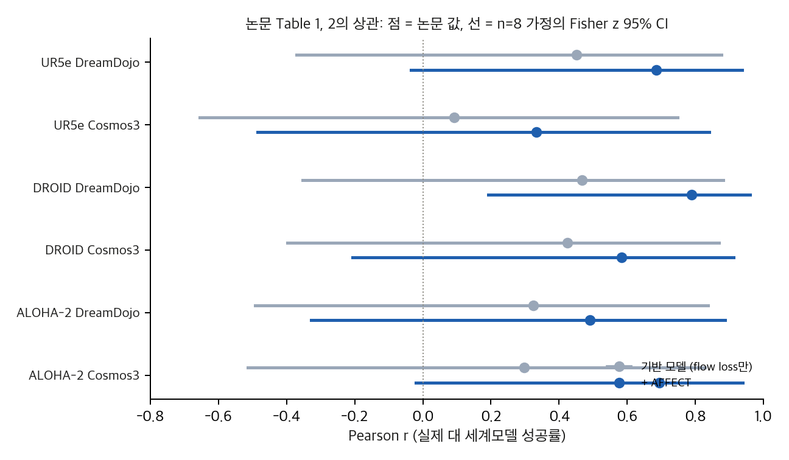
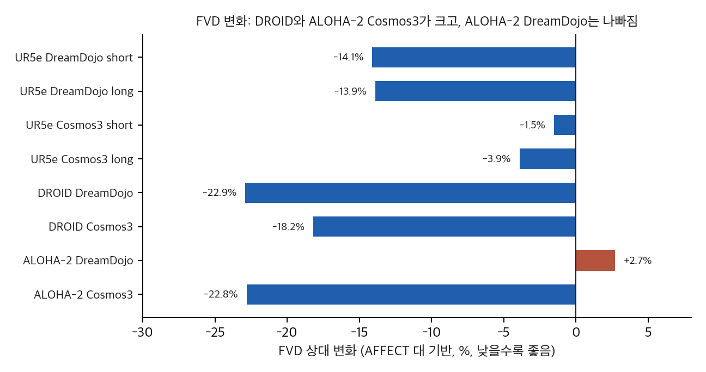
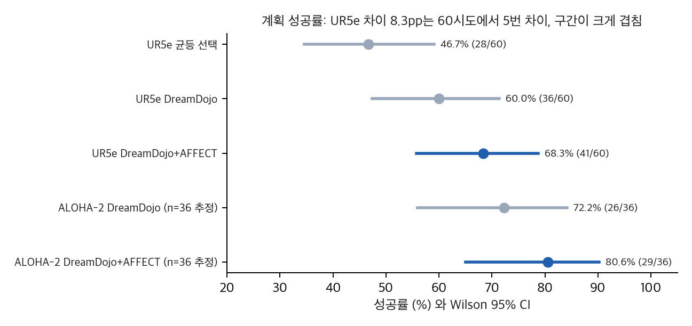

> **논문:** John Won, Yonghoon Dong, Jinwoo Shin. *Learning What Actions Change: Action Effect Matching for Dynamics-Faithful World Models.* arXiv:2611.25980 (v1, 2026-11-19). 학회 표기는 확인하지 못했습니다.
> 공식 코드와 프로젝트 페이지는 2026-11-21 기준으로 찾지 못했습니다. 이 글의 그림은 모두 우리가 그린 그래프입니다.

## 논문이 묻는 것

로봇 세계모델은 영상이 그럴듯해도 행동을 조금 바꿨을 때 결과가 실제처럼 달라지지 않을 수 있습니다. 이 차이는 정책 평가와 계획에서 치명적입니다. 같은 정책을 두 번 평가할 때 세계모델이 행동 차이를 무시하면 잘못된 정책을 고르게 됩니다.

AFFECT는 play 데이터를 모을 때 행동에 시간 상관 잡음을 넣고 잡음을 기록합니다. 그리고 생성 영상이 같은 잡음에 실제 영상과 같은 방향과 세기로 반응하도록 보조 손실을 더합니다. 손실은 "잡음 특징 × 영상 특징"의 공분산이 실제와 생성 영상에서 같은지를 맞추는 식입니다.

## 이 글에서 확인한 것

- **상관 개선은 방향이 맞습니다.** 여섯 개 백본과 환경 조합에서 모두 실제 대 세계모델 성공률의 Pearson r이 올랐습니다. DROID에서 DreamDojo는 0.468에서 0.790으로 올랐습니다.
- **하지만 표본이 작습니다.** 논문의 셀 수를 4 체크포인트 × 2 과제 = 8로 보고 다시 계산하면, 대부분의 신뢰구간이 0을 포함합니다. DROID DreamDojo+AFFECT만 하한이 0.19입니다. 셀 수를 6으로 보면 하한이 0 근처, 12로 보면 0.40입니다.

그래프: 논문 표 1, 2의 Pearson r과 n=8 가정의 Fisher z 95% 구간. 우리가 그렸습니다.

- **FVD는 백본에 따라 다릅니다.** DROID에서는 18–23% 줄었습니다. ALOHA-2 DreamDojo는 183에서 188로 조금 나빠졌습니다. 본문도 이 예외를 적었습니다.

그래프: 논문 표 1, 2의 FVD 상대 변화(음수가 개선). 우리가 그렸습니다.

- **계획 개선 8.3pp는 60시도 중 5번입니다.** UR5e에서 DreamDojo 60.0%, AFFECT 68.3%입니다. 두 비율의 Fisher 검정 p 값은 0.34로 유의하지 않습니다. 무작위 선택 대비 개선(46.7%에서 68.3%)은 p = 0.016입니다. ALOHA-2의 시도 수는 논문에 없어서 36으로 역산했습니다.

그래프: 계획 성공률과 Wilson 95% 구간. UR5e는 60시도, ALOHA-2는 36시도(역산한 추정)입니다. 우리가 그렸습니다.

- **소거 실험은 방향을 지지합니다.** 플라시보 매칭(행동과 결과의 짝을 섞음)과 무조건 매칭은 기준보다 FVD가 나빠졌습니다. 다만 시드가 하나라서 차이의 분산을 알 수 없습니다.
- **수식 검증.** 미니배치 제곱 평균은 Var/N_B만큼 편향되고, 서로 다른 에피소드의 곱으로 만든 U-통계량은 편향이 없습니다. 작은 시뮬레이션으로 이 점을 확인했습니다.

## 구현 가능성 (Apple M4 Pro, CUDA 없음)

- **재현은 할 수 없습니다.** 세계모델 후학습에 GPU가 필요하고, 실로봇 play 데이터와 정책도 필요합니다. 공식 코드도 없습니다.
- **할 수 있는 것은 수학 검증과 수치 재계산입니다.** 이 글의 재계산과 추정량 시뮬레이션은 CPU에서 수 초면 끝납니다.

## 한계

- 셀 수, 정책별 성공 횟수, 사람 라벨의 일치도가 논문에 없습니다. 따라서 상관 계수를 직접 다시 계산할 수 없습니다.
- 소거 실험은 시드 하나입니다.
- 샘플링 기반 손실의 계산 비용을 논문이 보고하지 않았습니다.

## 출처와 라이선스

- 논문은 arXiv에 CC BY 4.0으로 공개되어 있습니다(abs 페이지의 license 링크로 확인). PDF에서 저작권 표시는 찾지 못했습니다.
- 이 글의 그래프는 논문 값에서 계산해 우리가 그렸습니다. 논문 그림은 넣지 않았습니다.

## 자료

- [통합 리포트 PDF](report/report_public.pdf)
- [Learning What Actions Change: Action Effect Matching for Dynamics-Faithful World Models (arXiv:2611.25980)](analysis/01_paper_analysis.md)
- [선행연구와 관계 (arXiv:2611.25980)](analysis/02_prior_work.md)
- [03 수치 재계산과 일관성 검사 (arXiv:2611.25980)](analysis/03_analysis.md)
- [04 주장 검증 (공식 코드 없음, arXiv:2611.25980)](analysis/04_claim_verification.md)
