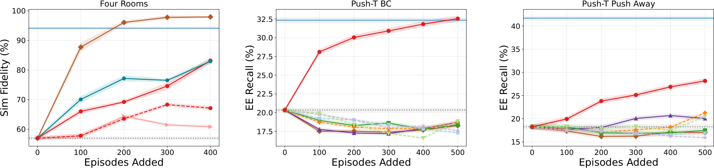
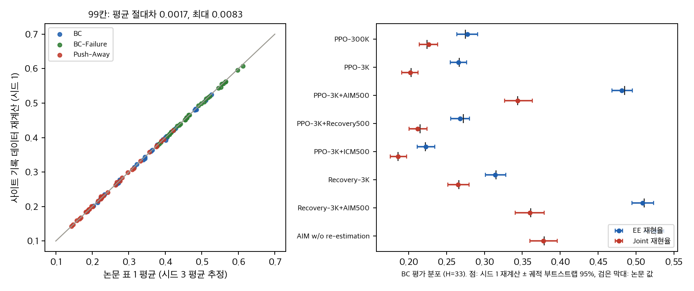
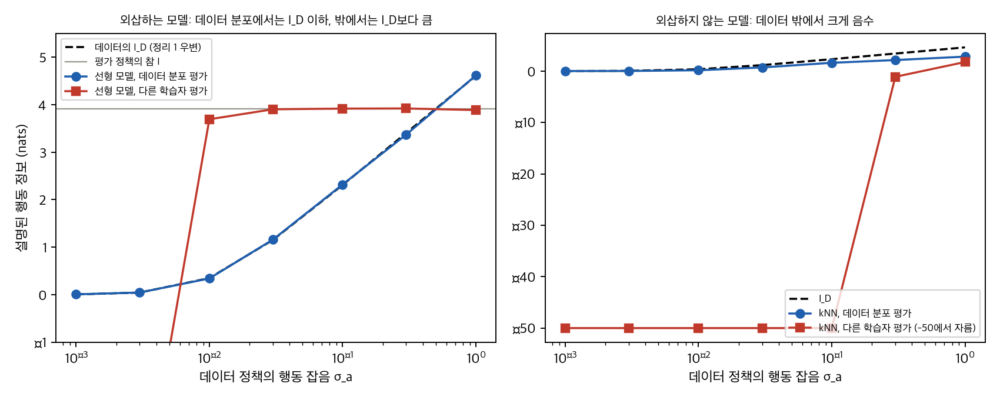
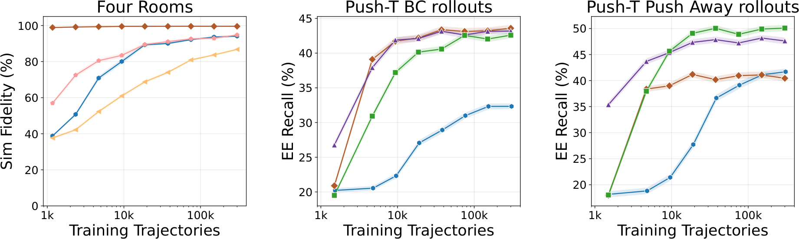
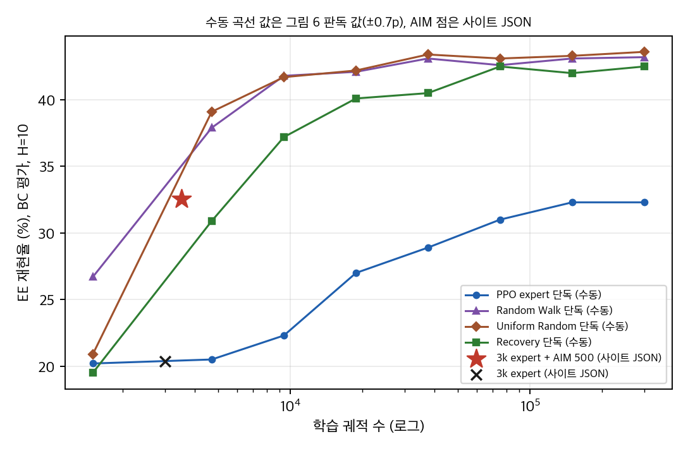

> **논문:** Samuel M. Bateman, Tenny Yin, Chongyi Zheng, Lei Huang, Brian Wang, Benjamin Eysenbach, Jaime Fernández Fisac, Dhruv Shah. *Training Controllable World Models via Action Influence Maximization.* CoRL 2026 포스터, arXiv:2610.27387 (v1, 2026-10-19).
> 공식 저장소는 2026-11-26 기준 프로젝트 사이트 소스와 README("Code coming soon")만 담고 있습니다. 논문 그림 세 장은 출처를 적어 실었고, 나머지는 우리가 그린 그래프입니다. 시행 수나 그림 판독 값을 쓴 곳은 문장에 밝혔습니다.

## 논문이 묻는 것

전문가 시연으로 학습한 행동 조건부 세계모델은 행동 명령을 무시하고 그럴듯한 전문가식 미래를 내놓습니다. 저자들은 이를 학습 데이터의 **행동 영향**이 낮은 탓으로 봅니다. 상태 s에서 행동 a를 바꿨을 때 다음 상태 분포가 얼마나 달라지는지, 곧 조건부 상호정보 I(A; S'|S)가 데이터에서 작다는 것입니다. 해법은 이 양을 늘리는 방향으로 데이터를 능동 수집하는 **AIM**입니다. 리플레이 버퍼의 밀도로 쓴 보상(점별 상호정보 + 상태 커버리지)을 IQL과 AWR로 최적화해 100 에피소드씩 모읍니다.

가장 눈에 띄는 결과는 Push-T에서 3k 전문가 시연에 AIM 500 에피소드를 더하면 end-effector(EE) 재현율이 전문가 300k로 학습한 모델과 같아진다는 것입니다("85배").

*그림 5 (논문 원문). © 저자, CC BY 4.0, 출처 arXiv:2610.27387.*

## 이 글에서 확인한 것

**1. 본문 수치는 다시 계산해도 맞습니다.** 표 1의 퍼센트 7개(69%, 54%, 36%, 10%, 16%, 16%, 8%)는 표 값에서 같은 값이 나옵니다. 프로젝트 사이트가 공개한 모델별 창 단위 기록(시드 1)으로 표 1의 99칸을 다시 계산하면 평균 절대차가 0.0017, 최대 0.0083입니다. 그림 3의 r = 0.979도 36점에서 0.9787(Fisher 구간 0.958–0.989)로 나옵니다.

*그래프 (우리가 그림). 왼쪽: 표 1 99칸과 재계산 값. 오른쪽: BC 분포의 재계산 값과 궤적 부트스트랩 95% 구간(검은 막대가 논문 값).*

**2. 정리 1은 맞고, 적용 범위를 붙여 읽어야 합니다.** 정리 1은 Î(ρ, π) ≤ I(ρ, π)이고, 유도는 I − Î = E[KL(q_π ‖ q̂_π)] ≥ 0으로 단계마다 맞습니다. 이 식의 I는 ρ, π 아래 참 전이의 성질이라 학습 데이터가 식에 들어가지 않습니다. 평가 분포를 데이터 분포로 놓을 때 "데이터가 상한"이 되고, 평가 정책이 다르면 우변은 평가 분포의 I입니다. 1차원 선형-가우시안 토이(선형 회귀와 k-최근접 이웃)로 이를 확인했습니다. 데이터 분포에서 평가하면 모든 설정에서 Î ≤ I_D이고, 다른 평가 정책에서 외삽하는 선형 모델은 Î ≈ 3.9 nats로 I_D = 0.35보다 큽니다. 외삽하지 않는 k-최근접 이웃은 데이터 밖에서 Î가 크게 음수입니다. 논문 §3.2도 "추가 귀납 편향 없이"라는 조건을 두므로 초록의 "any model trained on that data"가 이보다 넓은 서술이라는 점만 짚어 둡니다.

*그래프 (우리가 그림). 왼쪽은 외삽하는 선형 모델, 오른쪽은 외삽하지 않는 k-최근접 이웃입니다.*

**3. 85배는 어떤 비교인지 붙여야 하는 숫자입니다.** 300000/3500 = 85.7로 산술은 맞습니다. 분자인 전문가 300k는 곡선의 평탄한 끝점입니다. 그림 6을 확대해 읽으면(그림 판독 값, 오차 약 ±0.7p) 전문가 단독 곡선은 150k에서 이미 32.3%이고 AIM 500의 값은 32.54%이므로 같은 그림에서 약 43배로도 읽힙니다. 랜덤 워크와 균등 랜덤 단독 데이터는 4.7k 궤적에서 38–39%로 AIM 500보다 높습니다. 85배는 가장 약한 수동 수집(전문가 단독)과의 비교입니다. 그림 5는 "3k 전문가에 같은 수를 더하는" 설정이고 그림 6은 "해당 데이터만으로 학습"하는 설정이라 두 그림을 직접 겹쳐 읽을 수는 없으며, 같은 예산의 비교는 논문에 없습니다.

*그림 6 (논문 원문). © 저자, CC BY 4.0, 출처 arXiv:2610.27387.*

*그래프 (우리가 그림). 수동 곡선은 그림 6 판독 값(±0.7p), AIM 점과 3k 전문가 점은 사이트 JSON 값입니다.*

**4. 지평과 평가 분포에 따라 결과가 달라집니다.** 표 1(H = 33, 256×256)에서 BC EE 재현율은 PPO-3K .267, PPO-300K .275입니다. 차이 .008은 평가 잡음만 보면 p = 0.36(z = 0.92)입니다. 반면 AIM500은 .485입니다. BC Joint 재현율은 AIM500이 PPO-300K보다 54% 높지만, BC-Failure(.411 대 .432)와 Push Away(.165 대 .198)에서는 PPO-300K가 높습니다. 사이트 데이터의 쌍대 부트스트랩(시드 1, 궤적 100개)에서도 같은 방향입니다. 이득은 주로 EE 재현율에 몰려 있고, 논문 부록 H도 Tee 재현율은 어떤 방법으로도 잘 오르지 않는다고 설명합니다.

**5. 신뢰구간은 평가 변동만 담습니다.** 부록 E에 따르면 데이터셋마다 세계모델을 하나만 학습했습니다. 표 1의 구간 폭은 시드 1 단독 부트스트랩과 같은 폭(비율 중앙값 1.00)이므로 평가 궤적 100개의 표본 변동을 반영하고, 학습 시드 변동은 담지 않습니다. 표 1의 절제(재추정 없음 +10% 등)는 이 점을 감안해 읽어야 합니다. 사람 선호(Elo)는 재현율과 Spearman ρ .91 / .76 / .79(EE)로 대체로 일치합니다. 다만 BC에서 AIM500 대 Recovery-3K의 차이는 z = 1.1이고, Push Away에서는 Recovery-3K의 Elo가 더 높습니다(독립 정규 근사). Elo 구간의 계산법은 본문에 없습니다.

**6. 절제는 보상 항의 역할을 분리하지 못합니다.** 세 변형(전체 보상, 새로움 항만, MI 항만)의 BC EE 재현율은 .485, .481, .483으로 구간 안에서 같습니다. 보상을 상수나 무작위로 바꾸되 IQL·AWR 수집 구조는 그대로 두는 영(null) 보상 대조가 없어, 이득이 보상에서 오는지 보수적 정책 추출에서 오는지는 구별되지 않습니다.

**7. 정리 2는 정확한 q에서 성립합니다.** 상태 4, 행동 3, 다음 상태 5의 무작위 표 형태 환경 2000개에서 정확한 사후분포를 쓰면 I가 항상 오릅니다(2000/2000). q를 상태당 표본 n개로 추정하면 n = 5에서 70%, n = 20에서 61%의 환경에서 I가 줄어듭니다. 논문의 q̂는 흐름 모델 우도이고 표본이 훨씬 많으므로 직접 옮길 수는 없지만, 정리가 추정 오차를 다루지 않는다는 점은 저자도 §3.4와 §5에서 인정합니다.

## 한계와 확인할 것

- 학습·수집·평가 코드는 공개되지 않았습니다(2026-11-26 기준). 밀도 보상 모델(q̂, β̂, d̂)의 구조와 하이퍼파라미터가 논문 표에 없습니다.
- Four Rooms에서는 균등 랜덤이 AIM보다 높고(저자도 명시), AIM이 이기는 설정은 Push-T입니다.
- 탐험 기준선(DIAYN, DADS, ICM, METRA)은 시뮬 상태 입력이고 AIM은 픽셀 입력입니다.
- 표 3의 정책 파라미터 수(19.5M, 30.6M)는 표의 구성(d = 256, 6층과 12층)으로 계산한 값(6.3M, 10.2M)과 약 3배 차이가 납니다. 표에 없는 모듈이 있을 가능성이 크고, 저자 확인이 필요합니다.
- 그림 6의 값은 판독 값이라 ±0.7p의 오차가 있습니다.

분석 문서 01–04, 재계산·토이 스크립트와 결과, 통합 리포트는 함께 게시한 노트 폴더에 있습니다.

## 자료

- [통합 리포트 PDF](report/report_public.pdf)
- [01. 논문 분석: Training Controllable World Models via Action Influence Maximization (arXiv:2610.27387)](analysis/01_paper_analysis.md)
- [02. 선행연구와 관련 저장소](analysis/02_prior_work.md)
- [03. 수치 재계산, 일관성 검사, 이론·토이 확인](analysis/03_analysis.md)
- [04. 주장 검증 (공식 학습 코드 없음, arXiv:2610.27387)](analysis/04_claim_verification.md)
