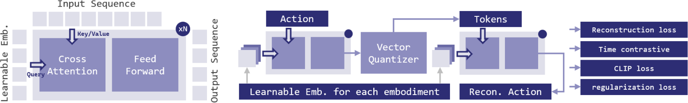
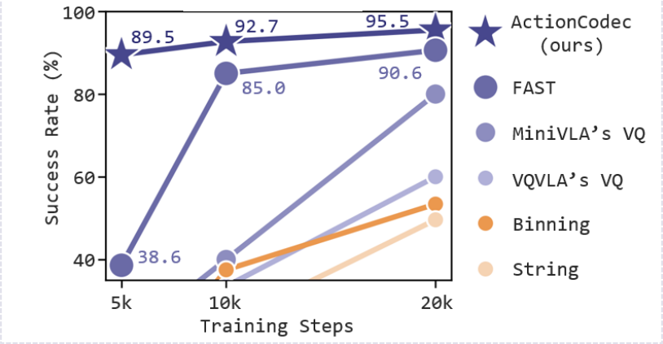
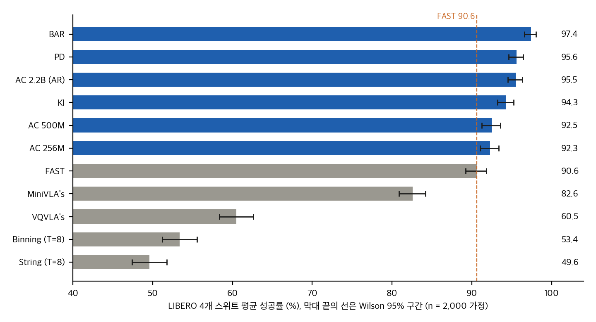
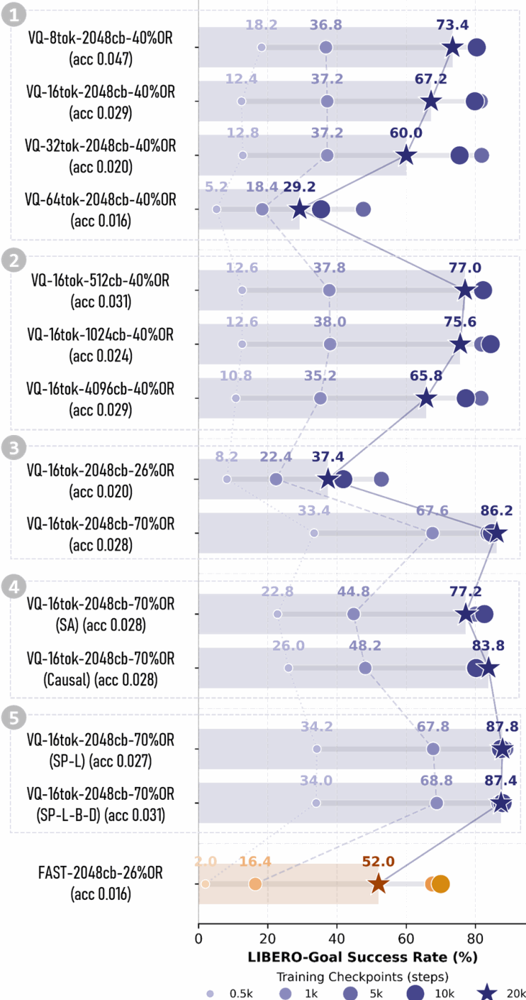
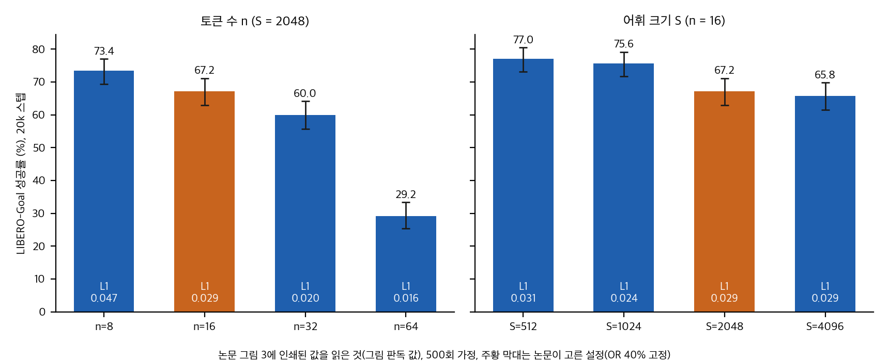
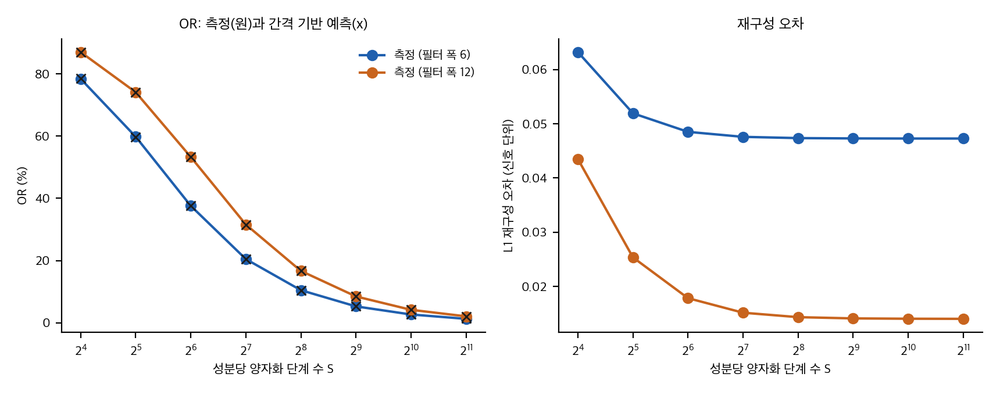
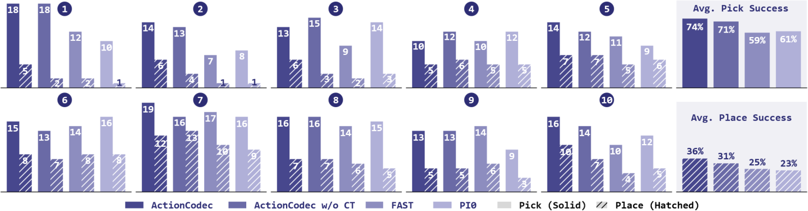
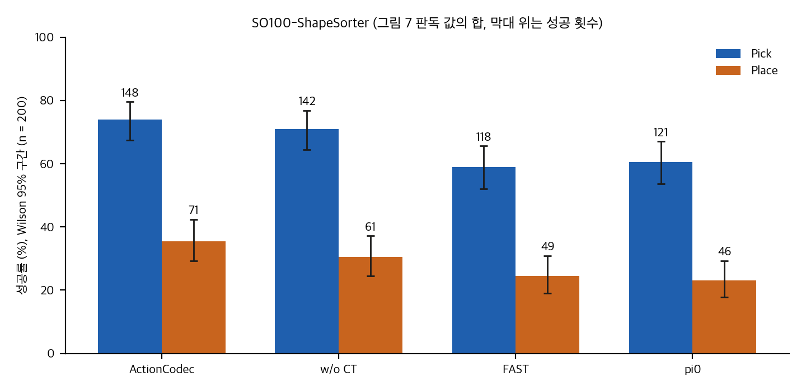

> **논문:** Zibin Dong 외. *ActionCodec: What Makes for Good Action Tokenizers.* CoRL 2026 포스터, arXiv:2602.15397 (v2, 2026-10-08).
> 공식 코드는 GitHub ZibinDong/actioncodec에 있습니다(README는 MIT, LICENSE 파일 없음). 이 글의 그림은 논문 그림 4장(출처 표기)과 우리가 그린 그래프입니다. 표 값은 논문 v2 기준이고, 그림에서 읽은 값과 가정한 시행 수는 문장 안에 적었습니다.

## 논문이 묻는 것

자기회귀 VLA는 행동을 토큰으로 바꿔야 합니다. 기존 VQ 토크나이저는 재구성 충실도로만 평가되었고, 토큰화가 VLA 학습에 주는 영향은 따로 묻지 않았다는 것이 출발점입니다. 논문은 네 가지 조건을 제안합니다. 인접 청크의 토큰이 같게 유지되는 정도(겹침률, OR), 작은 어휘와 토큰 예산, 문맥과의 정렬, 토큰 사이 결합의 감소입니다. 이를 반영한 ActionCodec은 Perceiver형 VQ에 로봇별 소프트 프롬프트와 RVQ 사후 학습을 더했고, SmolVLM2-2.2B를 VLA 사전학습 없이 미세조정해 LIBERO 95.5%(블록 단위 자기회귀 BAR는 97.4%)를 보고합니다.

*그림 2 (논문 원문). © 저자, CC BY 4.0, 출처 arXiv:2602.15397.*

식 (2)–(4)의 정보이론 분해는 항등식입니다. 결정적 토크나이저에서는 H(C|V,L) = H(C) − I(C;V,L)로 줄어서, 실질적인 내용은 "토큰의 엔트로피를 낮추고 문맥과의 상호정보를 높여라"입니다. v2는 이 식이 성능 향상을 보장하지 않는다고 직접 적었습니다.

## 같은 백본에서 토크나이저만 바꾼 비교

학습 곡선에서 5k 스텝 성공률은 ActionCodec 89.5%, FAST 38.6%이고(그림 1), 최종 값은 95.5% 대 90.6%입니다. 아래 그래프는 표 1(c)의 평균에 95% 구간을 붙인 것입니다(스위트당 500회, 합 2,000회 가정).

*그림 1의 학습 곡선 부분 (논문 원문). © 저자, CC BY 4.0, 출처 arXiv:2602.15397.*

*그래프 (우리가 그림). 평균 값은 논문 표 1(c)이고 구간은 시행 수 2,000 가정입니다.*

- **토크나이저 차이는 뚜렷합니다.** 2.2B에서 ActionCodec 대 FAST는 +4.9포인트(Fisher p = 1e-9)입니다. 256M 백본의 ActionCodec 92.3은 2.2B FAST 90.6과 구분되기 어렵고(p = 0.062), 500M(92.5)은 경계(p = 0.035)입니다. "작은 백본이 큰 백본의 기준선을 넘는다"는 서술은 방향은 맞고 확실성은 백본마다 다릅니다.
- **패러다임 중 BAR만 AR과 구분됩니다.** BAR 97.4 대 AR 95.5는 +1.9포인트(p = 0.0015)입니다. PD는 95.6 대 95.5로 0.1포인트 차이(p = 0.94)이고 스위트별 부호도 섞입니다. 본문의 "PD and BAR outperform native autoregression" 중 PD는 이 표에서 구분되지 않습니다.
- **BAR 97.4의 비교 범위.** 사전학습 없는 모델(VLA-0 94.7, π0.5 93.3)보다는 뚜렷하게 높습니다. 사전학습이 있는 OpenVLA-OFT 97.1(p = 0.63), π0.5 96.8(p = 0.30)과는 구분되지 않습니다. 논문도 "surpassing several"이라고만 씁니다.
- **토크나이저의 학습 데이터가 비교에 섞여 있습니다.** ActionCodec의 토크나이저는 LIBERO를 포함한 데이터로 사전학습한 반면, FAST는 공개된 범용 버전을, MiniVLA와 VQ-VLA는 공개 체크포인트를 "데이터 통계만 맞춰" 쓴 것으로 적혀 있습니다(부록 B.3).

## 설계 원리 실험: OR은 효과가 크고, 선택한 설정은 최고가 아니다

설계 원리는 SmolVLM2-256M, LIBERO-Goal의 소형 실험(그림 3)으로 검증합니다. 20k 스텝에서 OR 70%는 86.2%, OR 26%는 37.4%입니다(그림 판독 값, 시행 수 500 가정). 500스텝에서도 33.4% 대 8.2%입니다. 이 크기의 차이는 한 번의 학습 오차로 설명하기 어렵습니다.

*그림 3 (논문 원문). © 저자, CC BY 4.0, 출처 arXiv:2602.15397.*

다만 읽을 때 세 가지를 같이 봐야 합니다.

1. **OR은 다른 양과 함께 변합니다.** 표 5에서 OR이 26 → 70%로 오를 때 토큰 사용 분포의 PPL은 2016 → 1290으로, L1 재구성 오차는 0.020 → 0.028로 바뀝니다. OR만의 효과는 분리되지 않으며, 부록 E.1도 OR이 엔트로피의 직접 추정이 아니라고 적습니다.
2. **선택한 (n = 16, S = 2048)은 이 스윕에서 성공률이 가장 높지 않습니다.** 20k 값은 n = 8에서 73.4%, S = 512에서 77.0%이고 선택한 설정은 67.2%입니다(그림 판독 값; S = 512 대 2048은 p = 7e-4). 선택 근거는 재구성 오차와 FAST의 어휘 크기(2048)입니다. 논문도 "고유한 최적이 아니다"라고 씁니다.
3. **독립 토큰의 우위는 SA에 대해서만 뚜렷합니다.** 독립 86.2 대 SA 77.2는 구분되고(p = 3e-4), Causal 83.8과는 2.4포인트(p = 0.33)로 구분되지 않습니다.

*그래프 (우리가 그림). 그림 3의 인쇄된 값(그림 판독 값)을 다시 그렸습니다. 주황이 논문이 고른 설정입니다.*

## 토이: OR을 올리는 가장 쉬운 방법은 거칠게 양자화하는 것

OR(인접 청크의 같은 위치 토큰이 같은 비율)이 재구성 충실도와 어떻게 얽히는지 합성 신호로 확인했습니다. 7차원 매끄러운 신호의 20스텝 청크를 PCA로 16개 성분으로 줄이고 성분마다 S단계로 양자화했습니다(numpy, 약 10초). 학습된 VQ가 아니라서 논문 수치를 재현하는 실험은 아닙니다.

*그래프 (우리가 그림). 합성 신호, 학습 없음. x 표시는 간격에서 계산한 OR 예측입니다.*

- S를 키우면 OR과 L1이 함께 단조롭게 줄었습니다(두 신호 속도 모두). 거친 양자화는 OR을 올리지만 충실도를 잃습니다.
- OR은 "한 스텝에 잠재가 얼마나 움직이는가 대 양자화 간격"으로 0.003 이내에서 예측됩니다.
- 같은 Binning(1,000구간)의 OR이 이 합성 신호에서는 2–4%이고 논문 표 2의 LIBERO에서는 39%입니다. OR은 데이터의 속도에 의존하므로 서로 다른 데이터의 OR을 비교하면 안 됩니다.

이 토이가 확인한 것은 "OR은 재구성 오차와 함께 읽어야 한다"는 점뿐입니다. "OR이 높으면 VLA가 빨리 배운다"는 논문의 중심 주장은 확인하지 않았습니다.

## 표 안의 불일치

- **평균 순위.** 표 1의 "Avg. Rank"는 (b)와 (c) 패널을 한 풀로 합쳐 순위를 매겨야 17행이 모두 재현됩니다. (c) 패널만으로 매기면 11행 중 1행만 맞습니다. 같은 모델이 풀에 따라 다른 값을 가집니다(ActionCodec 2.2B: (a)에서 5.1, (b)+(c)에서 3.8).
- **VQVLA's 행.** 평균 열 60.5는 네 스위트 평균 59.4와 다르고 Goal 칸 값(60.5)과 같습니다. 이 Goal 값과 MiniVLA's Goal 82.1은 스위트당 500회로는 만들 수 없는 값입니다(0.2의 배수가 아님). 저자 확인이 필요합니다.
- **SimplerEnv(표 1(d)).** BAR 칸은 과제당 120회와 맞지만, 다른 행은 24, 50, 72회 등으로 보이는 값이 섞여 있습니다. BAR 평균 65.2는 π0 67.9보다 낮고(과제당 120회 가정, p = 0.41) 평균 순위 2.0이 같습니다. 본문의 "best rank among models with or without prior robotic data"는 이 동률로 읽는 것이 표와 맞습니다.

## 실로봇

SO100에서 그림 7의 막대 위 숫자를 합하면(과제 10개 × 20회 = 200회 가정) 공동 학습 ActionCodec은 Pick 148, Place 71입니다. 공동 학습이 없는 변형은 142와 61입니다.

*그림 7 (논문 원문). © 저자, CC BY 4.0, 출처 arXiv:2602.15397.*

*그래프 (우리가 그림). 그림 7의 숫자 합과 Wilson 95% 구간입니다.*

Pick과 Place 모두 FAST(118, 49)와 π0(121, 46)보다 뚜렷하게 높습니다(Place p = 0.022, 0.008). 반면 공동 학습 유무의 Place 차이(71 대 61)는 p = 0.34이고, 과제별로는 앞선 과제 5개, 뒤진 과제 2개입니다. 논문의 정성 비교(복구 행동)는 이 합계로 방향이 지지되지만 확정되지는 않습니다. xArm 표 3은 채소 수가 적혀 있지 않은데, 네 값(82.5, 74.1, 75.0, 72.5)이 모두 정수 비율이 되려면 채소가 16종 이상(16, 22, 28, …)이어야 합니다.

## 공식 코드와 논문의 차이

공식 저장소(커밋 f034eb9)는 토크나이저의 추론 모델, VLA 변형 네 가지의 학습 래퍼, LIBERO 평가를 담습니다. 구조의 핵심(교차 어텐션 질의, 로봇별 임베딩, 푸리에 시각 인코딩, RVQ 3단과 BAR 블록, 이미지 증강, 50회 초기 상태)은 논문과 맞고, 공개 토크나이저의 파라미터 수는 구성에서 센 값(약 45.09M)과 가중치 파일 크기가 0.02% 안에서 같습니다. 다음은 차이입니다.

- **범위.** 토크나이저 학습, TCL/CLIP 손실, OR 측정, 섭동 실험, 기준선(FAST, VQ-VLA, MiniVLA 등) 코드가 없습니다. 설계 원리 실험은 코드로 재현할 수 없습니다.
- **평가 기본값.** 청크 20스텝 중 4스텝만 실행하고 모든 겹치는 예측을 같은 가중치로 평균하는 시간 앙상블이 기본으로 켜져 있습니다. 논문에는 이 설정이 없고, 기준선이 같은 방식으로 평가됐는지도 적혀 있지 않습니다. PD와 BAR 평가 스크립트는 과제마다 위치 오프셋을 3 또는 4로 지정하는데(BAR는 40과제 중 13개가 3) 선택 기준이 없습니다.
- **KI.** 공개 KI 코드의 손실은 flow-matching MSE 하나이고 VLM으로 가는 기울기를 끊는 코드가 없습니다. 논문 부록 B.4는 VLM의 자기회귀 손실과 전문가 손실을 함께 쓰되 기울기를 차단한다고 씁니다. KI의 평가 스크립트와 체크포인트도 공개되어 있지 않습니다.
- **학습 설정.** 공개 설정은 학습률 2e-4, 50k 스텝, 전역 배치 64이고, 논문 표 7은 1e-4, 30k, 128입니다. 공개 Bridge 시간 창은 3초이고 논문은 1초입니다.
- **라이선스.** README는 MIT라고 적지만 LICENSE 파일이 없습니다.

## 구현 가능성 (Apple M4 Pro, CUDA 없음)

- **논문 수치 재현: 불가.** 설계 검증은 8 × RTX 3090, 표 1은 4 × A100, SimplerEnv는 8 × H100, 실로봇은 로봇이 필요합니다.
- **공개 토크나이저(약 45M, 180 MB) 추론: 조건부.** 새 설치, 다운로드, 저장소 코드 실행 승인이 필요합니다. 이 글에서는 하지 않았습니다.
- **작은 VQ와 OR 측정의 축소판: 가능.** 이 글의 토이가 그 출발점입니다.
- **공개 LIBERO 체크포인트 평가: 불가(실용).** CUDA와 flash-attention, 구 버전 시뮬레이터 의존이 있습니다.

이 글은 재현 실험을 하지 않았고, 공식 코드는 정적으로 읽기만 했습니다. 표 수치의 일부는 시행 수를 가정한 재계산이므로, 논문에 시행 수와 평가 조건이 적히면 값이 달라질 수 있습니다.

## 자료

- [통합 리포트 PDF](report/report_public.pdf)
- [01. 논문 분석: ActionCodec (arXiv:2602.15397)](analysis/01_paper_analysis.md)
- [02. 선행 연구와 공식 코드](analysis/02_prior_work.md)
- [03. 수치 재계산, 일관성 검사, 토이, 주장 판정](analysis/03_analysis.md)
- [04. 공식 코드 대조와 구현 가능성](analysis/04_code_verification.md)
