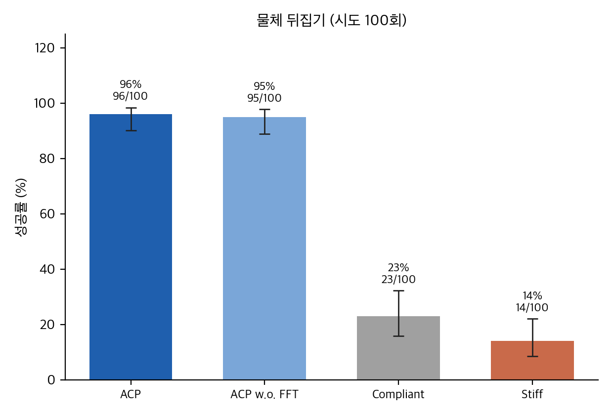
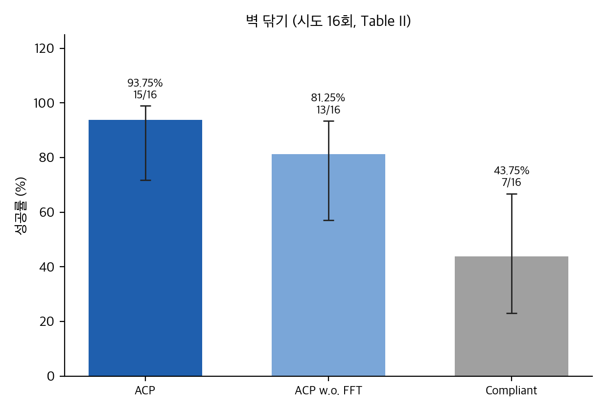

> **논문:** Yifan Hou, Zeyi Liu, Cheng Chi, Eric Cousineau, Naveen Kuppuswamy, Siyuan Feng, Benjamin Burchfiel, Shuran Song. *Adaptive Compliance Policy: Learning Approximate Compliance for Diffusion Guided Control.* arXiv:2410.09309 (v2, 2025-03-07). ICRA 2025로 적혀 있으나 공식 목록은 확인하지 못했습니다.
> 공식 코드는 GitHub `yifan-hou/adaptive_compliance_policy`(MIT)에 있습니다. 이 글의 그래프는 논문 표 값을 우리가 다시 그린 것입니다.

## 논문이 묻는 것

접촉이 많은 조작은 위치와 힘을 함께 맞춰야 합니다. 힘 센서를 쓰는 정책도 대개 위치 목표만 내고, 강성은 고정하거나 사람이 고릅니다. ACP는 데모에서 **대략적인 강성 프로파일**을 얻고, 정책이 그 프로파일을 시간과 공간에 따라 같이 예측하게 합니다.

핵심 규칙은 단순합니다. 힘이 걸리는 방향은 강성을 낮추고, 나머지 방향은 높입니다. 이렇게 해도 접촉 제약이 깨지지 않는다는 것을 정리 1로 보입니다. 정책 출력은 기준 자세 9개, 가상 목표 9개, 강성 1개의 19차원입니다.

## 이 글에서 확인한 것

**1. 표 값은 본문과 맞습니다.** 표의 백분율을 시도 수로 되돌리면 모든 행 합계가 맞습니다. 뒤집기는 시도 100회, 벽 닦기는 16회입니다.

*그래프: 뒤집기 성공률(시도 100회). 우리가 논문 Table I 값으로 그렸습니다.*

**2. 뒤집기 차이는 확실합니다.** ACP 96/100 대 Compliant 23/100입니다. Fisher 정확 검정 p < 1e-6입니다.

**3. 벽 닦기 차이는 약합니다.** ACP 15/16 대 Compliant 7/16, 차이 50%p, p = 0.006입니다. 시도 16회라 구간이 넓습니다(ACP 71.7–98.9%, Compliant 23.1–66.8%).

*그래프: 벽 닦기 성공률(시도 16회, Table II). 기준선 Stiff는 논문 Table II에서 빠져 있습니다.*

**4. "50% 이상 향상"은 기준에 따라 다릅니다.** 벽 닦기에서 %p로는 정확히 50이고, 상대 비율로는 +114%입니다. 뒤집기는 어느 기준으로도 충분히 큽니다.

**5. FFT 인코더의 효과는 확인되지 않습니다.** 벽 닦기 15/16 대 13/16은 방향만 맞고 p = 0.60입니다. 뒤집기는 96 대 95로 같습니다.

**6. 공식 코드는 논문과 다른 점이 있습니다.** 강성 상·하한(5000, 200 N/m)과 회전 강성(100)은 코드에만 있고, 논문에는 값이 없습니다. 속도 보정(`vel_tol`)도 코드에만 있습니다. 비전 백본은 논문의 ViT-B/16 대신 ViT-B/32를 씁니다. 코드는 실행하지 않고 읽기만 했습니다.

## 구현 가능성

- **실로봇 재현은 맥에서 불가능합니다.** UR5e, 힘 센서, C++ 컨트롤러가 필요합니다.
- **정책 학습은 GPU가 필요합니다.** 맥에는 CUDA가 없습니다.
- **맥에서 가능한 것**은 식 (6)–(7)의 레이블 생성을 합성 궤적에 적용하는 토이와 정적 검산입니다.

## 남은 질문

- 학회 공식 목록을 직접 확인해야 합니다.
- 기준선 Compliant와 Stiff의 학습 설정이 공식 코드에 있는지 확인하지 못했습니다.
- 힘 신호의 샘플링 속도가 본문 250 Hz와 맞는지 확인하지 못했습니다. 데이터셋이 있어야 판단할 수 있습니다.

## 자료

- [통합 리포트 PDF](report/report_public.pdf)
- [01. 논문 분석: Adaptive Compliance Policy](analysis/01_paper_analysis.md)
- [02. 선행 연구와 공개 자료](analysis/02_prior_work.md)
- [03. 수치 재계산과 일관성 검사](analysis/03_analysis.md)
- [04. 공식 코드 대조 (정적 읽기)](analysis/04_code_verification.md)
