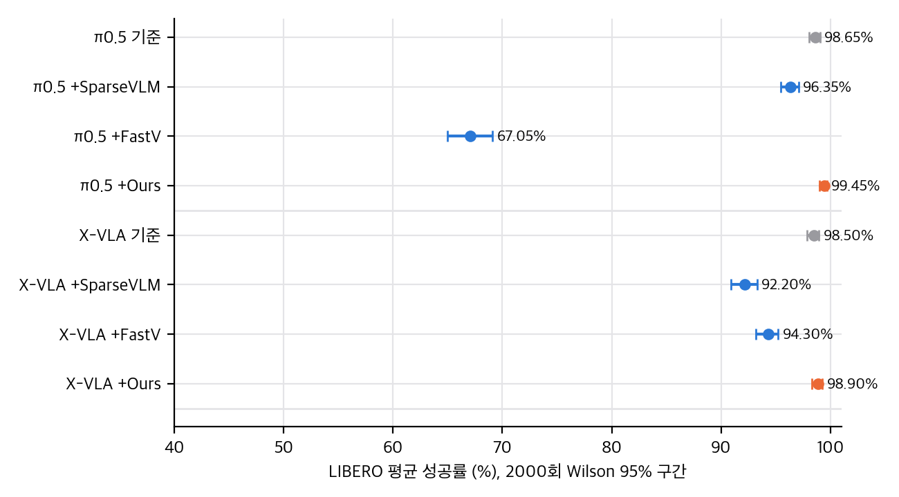
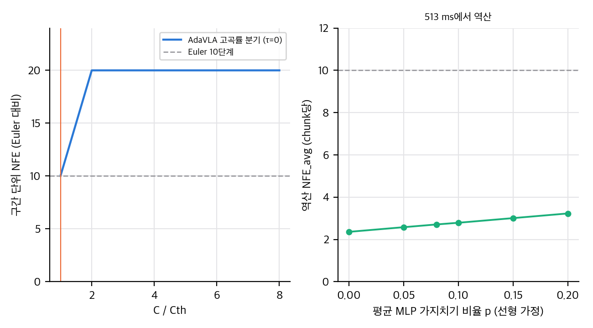
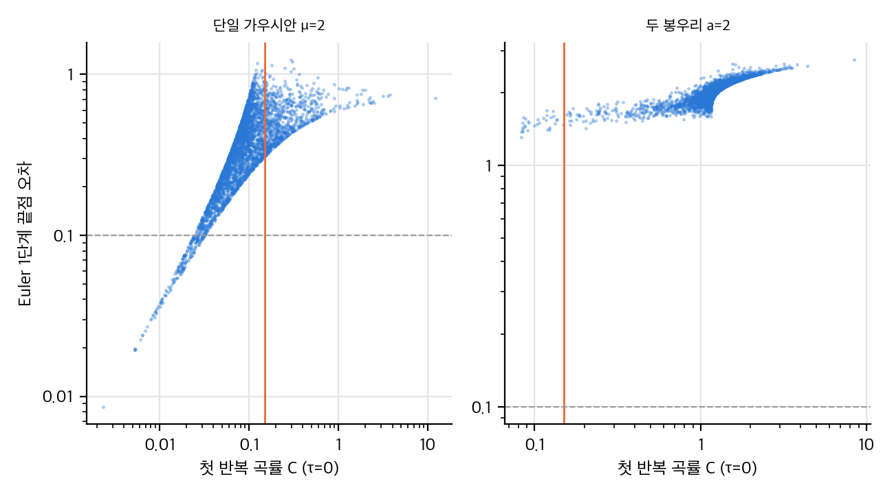

> **논문:** Han, Han, Yi. *AdaVLA: Adaptive Step Flow Matching for Training-free Acceleration of Vision-Language-Action Models.* IROS 2026, arXiv:2608.29208 (v2).
> 논문 그림과 표는 라이선스(arXiv 비독점 배포, 논문 1쪽의 IEEE 저작권 문구) 때문에 싣지 않았습니다. 이 글의 그래프는 논문 수치와 직접 만든 toy로 그렸습니다. 공식 코드는 찾지 못했습니다(2026-11-10 확인).

## 한 줄 요약

π0.5의 행동 전문가는 흐름을 10번 적분합니다. AdaVLA는 **두 속도의 상대 변화량 C**를 재서, 변화가 작으면 한 번에 끝내고 크면 작은 스텝으로 갑니다. 학습은 필요 없습니다. 논문은 LIBERO에서 π0.5 지연 1.87배, 성공률 98.65 → 99.45%를 보고합니다. 수치는 대부분 맞지만 두 가지가 더 중요합니다. 지연 이득은 평균 2–3번의 함수 호출에서 나오고, 논문 식의 중점 평가 방식은 오차를 키웁니다.

## 1. 아이디어: 곡률을 "확신"의 대리 변수로 쓴다

흐름 매칭은 노이즈에서 행동까지 ODE를 풉니다. 저자들은 행동 차원이 이미지보다 작아서, 모델이 확신할 때 궤적이 거의 직선이라고 가정합니다. 그래서 한 시점에서 속도 두 개를 비교해 C를 만듭니다.

- C < Cth: 중점 속도로 남은 구간을 한 번에 건넙니다(함수 호출 2회).
- C ≥ Cth: 스텝을 Cth/C에 따라 줄여 조금씩 갑니다.

VLM의 MLP 가지치기 비율도 같은 C로 조절합니다. 그래서 "적응"이라고 부릅니다.

## 2. 표를 다시 계산하면

모든 성공률이 정수 횟수와 맞습니다(LIBERO 2000회). 다만 차이의 크기와 유의성은 다르게 읽어야 합니다.

| 구성 | 성공률 | Wilson 95% | Fisher p (기준 대비) |
|---|---|---|---|
| π0.5 기준 | 98.65% | [98.04, 99.07] | – |
| π0.5 + AdaVLA | 99.45% | [99.02, 99.69] | 0.013 |
| X-VLA 기준 | 98.50% | [97.87, 98.95] | – |
| X-VLA + AdaVLA | 98.90% | [98.34, 99.27] | 0.33 |

π0.5의 +0.8pp는 Object suite(500/500 대 491/500)가 대부분을 설명합니다. X-VLA의 +0.4pp는 차이가 없습니다. 실물(SmolVLA, 과제당 30회)의 90.0%(108/120)와 87.5%(105/120)도 차이가 없습니다(p = 0.68).

## 3. 지연은 어디서 나오나

논문 Table I으로 지연을 나누면 행동 전문가 한 번 호출은 53.75 ms, VLM은 386.53 ms입니다. AdaVLA의 513 ms를 이 선형 모형에 넣으면, 가지치기가 작다고 가정할 때 chunk당 행동 전문가 호출은 **2.4–3.2회**입니다. 반복 한 번에 2회를 쓰므로, 대부분의 chunk가 한 번의 점프로 끝난다는 뜻입니다.

이 숫자는 논문에 없습니다. 그래서 같은 지연의 정적 기준선도 없습니다. 2단계 Euler는 494 ms, 3단계는 548 ms입니다. 논문은 1단계(97.05%)와 5단계(98.00%)만 비교합니다. 그 사이의 지연 구간에서 AdaVLA가 이기는지는 알 수 없습니다.

## 4. 식 9: 중점 평가점이 틀렸다

논문은 중점 속도 v_mid를 τ + (1−τ)/2에서 얻고, 그 값을 ŝ 만큼의 갱신에 씁니다. 두 평가점이 같은 것은 ŝ = (1−τ)/2일 때뿐입니다. 고곡률 분기에서 ŝ가 더 작으면 속도가 틀린 시점에서 나옵니다.

2봉우리 목표의 toy에서 분기 규칙은 그대로 두고 중점만 바꿨습니다(ŝ/2 지점에서 속도를 다시 구함).

- 논문 식 9(Cth = 0.01): 평균 끝점 오차 0.385, 함수 호출 21회
- 중점 수정(Cth = 0.01): 평균 끝점 오차 0.0026, 함수 호출 31회
- Euler 10단계: 평균 끝점 오차 0.070, 함수 호출 10회

오차의 주된 원인이 식 9라는 점이 toy에서 보입니다. 실제 정책에서 얼마나 되는지는 측정이 필요합니다.

## 5. 곡률은 어디까지 믿을 수 있나

toy(정확한 2차원 가우시안 혼합 흐름)에서 첫 반복 곡률은 1단계 Euler 오차와 강하게 상관합니다(Spearman 0.64–0.98). 곡률은 큰 오차를 잘 가리킵니다.

하지만 두 가지 실패가 있습니다.

1. **임계값 근처:** 두 봉우리 목표에서 C < 0.15인 첫 반복 샘플 31개는 모두 오차가 0.1을 넘었습니다. 곡률이 작아 보여도 봉우리 선택은 이미 정해져 있었습니다.
2. **스케일:** 같은 Cth = 0.15에서 목표를 10배 줄이면 모든 샘플이 첫 반복에서 점프하고, 10배 키우면 첫 반복에서 점프하는 샘플이 없습니다(반복이 더 가서야 점프합니다). 논문 값도 π0.5 0.15와 X-VLA 0.002로 75배 차이 납니다. Cth 하나를 다른 로봇으로 옮기려면 행동 정규화를 같이 고정해야 합니다.

## 6. 참여율과 가지치기

논문은 실효 랭크(식 11–12)를 근거로 쓰지만 실제로는 참여율(PR)을 계산합니다. PR의 trace 식은 고윳값 정의와 수치적으로 같습니다. 다만 두 양은 다른 값을 주며(같은 스펙트럼에서 PR 13.8, 실효 랭크 55.0), 같은 순위를 준다는 보장은 없습니다.

가지치기 효과는 작습니다. PR 방식과 고정 가지치기의 성공률 차이는 0.10pp(2회)이고, 지연은 PR이 21 ms 더 깁니다. SVD보다 빠른 것은 맞지만, 논문의 "limited latency improvements"는 표와 반대 방향입니다. SVD는 894.78 ms로 PR보다 381 ms 느립니다.

## 7. 구현 가능성

- **공식 재현:** 불가능합니다. 코드, 가지치기 설정, 평가 스크립트가 공개되지 않았습니다.
- **분기 규칙:** openpi의 샘플러 루프에 약 50줄이면 옮길 수 있습니다. 식 9는 중점 평가로 고쳐야 합니다.
- **가지치기:** 논문에 p_l 초기값, 채널 유지 비율, 재정렬 조건이 없어서 임의로 정해야 합니다.
- **검증:** 실제 π0.5 측정은 GPU나 Jetson이 필요합니다. 맥의 MPS 지연은 논문 수치와 비교할 수 없습니다.

## 8. 읽고 나서 남는 질문

- 정적 2–3단계 Euler와 같은 지연에서 AdaVLA가 이기는가?
- 식 9를 고쳐도 지연 이득이 유지되는가(고곡률 분기가 늘면 비용은 2배)?
- 곡률 임계값이 행동 정규화를 바꾸면 얼마나 움직이는가?

이 질문들이 풀리면 "흐름 정책에서 적분 단계를 언제 줄일지"에 대한 판단 기준이 생깁니다. 지금은 가능성은 있지만 근거가 부족한 아이디어라고 보는 것이 맞습니다.

## 참고

- 논문: Han, Han, Yi, arXiv:2608.29208v2 (IROS 2026 채택).
- 관련 연구: IMLE-VLA(arXiv:2609.10915)는 같은 π0.5 지연 문제를 학습된 단일 단계 생성기로 풉니다. 초록만 읽었습니다.
- 재계산과 toy 코드: 이 저장소 `analysis/` 폴더.

## 자료

- [통합 리포트 PDF](report/report_public.pdf)
- [01. 논문 분석: AdaVLA](analysis/01_paper_analysis.md)
- [02. 선행연구와 관계](analysis/02_prior_work.md)
- [03. 재계산과 유도](analysis/03_analysis.md)
- [04. 주장 검증: 표 재계산, toy, 구현 가능성](analysis/04_claim_verification.md)
