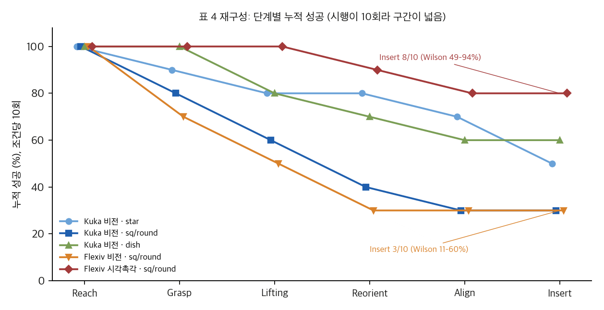
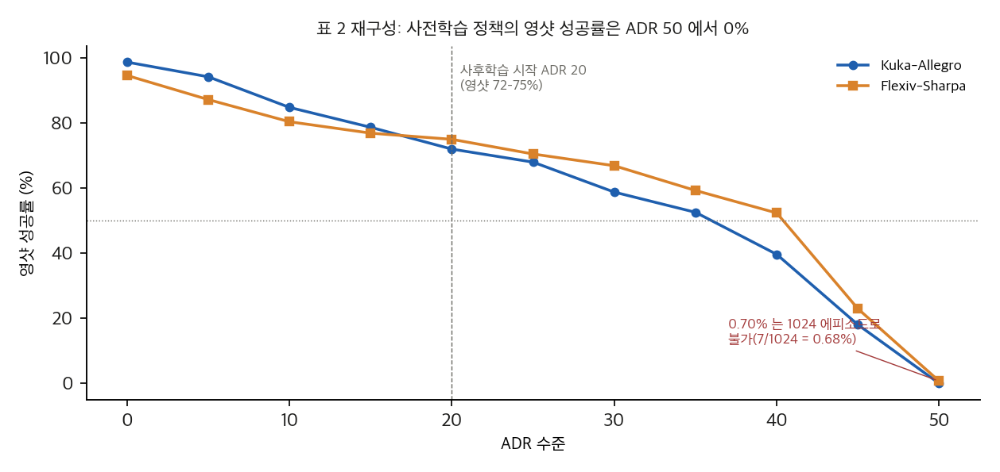
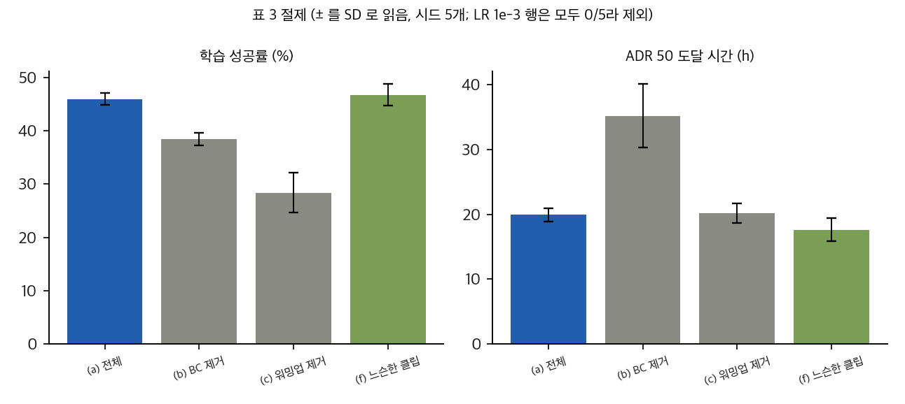
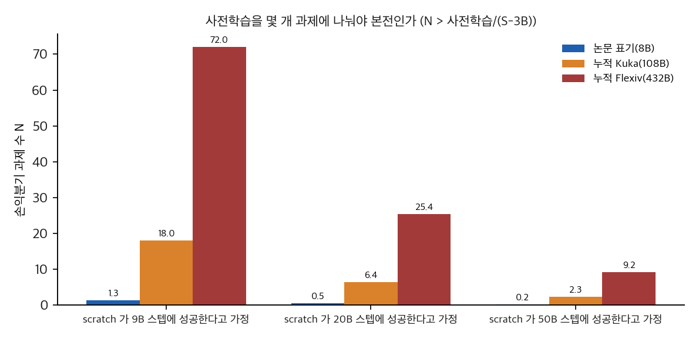

# 03. 수치 재계산과 해석: ADEPT (arXiv:2608.19182 v2)

논문이 보고한 표 1–5, 표 6–7, 부록 C의 숫자를 다시 계산하고, 표끼리·본문과 맞는지 확인했습니다. 재계산은 `analysis/recompute.py`(numpy, scipy, 수 초)이고 결과는 `analysis/recompute_results.json`입니다. 번호 **V1–V12**는 논문 수치 검사, **K1–K2**는 우리가 만든 계산입니다. 학습과 실행은 하지 않았습니다.

## 0. 요약

| 번호 | 대상 | 결과 |
|---|---|---|
| V1 | 표 4 단계 누적 | 5행 모두 단조 비증가로 정수 일치. 마지막 단계 구간은 넓음(8/10의 Wilson 49–94%, 3/10은 11–60%). 정렬(Align) 이후 삽입 성공은 27회 중 25회(92.6%)로, 삽입 동작보다 파지·들기·재방향 단계가 병목 |
| V2 | 표 4 쌍별 검정 | 촉각 8/10 대 비전 3/10은 Fisher p = 0.070(양측), 시행당 구간 6.7–73.9 %p. 유의하지 않음. 들기(10 대 5, p = 0.033)와 재방향(9 대 3, p = 0.020)은 사후 선택 단계라 다중비교 보정 필요. 별 5/10 대 사각-원 3/10은 p = 0.65 |
| V3 | 시뮬 학생 대 실로봇 | 실 3/10 대 시뮬 46.7%, 실 5/10 대 시뮬 65.2%는 정확 이항 p = 0.35, 0.33. 방향은 낮지만 구별 안 됨. Flexiv와 접시는 시뮬 학생 수치 없음 |
| V4 | 표 2 정수 가능성 | 1024 에피소드로는 Flexiv ADR 50의 **0.70%가 불가능**(7/1024 = 0.68, 8/1024 = 0.78). 7/1000이면 정확히 0.70. 나머지 21칸은 1024로 가능. 시뮬 평가 85.0, 89.2, 46.7, 65.2%도 1024로 가능(870, 913, 478, 668회) |
| V5 | 표 1 | 표준편차 단위로 환산하면 Kuka 펙 0.76 대 기본 0.73은 약 10 SD, Flexiv 펙 0.58 대 0.64는 −6.5 SD. "Flexiv는 가깝다"는 6 %p 하락이고 시드 수와 ± 종류가 없어 검정 불가 |
| V6 | 표 3 | 본문 산술(+17.6 %p, 19.9 대 35.2 h)은 일치. BC 제거 시간 43.5% 감소는 p = 0.007(SD로 읽을 때)–0.0495(SEM으로 읽을 때). 느슨한 클립의 시간 이점은 p = 0.045 또는 0.31로 ± 해석에 달림. 학습률은 두 값(1e-3, 1e-5)만 있고 본문의 "1e-5에서 KL 0/5"는 표에 행이 없음 |
| V7 | 표 6, 7 차원 합 | 12개 합계 모두 일치(391, 438, 392, 280, 392, 206 / 436, 477, 437, 487, 437, 196). "9개 제거, 10개 추가" 일치 |
| V8 | 부록 C | 식 29, 30 산술 일치(228.31년, 57.08년). 그러나 "8B 스텝"은 PBT 구성원 하나 기준이라 누적 계산은 Kuka 108B, Flexiv 432B로 약 14–54배 |
| V9 | 표 5 | 비율 100배, 4배 일치. **4096 환경 × 호라이즌 16 = 65,536이 미니배치 24,576으로 나누어떨어지지 않음**(2.67). 선형 감쇠는 3B 스텝 시점에 5.7%(4 GPU) 또는 22.9%(1 GPU) 진행 |
| V10 | 속도비 2×–14× | 20/10 = 2, 70/5 = 14로 산술 일치하지만 양 끝을 짝지은 값. 같은 조건 짝은 4×–7×. 5–10 s의 측정 근거 표 없음 |
| V11 | BC 손실 정의 | 식 31(두 항 제곱근)과 알고리즘 1(둘째 항은 제곱 노름, 정규화 없음)이 다름. 부록 H는 학생 log-std 고정이라 둘째 항은 학습에 영향 없음 |
| V12 | 그림 3, 8, 9 눈 판독 | ADEPT 곡선은 1.7B에서 시작해 2.9B에 ADR 50. "3B"는 BC·워밍업 약 1.7B를 포함 |
| K1 | 손익분기 | 논문 표기(8B)로는 과제 2개면 본전, 누적 계산(108B–432B)으로는 scratch가 9B에 성공한다는 가정에서도 18–72개 과제 필요 |
| K2 | 학습률 감쇠 진행률 | 3B 스텝에서 LR이 최종값 0 가정 시 초기의 77–94%. 사실상 거의 상수 |

## 1. 표 4 실로봇 (§4.2, V1–V3)

*우리가 그린 그래프: 표 4의 단계별 누적 성공(조건당 10회). 마지막 단계의 Wilson 95% 구간을 표시했습니다.*

### 1.1 단조성과 단계 전이 (V1)

- **정수와 단조성:** 모든 행이 10에서 시작해 감소하지 않습니다(누적 정의와 일치).
- **조건부 통과율(앞 단계 성공 시):**
  - Kuka 별: 0.90, 0.89, 1.00, 0.88, 0.71.
  - Kuka 사각-원: 0.80, 0.75, 0.67, 0.75, 1.00.
  - Flexiv 비전: 0.70, 0.71, 0.60, 1.00, 1.00.
  - Flexiv 시각촉각: 1.00, 1.00, 0.90, 0.89, 1.00.
  - Kuka 접시: 1.00, 0.80, 0.88, 0.86, 1.00.
- **정렬 이후 삽입:** 5행 중 4행이 Align = Insert(3, 3, 8, 6)이고 별만 7 → 5입니다. 합쳐서 25/27(92.6%)입니다. 최종 성공을 가르는 것은 삽입 접촉 자체가 아니라 앞 단계(파지, 들기, 재방향)입니다. 논문의 "지각이 병목"(§5)과 같은 방향이지만, 삽입 단계의 정밀성(저자 서술의 주요 도전)이 시행에서 실패 원인이 아니었다는 뜻이기도 합니다.
- **"비대칭 펙은 들기와 재방향에서 가장 크게 떨어진다"(§4.2):** 사각-원 Kuka는 Grasp, Lifting, Reorient가 각각 −2로 같습니다. "가장 큰 감소"가 들기·재방향에만 있는 것은 아니고 동률입니다. 별의 가장 큰 감소는 삽입(−2)입니다.
- **풀링:** Kuka 비전 FMB 두 펙 8/20 = 40.0%(Wilson 21.9–61.3%), 세 과제 14/30 = 46.7%(30.2–63.9%), 전체 실로봇 50회 중 25회 삽입 성공 = 50.0%(36.6–63.4%). Kuka 풀링 46.7%는 우연히 시뮬 학생 46.7%(사각-원)와 같은 값입니다(서로 다른 양).
- **마지막 단계 구간(조건당 10회):** 8/10은 Wilson 49.0–94.3%, 6/10은 31.3–83.2%, 5/10은 23.7–76.3%, 3/10은 10.8–60.3%입니다. 반폭 ±10 %p의 구간에는 p = 0.5에서 약 97회가 필요합니다.

### 1.2 촉각 대 비전과 쌍별 검정 (V2)

| 비교 (Flexiv 사각-원) | 차이 | Newcombe 95% 구간 | Fisher 양측 p |
|---|---|---|---|
| 삽입 8/10 대 3/10 | +50 %p | 6.7 ~ 73.9 | 0.070 |
| 파지 10 대 7 | +30 %p | −3.8 ~ 60.3 | 0.21 |
| 들기 10 대 5 | +50 %p | 11.7 ~ 76.3 | 0.033 |
| 재방향 9 대 3 | +60 %p | 17.1 ~ 80.9 | 0.020 |
| Kuka 별 5/10 대 사각-원 3/10 | +20 %p | −20.1 ~ 52.6 | 0.65 |
| Kuka 사각-원 3/10 대 Flexiv 비전 3/10 | 0 | −35.9 ~ 35.9 | 1.0 |
| Kuka 접시 6/10 대 Kuka 사각-원 3/10 | +30 %p | −11.7 ~ 60.1 | 0.37 |

- **본문 "촉각이 3/10 → 8/10으로 올린다"(§4.2)는 방향은 분명하지만 최종 성공률 차이는 5% 수준에서 유의하지 않습니다**(p = 0.070). 들기·재방향 단계에서의 차이가 p < 0.05이지만, 이는 결과를 본 뒤 고른 단계이고 5개 단계(또는 6)를 비교했으므로 보정하면(Bonferroni 단계 5개 기준 0.05/5 = 0.01) 유의하지 않습니다.
- **서로 다른 로봇의 비전 학생 두 개(Kuka 사각-원 3/10, Flexiv 비전 3/10)가 같은 값**입니다. 손과 팔이 다른데 같은 값이 나온 것이므로 촉각 효과는 Flexiv 안의 비교로만 읽어야 합니다.
- **검정력:** n = 10씩일 때 참 성공률 0.8 대 0.3을 5% 양측 Fisher로 구별할 확률은 0.43, 0.8 대 0.5는 0.13, 0.5 대 0.3은 0.055입니다. 조건당 10회 설계는 중간 크기 차이를 대부분 놓칩니다.
- **독립성:** 한 조건의 10회는 같은 학습된 학생 하나의 시행입니다(시드 하나). 시행 간 변동만 반영하고 학습 시드 변동은 반영하지 않습니다. 초기 위치·조명은 시행마다 달라지지만(그림 4C) 시행 순서·무작위화 방식이 적혀 있지 않습니다.

### 1.3 시뮬레이션 학생 대 실로봇 (V3)

- 저자는 "실로봇 거동이 시뮬레이션과 가깝게 일치한다"(§5)고 씁니다. 숫자로 비교할 수 있는 것은 Kuka 비전 학생 두 개뿐입니다.
- 사각-원: 시뮬 46.7%(1024회) 대 실 3/10. 3 이하가 나올 확률 0.231, 정확 이항 양측 p = 0.35. 별: 시뮬 65.2% 대 실 5/10, p = 0.33. 방향은 실로봇이 낮지만 10회로는 구별되지 않습니다. 접시와 Flexiv 두 학생은 시뮬 학생 성공률이 보고되지 않아 비교할 수 없습니다.
- 교사 → 학생 격차(85.0 → 46.7/65.2%)는 시뮬 안에서 이미 큽니다. 격차의 원인은 본문 한계 절의 지각 문제로 설명됩니다.

## 2. 표 2 영샷 성공률 (V4)

*우리가 그린 그래프: 표 2의 영샷 성공률. 사후학습 시작 ADR 20과, 1024 에피소드로는 불가능한 0.70% 칸을 표시했습니다.*

- 두 행 모두 ADR이 높아질수록 단조 감소합니다. "ADR 35까지 50% 초과"(Kuka 52.5, Flexiv 59.2)와 "ADR 50에서 0%(Kuka)와 0.70%(Flexiv)"는 본문과 표가 일치합니다.
- **정수 가능성:** 에피소드 수 1024에서 k/1024 × 100을 소수 한 자리로 반올림한 값으로 22칸 중 21칸이 가능합니다. **Flexiv ADR 50의 0.70%는 소수 두 자리 표기로는 불가능**합니다(7/1024 = 0.684%, 8/1024 = 0.781%). 7/1000이면 정확히 0.70%이므로 이 칸은 에피소드 수가 1000이었거나 다른 방식으로 계산됐을 수 있습니다. 헤더 "across 1024 Episodes"와 모순입니다.
- **사후학습 시작점 선택(ADR 20)의 근거:** Kuka 71.9, Flexiv 74.9%입니다. 본문은 ADR 20에서 "FMB reposing을 신뢰성 있게 푼다"고 쓰지만 약 25–28%는 실패합니다("reliably"는 과한 표현).
- 표 2의 ADR 20 영샷(71.9%)과 그림 3 삽입(inset)의 ADR 20 성공률(ADEPT 시작 약 8%, 이후 약 2%까지 하락 후 상승; 눈 판독)이 크게 다릅니다. 둘은 목표가 다릅니다(표 2는 L자 경로의 ADR 20 목표, inset은 BC 이후 목표를 최종 삽입 지점 ADR 50으로 둔 상태에서 ADR 20 무작위화). 같은 이름의 "ADR 20 성공"이 두 가지입니다.

## 3. 표 1 (V5)

- 시드 평균 ± 표준편차이고 시드 수가 없습니다(본문 §4.1: "Mean ± std across seeds at the final ADR level"). 최종 ADR 수준에서 측정되므로, 사전학습이 어느 ADR까지 갔는지(50?)와 평가 에피소드 수가 필요합니다.
- Kuka: 기본 0.73, FMB 0.76, VisDex 0.77. 본문 "matches or slightly exceeds"는 표와 일치합니다. 평균 차이를 풀링 SD로 환산하면 +10.0, +5.0 SD입니다(시드 간 변동이 매우 작아 SD 단위 환산 값은 크지만 평가 에피소드 수에 따라 달라집니다).
- Flexiv: 0.64, 0.58, 0.61. 본문 "stays close"는 FMB 펙에서 −0.06, VisDex에서 −0.03입니다. −0.06은 표의 SD(0.007–0.011)로 환산하면 −6.5 SD라 우연한 차이가 아니고, "가깝다"의 기준은 저자가 정합니다. 즉 Flexiv에서는 분포 밖 물체가 약 6–9% 상대 하락을 보입니다.
- "VisDex 152개 (고정 목표)"는 다른 프로토콜(고정 목표)이라 기본 형상과 완전히 같은 조건은 아닙니다.

## 4. 표 3 절제 (§4.1, V6)

### 4.1 본문 산술

- 비평가 워밍업이 올리는 학습 성공률: 46.0 − 28.4 = **+17.6 %p**. 일치.
- BC가 줄이는 시간: 19.9 / 35.2 = 0.565, 즉 **43.5% 감소**. "nearly halves"는 문자 그대로는 근사입니다.
- 느슨한 클립: 시간 17.6 / 19.9 = 0.884(11.6% 짧음), 성공률 +0.8 %p.
- 행 (g), (g†): 0/5 도달, 정체 ADR 29–39와 43.

### 4.2 ± 의 의미와 검정 (시드 5개)

*우리가 그린 그래프: 표 3의 학습률 1e-5 행(± 를 SD로 읽음). 학습률 1e-3 행은 모두 0/5라 뺐습니다.*

표 3은 "±"가 SD인지 SEM인지 적지 않습니다. 두 가지로 읽고 Welch 검정을 했습니다.

| 비교 | ± 를 SD로 읽음 | ± 를 SEM으로 읽음 |
|---|---|---|
| 학습 SR (a) 대 (c) 워밍업 제거 | p = 0.0002 | 0.007 |
| 학습 SR (a) 대 (b) BC 제거 | p < 0.0001 | 0.002 |
| 학습 SR (a) 대 (f) 느슨한 클립 | 0.46 | 0.74 |
| 시간 (a) 대 (b) BC 제거 (n = 5 대 4) | 0.007 | 0.0495 |
| 시간 (a) 대 (c) 워밍업 제거 (5 대 4) | 0.75 | 0.87 |
| 시간 (a) 대 (f) 느슨한 클립 | **0.045** | **0.31** |

- **v2의 "느슨한 클립이 ADR 50에 더 일찍 도달한다"는 ± 가 SD이면 p = 0.045로 겨우 유의, SEM이면 0.31로 아님입니다.** 본문 결론("클립보다 학습률이 핵심")은 어느 쪽으로 읽어도 유지됩니다.
- **BC의 이점은 시간 쪽이 가장 약합니다.** SD로 읽으면 p = 0.007, SEM으로 읽으면 0.0495입니다. 그리고 BC 제거 행은 5개 중 4개만 ADR 50에 도달해 시간 평균은 도달한 4개만의 값입니다(선택 편향 가능). 도달 횟수 5/5 대 4/5는 Fisher p = 1.0입니다.
- **ADR 50 도달 횟수:** 5/5(전체) 대 0/5(d, e, g, h, i)는 Fisher p = 0.0079이고, 학습률 1e-3 행은 모두 0/5입니다. 이 줄이 표에서 가장 강한 결과입니다.
- **워밍업의 효과는 시간이 아니라 성공률에만 있습니다**(20.2 h 대 19.9 h, p = 0.75). 워밍업 제거 행은 4/5가 도달합니다.

### 4.3 절제 설계의 빈칸

- 학습률은 **1e-3과 1e-5 두 값**뿐이고 중간 값(1e-4 등)이 없습니다. "학습률 감소가 핵심"은 100배 차이의 이분 비교만 지지합니다. 임계 학습률은 알 수 없습니다.
- 본문의 "1e-5에서 KL 페널티 β = 1을 더해도 5개 시드 모두 0%"(§4.1)에 해당하는 표 행이 **없습니다**. 표의 (i) Direct FT + KL은 학습률 1e-3입니다. 이 문장은 표 밖 결과입니다.
- 학습률 1e-3에서 BC와 워밍업을 둔 상태(d, e)와 없는 상태(h)가 모두 0이므로, 1e-3에서의 BC와 워밍업 효과는 구별 불가(전부 바닥)입니다.
- **행 간 "학습 SR" 비교는 같은 ADR에서의 값이 아닙니다.** (a) 46.0%는 ADR 50에서, (g) 26.6%와 (g†) 27.0%는 ADR 29–43에서 멈춘 상태의 값입니다. (c) 28.4%(ADR 50 도달)와 (g) 26.6%를 같은 난이도의 점수로 비교할 수 없습니다.
- 한 개 로봇(Kuka-Allegro), 한 개 과제(FMB 펙, 어느 펙인지 표에 없음), 한 개 사전학습 체크포인트에서의 시드 5개입니다. 사전학습 자체의 변동은 반영되지 않습니다.
- 성공률 기준은 "instantaneous training success rate"로, 시뮬 평가의 에피소드 성공률(교사 85.0%)과 다른 양입니다(저자도 §4.2에서 밝힘).

## 5. 표 5–7 일관성 (V7, V9, V11)

### 5.1 관측 차원 합 (V7)

- Kuka(표 6) 합계 6열(사전 액터 391, 사전 크리틱 438, 사후 액터 392, 사후 크리틱 280, 교사 392, 학생 206)과 Flexiv(표 7) 6열(436, 477, 437, 487, 437, 196)을 필드별로 더해 모두 일치했습니다.
- "아홉 개의 불필요한 입력을 빼고 열 개를 더한다"(§4.1): 제거 필드는 물체 위치 3, 회전 4, 원핫 1, 크기 1로 합 9, 추가는 수용체 자세 7 + 접촉력 3으로 10입니다. 391 − 9 + 10 = 392, Flexiv도 436 − 9 + 10 = 437로 일치합니다.
- **사후 비평가(280차원)는 포인트클라우드(192)를 쓰지 않고 새 필드(nominal delta 38)를 쓰므로, 사전 비평가(438)와 입력 구성이 달라 가중치를 그대로 이어 쓸 수 없습니다.** 이는 "새 비평가를 워밍업한다"는 설계와 일관됩니다.
- Kuka 학생(206 + 이미지)은 이전 행동을 입력으로 받지만 Flexiv 학생은 받지 않습니다(표 6 대 7의 "actions" 대 "last actions ✗").

### 5.2 표 5 하이퍼파라미터 (V9)

- 액터 학습률 비율 1e-3/1e-5 = 100, 클립 0.20/0.05 = 4로 캡션과 일치합니다.
- 비평가 워밍업 "20 PPO 반복 ≈ 1M 환경 스텝(GPU당, 4096 환경)": 20 × 4096 × 16(호라이즌) = 1.31M으로 일치합니다.
- **미니배치 24,576(사후)은 4096 환경 × 호라이즌 16 = 65,536을 나누지 못합니다**(2.67). 사전학습은 4096 × 32 = 131,072를 16,384로 정확히 8등분합니다. 사후학습 환경 수가 다르거나(24,576 = 4096 × 6) GPU당 환경 수가 다를 수 있으며, "4096 환경"은 워밍업 설명에서만 나옵니다.
- 선형 감쇠 "200,000 epoch"이 얼마나 진행되는지 K2에서 계산했습니다.

### 5.3 BC 손실 (V11)

- 식 31: 평균 항과 σ 항이 각각 제곱합의 제곱근입니다(둘 다 σ_T로 정규화). 알고리즘 1 10행: 평균 항은 제곱근이지만 σ 항은 ‖σ_post − σ_pre‖²(정규화 없음)입니다. 두 정의는 σ 불일치가 0이면 같고, 학생 σ가 교사의 1.5배일 때 값이 41.7(식 31) 대 39.4(알고리즘 1)로 달라집니다(임의 평균 오차 예시).
- **부록 H는 학생의 log-std가 고정이라고 씁니다.** 고정이면 σ 항은 기울기가 없어 두 정의의 차이는 학습에 영향이 없습니다. 교사의 σ가 부록 G.1에서 "fixed"인 것과 합쳐 σ 항은 사실상 장식입니다.

## 6. 계산 비용과 그림 판독 (V8, V12, K1, K2)

### 6.1 부록 C 산술 (V8)

- 식 29: 100 h × 3600 × 75,000 × 16 / (60 × 3.1536e7) = **228.31년**. 식 30: 25 h × 3600 × 1.2e6 / (60 × 3.1536e7) = **57.08년**. 본문 228년, 57년과 일치. 75,000 × 16 = 1.2e6/초도 일치. 총 전이는 4.32e11(Flexiv), 1.08e11(Kuka)입니다.
- **정의가 다른 두 가지 "경험량":** 본문 §3.2의 228년, 57년은 16개 PBT 구성원 전체의 합입니다. 부록 E는 "8B 스텝 사전학습 예산은 PBT 구성원 하나 기준"이라고 씁니다. Kuka 합계 1.08e11 / 16 = 6.75B 스텝/구성원으로 8B와 대략 맞습니다(18% 낮음). Flexiv는 4.32e11 / 16 = 27B/구성원입니다. 그러므로 본문의 "8B + 3B = 11B" 비용은 Kuka 구성원 하나를 기준으로 한 것이고 Flexiv는 약 3.4–4배 더 큽니다.
- 부록 E의 4 GPU 훈련 곡선에서 3B 스텝/19.9 h는 41,900 스텝/초(GPU당 약 10,500)로, 부록 C의 노드당 75,000 스텝/초와 단위가 다릅니다.

### 6.2 훈련 곡선 눈 판독 (V12)

PDF 그림 3, 8, 9는 벡터 좌표 추출 대신 눈으로 읽었습니다(오차 약 ±0.3B 스텝, ±1 h).

- **그림 3:** 사전학습(Reposing)은 약 1.3B에서 시작해 약 8B에서 ADR 50. **ADEPT는 약 1.7B에서 ADR 21로 시작해 약 2.9B에서 ADR 50.** 직접 파인튜닝은 ADR 20에서 평탄. 처음부터 학습은 약 5.5B에서 처음 ADR이 오르고 약 9B에서 ADR 6.
- 해석: "3B"는 BC 증류와 비평가 워밍업이 쓴 약 1.7B를 포함하고, PPO로 ADR 20 → 50을 오르는 구간은 약 1.2B입니다. 그림 8(시간)의 ADEPT도 약 12 h에서 시작해 약 20 h에서 ADR 50(표 3 (a)의 19.9 h와 일치)입니다.
- **그림 9:** 시드 s8292–s8301(10개) 중 ADR 5–6에 도달한 시드는 4개(s8292가 6, s8293, s8296, s8300이 5), 나머지 6개는 9B 스텝 동안 ADR 0입니다. 본문 "most seeds plateauing well below ADR 6"는 6/10 시드가 ADR 0이라 맞고, "only a few reaching it"은 ADR 6에 도달한 시드가 1개뿐입니다.
- 그림 3 삽입(inset)의 ADEPT도 초기 약 8%에서 약 2%까지 하락한 뒤 상승합니다. 본문 "while ADEPT improves"는 짧은 초기 하락을 생략한 표현입니다(눈 판독).
- **프로젝트 페이지 문구와의 차이:** 페이지는 "training a single task from scratch takes around 9B — and rarely succeeds"라고 쓰지만 논문 그림 9는 9B 스텝 동안 **ADR 6/50에 그쳤고** ADR 50 도달 시간은 알 수 없습니다. 9B는 "성공까지 필요한 스텝"이 아니라 "실험이 멈춘 예산"입니다.

### 6.3 사전학습 비용의 손익분기 (K1)

*우리가 그린 그래프: 손익분기 과제 수 N. 사전학습 비용을 논문 표기(8B)와 누적 계산(Kuka 108B, Flexiv 432B)으로 놓았을 때입니다.*

본문은 "8B 사전학습 비용이 모든 하류 과제에 걸쳐 상각되므로, 새 과제의 한계 비용은 3B"라고 말합니다(§4.1). N개 과제에서 사전학습이 본전이 되려면 처음부터 학습이 ADR 50까지 필요한 스텝 S(가정)에 대해 N > (사전학습) / (S − 3B)여야 합니다.

| 사전학습 비용 기준 | S = 9B | S = 20B | S = 50B |
|---|---|---|---|
| 논문 표기 8B (구성원 1개) | 1.3 | 0.5 | 0.2 |
| 누적 Kuka 1.08e11 (25 h 합산) | 18.0 | 6.4 | 2.3 |
| 누적 Flexiv 4.32e11 (100 h 합산) | 72.0 | 25.4 | 9.2 |

- 논문 표기(8B)로는 과제 2개면 본전이지만 PBT 전체 집단 기준으로는 S = 9B일 때 Kuka 18개, Flexiv 72개 과제가 필요합니다. 처음부터 학습이 ADR 50에 필요한 S가 크면 부담은 줄지만, 논문은 S를 측정하지 않았습니다(9B에서 ADR 6).
- 동시에 PBT 하이퍼파라미터 탐색은 사전학습에만 쓰였습니다(부록 E). 처음부터 학습은 같은 탐색 없이 고정 하이퍼파라미터이므로 비교가 한쪽에 유리합니다. 또 ADEPT 쪽은 ADR 20부터 시작하므로 ADR 0 → 20 구간을 사전학습 정책이 공짜로 제공합니다(처음부터 학습은 ADR 0에서 시작).
- 이 계산은 논문의 주장을 반박하는 것이 아니라 "상각" 주장의 비용 정의가 열려 있다는 것을 정량화합니다.

### 6.4 학습률 감쇠의 진행률 (K2)

- 표 5와 부록 D는 사후학습 액터 학습률을 "1e-5, 200,000 epoch에 걸쳐 선형 감쇠"라고 씁니다. 최종값은 적혀 있지 않습니다(본문 §3.3의 "1e-3 → 1e-5"는 사전학습 값에서 사후학습 값으로의 변화로 읽는 것이 표 5와 맞음).
- 3B 스텝은 4096 환경 × 호라이즌 16 × GPU 수로 나누면 GPU 4개일 때 11,444 epoch(5.7%), 1개일 때 45,776 epoch(22.9%)입니다. 최종값이 0이라면 이 시점의 학습률은 초기의 94.3% 또는 77.1%입니다. 즉 "선형 감쇠"는 학습 대부분에서 거의 상수 1e-5이고, 가장 중요한 선택인 학습률의 시간 변화는 효과를 거의 내지 않았을 가능성이 큽니다(epoch 정의가 불명확해 추정입니다).

## 7. 속도비 (V10)

- 기여 4항과 §4.2: 5–10 s 대 20–70 s, "2×–14×". 산술은 20/10 = 2, 70/5 = 14로 맞지만 **가장 느린 쪽과 가장 빠른 쪽을 짝지은 극단값**입니다. 같은 끝끼리는 20/5 = 4, 70/10 = 7입니다. 프로젝트 페이지의 비교 영상도 70 s 대 약 9 s(7.8배), 20 s 대 약 5 s(4배)입니다.
- 5–10 s의 시행당 시간 측정(성공 시행만인지, 실패 시행 포함인지, 어떤 시행)은 논문에 표나 그림이 없습니다. FMB의 20–70 s는 평행 턱 인간 시연 파이프라인[12]이고 다른 시스템·다른 성공률입니다.
- "human-level speed"는 사람이 같은 과제를 하는 시간 측정이 없고 "human-comparable timescales (5–10 s)"로만 서술됩니다.

## 8. 이 문서가 확인하지 못한 것

- 표 1의 시드 수, 표 3의 ± 종류, 부록의 PBT 이외 하이퍼파라미터, 시뮬 평가의 어떤 펙인지, 실로봇 시행의 시간과 순서, 접시의 시뮬 학생 성공률: 논문에 없어 검정하지 못했습니다.
- 그림 3, 8, 9는 눈으로 읽었고 벡터 판독을 하지 않았습니다.
- 공식 코드가 없어 학습률 스케줄 정의, epoch 정의, 환경 수는 코드로 확인하지 못했습니다.
- 소규모 CPU toy(붕괴 현상 재현)는 하지 않았습니다. 필요하면 별도 승인을 받은 뒤 진행합니다.
