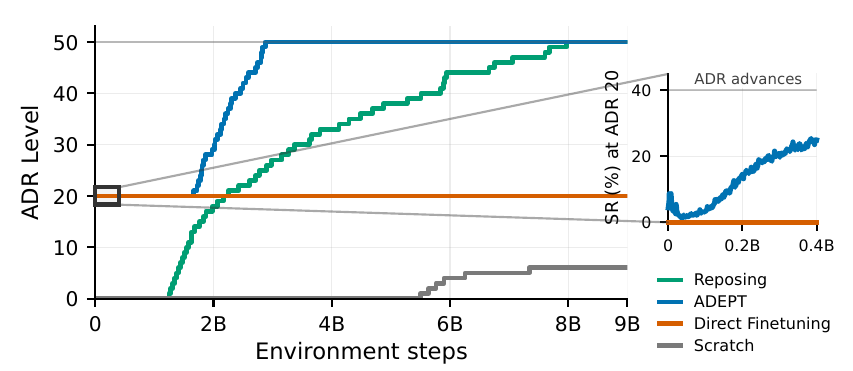
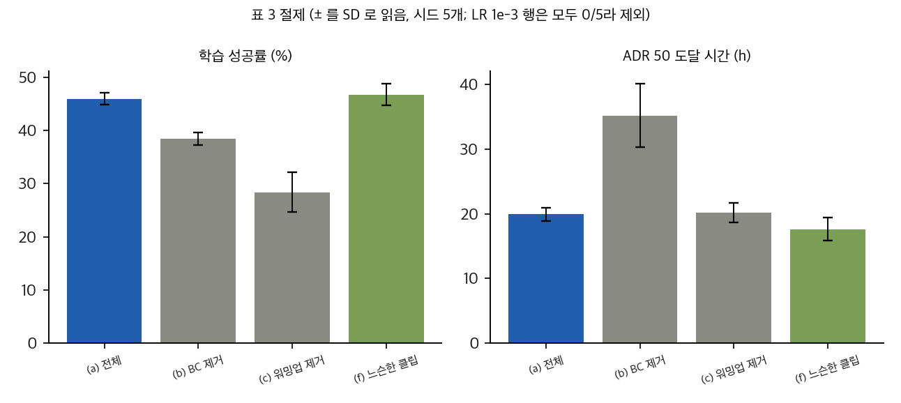
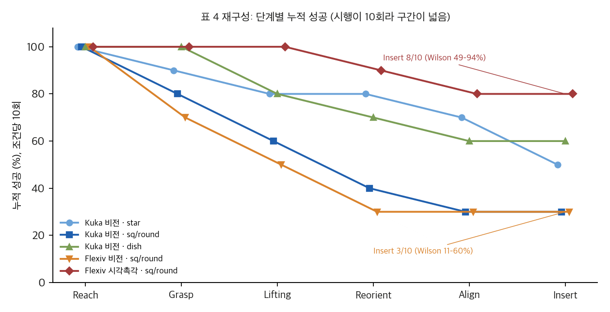
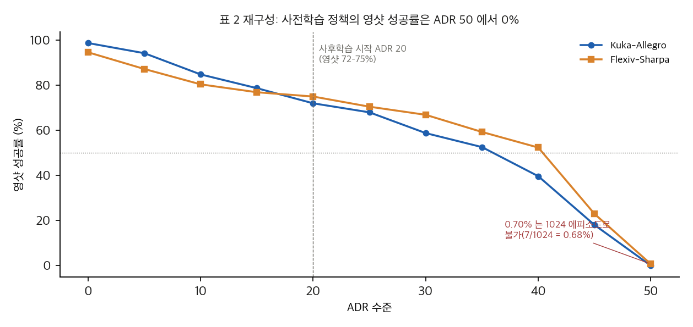
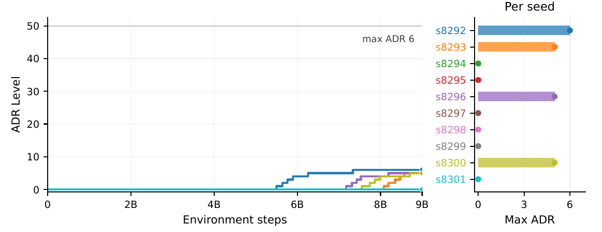
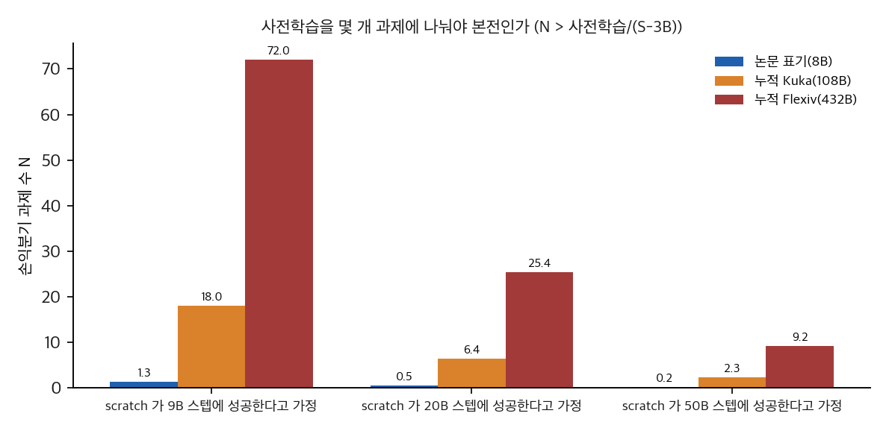

> **논문:** Jayjun Lee, Jessica Yin, Asif Rana, Nicholas Blauch, Octi Zhang, Sam Mady, Mohak Bhardwaj, Nima Fazeli, Nathan Ratliff, Karl Van Wyk, Ankur Handa. *ADEPT: Accelerating Dexterity via Pre-Training and Post-Training using Reinforcement Learning.* CoRL 2026 포스터, arXiv:2608.19182 (v2, 2026-10-16).
> 공식 코드는 공개되지 않았고(프로젝트 페이지 Code 버튼 "Coming soon") 프로젝트 페이지만 있습니다. 논문은 arXiv에서 CC BY 4.0이라 순수 그래프인 그림 3, 9를 출처와 함께 옮겼습니다.

## 논문이 묻는 것

팔-손 로봇의 숙련 조작 RL은 과제마다 도달, 파지, 들기, 재방향을 처음부터 다시 배웁니다. ADEPT는 일반 물체 재배치(reposing) 과제로 한 번 사전학습한 뒤, 하류 접촉 과제(FMB 페그 삽입, 접시 놓기)를 세 단계로 사후학습합니다. (1) 사전학습 액터를 새 관측 공간으로 BC 증류, (2) 액터를 얼리고 새 비평가만 워밍업, (3) 학습률 1e-5, 클립 0.05의 보수적 PPO. 이후 교사를 RGB(와 촉각) 학생으로 증류해 23자유도 Kuka-Allegro와 29자유도 Flexiv-Sharpa에서 영샷으로 배포합니다. 제어는 전체 관절 공간을 구동하는 기하 패브릭 위에서 이뤄집니다.

*그림 1. FMB 삽입 훈련 곡선(논문 그림 3). © 저자(Lee 외), CC BY 4.0, 출처 arXiv:2608.19182.*

## 이 글에서 확인한 것

**1. 낮춘 학습률이 붕괴를 막는다는 결과는 지지되지만 비교점이 두 개뿐입니다.**

*그림 2. 표 3의 학습률 1e-5 행(± 를 SD로 읽음). 우리가 그린 그래프.*

학습률 1e-3인 네 행은 모두 0/5로 ADR 20에서 붕괴하고(Fisher p = 0.0079), 1e-5 행은 4/5 이상입니다. 그러나 중간 학습률이 없고, 본문이 말하는 "1e-5에서 KL 페널티도 0/5"에 해당하는 표 행이 없습니다. 비평가 워밍업은 성공률을 +17.6 %p 올리지만 시간은 줄이지 않고(20.2 대 19.9 h), BC는 시간을 43.5% 줄입니다(± 를 SD로 읽으면 p = 0.007, SEM이면 0.0495). 또 선형 감쇠 학습률은 3B 스텝 시점에 감쇠가 5.7–22.9%만 진행되어 사실상 상수입니다(epoch 정의가 불명확해 추정).

**2. 실로봇 결과는 방향은 분명하지만 조건당 10회입니다.**

*그림 3. 표 4의 단계별 누적 성공. 우리가 그린 그래프.*

촉각 8/10 대 비전 3/10은 Fisher p = 0.070입니다. 들기(p = 0.033)와 재방향(p = 0.020) 단계의 차이는 결과를 본 뒤 고른 단계라 보정하면 유의하지 않습니다. 정렬 이후 삽입 성공은 27회 중 25회라서, 실패는 삽입보다 파지·들기·재방향에서 생깁니다. 시뮬 학생 대 실로봇은 3/10 대 46.7%, 5/10 대 65.2%로 p = 0.35, 0.33이라 구별되지 않습니다.

**3. 표 2의 0.70%는 1024 에피소드로 불가능합니다.**

*그림 4. 표 2의 영샷 성공률. 우리가 그린 그래프.*

7/1024 = 0.68%이고 7/1000이면 0.70%입니다. 나머지 21칸은 1024로 가능합니다. 사전학습 정책은 ADR 35까지 50%를 넘지만 사후학습 시작점 ADR 20에서도 25–28%는 실패하고, 삽입 목표(ADR 50)에서는 0–0.7%입니다.

**4. "처음부터 학습 9B 대 ADEPT 3B"는 비용 정의에 달려 있습니다.**

*그림 5. 처음부터 학습의 시드별 ADR 곡선(논문 그림 9). © 저자(Lee 외), CC BY 4.0, 출처 arXiv:2608.19182.*

처음부터 학습은 9B 스텝에서 ADR 6/50이고, 10 시드 중 6개는 ADR 0입니다. 논문의 사전학습 8B는 PBT 구성원 하나 기준이며 부록 C의 누적 모의 경험은 Kuka 약 1.08e11, Flexiv 4.32e11 전이입니다.

*그림 6. 사전학습을 몇 개 과제에 나눠야 본전인가. 우리가 그린 그래프.*

처음부터 학습이 9B에 성공한다고 가정해도 누적 기준 손익분기는 Kuka 18개, Flexiv 72개 과제입니다. 처음부터 학습은 ADR 0에서 시작하고 ADEPT는 ADR 20에서 시작하며, PBT는 사전학습에만 쓰였다는 점도 비교의 조건입니다.

**5. 본문과 표가 어긋나는 곳.** 미니배치 24,576은 4096 환경 × 호라이즌 16 = 65,536을 나누지 못하고, "2×–14×"는 20/10과 70/5의 극단값 짝입니다(같은 쪽끼리는 4×–7×). 시행당 시간 측정 표는 없습니다. 패브릭 절제와 2단계 증류 기준선 표도 없습니다. v1 → v2에서 수치는 같고 "first demonstration"이 "to our knowledge"로, "decisive"가 "improves"로 약해졌습니다.

## 구현 가능성

이 맥(Apple M4 Pro, MPS, CUDA 없음)에서 논문 수치를 재현할 수 없습니다. Isaac Lab과 NVIDIA GPU, 두 대의 팔-손 로봇이 필요하고 공식 코드가 없습니다. 사후학습 레시피(BC 증류, 비평가 워밍업, 낮은 학습률)의 소형 PyTorch 축소 재현은 조건부로 가능합니다(3–5일, 추정).

## 자료

- 논문: https://arxiv.org/abs/2608.19182
- 프로젝트 페이지: https://adept-dexterity.github.io
- 분석 노트와 재계산 스크립트는 같은 게시본의 `analysis/`에 있습니다.

## 자료

- [통합 리포트 PDF](report/report_public.pdf)
- [01. 논문 분석: ADEPT (arXiv:2608.19182)](analysis/01_paper_analysis.md)
- [02. 선행연구와 관련 자료: ADEPT (arXiv:2608.19182)](analysis/02_prior_work.md)
- [03. 수치 재계산과 해석: ADEPT (arXiv:2608.19182 v2)](analysis/03_analysis.md)
- [04. 주장 검증과 구현 가능성: ADEPT (arXiv:2608.19182)](analysis/04_claim_verification.md)
