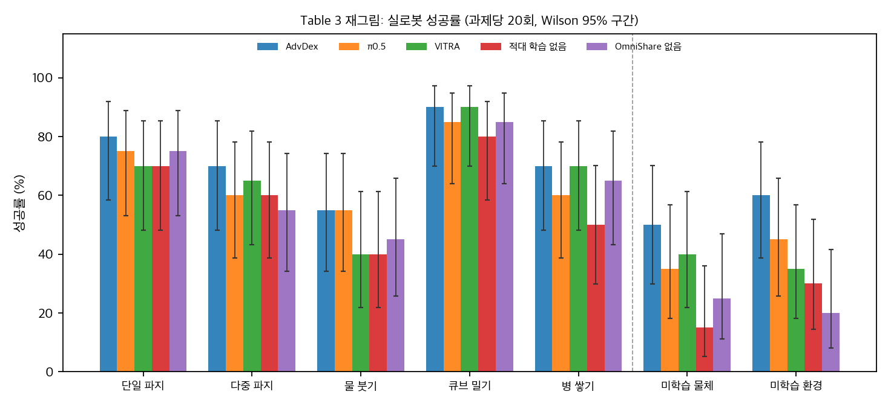
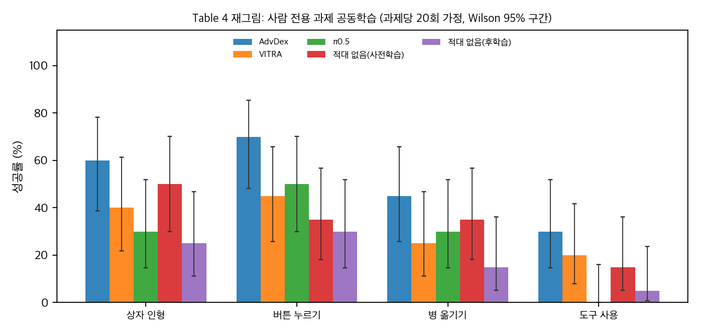

# 03. 수치 재계산과 일관성 검사

이 문서는 논문 표 값만으로 다시 계산한 결과입니다. 학습과 재현은 하지 않았습니다. 계산 코드는 `analysis/recompute.py`, 결과는 `analysis/recompute_results.json`(수 초)이고, 그래프는 `analysis/plot_figures.py`로 그렸습니다. 논문 그림은 쓰지 않았습니다.

## 0. 전제

- **V1 (시도 수).** 실로봇 Table 3은 §4.3 Protocol에 따라 과제당 **20회**로 봅니다. 모든 값이 5의 배수라서 20회 기준 정수 성공 수로 바뀌는 것을 확인했습니다(`all_values_multiples_of_5`). Table 4는 시도 수가 본문에 없으므로 20회로 가정합니다. 이 가정이 틀리면 Table 4의 모든 검정 결과가 바뀝니다.
- **V2 (정책 수).** 각 방법은 정책 하나입니다. 따라서 아래 구간은 시도 샘플링만 반영하고 학습 시드 변동은 반영하지 않습니다. 실제 불확실성은 더 큽니다.
- **통계 방법.** 열별 두 비율 차이는 Fisher 정확 검정과 Newcombe 점수 구간(Wilson 결합)으로 봅니다. 모든 차이는 독립 시도 가정입니다. 같은 초기 배치를 기준선과 공유했는지는 논문이 밝히지 않습니다.

## 1. 실로봇 표 (Table 3) 재계산

### 1.1 기준선 대비 차이 (Ours − 기준선, 퍼센트포인트)

| 비교 | 5개 seen 합 (100회 대 100회) | Newcombe 95% | Fisher p | 7열 합 Fisher p (140회 대 140회, 민감도) |
|---|---|---|---|---|
| Ours 대 π0.5 | 73 대 67 (+6.0 pp) | −6.7 ~ +18.4 | 0.44 | 0.17 |
| Ours 대 VITRA | 73 대 67 (+6.0 pp) | −6.7 ~ +18.4 | 0.44 | 0.14 |
| Ours 대 적대 학습 없음 | 73 대 60 (+13.0 pp) | −0.1 ~ +25.5 | 0.072 | 0.0024 |
| Ours 대 OmniShare 없음 | 73 대 65 (+8.0 pp) | −4.8 ~ +20.4 | 0.28 | 0.014 |

**읽는 법.** 5개 seen 합 p 값은 과제 5개를 같은 집단으로 본 값입니다. 과제마다 난이도가 달라서 합치면 과제 차이가 섞입니다. 7열 합은 미학습 열 2개를 더해 모든 열을 같은 가중으로 보는 민감도 분석이며, 셀들이 서로 독립이라는 가정이 더 약합니다. 이 값을 주장의 근거로 쓰지 않습니다.

### 1.2 열별 차이와 Fisher p

| 열 | Ours − π0.5 (pp, p) | Ours − VITRA (pp, p) | Ours − 적대 없음 (pp, p) | Ours − OmniShare 없음 (pp, p) |
|---|---|---|---|---|
| 단일 파지 | +5 (1.00) | +10 (0.72) | +10 (0.72) | +5 (1.00) |
| 다중 파지 | +10 (0.74) | +5 (1.00) | +10 (0.74) | +15 (0.51) |
| 물 붓기 | 0 (1.00) | +15 (0.53) | +15 (0.53) | +10 (0.75) |
| 큐브 밀기 | +5 (1.00) | 0 (1.00) | +10 (0.66) | +5 (1.00) |
| 병 쌓기 | +10 (0.74) | 0 (1.00) | +20 (0.33) | +5 (1.00) |
| 미학습 물체 | +15 (0.52) | +10 (0.75) | **+35 (0.041)** | +25 (0.19) |
| 미학습 환경 | +15 (0.53) | **+25 (0.20)** | +30 (0.11) | **+40 (0.023)** |

**해석.** 열 단위로 p < 0.05인 셀은 두 개뿐입니다. 적대 학습 없음의 미학습 물체(p = 0.041)와 OmniShare 없음의 미학습 환경(p = 0.023)입니다. 여러 비교를 보정하면 (7열 × 4비교 = 28) 이 두 셀도 확정적이지 않습니다. Holm 보정은 하지 않았습니다. 주된 비교인 Ours 대 π0.5, VITRA는 어떤 열에서도 p < 0.2입니다.

### 1.3 검정력 (무엇을 확인할 수 있었는가)

정규 근사, 양측 α = 0.05, 검정력 0.8, 두 비율 p1, p2 (`recompute_results.json`의 `n_per_arm_for_80pct_power`):

- 0.70 대 0.60 (5개 seen 평균 수준의 차이): **과제 집단 기준 필요 시도 수 약 356회/팔**. 현재 100회/팔의 약 3.6배입니다.
- 0.50 대 0.35 (미학습 물체, Ours 대 π0.5): 약 170회/팔.
- 0.60 대 0.35 (미학습 환경, Ours 대 VITRA): 약 62회/팔.

결론: **20회 셀로는 5–15 pp 차이를 구별할 수 없습니다.** 논문 본문의 "일관된 우위"는 방향에 대한 주장으로만 읽어야 합니다.

## 2. 공동학습 표 (Table 4) 재계산

| 비교 | 성공 합 (80회 대 80회) | Fisher p (풀링) | 과제별 p (상자 인형 / 버튼 / 병 옮기기 / 도구 사용) |
|---|---|---|---|
| Ours 대 π0.5 | 41 대 22 | 0.0034 | 0.11 / 0.33 / 0.51 / **0.020** |
| Ours 대 VITRA | 41 대 26 | 0.025 | 0.34 / 0.20 / 0.32 / 0.72 |
| Ours 대 적대 없음(사전학습) | 41 대 27 | 0.037 | 0.75 / 0.056 / 0.75 / 0.45 |
| Ours 대 적대 없음(후학습) | 41 대 15 | < 0.0001 | 0.054 / 0.026 / 0.082 / 0.091 |

**읽는 법.** 네 과제를 풀링한 검정은 과제 차이를 무시합니다. 그래도 방향은 일관됩니다. 과제별로는 도구 사용에서 π0.5 대 Ours만 p < 0.05입니다. 이 표는 "사람 전용 과제에 대한 우위"의 크기를 보여 주지만, 과제 수가 4개뿐이라 일반화 주장은 약합니다. 적대 학습 제거의 효과는 후학습 단계에서 더 크게 보입니다(풀링 15 대 41).

## 3. Table 2 (사람 손 동작 예측)

- Table 2에는 반복, 시드, 분산이 없습니다. 재계산할 수 있는 것은 **상대 개선**뿐입니다.
- 접근 단계 dh-o (시작 거리 대비 감소율):
  - OmniShare-Unseen (시작 22.4 mm): VITRA 10%, 적대 없음 71%, Ours 86%.
  - HOI4D (시작 20.2 mm): VITRA 19%, 적대 없음 31%, Ours 48%.
- 방향은 여섯 열 모두에서 Ours가 가장 좋습니다. 그래도 제시된 값만으로는 통계 검정을 할 수 없습니다.
- w/o OmniShare와 VITRA는 MPJPE에서 엇갈립니다(OmniShare-Unseen 15.7 대 16.2, HOI4D 14.1 대 13.7). 본문의 "comparable" 표현과 맞습니다.

## 4. 일관성 검사 (V 항목)

| ID | 검사 | 결과 |
|---|---|---|
| V1 | 시도 수 20회 가정이 Table 3·4 값과 맞는가 | **맞음** (모든 값이 5의 배수). Table 4 시도 수는 본문에 없어 가정 |
| V2 | Figure 1 평균이 Table 3·4와 맞는가 | **맞음.** 7열 평균 π0.5 59.29, VITRA 58.57, Ours 67.86 (그림 59.3, 58.6, 67.9). Table 4 평균 27.5, 32.5, 51.25 (그림 27.5, 32.5, 51.3) |
| V3 | 5개 seen 평균 | Ours 73.0, π0.5 67.0, VITRA 67.0, 적대 없음 60.0, OmniShare 없음 65.0, 사전학습 없음 28.0 |
| V4 | 본문 "전체 모델이 모든 과제에서 기준선과 같거나 낫다" | **맞음.** 5개 seen 과제 모두 Ours ≥ max(π0.5, VITRA). 동점은 물 붓기 (π0.5), 큐브 밀기 (VITRA), 병 쌓기 (VITRA) |
| V5 | 본문 "제거하면 줄고, 미학습 열에서 더 크게 줄어든다" | **부분 맞음.** 미학습 물체에서는 적대 제거가 더 크게 줄임 (−35 대 −25). 미학습 환경에서는 OmniShare 제거가 더 크게 줄임 (−40 대 −30). seen 평균 하락은 적대 제거가 더 큼 (−13 대 −8). "미학습에서 더 크다"를 한 방향으로 말하기 어렵습니다 |
| V6 | OmniShare 규모 | **불일치.** 본문 §1·§3.1.1: 100k 이상 궤적, 본문 "다섯 실세계 도메인" (§3.1.1). Table 1: 168k 궤적, 721 물체, 14 시점. Fig. 2 캡션: 10k 시간 이상, 500 과제, 700 물체. Fig. 1과 Fig. 4의 도메인 라벨은 4개 (사람 장갑/사람 손, 다지 손, 그리퍼) |
| V7 | JAAS 자유도 | **모호.** "51-DoF MANO 상태" (§1). 손목 6 + 관절 15 × 3 = 51로 계산되지만 논문이 이 계산을 명시하지 않음. 행동 벡터의 실제 차원, 회전 표현(연속 6D 대 Euler) 여부는 확정 불가 |
| V8 | Table 2에서 Ours가 여섯 열 모두 최선인가 | **맞음** (수치만 보면) |
| V9 | Table 4 "zero-shot" 표현 | 로봇 데이터에 없는 과제이므로 **로봇 쪽 zero-shot**은 맞음. 다만 사람 데이터 1,000 궤적이 같은 과제군에서 나왔으므로 "데이터 없음"과는 다릅니다 |

## 5. 결과 요약

1. **실로봇 우위는 방향만 확인.** Ours 대 π0.5/VITRA 차이는 seen 평균 +6 pp, 95% 구간 −6.7 ~ +18.4 pp, p = 0.44입니다.
2. **적대 학습 제거가 가장 큰 효과.** 미학습 물체 열 +35 pp (p = 0.041), seen 평균 +13 pp (p = 0.072).
3. **사람 전용 과제 공동학습은 풀링에서 강함** (41/80 대 22/80, p = 0.0034). 과제별로는 도구 사용 하나만 p < 0.05.
4. **숫자의 일관성은 대체로 좋다.** Figure 1 평균과 본문 주장 V4는 맞음. 다만 OmniShare 규모(V6)와 JAAS 차원(V7)은 본문 안에서 맞지 않거나 모호합니다.
5. **재현 가능한 수치는 표 재계산뿐.** 학습과 평가 코드가 없어 본문 수치를 독립적으로 검증할 수 없습니다 (`04_claim_verification.md`).

## 6. 그림

Table 3의 열별 성공률과 Wilson 95% 구간. 과제당 20회입니다. 구간이 서로 많이 겹칩니다.

Table 4의 사람 전용 과제 성공률과 Wilson 95% 구간. 과제당 20회를 가정했습니다 (V1).
