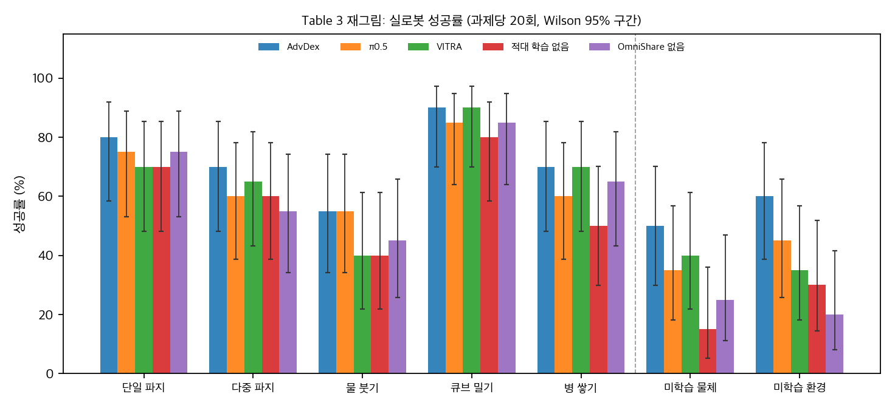
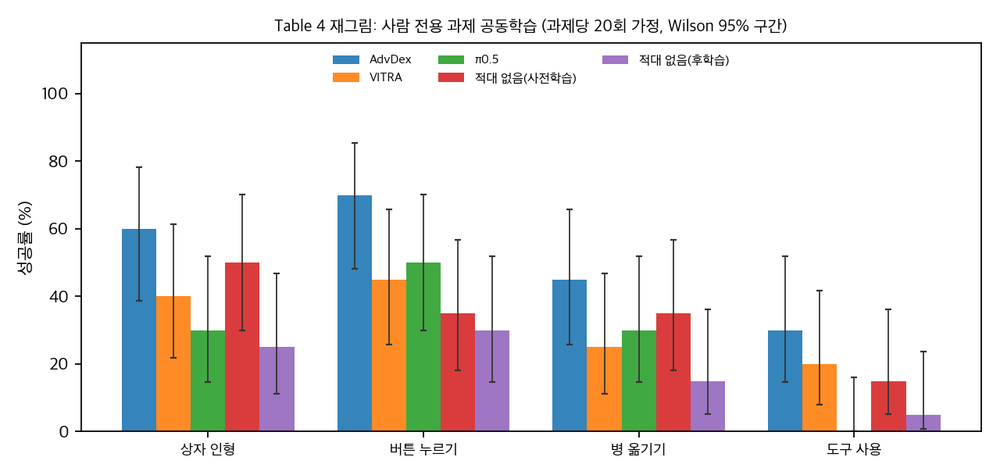

> **논문:** Zhiyue Zhao, Jingyi Wu, Hairuo Liu, Mingyu Liu, Liyang Li, Hengdi Zhang, Tong He, Zhengxue Cheng. *AdvDex: Learning Dexterous Manipulation from Human Demonstrations via Joint-Aligned Actions and Adversarial Learning.* CoRL 2026 포스터, arXiv:2608.14028 (v1, 2026-08-14).
> 공식 코드와 프로젝트 페이지는 찾지 못했습니다. 이 글의 그래프는 논문 표 값으로 우리가 다시 그린 것입니다. 논문 그림은 넣지 않았습니다(arXiv 비독점 라이선스).

## 논문이 묻는 것

손 조작 정책을 배우려면 로봇 시연이 많이 필요하지만, 로봇 원격조작은 비쌉니다. 사람 손 시연은 훨씬 싸고 많습니다. 문제는 사람 손, 다지 로봇 손, 평행 그리퍼가 관절 수와 구조가 달라서 같은 행동 공간에 놓기 어렵다는 점입니다. 게다가 공유 시각 인코더는 과제와 무관한 손 외형(장갑, 로봇 손의 색과 모양)까지 외워 버려서, 한 구현체에서 배운 것이 다른 구현체로 잘 옮겨 가지 않습니다.

AdvDex는 세 가지로 이 문제를 풉니다.

- **OmniShare:** 장갑(관절 엔코더 29개)과 촉각 배열로 모은 사람 조작 데이터셋. 논문 본문은 100k 이상 궤적, 500개 과제, 700개 물체라고 씁니다.
- **JAAS (Joint-Aligned Action Space):** 손목 SE(3) 포즈 하나와 손가락 관절 15개로 된 공통 행동 공간. 사람 손, 19자유도 로봇 손, 평행 그리퍼를 같은 슬롯에 기능적으로 대응시키고, 없는 슬롯은 손실에서 가립니다.
- **도메인 적대 학습:** 시각 토큰에서 구현체를 맞히는 판별기를 Gradient Reversal Layer로 붙여, 시각 인코더가 구현체 정보를 줄이도록 합니다. 판별기는 학습 때만 쓰이고 추론 때는 빠집니다.

## 이 글에서 확인한 것

**1. 실로봇 우위는 방향만 확인됩니다.** 과제당 20회인 표(Table 3)에서 5개 과제 평균은 AdvDex 73%, π0.5 67%, VITRA 67%입니다. 풀링 Fisher 검정 p = 0.44이고, 차이 +6 pp의 95% 구간은 −6.7 ~ +18.4 pp입니다. 과제마다 20회라서 15 pp 이하 차이는 구별하기 어렵습니다. 정책도 방법당 하나입니다.

*그림 1. 논문 Table 3의 수치를 다시 그렸습니다. 과제당 20회, Wilson 95% 구간. 우리가 그린 그래프입니다.*

**2. 적대 학습 제거의 효과가 가장 큽니다.** 적대 학습을 빼면 미학습 물체 성공률이 50%에서 15%로 떨어집니다(Fisher p = 0.041). 5개 과제 평균은 73%에서 60%입니다(p = 0.072). 판단은 여러 비교를 보정하지 않은 값이라 확정적이지 않습니다.

**3. 사람 전용 과제 공동학습은 풀링에서 강합니다.** 로봇 데이터에는 없고 사람 데이터에만 있는 과제 4개에서 AdvDex는 41/80, π0.5는 22/80입니다(Fisher p = 0.0034). 그러나 과제별로는 도구 사용 하나만 p < 0.05입니다. 과제가 4개뿐이라 일반화를 말하기는 이릅니다.

*그림 2. 논문 Table 4의 수치를 다시 그렸습니다. 시도 수는 본문에 없어 과제당 20회로 가정했습니다.*

**4. 일부 숫자는 서로 맞지 않습니다.** 논문 본문은 OmniShare를 100k 이상 궤적이라고 하고, Table 1은 168k, Fig. 2 캡션은 10k 시간이라고 씁니다. 본문은 "다섯 도메인"이라고 하지만 그림의 도메인 라벨은 네 개입니다. JAAS의 행동 차원도 본문에서 명시하지 않습니다. 본문의 "모든 과제에서 같거나 낫다"는 주장과 그림 1의 평균 값은 표에서 그대로 재현됩니다.

**5. 주장 대부분은 독립적으로 확인할 수 없습니다.** 공식 코드, 데이터, 체크포인트가 공개되지 않았습니다. 장갑 센서 정확도 측정치도 없습니다. 전체 주장 열 개 중 "맞음"은 사전학습 제거 효과 하나뿐입니다.

## 이 맥에서 구현할 수 있는가

**전체 시스템은 구현할 수 없습니다.** 필요한 것은 (1) 공개되지 않은 OmniShare 규모의 사람 데이터, (2) 대규모 GPU 학습, (3) 다지 로봇 손과 팔이 있는 실로봇입니다. 학습 설정(λ, 청크 길이, 학습 스텝)도 본문에 없습니다.

CPU 또는 MPS에서 가능한 것은 두 가지입니다. 빈 슬롯을 가린 행동 손실이 서로 다른 손 구조에서 어떻게 작동하는지 보는 것, 그리고 합성 두 도메인 데이터로 적대 학습 신호의 강도(λ)에 따른 판별기 정확도를 보는 것입니다. 둘 다 논문 수치와 직접 비교할 수 없는 기전 확인입니다. 노력은 하루에서 이틀 정도로 추정합니다(측정 전).

## 한계와 주의

- 정책 하나, 과제당 20회. 차이 10–15 pp를 확인하려면 과제당 수백 회가 필요합니다.
- 기준선(π0.5, VITRA)을 "같은 조건"이라고 했지만 세부 설정이 없습니다.
- 평가자가 방법을 알았는지 적혀 있지 않습니다.
- 사람 데이터 규모 숫자와 행동 차원이 본문 안에서 맞지 않습니다.

## 참고

- 논문: arXiv:2608.14028 (비독점 라이선스). 이 글은 논문 텍스트와 표 값을 인용하고, 그래프와 분석은 우리가 만들었습니다.
- 재계산 코드와 결과, 주장 검증 문서는 게시 패키지 `git/` 폴더에 있습니다.

## 자료

- [통합 리포트 PDF](report/report_public.pdf)
- [01. 논문 분석: AdvDex](analysis/01_paper_analysis.md)
- [02. 선행연구, 공식 저장소, 이 저장소의 관련 분석](analysis/02_prior_work.md)
- [03. 수치 재계산과 일관성 검사](analysis/03_analysis.md)
- [04. 주장 검증과 구현 가능성](analysis/04_claim_verification.md)
