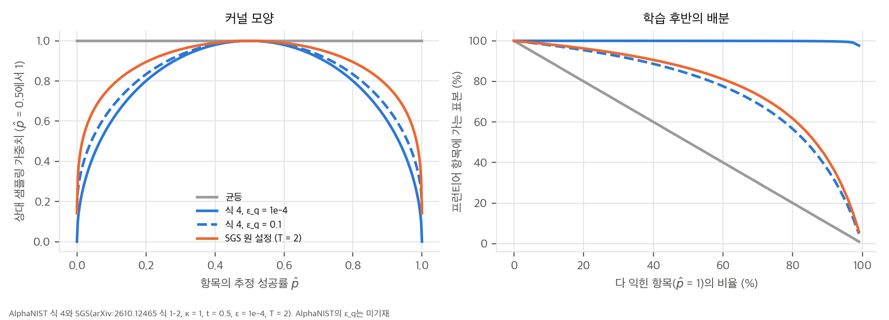
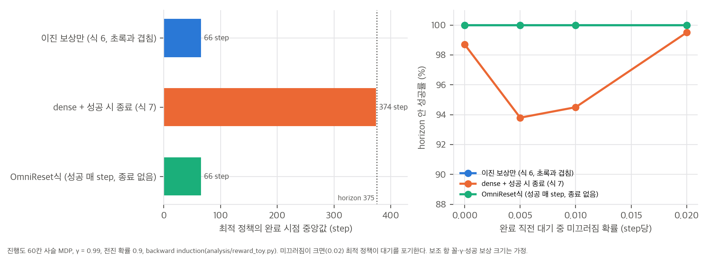
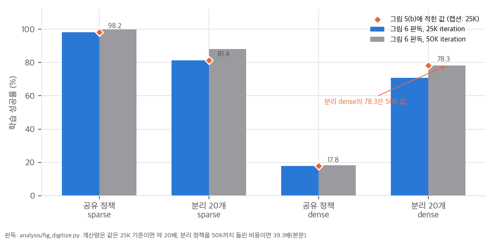

# 03. 핵심 식 해석과 toy 검증

스크립트는 모두 CPU에서 수 초 안에 끝납니다.

| 스크립트 | 내용 | 결과 |
|---|---|---|
| `analysis/fig_digitize.py` | 그림 5(a)·6 판독 (원문 PDF를 300 dpi로 렌더링) | `fig_digitize_results.json` |
| `analysis/sampling_toy.py` | 식 4와 SGS 커널 비교 | `sampling_toy_results.json` |
| `analysis/reward_toy.py` | 성공 시 종료 + 보조 보상의 최적 정책 | `reward_toy_results.json` |
| `analysis/table_check.py` | 본문 수치 재계산 | `table_check_results.json` |

## 1. 시작 상태 샘플링: 식 4와 SGS는 같은 규칙인가

### 1.1 식 정리
AlphaNIST 식 4는 q_i ∝ ε_q + √(p̂_i(1 − p̂_i))입니다.

SGS 원 논문(arXiv:2610.12465 식 1–2)의 조작 설정(κ = 1, t = 0.5, ε = 1e-4, T = 2)은 다음과 같습니다.

```
w = (p+ε)^{κt} (1−p+ε)^{κ(1−t)} ≈ √(p(1−p))
ℓ = log(max(w, ε) + ε)
q ∝ exp(ℓ / T) ≈ (p(1−p))^{1/4}
```

즉 SGS는 온도 2의 softmax 때문에 지수가 ¼이 됩니다. 식 4는 SGS에서 T = 1로 둔 것과 같습니다. AlphaNIST는 "SGS의 샘플링 규칙을 유지한다"고 쓰지만 두 커널은 같지 않습니다. 실제 구현이 SGS 코드를 그대로 썼다면 식 4가 부정확한 것이고, 식 4대로 구현했다면 SGS보다 탐욕적인 샘플러를 쓴 것입니다. 어느 쪽인지는 코드가 없어서 알 수 없습니다.

### 1.2 학습 단계별 배분 (S1, 실제 p를 안다고 가정)

M = 32,768개 항목입니다(SGS 조작 설정의 N과 같게 둠. AlphaNIST의 M은 미기재). 아래는 프런티어(0 < p < 1) 항목에 가는 표본 비율입니다.

| bank 상태 | 균등 | 식 4, ε_q = 1e-4 | 식 4, ε_q = 1e-2 | 식 4, ε_q = 0.1 | SGS (T = 2) |
|---|---|---|---|---|---|
| 초기: 80% 못 풂 | 20% | 99.9% | 91.5% | 56.5% | 61.6% |
| 중반: 30% 익힘, 30% 못 풂 | 40% | 100% | 96.6% | 77.6% | 81.1% |
| 후반: 95% 익힘 | 5% | 99.6% | 69.5% | 21.6% | 25.3% |



해석:
- **ε_q가 정해지지 않으면 샘플러가 정해지지 않습니다.** 학습 후반의 프런티어 비율이 ε_q에 따라 22%에서 99.6%까지 달라집니다. ε_q = 0.1인 식 4가 SGS(T = 2)와 가장 비슷합니다.
- **"Beta가 균등보다 낫다"(그림 7)는 어떤 Beta인지에 달려 있습니다.** 다 익힌 항목이 대부분인 후반에, 균등은 표본의 95%를 이미 성공하는 시작점에 씁니다. 이진 보상에서 이런 episode는 advantage가 거의 0입니다. 표본당 이항 분산 E_q[p(1−p)]는 균등 0.009, SGS(T = 2) 0.048, 식 4(ε_q = 1e-4) 0.194입니다.

### 1.3 추정 잡음과 '굶는 항목' (S2, S3)
p̂를 최근 L = 50개 결과의 평균으로 쓰면(독립 구현의 기본값), 실제 p = 0.95인 항목도 0.95⁵⁰ = 7.7% 확률로 p̂ = 1이 됩니다. 이때 그 항목은 ε_q만 받습니다. 실제 p가 0.9–1인 항목의 19.3%가 이 상태였습니다.

64K 환경, iteration당 32 step, 평균 episode 100–375 step을 가정하면, 학습 후반에 다 익힌 항목 하나가 다시 뽑히는 간격은 다음과 같습니다.

| 커널 | iteration 간격 (episode 100 step) | iteration 간격 (episode 375 step) | 25K iteration 동안 방문 |
|---|---|---|---|
| 식 4, ε_q = 1e-4 | 336 | 1,265 | 20–74회 |
| 식 4, ε_q = 1e-2 | 5 | 19 | 1,346–5,016회 |
| SGS (T = 2) | 2 | 8 | 3,278–12,310회 |
| 균등 | 1.6 | 6 | 4,167–15,625회 |

ε_q가 작으면 "다 익혔다"고 판정한 시작점을 수백 iteration 동안 다시 보지 않습니다. 다중 과제 학습에서 다른 과제를 배우다 그 시작점을 잊어도(망각) 늦게 알아챕니다. ε_q를 적지 않은 것은 작은 누락이 아닙니다.

## 2. 보상 구조: 성공 시 종료 + 양의 보조 보상

### 2.1 유도
완료 직전 상태에서 매 step 보조 보상 s를 받는다고 하겠습니다. "지금 끝내면" 성공 보상 R을 받고 종료합니다. "n step 기다린 뒤 끝내면" 다음을 받습니다.

```
s(1 − γⁿ)/(1 − γ) + γⁿ R
```

두 값의 차이는 (1 − γⁿ)[s/(1 − γ) − R]입니다. 따라서 **s/(1 − γ) > R이면 남은 step 수와 상관없이 끝까지 미루는 편이 낫습니다.** 조건은 n과 무관합니다.

| γ | s = 0.01 | s = 0.02 |
|---|---|---|
| 0.99 | s/(1−γ) = 1.0 → 경계 | 2.0 > R = 1 → **미룸** |
| 0.995 | 2.0 → **미룸** | 4.0 → **미룸** |

AlphaNIST dense 비교군은 c₂ = c₃ = 0.01이라, 손이 부품 가까이 있고 방향이 맞으면 s가 최대 0.02입니다(두 항이 [0, 1] 범위라고 가정). 성공 보상 R = 1(식 5)이고 OmniReset의 γ = 0.99를 쓰면 미루는 쪽에 해당합니다.

OmniReset 구현은 이 문제를 구조로 피합니다. 성공 상태에 머무는 동안 매 step 성공 보상 1.0 × dt를 주고(실효 0.1/step, 보조 항 0.02/step보다 큼), 성공으로 종료하지 않습니다(`04` C14).

### 2.2 사슬 MDP로 확인 (H1, H2)
진행도 60칸, 전진 확률 0.9, horizon 375 step, γ = 0.99인 사슬 MDP를 backward induction으로 풀었습니다.



| 보상 | 완료 직전에서 끝내기를 처음 고르는 시각 | horizon 안 성공(미끄러짐 0) | 미끄러짐 1%/step |
|---|---|---|---|
| 이진 보상만 (식 6) | step 0 (즉시) | 100%, 중앙값 66 step | 100% |
| dense + 성공 시 종료 (식 7) | step 373 | 98.9%, 중앙값 374 step | 94.4% |
| dense + 성공 시 종료, R도 dt 배율(0.04)이면 | step 374 | 90.1% | 76.8% |
| OmniReset식 (성공 매 step, 종료 없음) | step 0 (즉시) | 100%, 중앙값 66 step | 100% |

해석:
- dense + 성공 시 종료에서 최적 정책은 **완료 직전에 머물다가 horizon 끝에 끝냅니다.** 확률적 전진 때문에 시간이 모자라 실패하는 경우가 생기고(1.1%), 머무는 동안 미끄러질 위험이 있으면 성공률이 더 떨어집니다.
- 학습 관점에서도 나쁩니다. 성공 신호가 episode 끝으로 밀리고, 정책은 정렬 근처에서 머무는 행동을 강화하게 됩니다.
- 이 toy로 공유 dense의 17.8%를 설명할 수는 없습니다. 분리 dense가 78%까지 간 것도 이 유인만으로는 설명되지 않습니다. 보조 항의 실제 꼴, γ, 성공 보상의 실제 스케일(Isaac Lab 보상은 dt를 곱함)이 논문에 없기 때문입니다. 다만 "이진 대 dense" 비교가 **보상 형식 외에 종료 구조의 차이까지 함께 바꾼 비교**라는 점은 분명합니다.

## 3. 그림 판독: reset 혼합 분포의 비중

그림 5(a) heatmap 80칸을 색 막대 역산으로 수치화했습니다. 행 평균(99.9 / 81.9 / 17.1 / 79.0)은 그림 5(b) 값(98.2 / 81.4 / 17.8 / 78.3)과 ±1.7%p(포화된 첫 행), 나머지 행은 ±0.7%p 안에서 맞습니다. 본문이 적은 두 칸(분리 dense M4 45.0%, 중간 기어 93.6%)도 45.6, 94.2로 재현됩니다.

| 분리 sparse 정책 | heatmap 판독 | 본문 (무작위 초기 상태) |
|---|---|---|
| M4 너트 (N4) | 50.0% | ≤ 0.3% |
| 4 mm 막대 (R4) | 51.7% | ≤ 0.3% |
| 4 mm 페그 (P4) | 31.3% | ≤ 0.3% |

두 값이 모두 맞다면, heatmap은 모든 reset 종류의 평균이고 본문은 "무작위 초기 상태" 종류만의 값입니다. 분리 정책은 테이블에 놓인 부품을 집지 못하지만 손에 쥔 상태나 끼우기 직전 상태에서는 성공합니다. 그렇다면 이 과제들의 bank에서 그런 쉬운 시작점이 30–50% 정도를 차지한다고 볼 수 있습니다. 헤드라인 98.2%도 같은 혼합 분포의 평균입니다. 논문은 공유 정책이 테이블에 놓인 부품에서 시작했을 때의 성공률을 따로 보고하지 않습니다.

SGS 논문은 끼우기 직전 reset을 빼면 학습이 되지 않았다고 보고합니다(SGS 부록 B.3). 그리고 평가는 Reaching 초기 분포에서 따로 합니다(SGS 표 6). AlphaNIST에서도 쉬운 reset은 학습에 꼭 필요한 장치이지만, 평가 지표에 섞이면 과제의 실제 난이도를 가립니다.

## 4. 계산량 해부

- **처리량:** 64K 환경 × 25K iteration × 32 step = 5.12×10¹⁰ step을 410 GPU-h에 썼습니다. GPU당 초당 약 34,700 step(환경당 8.7 step/s)이고, 16 GPU면 wall-clock 약 25.6시간입니다. GPU 종류는 적혀 있지 않습니다. FlashDexRetarget의 300M step과 비교하면 170배 많은 step입니다.
- **그림 5·6의 계산량 비율:**



  분리 정책 하나당 805 GPU-h는 공유 정책의 1.96배이고, 그림 6 곡선이 50K까지 이어진다는 점과 맞습니다. 같은 25K 기준이면 계산량 비율은 약 20배입니다(98.2% 대 81.4%). 분리 정책을 50K까지 돌린 비용이면 39.3배입니다(98.2% 대 88.1%). 본문의 "39.3배, 81.4%"는 앞의 성공률과 뒤의 비용을 짝지은 것입니다.
- **그림 7의 x축은 계산량 축입니다.** iteration을 고정했으므로 1K → 256K는 step 256배, GPU 1 → 64장입니다. 선형 가정에서 256K 실행은 약 1,640 GPU-h입니다.

## 5. Table I: 다중 부품 성공률의 구조

연속 비율 s_k / s_{k−1}은 0.977–0.989로 거의 일정합니다. s_k ≈ 0.99 × 0.9825^(k−1)로 적합되고, 10개에서 84%가 정확히 나옵니다.

- **독립 모델과의 차이:** 쌍마다 독립적으로 99%로 성공한다고 보면 10개에서 90.4%여야 합니다. 실제(84%)가 더 낮아서, 쌍이 늘수록 쌍당 실패가 1%에서 약 1.75%로 늘어납니다. 긴 horizon, 간섭, 순서 정하기의 비용으로 읽힙니다.
- **외삽:** 같은 비율로 20개를 외삽하면 70.8%이고, 10개 정책을 두 번 쓰면 70.6%입니다. 저자가 제안한 "10개씩 나눠 보드 전체 풀기"는 이 추세라면 70% 근처입니다.
- **빠진 정보:** 시행 수와 활성 쌍을 고르는 방법이 없어서 이 적합의 불확실성은 계산할 수 없습니다.

## 6. 망 차원 점검 (Fig. 3)

- 고유감각 한 프레임은 자세 7 + twist 6 + 관절 9 + 행동 8 = 30이고, 150 = 5 × 30이라 5프레임 이력으로 보입니다(본문에 이력 길이는 없음).
- 점군 임베딩 128 + 150 = 278로, 그림의 입력 차원과 맞습니다.
- SimBa 몸통(입력 사영 + residual block 2 + 출력)의 파라미터는 actor 약 113만, critic 약 112만입니다. 점군 인코더는 n_pts가 없어 셀 수 없습니다. 3 × n_pts를 그대로 펴서 256으로 사영한다면 n_pts = 1,000일 때 약 77만이 더해집니다(가설).
