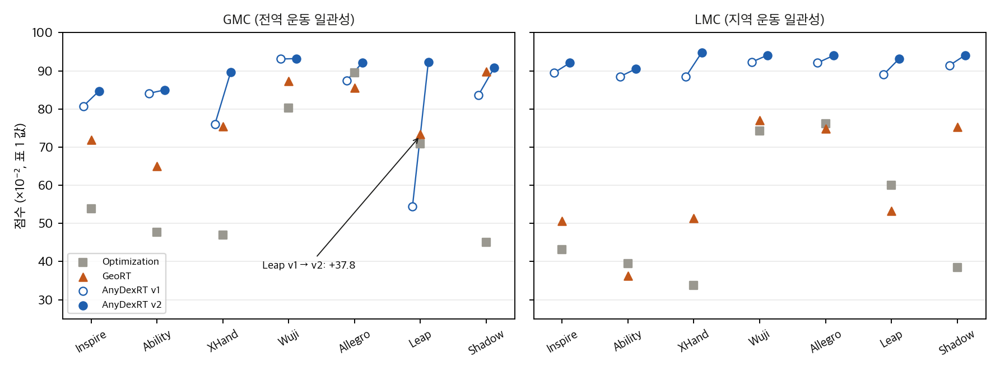
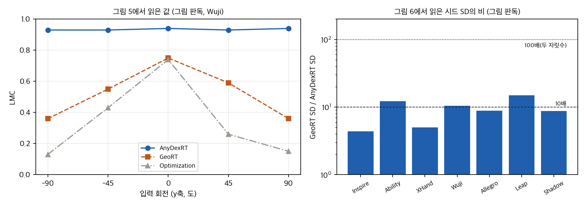
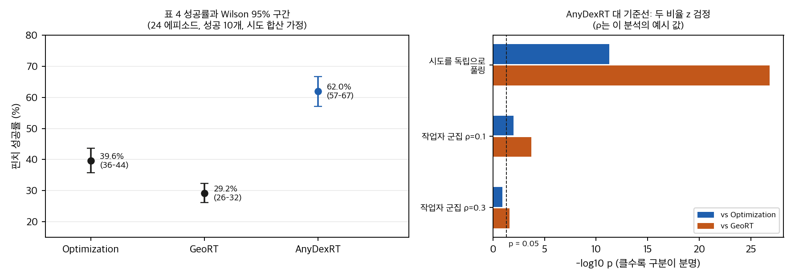
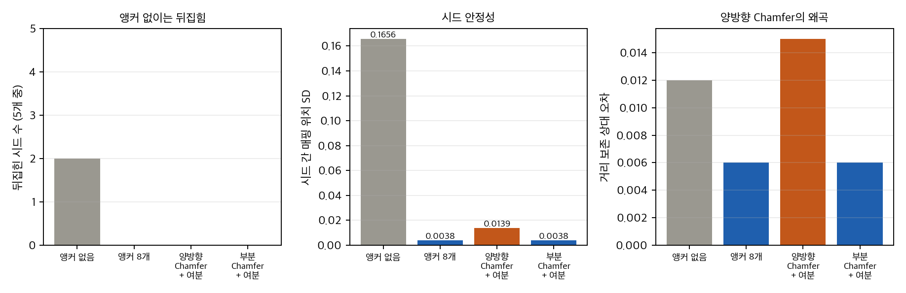

> **논문:** Chenxi Wang, Ying Feng, Hongjie Fang, Shangning Xia, Lixin Yang, Chuan Wen, Cewu Lu. *AnyDexRT: Calibration-Efficient Dexterous Hand Retargeting with Few-Shot Human Guidance.* CoRL 2026 포스터, arXiv:2607.08341 (v2, 2026-11-05).
> 공식 코드는 GitHub chenxi-wang/anydexrt에 있습니다(라이선스 파일 없음). 논문은 arXiv 비독점 배포 라이선스(CC BY 아님)라 논문 그림은 싣지 않았고, 이 글의 그림은 모두 표 값과 재계산으로 우리가 그린 그래프입니다.

## 논문이 묻는 것

글러브나 카메라로 읽은 사람 손 동작을 로봇 손 관절 명령으로 바꾸는 일을 **리타게팅**이라고 합니다. 이 변환이 텔레오퍼레이션의 손맛과, 그렇게 모은 시연의 품질을 정합니다. 기존 방법은 크게 두 가지입니다. 사람과 로봇의 지문·관절 벡터 쌍을 손으로 정하고 최적화하는 방법은 좌표계, 스케일, 가중치를 손마다 맞춰야 합니다. 신경망으로 두 손의 지문 공간을 맞추는 방법(GeoRT)은 조정은 줄지만, 로봇 손에 사람 공간과 대응이 없는 여분 영역이 있으면 대응이 휠 수 있다고 논문은 지적합니다.

AnyDexRT의 답은 세 부분입니다. 손가락마다 작은 MLP를 두고 사람 지문 위치를 로봇 지문 위치로 보냅니다. 학습 신호는 (1) 사람 → 로봇 한 방향 Chamfer 거리(부분 Chamfer), (2) 쌍별 거리 보존, (3) 지문의 지역 좌표계에서 본 운동 방향 보존입니다. 이 자기지도 해는 유일하지 않아서, 조작자가 몇 가지 기준 제스처를 흉내 낸 **소수의 사람-로봇 앵커 쌍**으로 해를 고정합니다. 마지막으로 핀치 자세는 엄지와 손가락의 위치로 접촉을 감지하는 분류기가 로봇의 핀치 근처로 보정합니다.

## 이 글에서 확인한 것

**1. 표 1의 산술은 맞습니다. 다만 본문 한 문장이 v1 값에 머물러 있습니다.** 7개 손 평균 12개가 소수 첫째 자리까지 재계산과 일치합니다. 4.1절의 "평균 LMC를 59.8%에서 90.2%로"는 v1 표의 평균(90.2)과 같고, v2 표의 평균은 93.3입니다. v2에서 표만 갱신되고 문장이 그대로 남은 것으로 보이며, 저자 확인이 필요합니다.

**2. 앵커 매개변수 하나를 바로잡자 표가 크게 움직였습니다.** v2 부록 E에 따르면 v1의 로봇 앵커 생성에서 굽힘 비 λ를 1로 썼고 2여야 했습니다. 정정 뒤 AnyDexRT의 14칸이 모두 올랐습니다(GMC 평균 +9.8, LMC 평균 +3.1). Leap 손의 GMC는 54.5에서 92.3으로 +37.8입니다. v1에서는 Allegro, Leap, Shadow의 GMC가 두 기준선 중 높은 쪽보다 낮았고, v2에서는 모든 칸에서 높습니다. 소수 앵커로 해를 고정하는 설계에서 앵커의 정의 자체가 결과를 좌우하는 조정값이라는 뜻입니다. 표 2가 세는 "하이퍼파라미터 3개"에 이것이 포함되는지는 논문과 코드로 확인되지 않습니다.

*그림 1. 표 1의 칸별 GMC·LMC. AnyDexRT v1(속이 빈 원)에서 v2(채운 원)로의 변화와 두 기준선. 우리가 그린 그래프이며 논문 표 값을 옮겼습니다.*

**3. 시드 SD로 보면 14칸 중 13칸에서 차이가 분명하고, 한 칸은 구분되지 않습니다.** 표 1의 ±를 표본 SD로, 시드를 5개로 가정하고 Welch 검정을 하면 AnyDexRT와 GeoRT의 차이는 13칸에서 p < 0.01입니다. 구분되지 않는 칸은 Shadow 손의 GMC(90.8 대 89.8, p = 0.24)입니다. 이 검정은 훈련 시드의 변동만 보며, 평가에 쓴 사람 입력이 학습 샘플과 같은지는 논문에 적혀 있지 않습니다.

**4. 안정성 주장은 방향이 분명하고, 크기는 약 한 자릿수입니다.** 본문은 그림 6에서 AnyDexRT가 "orders-of-magnitude better stability"라고 씁니다. 그림에서 읽은 값(근사)으로 GeoRT와 AnyDexRT의 시드 간 위치 SD 비는 4.4배(Inspire)에서 15배(Leap)이고 log10으로 0.64–1.18입니다. 그림 5의 회전 섭동에서는 ±90°에서 GeoRT의 LMC가 약 0.39, 최적화가 약 0.61 떨어지고 AnyDexRT는 범위 0.01 안에 있습니다. 다만 회전한 입력으로 재학습했는지, 앵커도 함께 돌렸는지가 적혀 있지 않습니다. 공식 코드 README는 학습과 추론의 좌표 규약이 같아야 하고 바꾸면 데이터를 다시 만들어 재학습하라고 안내합니다.

*그림 2. 논문 그림 5(회전 섭동, Wuji 손의 LMC)와 그림 6(시드 간 위치 SD의 비)에서 읽은 값을 다시 그린 것(그림 판독, 근사). 우리가 그린 그래프입니다.*

**5. 실로봇 평가는 작업자 8명, 과제당 3회라 평균만 있고 검정 자료가 없습니다.** 에피소드당 시간은 AnyDexRT가 네 과제 모두 가장 짧습니다. 상대 절감은 Sprink 63%, Pick-10 30%, Screw 25%, Shovel 23%로, 본문이 "특히 분명하다"고 쓴 Sprink와 Shovel 중 Shovel은 상대 절감이 가장 작습니다. 핀치 성공률 62.0 / 39.6 / 29.2%는 성공을 10개씩, 에피소드를 24개(가정)로 합산하면 정수 시도 수(387 / 606 / 821–823)로 성립하고, 에피소드당 시도 시간도 방법 사이에서 비슷합니다(약 6.0–6.6초). 시도를 독립으로 풀링하면 p는 10⁻¹² 이하입니다. 그러나 시도는 작업자에게 묶여 있어서, 작업자 내 상관 ρ를 0.3으로 가정(예시 값)하면 대 Optimization의 p가 0.12로 올라갑니다. 논문에는 작업자별 값이나 검정이 없습니다.

*그림 3. 표 4 핀치 성공률의 Wilson 95% 구간(24 에피소드, 시도 합산 가정)과 AnyDexRT 대 기준선 검정의 p(독립 풀링 대 작업자 군집). ρ는 이 글의 예시 값이며 측정한 것이 아닙니다. 우리가 그린 그래프입니다.*

**6. 공식 코드는 논문의 서술보다 구성 요소가 많습니다.** 커밋 627003b를 정적으로 읽고(실행하지 않음) 논문 v2와 대조한 결과입니다.
- 학습 손실에 논문 식에 없는 **지도 대조 손실**이 더해져 있습니다.
- 거리 보존은 논문 식 2의 제곱 대신 절댓값(L1)이고 물리 단위로 계산합니다.
- 접촉 보정의 기본 임계값은 0.5이고 점수에 비례해 예측을 템플릿 쪽으로 보간합니다. 논문 v2는 0.9와 최근접 템플릿 탐색으로 적었고, v1은 0.5였습니다. 템플릿은 핀치 전용이 아니라 로봇 지문 샘플표 전체입니다.
- 관절 선택에는 5 mm 이내 후보 중 최소 노름 선택, One Euro 필터, 학습 범위를 벗어난 입력의 대체가 들어 있습니다.
- 평가 코드(GMC, LMC, 회전 섭동, 시드 안정성), 체크포인트, 사람 글러브 데이터는 공개되지 않았습니다. 저장소에는 라이선스 파일이 없습니다.

**7. 작은 토이에서 앵커가 없는 자기지도 해는 뒤집혔습니다.** 3차원 원호 곡선에 부분 Chamfer, 거리 보존, 정렬 손실만 쓴 토이입니다(지역 운동 손실과 분류기는 넣지 않았고 시드 5개). 원호는 좌우 반사에 대칭이라 뒤집힌 해도 같은 손실값을 갖습니다. 앵커가 없으면 시드 5개 중 2개가 뒤집혔고, 앵커 8개를 주자 0개가 되었으며 시드 간 위치 SD가 0.166에서 0.0038로 줄었습니다. 논문 3.3절 설명과 같은 방향입니다. 로봇 쪽에 여분 원호를 두고 양방향 Chamfer를 쓰면 부분 Chamfer 대비 시드 SD가 3.7배, 거리 오차가 2.5배 커졌지만 거리 오차는 1.5%로 작았습니다. 실제 손에서 같은 크기로 나타나는지는 이 토이로 알 수 없습니다.

*그림 4. 토이 결과(시드 5개). 앵커 없음은 5개 중 2개가 뒤집혔고 앵커 8개에서는 없었습니다. 우리가 그린 그래프입니다.*

## 구현할 수 있는가

- 방법(손가락별 MLP, 네 손실, 최근접 이웃 역변환, 접촉 분류기)은 MLP 5개(입력 3차원)라 CPU로 작게 학습할 수 있습니다. 공식 코드 기본값에서 계산한 학습 스텝은 약 7,320개입니다(실행 시간은 측정하지 않은 추정).
- 논문 수치(표 1–4)는 이 저장소의 코드만으로 만들 수 없습니다. 평가 코드와 사람 글러브 데이터가 없고, GMC·LMC의 정의식은 논문에 없이 GeoRT를 가리킵니다. 실로봇 결과는 Flexiv Rizon 4, Wuji 손, Manus 글러브와 작업자 8명이 필요합니다.
- 공식 학습 코드는 CUDA가 없으면 오류를 내므로 장치 인자를 고쳐야 쓸 수 있습니다.

## 읽고 난 평가

접근은 분명하고 작습니다. "여분 영역을 덮지 않는다"는 가설을 한 방향 Chamfer 하나로 풀고, 소수 앵커로 모호성을 고정하며, 한 번 모은 사람 데이터로 여러 손을 학습하는 사용 모델이 실용적입니다. 공식 코드도 있습니다. 다만 (1) v2의 표와 본문이 한 곳에서 어긋나 있고, (2) 앵커 정의가 결과를 크게 좌우하는 숨은 조정값이며, (3) 보정 민감도 실험과 평가 입력의 조건이 짧게만 적혀 있고, (4) 실로봇 비교는 평균만 있어 유의성은 작업자 변동에 달려 있습니다. 이 가운데 (1)은 저자 확인이 필요한 사항입니다.

수치 재계산, 검정, 토이 스크립트는 공개 저장소의 분석 노트에 있습니다. 시행 수를 가정한 계산은 모두 본문에 "(가정)"으로 적었습니다.

## 자료

- [통합 리포트 PDF](report/report_public.pdf)
- [01. 논문 분석: AnyDexRT (arXiv:2607.08341)](analysis/01_paper_analysis.md)
- [02. 선행연구와 구성 요소의 출처](analysis/02_prior_work.md)
- [03. 수치 재계산, 일관성 점검, 주장 판정](analysis/03_analysis.md)
- [04. 공식 코드 대조와 구현 가능성](analysis/04_code_verification.md)
