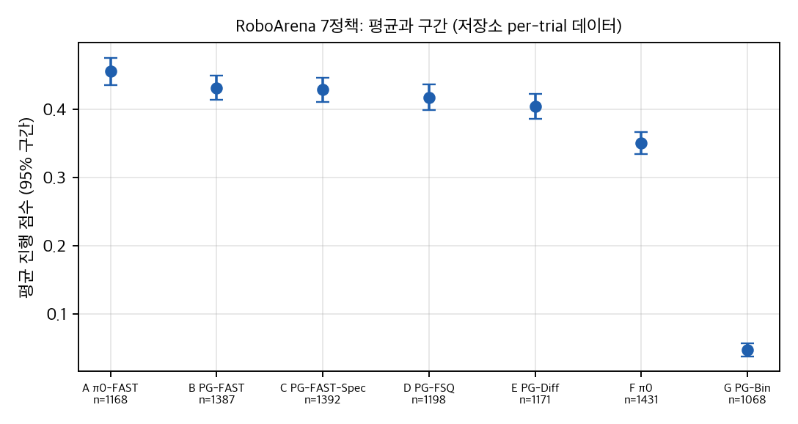
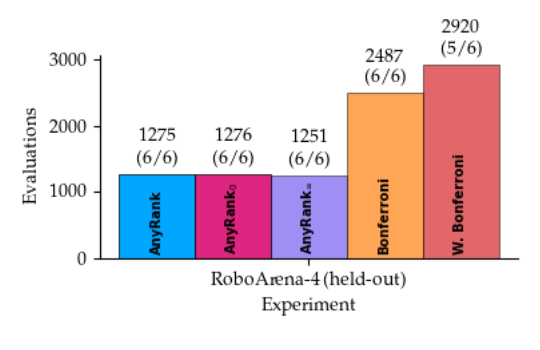
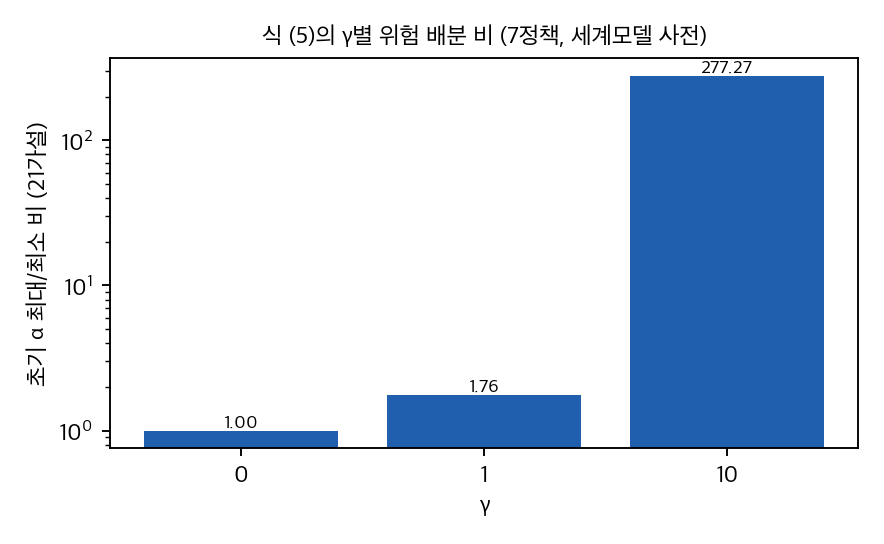
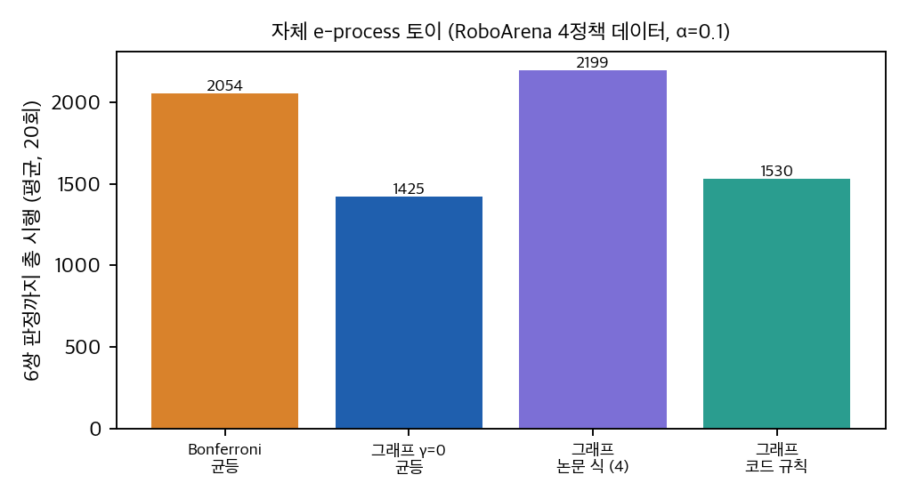

> **논문:** Badithela, Snyder, Yin, Sceats, Pappas, Matni, Itkina, Nishimura, Majumdar. *AnyRank: Reliable Anytime Policy Ranking via Sequential Testing.* CoRL 2026 포스터, arXiv:2610.14603 (v2, 2026-10-16).
> 공식 코드는 MIT 라이선스의 GitHub irom-princeton/AnyRank에 있습니다. 이 글의 그림은 논문 그림 한 장(출처 표기)과 우리가 그린 그래프입니다.

## 논문이 묻는 것

정책 여러 개를 20–30번의 하드웨어 시행으로 비교하면 순위는 우연으로 쉽게 뒤집힙니다. 선호 기반 Bradley-Terry(BT) 순위는 항상 완전한 순위를 내지만 오류율을 말해 주지 않습니다. AnyRank는 순위를 쌍별 가설 K = C(M,2)개의 다중 검정으로 보고, 쌍별로는 어느 시점에 멈춰도 유효한(anytime-valid) 순차 검정을, 다중성 보정에는 위험 예산을 재배분하는 그래프 절차를 씁니다. 시뮬레이터나 세계모델의 예측은 초기 위험 배분의 사전(prior)으로만 쓰고, 사전이 틀려도 가족별 오류율(FWER) 보장은 유지된다고 주장합니다.

## 이 글에서 확인한 것

**1. 표 3의 숫자는 공개 데이터와 맞습니다.** 저장소의 per-trial 데이터(RoboArena 14정책, 총 9025회)에서 계산한 정책 평균 14칸이 표 3과 소수 셋째 자리까지 같고, 비교 수 6칸도 선호 파일 행 수와 같습니다. 표 1 캡션의 평균은 A와 G에서 0.004 정도 다릅니다. 어떤 부분집합을 썼는지 논문에 적혀 있지 않아 저자 확인이 필요합니다.

*그래프 (우리가 그림). 저장소 per-trial 데이터로 계산한 평균과 95% 구간. 가운데 다섯 정책의 구간이 크게 겹칩니다.*

**2. 위험 재배분의 이득은 확인됩니다.** 논문 그림 4에서 RoboArena4의 총 시행은 AnyRank 1275, Bonferroni 2487입니다(그림 판독 값, 48.7% 감소). 같은 방향의 효과가 우리 토이에도 나타납니다. 직접 만든 e-process(N-SCORE가 아님)로 4정책 6쌍을 판정하는 데 Bonferroni는 평균 2054회, 그래프 재배분(γ=0)은 1425회가 필요했습니다(20회 반복, 약 31% 감소).

*그림 4 (논문 원문). © 저자, CC BY 4.0, 출처 arXiv:2610.14603. 막대 위 숫자는 총 시행 수와 판정 쌍 수입니다.*

**3. 사전의 이득은 작고, 표본 선택 식은 논문과 코드가 다릅니다.** 식 (5)에서 γ=1이면 7정책 21가설의 초기 위험 배분 최대/최소 비가 1.76이라 Holm에 가깝습니다. 식 (4)의 표본 선택 가중치 exp(p̂)는 p̂ ≤ α* = 0.1에서 비가 1.1 이하라 거의 균등합니다. 공식 코드는 가설을 exp(2α) − 1에 비례해 고르며, α 0.1 대 0.01의 가중치 비가 10.96입니다. 우리 토이에서는 논문식(평균 2199회)과 코드 규칙(1530회) 모두 균등 선택(1425회)보다 낫지 않았습니다(한 데이터, 한 구현의 결과이므로 일반화하지 않습니다).

*그래프 (우리가 그림). 7정책, 세계모델 사전, K = 21, α* = 0.1. γ=10이면 비가 277입니다.*

*그래프 (우리가 그림). RoboArena 4정책 데이터, α = 0.1, 20회 반복. N-SCORE가 아닌 자체 구현입니다.*

**4. 서술이 둘로 읽히는 곳이 있습니다.** 수건 접기의 세계모델이 본문 §5에서는 play data로 미세조정한 모델, 부록 E에서는 기성 Ctrl-World입니다. 저장소 데이터로 상관을 다시 계산하면 기성(base) 모델에서 r = 0.885, 미세조정(specialist)에서 0.868이고 논문 값은 0.89이므로 부록 서술과 맞습니다. 사전 상관 r = 0.05는 재계산에서 Pearson 0.017, Spearman −0.20이었습니다. "AnyRank requires fewer samples than AnyRank0 (204 vs. 195)"는 괄호 순서가 문장과 맞지 않아 보입니다. 모두 저자 확인이 필요합니다.

**5. 보장의 조건.** 정리 1은 FWER ≤ α*로 서술되지만, 두 정책의 평균이 정확히 같으면 어느 판정도 오류라 상한이 2α입니다(부록 C Remark 3). 공식 코드는 기본으로 동률이 없다고 가정하는 모드(`ranking_no_ties`)를 씁니다. 추이 폐포는 논문에서 최종 판정의 사후 필터(따름정리 1)인데 코드는 그래프 루프 안에서 함의된 가설을 기각하고 그 예산을 재배분합니다.

## 한계와 구현 가능성

핵심 쌍별 검정(N-SCORE)은 저장소 밖 패키지(README 기준 CC BY-NC 4.0)라 p-value 계산은 확인하지 못했고, 그림 5–7의 판정 수는 재현하지 않았습니다. 알고리즘 자체는 numpy만으로 구현할 수 있어 이 글의 토이로 시험했습니다. 세계모델 사전과 실로봇 평가는 GPU·로봇이 필요합니다. 공식 코드의 `scripts/irom_data.py`에는 클러스터 절대 경로가 들어 있어 그대로는 실행되지 않습니다.

## 마무리

정리하면, 순위 신뢰도를 "몇 쌍이 판정되었는가"로 보고하는 형식과 위험 재배분은 작은 하드웨어 예산에 실용적입니다. 이득의 대부분은 사전이 아니라 재배분에서 나오며, 능동 표본 선택의 효과는 논문의 식만으로는 판단하기 어렵습니다. 표본 선택 식, 합성 실험(표 2)의 설정과 반복 수는 저자 확인이 필요합니다.

## 자료

- [통합 리포트 PDF](report/report_public.pdf)
- [01. 논문 분석: AnyRank (arXiv:2610.14603)](analysis/01_paper_analysis.md)
- [02. 선행연구와 코드 저장소](analysis/02_prior_work.md)
- [03. 수치 재계산과 일관성 검사](analysis/03_analysis.md)
- [04. 공식 코드 정적 대조](analysis/04_code_verification.md)
