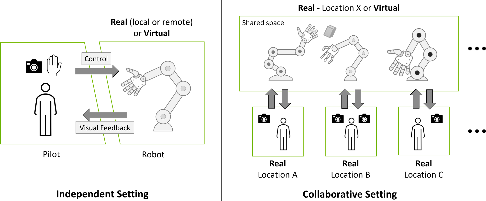
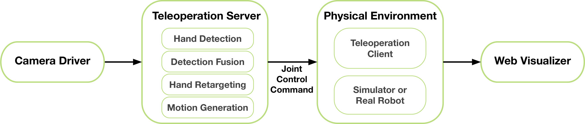
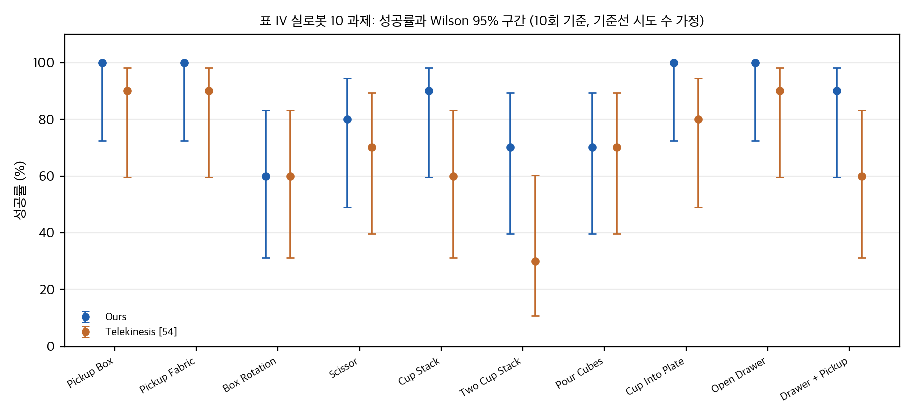
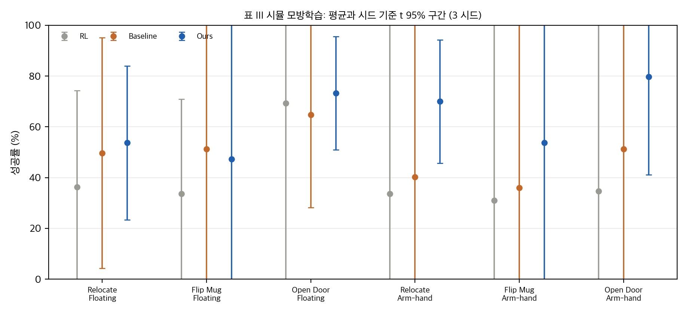
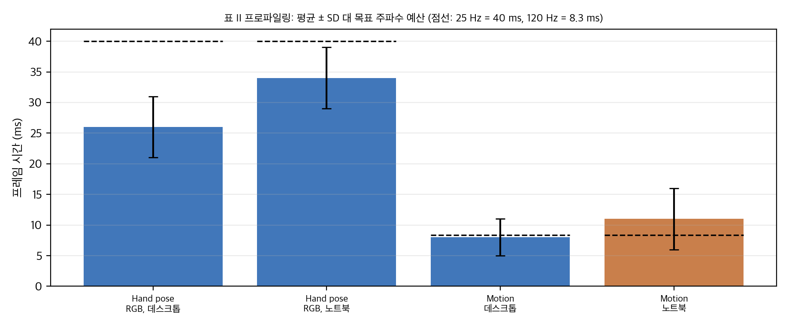

> **논문:** Yuzhe Qin, Wei Yang, Binghao Huang, Karl Van Wyk, Hao Su, Xiaolong Wang, Yu-Wei Chao, Dieter Fox. *AnyTeleop: A General Vision-Based Dexterous Robot Arm-Hand Teleoperation System.* RSS 2023, arXiv:2307.04577 (v3, 2024-05-16).
> 공식 코드는 리타게팅 라이브러리(dex-retargeting)와 웹 뷰어(sim-web-visualizer)이며 둘 다 MIT입니다. 이 글의 그림은 논문 도식 두 장(출처 표기)과 우리가 그린 그래프 세 장입니다.

## 논문이 묻는 것

원격조작으로 시연을 모으려면 장비가 비쌉니다. 장갑, VR, 모션캡처가 흔합니다. 영상 기반 손 추적은 싸지만, 지금까지의 시스템은 특정 로봇과 특정 스튜디오에 맞춰 만들어져 다른 팔-손이나 시뮬레이터로 옮기기 어렵습니다.

AnyTeleop은 이 문제를 **모듈형 서버**로 풉니다. 카메라 영상에서 손 자세를 추정하고, 카메라 여러 대를 융합하고, 손가락 키포인트를 로봇 손 관절로 최적화하고, 팔의 충돌 회피 궤적을 만듭니다. 시뮬레이터(IsaacGym, SAPIEN)와 실로봇은 같은 인터페이스로 연결되고, 웹 뷰어는 브라우저에서 원격으로 볼 수 있게 합니다.

*그림 2 (논문 원문). © 저자, CC BY 4.0, 출처 arXiv:2307.04577.*

*그림 3 (논문 원문). © 저자, CC BY 4.0, 출처 arXiv:2307.04577.*

## 이 글에서 확인한 것

**1. 성능 우위는 방향만 맞습니다.** 실로봇 XArm6와 Allegro 과제 10개에서 AnyTeleop은 8개에서 기준선보다 높고 2개에서 같습니다. 그러나 과제당 10회라서 과제별 Fisher 검정 p는 모두 0.18 이상입니다. 기준선은 Telekinesis 논문의 값을 옮긴 것이고 시도 수가 없습니다.

*그래프 (우리가 그림). 논문 표 IV의 값을 다시 그렸습니다. 기준선 시도 수는 10회로 가정했습니다.*

**2. 시뮬 모방학습도 같은 한계가 있습니다.** 시뮬 세 과제(Relocate, Flip Mug, Open Door)의 두 변형에서 AnyTeleop 평균은 기준선보다 여섯 조건 중 다섯 곳에서 높습니다. 시드가 3개라서 시드 기준 Welch p는 0.25에서 0.89입니다.

*그래프 (우리가 그림). 논문 표 III의 평균과 SD를 3 시드 t 분포 구간으로 다시 그렸습니다.*

**3. 독립 단위를 잘못 잡으면 같은 숫자가 과대 확신을 줍니다.** 300 시행을 독립으로 풀링하면 팔-손 과제의 p는 10^-13 수준이 됩니다. 정책 학습의 시드 분산이 실제 불확실성입니다. 시드를 단위로 두어야 합니다.

**4. 공식 코드와 논문 식 (1)이 다릅니다.** 논문은 키포인트 오차를 제곱으로 쓰지만, 공개된 리타게팅 코드는 거리에 Huber 손실을 씁니다. 시간 매끄러움 항은 목적함수 값에는 빠지고 기울기에만 들어 있습니다. 출력에는 논문에 없는 저역통과 필터(α = 0.1)가 기본으로 켜져 있습니다. 이것들은 코드를 읽어서 확인한 차이이고, 실행해서 확인하지는 않았습니다.

**5. 노트북에서는 120 Hz 동작 생성이 평균으로도 맞지 않습니다.** 논문 표 II에서 동작 생성은 노트북 11 ± 5 ms, 데스크톱 8 ± 3 ms입니다. 120 Hz의 예산은 8.33 ms라서 노트북은 맞지 않고 데스크톱은 경계입니다.

*그래프 (우리가 그림). 논문 표 II의 값을 25 Hz(40 ms)와 120 Hz(8.3 ms) 예산과 비교했습니다. 주황색은 평균이 예산을 넘는 모듈입니다.*

## 구현 가능성 (Apple M4 Pro, CUDA 없음)

- **전체 시스템: 재현 불가.** 서버 본체(손 검출, 융합, 동작 생성, 클라이언트)가 공개되지 않았습니다. CuRobo 동작 생성은 CUDA를 전제합니다. 실로봇과 GPU 학습이 필요합니다.
- **리타게팅과 웹 뷰어: CPU로 가능성이 있습니다.** 두 저장소는 MIT이고 소스에서 CUDA 호출을 찾지 못했습니다. 다만 리타게팅 코드는 torch를 선언하지 않은 채 import하고 있어서, 설치와 실행은 아직 하지 않았습니다.
- **노력 추정 (측정 전):** 리타게팅 재구현과 대조 1–2일, 동작 생성까지 포함한 서버 재구현 2–4주입니다.

이 글은 재현 실험을 하지 않았습니다. 재현은 사용자 확인 뒤에 시작하는 것이 맞습니다.

## 한계

- 실로봇 시도는 과제당 10회입니다. 기준선의 시도 수와 조건은 논문에 없습니다.
- 시뮬 비교에서 기준선의 팔-손 시연은 떠 있는 손 시연을 변환해 만들었고, AnyTeleop은 팔-손으로 직접 모았습니다. 차이가 조작 품질에서 왔는지 변환 방식에서 왔는지 분리되지 않습니다.
- 협업 원격조작은 시연 한 장면만 있고 정량 결과가 없습니다. 카메라 구성 실험(부록 표 V)도 시도별 값과 표준편차가 없습니다.
- "매끄럽다", "충돌이 없다", "지연이 낮다"는 측정 결과가 없습니다.
- 논문 부록의 프로젝트 주소(`anyteleop.com`)는 무관한 사이트이고, 프로젝트 페이지(`yzqin.github.io/anyteleop`)는 현재 404입니다. 2025-11-18 보관본으로 두 저장소 링크를 확인했습니다.

## 출처와 라이선스

- 논문: arXiv:2307.04577, CC BY 4.0(arXiv 라이선스 페이지 확인). 원문 PDF에 저작권 표시는 찾지 못했습니다. RSS 2023 proceedings는 DOI 10.15607/RSS.2023.XIX.015입니다.
- 그림 2와 3은 원문에서 잘라 실었습니다(© 저자, CC BY 4.0). 로봇 사진, 사람 손 사진, 시뮬 화면은 싣지 않았습니다.
- 표 값은 인용과 재계산을 위해 옮겼습니다. 그래프, 분석 문서와 스크립트는 이 글의 작성자가 만들었습니다.
- 공식 코드는 얕게 복제해 정적으로만 읽었습니다. 실행, 설치, 가중치와 데이터 다운로드는 하지 않았습니다.

## 자료

- [통합 리포트 PDF](report/report_public.pdf)
- [01. 논문 분석: AnyTeleop](analysis/01_paper_analysis.md)
- [02. 선행연구와 관련 자료](analysis/02_prior_work.md)
- [03. 재계산, 일관성 검사, 주장 판정](analysis/03_analysis.md)
- [04. 공식 코드 대조와 구현 가능성](analysis/04_code_verification.md)
