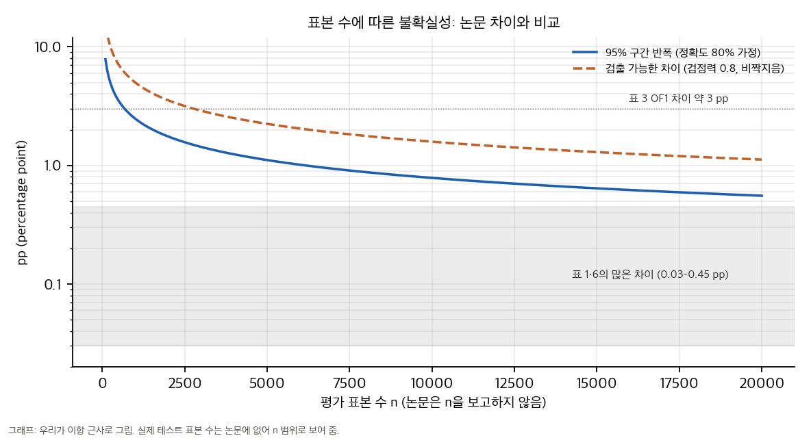
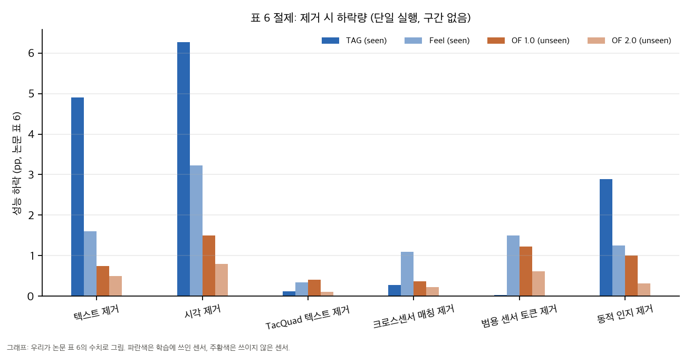

# AnyTouch: 수치 재계산, 일관성 검사, 주장 판정

재현 실험은 하지 않았습니다. 논문 표의 값만 다시 계산하고, 표끼리 맞는지 검사하고, 본문 주장을 그 값으로 판정합니다. 계산 스크립트는 `analysis/recompute.py`(수 초, numpy·scipy), 결과는 `analysis/recompute_results.json`, 그림은 `analysis/plot_figures.py`로 만듭니다. 토이 실험은 만들지 않았습니다. 논문 주장의 핵심은 대규모 사전학습 효과이고, CPU 토이로는 그 주장을 검증할 수 없기 때문입니다.

**통계의 한계 (먼저 밝힙니다).** 논문은 대부분의 표에 표본 수(테스트 샘플 수)와 표준편차, 시드 수를 적지 않았습니다. 그래서 "실제 시행 수"로 검정할 수 있는 것은 실로봇 표 4(10회)뿐입니다. 분류 정확도 표는 n을 가정한 민감도 분석만 할 수 있습니다. 모든 차이는 단일 실행이라고 가정합니다.

## 1. 재계산과 검정

### 1.1 표 1·표 6 산술 검사

- 표 1: 증분 16개를 다시 계산해 모두 맞습니다. ↑/↓ 표기도 맞습니다. 주의할 점은 1행만 CLIP 대비이고 2행 이후는 바로 앞 행 대비라는 것입니다.
- 표 6: 32개 중 31개가 맞습니다. **"w/o Universal Sensor Tokens"의 Feel 열: 80.53 − 79.03 = 1.50인데 표는 1.53**입니다. 0.03 pp 차이이며 결론을 바꾸지 않습니다. 이후 계산은 원표(1.53)와 재계산값(1.50)을 함께 봅니다.

### 1.2 표 3 차이 (같은 데이터 대 같은 데이터, 전체 대 전체)

| 비교 | 값 | 차이 |
|---|---|---|
| OF1: AnyTouch(UniTouch 데이터) − UniTouch | 46.50 − 41.3 | **+5.20 pp** |
| OF1: AnyTouch(전체) − UniTouch† | 49.62 − 47.25 | +2.37 pp |
| OF2: AnyTouch(UniTouch 데이터) − UniTouch (OF2 학습됨) | 85.87 − 85.4 | +0.47 pp |
| OF2: AnyTouch(전체) − UniTouch† | 76.02 − 75.29 | +0.73 pp |
| OF2: AnyTouch(전체) − UniTouch (OF2 학습됨) | 76.02 − 85.4 | **−9.38 pp** (본문 언급 없음) |

UniTouch†와 전체 AnyTouch는 학습 데이터가 다릅니다(부록 A.4). 같은 데이터를 쓴 짝만 공정 비교입니다. OF2 행은 UniTouch가 그 데이터로 학습한 것이라서 "보지 못한 센서" 비교가 아닙니다. 그래도 전체 AnyTouch가 OF2에서 9.4 pp 낮다는 사실은 본문이 언급하지 않습니다.

### 1.3 표 7 상대 감소

| 쌍 | T3 MSE | AnyTouch MSE | 상대 감소 |
|---|---|---|---|
| GelSight Mini → DuraGel | 0.2261 | 0.2159 | 4.5% |
| GelSight Mini → Tac3D | 0.0167 | 0.0151 | 9.6% |
| DIGIT → Tac3D | 0.0155 | 0.0144 | 7.1% |

AnyTouch는 T3보다 적은 데이터(2.48M 대 3.08M)로 학습했습니다. 방향은 모두 같습니다. 반복 실행과 구간이 없어 크기의 신뢰도는 판단할 수 없습니다.

### 1.4 표 4 실로봇 pouring: 10회, 표준편차 없음

보고된 값은 평균뿐입니다. 두 군이 같은 표준편차 s를 가진다고 가정하고, 10회씩의 Welch(Student) 검정에서 p < 0.05가 되는 최대 s를 계산했습니다. 임계값은 t(18, 0.975) = 2.101입니다. 계산은 Δ / (2.101 × √(2/10))입니다.

| 비교 | 평균 차이 (g) | p < 0.05가 되는 최대 SD (g) | 판단 |
|---|---|---|---|
| 동적 AnyTouch vs 정적 AnyTouch (미세조정) | 0.89 (1.56 vs 2.45) | 0.95 | SD가 0.95 g 이하일 때만 유의. 보고 없음 |
| 정적 AnyTouch vs T3 (미세조정) | 0.12 (2.45 vs 2.33) | 0.13 | 두 방법은 구분되지 않음. "비슷하다"는 말은 가능하지만 통계는 없음 |
| 동적 AnyTouch vs 정적 AnyTouch (동결) | 1.38 (8.22 vs 9.60) | 1.47 | 판단 불가 |
| 동적 AnyTouch vs T3 (동결) | 1.52 (8.22 vs 9.74) | 1.62 | 판단 불가 |
| 정적 AnyTouch vs T3 (동결) | 0.14 (9.60 vs 9.74) | 0.15 | 구분되지 않음 |

결론: 실로봇 결과는 방향(동적 > 정적 ≈ T3 > CLIP)만 말할 수 있습니다. 표준편차를 보고하지 않았기 때문에 "최고 성능"이라는 말은 증명되지 않았습니다.

### 1.5 이항 정확도의 구간과 검출 가능한 차이 (n 가정)

논문은 테스트 표본 수를 적지 않았습니다. 정확도 p = 0.8을 가정하고 n에 따라 계산했습니다(`own_sensitivity.png`).

| n | 95% 구간 반폭 (pp) | 검출 가능한 차이, 비짝지음, 검정력 0.8 (pp) |
|---|---|---|
| 500 | 3.5 | 7.1 |
| 2,000 | 1.8 | 3.5 |
| 10,000 | 0.8 | 1.6 |

- 표 1의 후반 행(0.04–0.45 pp), 표 6의 TacQuad 텍스트 제거(0.11–0.41 pp)는 n이 수만 이하이면 검출 범위 밖입니다. 표 6의 범용 센서 토큰 제거 OF2(0.62 pp)도 n ≈ 2,000 이하에서는 검출되지 않습니다. 짝지은 비교(같은 테스트 샘플)라면 검정력이 올라가지만, 논문은 짝 정보를 주지 않았습니다.
- 표 3의 OF1 차이는 5.20 pp이면 n ≈ 900 이상, 2.37 pp이면 n ≈ 4,500 이상에서 검출 가능합니다 (비짝지음, p = 0.8 가정).

그림: 우리가 이항 근사로 그린 그래프. 논문은 n을 보고하지 않아 n 범위로 보여 줍니다.

### 1.6 절제 하락 (표 6)

그림: 우리가 표 6의 수치로 그린 그래프. 파란색은 학습에 쓰인 센서(TAG, Feel), 주황색은 쓰이지 않은 센서(OF1, OF2)입니다.

| 제거한 구성 | 보는 센서 평균 (TAG, Feel) | 보지 못한 센서 평균 (OF1, OF2) | 가장 큰 하락 |
|---|---|---|---|
| 크로스 센서 매칭 | 0.69 | 0.30 | Feel (1.10) |
| 범용 센서 토큰 | 0.77 | 0.92 | Feel (1.50, 원표 1.53) |

## 2. 일관성 검사 (K)

| 번호 | 검사 | 결과 |
|---|---|---|
| K1 | 표 1 증분과 ↑/↓ 표기 (16개) | 일치 |
| K2 | 표 6 하락량 (32개) | 31개 일치. **Feel, 범용 센서 토큰 제거: 1.50 대 원표 1.53** (사소) |
| K3 | 표 5 행별 크기의 합 대 본문 총합 | **불일치.** 표 5 합계 2,909.5천 장, 부록 A.1은 2,481,703장. 차이 약 428천 장 |
| K4 | 표 1 첫 행 누적 (TAG+VisGel+Cloth) 대 표 5 | **불일치.** 표 1은 996천, 표 5는 1,424천 (250 + 587 + 587) |
| K5 | 표 1 마지막 행 누적 + TacQuad 대 부록 A.1 총합 | 일치 (2,427 + 55 = 2,482천, 반올림 범위) |
| K6 | 정밀 쌍 17,524 + 거친 쌍 55,082 = 72,606 (서론, 그림 1) | 일치. 30세트·25물체, 151세트·99물체도 §3, 그림 1, README에서 같음 |
| K7 | CLIP 기준선 값 (표 1, 2, 3) | 일치 (52.96, 72.37, 41.00, 73.16) |
| K8 | README 표의 전체 모델 값 대 논문 표 2, 3 | 일치 (80.82 / 86.74 / 94.68, 80.53, 49.62, 76.02) |
| K9 | 표 7 학습 데이터 크기 대 부록 A.10 | 일치 (3.08M, 2.48M) |
| K10 | 표 2 본문 "UniTouch 데이터 학습 AnyTouch가 네 과제 모두에서 UniTouch를 앞선다" | **과장.** UniTouch는 TAG 거칠기·단단함을 보고하지 않아 비교 가능한 것은 두 과제 |
| K11 | 표 2 본문 "TLV-Link†가 TAG 세 과제 모두에서 단일 센서 모델을 앞선다" | 일치 |
| K12 | 부록 A.9 본문 "보지 못한 센서에서 주로 하락" (크로스 센서 매칭, 범용 토큰) | **표와 불일치.** §1.6 참조 |
| K13 | 표 3 캡션 "OF 1.0과 OF 2.0은 보지 못한 센서" 대 하단 각주 "OF 2.0은 UniTouch와 같은 데이터 AnyTouch에서 학습됨" | 용어 불일치. OF2.0은 두 방법 중 하나에는 학습에 쓰였습니다 |
| K14 | 표 4 본문 "동결 상태에서 CLIP은 어려움" (49.1) | 일치 |
| K15 | 표 2 캡션 "UniTouch는 Feel을 학습" 대 본문 "보지 못한 데이터셋 Feel" (§5.4) | 용어 불일치. Feel은 보는 센서(GelSight)의 보지 못한 데이터셋으로 쓰였지만, 표 2 캡션은 Feel이 UniTouch·AnyTouch에게 "seen"이라고 함 |

## 3. 주장 판정 (C)

판정 기호: **지지** (표 값과 방향이 일치하고 크기가 구간 밖), **부분 지지** (일부만 맞음), **판단 불가** (구간·표준편차·표본 수가 없음), **반박** (표 값과 반대).

| 번호 | 논문 주장 (위치) | 근거 값 | 판정 |
|---|---|---|---|
| C1 | 데이터가 늘수록 보지 못한 센서 성능이 오른다 (§5.2, 표 1) | OF1 +1.43, +0.45, +0.75; OF2 +0.43, +0.04, +0.09; Feel +0.16, −0.18, +0.30 | **부분 지지.** OF1은 방향이 일관. 나머지는 0.5 pp 이하이고 구간 없음 |
| C2 | 보지 못한 센서에서 개선이 보는 센서보다 크다 (§5.2) | 세 단계 모두 OF1 증가가 Feel 증가보다 큼: OF Real 추가 +1.43 대 +0.16, TVL·SSVTP·YCB 추가 +0.45 대 −0.18, Octopi 추가 +0.75 대 +0.30 | **부분 지지.** 방향은 세 단계 모두 맞지만 차이는 0.5–1.3 pp이고 구간이 없음 |
| C3 | AnyTouch(UniTouch 데이터)는 UniTouch를 네 과제 모두에서 앞선다 (§5.4) | 비교 가능 두 과제: TAG 재질 +21.4, Feel +4.9. 나머지 두 과제는 UniTouch 값 없음 | **반박 (과장).** 비교 가능한 과제에서는 앞섬. "네 과제 모두"는 증명 불가 |
| C4 | 전체 AnyTouch가 TAG 거칠기·단단함에서 최고 (§5.4) | 86.74 대 TLV-Link† 85.94 (+0.80), 94.68 대 94.18 (+0.50) | **판단 불가.** 구간과 시드 없음. 차이가 1 pp 미만 |
| C5 | 같은 데이터에서 AnyTouch가 UniTouch보다 OF1에서 높다 (§5.5, 표 3) | 46.50 대 41.3 (+5.20) | **지지 (단일 실행).** 큰 차이이나 두 방법의 테스트 프로토콜이 같은지 확인할 수 없음 (`04` D8) |
| C6 | 전체 AnyTouch가 OF1에서 최고 (§5.5) | 49.62 대 UniTouch† 47.25 (+2.37) | **부분 지지.** 데이터가 달라 공정 비교가 아님. OF2에서는 같은 표에서 UniTouch가 더 높음 (−9.38, 같은 데이터 짝이 아님) |
| C7 | 매칭 학습은 센서 불변 표현을 만든다 (§5.3, 그림 4) | t-SNE 정성 비교만 있음. 정량 지표 없음 | **판단 불가 (정성적 지지만).** |
| C8 | 텍스트와 시각 모달이 기여한다 (부록 A.9, 표 6) | 텍스트 제거 TAG −4.91, Feel −1.60, OF1 −0.75, OF2 −0.50; 시각 제거 −6.27, −3.23, −1.50, −0.80 | **지지 (단일 실행).** 시각 쪽이 크다는 논문 단서도 표와 맞음 |
| C9 | 정밀·거친 쌍 TacQuad의 텍스트가 도움이 된다 (A.9, 표 6) | TacQuad 텍스트 제거: 0.12, 0.34, 0.41, 0.11 | **판단 불가.** 효과가 작아 노이즈 범위일 수 있음 (§1.5) |
| C10 | 크로스 센서 매칭 제거의 하락은 주로 보지 못한 센서에서 나타난다 (A.9) | 보는 센서 평균 0.69 (Feel 1.10 최대), 보지 못한 센서 평균 0.30 | **반박.** 하락은 보는 센서 Feel에서 가장 큼 |
| C11 | 범용 센서 토큰 제거의 하락은 주로 보지 못한 센서에서 나타난다 (A.9) | 보는 센서 평균 0.77 (Feel 1.50), 보지 못한 센서 평균 0.92 (OF1 1.22). TAG는 0.03 | **부분 반박.** 평균은 보지 못한 쪽이 조금 크나, 최대 하락은 Feel (보는 센서) |
| C12 | 2단계 제거 시 OF2에서 CLIP보다 나쁘다 (A.9) | 2단계 제거 OF2 73.09 대 CLIP 73.16 (−0.07) | **방향만 지지.** 차이가 구간 안에 있음 |
| C13 | 2단계 제거가 가장 큰 하락 (A.9, 표 6) | TAG −12.18, Feel −8.14, OF1 −3.12, OF2 −2.93 | **지지.** 가장 큰 효과 |
| C14 | 동적 인지가 정적 인지를 높인다 (A.9, 표 6) | 제거 시 TAG −2.89, Feel −1.25, OF1 −1.00, OF2 −0.32 | **지지 (단일 실행).** 네 열 모두 같은 방향 |
| C15 | 실로봇: 정적 AnyTouch는 T3와 비슷하다 (§5.6, 표 4) | 2.45 대 2.33 (Δ 0.12 g). 유의하려면 SD ≤ 0.13 g | **판단 불가.** 방향은 맞으나 SD가 없음 |
| C16 | 실로봇: 동적 인지 AnyTouch가 가장 좋다 (§5.6, 표 4) | 1.56 대 2.45 (Δ 0.89 g). 유의하려면 SD ≤ 0.95 g | **판단 불가 (구조상 가장 좋은 값은 맞음).** 10회 SD 없음 |
| C17 | 교차 센서 생성에서 T3보다 낫다 (A.10, 표 7) | MSE 4.5–9.6% 감소 (데이터는 더 적음) | **지지 (단일 실행).** 구간 없음 |
| C18 | 코드, TacQuad, 모델을 공개했다 (초록) | GitHub MIT (커밋 `9c43a1a`), HF TacQuad (license mit), 체크포인트는 Drive | **지지 (공개 확인).** 체크포인트는 받지 않았음 |
| C19 | 공개 데이터 TacQuad 규모 (§3) | 72,606 프레임 (K6) | **지지.** 표 5와 A.1의 합계는 맞지 않음 (K3, K4) |
| C20 | 텍스트 1.4M 샘플 (§4.3) | 데이터셋별 수가 없음 | **판단 불가.** |
| C21 | GPT-4o 주석은 충분히 정확하다 (A.7) | "간단하고 거친 샘플 점검"만 있음. 오류율 없음 | **판단 불가.** |

## 4. 요약: 이 논문에서 믿을 수 있는 것과 아닌 것

- **믿을 만한 것**: 정렬 구성과 동적 인지 구성이 여러 데이터셋에서 같은 방향으로 도움이 된다는 점 (C8, C13, C14). TacQuad의 구성과 규모 (K6). 학습 설정은 코드와 대부분 일치합니다 (`04`).
- **조심해야 하는 것**: "보지 못한 센서"에 대한 전이 주장 (C2, C10, C11). 표 6이 가장 큰 하락을 보는 센서 Feel에서 보여 주기 때문입니다. "모든 과제에서 최고"라는 주장 (C3, C4). 실로봇 주장 (C15, C16).
- **재확인이 필요한 것**: 표 3 OF2 행의 센서 ID 문제 (`04_code_verification.md` D7)와 테스트 최고치 보고 (`04` D8). 둘 다 체크포인트와 데이터를 받아 확인해야 합니다.

## 5. 재계산 방법과 한계

- 모든 검정은 논문 표 값으로만 합니다. 원자료, 표본 수, 시드 정보는 없습니다.
- 실로봇 검정은 "같은 SD" 가정을 둡니다. 실제 SD가 다르면 결과가 달라질 수 있습니다.
- 이항 근사는 정확도 p = 0.8을 가정합니다. p = 0.5에서는 구간이 더 넓습니다.
- 표 2와 3의 프로토콜(선형 탐침인지 전체 미세조정인지)은 본문에서 명확하지 않습니다. 표 3 캡션만 "선형 탐침"이라고 씁니다.
