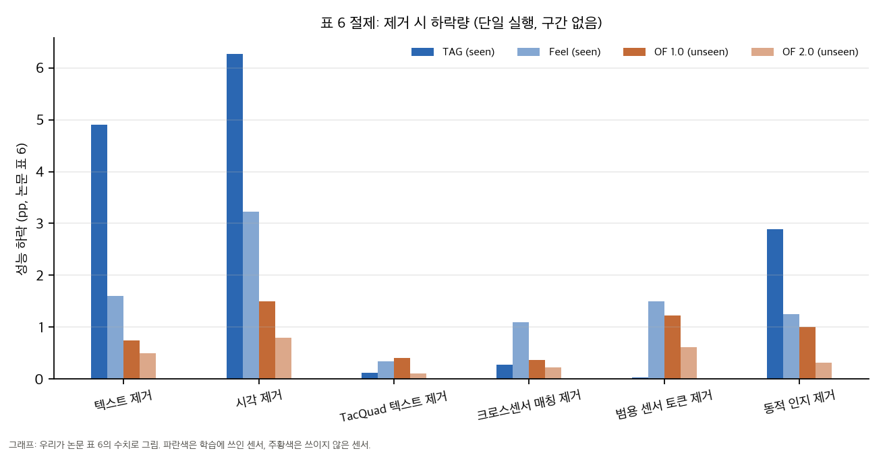
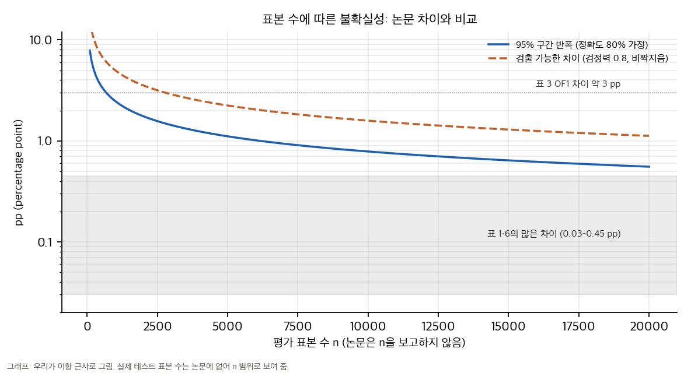
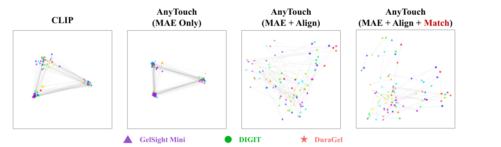

> **논문:** Ruoxuan Feng, Jiangyu Hu, Wenke Xia, Tianci Gao, Ao Shen, Yuhao Sun, Bin Fang, Di Hu. *AnyTouch: Learning Unified Static-Dynamic Representation across Multiple Visuo-tactile Sensors.* ICLR 2025 (Poster), arXiv:2502.12191 (v3, 2025-04-01).
> 공식 코드는 GitHub GeWu-Lab/AnyTouch(MIT)에 있습니다. 이 글의 그림은 우리가 논문 수치로 그린 그래프 두 장과 논문 그림 한 장(출처 표기)입니다.

## 논문이 묻는 것

촉각 센서는 표준이 없습니다. 같은 접촉이라도 GelSight Mini, DIGIT, 자체 제작 젤, 힘장 센서는 서로 다른 이미지를 냅니다. 센서마다 데이터를 따로 모으면 규모가 작고, 여러 센서의 데이터를 그냥 합치면 표현 공간이 나뉘어 전이가 약합니다.

AnyTouch는 두 가지를 함께 합니다. 첫째, 같은 물체의 같은 위치를 여러 센서로 누른 **쌍 데이터(TacQuad)**를 만듭니다. 둘째, 정적 입력(촉각 이미지)과 동적 입력(촉각 비디오)을 같은 토큰 형식으로 처리하는 **다단계 학습**을 씁니다. 1단계는 마스크 모델링으로 픽셀 수준 세부를 익히고, 2단계는 텍스트를 앵커로 한 정렬과 "같은 위치인가"를 묻는 크로스 센서 매칭으로 센서에 무관한 의미 표현을 익힙니다. 센서 토큰을 확률적으로 범용 토큰으로 바꾸는 장치도 있습니다.

## 이 글에서 확인한 것

**1. 구성요소 절제는 방향이 대체로 맞습니다.** 표 6에서 2단계를 빼면 보는 센서 TAG 재질 분류가 12.2 pp 떨어집니다. 동적 인지를 빼면 네 데이터셋 모두 떨어집니다. 시각 모달을 빼는 쪽이 텍스트를 빼는 쪽보다 큽니다. 다만 모두 단일 실행이고 구간이 없습니다.

*그래프: 우리가 논문 표 6 값으로 그렸습니다. 파란 막대는 학습에 쓰인 센서, 주황 막대는 쓰이지 않은 센서입니다.*

**2. "보지 못한 센서로의 전이" 해석은 표와 맞지 않습니다.** 논문은 크로스 센서 매칭과 범용 센서 토큰을 빼면 떨어지는 곳이 주로 보지 못한 센서라고 씁니다. 그런데 표 6에서 가장 크게 떨어지는 곳은 두 경우 모두 **보는 센서 Feel**입니다 (각각 1.10 pp, 1.53 pp). 보지 못한 센서의 평균 하락이 보는 센서보다 큰 경우는 토큰 제거뿐이고, 그나마도 Feel 하나가 최대입니다.

**3. "네 과제 모두에서 UniTouch를 앞선다"는 두 과제만 비교할 수 있습니다.** UniTouch는 TAG 거칠기와 단단함을 보고하지 않았습니다. 비교 가능한 두 과제에서는 AnyTouch가 앞섭니다 (재질 82.74 대 61.3, Feel 87.17 대 82.3).

**4. 보지 못한 센서 평가에서 같은 데이터 짝을 보면 차이가 큽니다.** 같은 데이터로 학습한 AnyTouch와 UniTouch를 OF 1.0에서 비교하면 46.50 대 41.3, 5.2 pp 차이입니다. 그러나 전체 데이터 AnyTouch는 OF 2.0에서 UniTouch보다 9.4 pp 낮습니다. 이 점은 본문이 언급하지 않습니다. 표 3의 OF 2.0 행은 UniTouch가 그 데이터로 학습했기 때문에 "보지 못한 센서" 비교도 아닙니다.

*그래프: 우리가 이항 근사로 그렸습니다. 논문은 테스트 표본 수를 보고하지 않아 n 범위로 보여 줍니다. 표 1 후반 행과 표 6의 TacQuad 텍스트 제거 차이는 이 범위에서 구분되지 않습니다.*

**5. 실로봇 결과는 10회 평균뿐입니다.** pouring 과제에서 동적 AnyTouch가 정적 AnyTouch보다 평균 0.89 g 적게 틀렸습니다. 두 군의 표준편차가 0.95 g 이하여야 유의합니다. 표준편차를 보고하지 않아 이 결과를 판단할 수 없습니다.

**6. 데이터 규모 수치가 표끼리 맞지 않습니다.** 표 5의 행별 합계는 약 2,910천 장이고, 부록 A.1의 총합은 2,481,703장입니다. 표 1의 첫 행 누적 996천 장과 표 5의 TAG+VisGel+Cloth 1,424천 장도 다릅니다. TacQuad 자체의 72,606 프레임 (정밀 17,524 + 거친 55,082)은 서론, 그림 1과 맞습니다.

*그림 4 (논문 원문, © 저자, CC BY 4.0, 출처 arXiv:2502.12191). CLIP은 센서별로 묶이고, 매칭을 더하면 센서가 섞여 물체 기준으로 모입니다. 정량 지표는 없습니다.*

## 공식 코드를 읽으며 발견한 것

공식 저장소 GeWu-Lab/AnyTouch (MIT, 커밋 `9c43a1a`, 2026-01-13 기준)를 **설치나 실행 없이** 정적으로 읽었습니다. 논문과 다른 곳이 여럿 있습니다.

- 2단계 손실에 MAE 재구성 항이 남아 있습니다. 논문 식 (9)에는 없습니다.
- 정렬과 매칭을 한 스텝에 합치지 않고 배치마다 번갈아 계산합니다.
- 매칭 헤드는 MLP가 아니라 선형층 하나입니다.
- 음성 샘플에서 같은 물체의 다른 위치를 뺍니다. 논문은 이를 음성에 넣는다고 씁니다.
- 학습 스크립트가 정의되지 않은 인자 `args.no_text`를 참조합니다. 정적으로 보면 시작 단계에서 멈출 수 있습니다.
- 선형 탐침 평가는 에폭마다 테스트 집합 정확도를 기록하고 최고값을 저장합니다. 테스트 집합으로 에폭을 고르면 결과가 낙관적으로 나옵니다.
- OF 2.0 평가는 학습 코드에서 한 번도 쓰이지 않은 센서 ID 5를 씁니다. 범용 토큰을 써야 한다는 논문의 설명과 다릅니다. 체크포인트를 받지 않아 실제 값은 확인하지 못했습니다.

## 재현 가능성

- **사전학습 재현은 이 맥에서 불가능합니다.** 논문 설정은 A800 4장 기준이고, 코드는 CUDA 전용입니다.
- **체크포인트 추론과 선형 탐침 재평가는 조건부로 가능합니다.** 데이터 다운로드와 코드 수정이 먼저 필요합니다.
- **실로봇 pouring 재현은 불가능합니다.** xArm 6, GelSight Mini, 데모 수집이 필요합니다.

## 정리

AnyTouch의 **구성 요소 설계**(픽셀 수준 마스크 모델링, 텍스트 앵커 정렬, 두 층 데이터 수집)는 촉각 표현 연구에서 참고할 만합니다. 반면 **보지 못한 센서로의 전이**를 뒷받침한다는 절제 해석과 실로봇 우위는 지금 표 수준에서는 확정할 수 없습니다. 공식 코드를 쓸 때는 2단계 손실, 음성 샘플 정의, OF 2.0 센서 ID, 테스트 집합 최고값 보고를 먼저 확인해야 합니다.

## 자료

- [통합 리포트 PDF](report/report_public.pdf)
- [AnyTouch: 논문 분석](analysis/01_paper_analysis.md)
- [AnyTouch: 선행 연구, 가까운 대안, 공식 저장소](analysis/02_prior_work.md)
- [AnyTouch: 수치 재계산, 일관성 검사, 주장 판정](analysis/03_analysis.md)
- [AnyTouch: 공식 코드 대조 (D1–D11)](analysis/04_code_verification.md)
