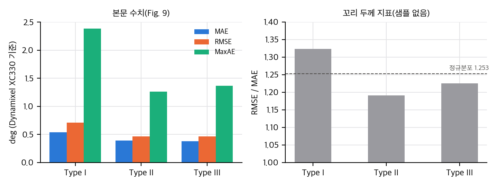
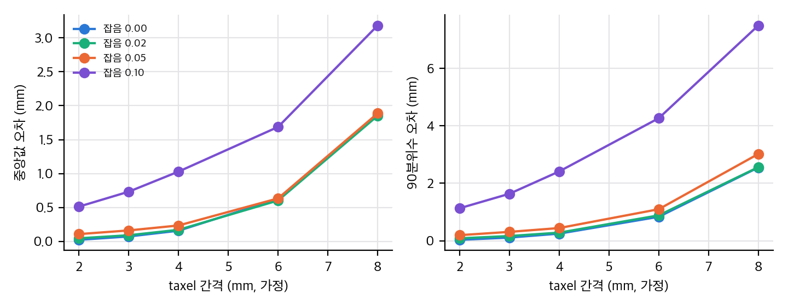
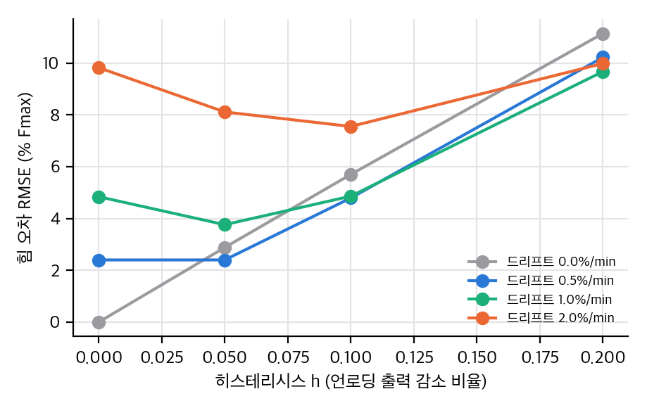
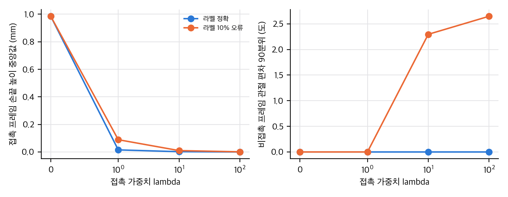

# ART-Glove: 관절형 촉각 장갑은 접촉이 담긴 사람 시연을 모을 수 있는가

ART-Glove(arXiv:2606.16370 v1)는 사람이 손을 자연스럽게 쓰면서도 손 쪽 접촉 정보를 남기는 장갑을 제안합니다. 손을 강체 면 16개로 나누고, 이 면을 해부학적으로 정렬된 관절 22개로 잇고, 면마다 압저항 촉각 2048 taxel(64×32)을 덮어 120 Hz로 기록합니다. 이 글에서는 논문의 수치를 다시 계산하고, 공개된 파일을 대조하고, 접촉 정보를 쓰는 방법을 CPU 토이로 점검했습니다. 결론부터 말하면 기계 설계는 수치상 맞고 기계 파일도 공개되어 있지만, 촉각과 센싱은 측정 결과가 부족하고 재현 파일도 아직 없습니다.

## 논문이 한 일

- **강체 면과 관절:** 손가락과 엄지, 손바닥을 강체 면 16개로 나누고, 관절 22개(손가락 4×4, 엄지 6)로 잇습니다. 엄지의 축 회전을 넣은 점이 특징입니다.
- **관절 방식 세 가지:** 공간 제약에 따라 축-슬리브, 축-베어링, 호형 슬롯을 나눠 씁니다.
- **촉각:** taxel 2048개를 행 공유 그룹 세 개로 배치합니다. 1024 + 544 + 480 = 2048로 맞습니다.
- **엔코더와 동기화:** 자기 엔코더 22개와 촉각을 STM32로 읽어 120 Hz로 묶습니다.

## 재계산에서 확인한 것

- 면 16개, 관절 22개, 엔코더 PCB 22개, taxel 2048개는 모두 산술적으로 맞습니다.
- 관절 정확도는 서보 기준 MAE 0.38–0.54°, MaxAE 2.4° 미만입니다. 다만 왕복 5회, 장치 1대라서 방식 간 차이의 유의성은 말할 수 없습니다.
- Type I의 큰 오차를 기어 전달 탓으로 돌리지만, 기어를 쓰는 Type III는 오차가 작습니다. 7.4:1 전달비의 분해능 이득은 관절 환산 0.012°로, 0.38° 오차를 설명하지 못합니다.

그래프: 논문 Fig. 9 본문 수치의 MAE, RMSE, MaxAE와 RMSE/MAE 비율. 직접 계산.

## 토이 1: taxel 간격과 잡음

촉각 위치 정확도는 taxel 간격과 판독 잡음에 달려 있습니다. 논문은 간격을 보고하지 않아서 가정 격자(2–8 mm)로 점검했습니다. 잡음이 없어도 간격이 8 mm이면 중앙값 오차가 1.9 mm이고, 잡음이 피크의 10%이면 간격 2 mm에서도 0.5 mm입니다. 위치 정확도를 말하려면 간격과 잡음을 함께 보고해야 합니다. 접촉 폭도 같이 봐야 합니다. 접촉 표준편차가 5 mm로 넓으면 간격 8 mm까지 2 mm 기준을 넘고, 1.5 mm로 좁으면 간격 5 mm가 한계입니다.

그래프: taxel 간격과 잡음에 따른 접촉 위치 오차 중앙값과 90분위. 설정은 가정이며 직접 계산.

## 토이 2: 히스테리시스와 드리프트

논문은 힘 보정을 하지 않았다고 스스로 밝힙니다(§8). 보정 없이 힘 크기를 읽으면 어떤 오차가 생기는지 봤습니다. 언로딩 출력이 10% 낮으면 힘은 (0.9)^(1/0.7) − 1 = −14%로 읽힙니다. 분당 1%의 드리프트는 10분 뒤 +15%입니다. 두 효과는 부호가 반대라서 한 번 잰 RMSE만 보면 상쇄되어 원인을 나눌 수 없습니다.

그래프: 히스테리시스 h와 드리프트에 따른 힘 오차 RMSE(% Fmax). 계수는 가정이며 직접 계산.

## 토이 3: 접촉 라벨을 리타게팅에 넣기

장갑이 주는 접촉 라벨을 관절 공간 리타게팅의 목적함수에 넣으면 로봇 손끝이 책상 위에 붙습니다. 가중치를 키우면 접촉 높이는 1 mm에서 0.002 mm 수준으로 줄지만, 관절은 약 0.7°만 움직이고 그 이상은 움직이지 않습니다. 이것은 선형 근사로 미리 계산한 값과 맞습니다. 라벨이 10% 틀리면 접촉이 없는 프레임에서 관절 편차 90분위가 2.3–2.6°로 커집니다. 토이는 평면 3관절과 링크 차이 8%에서만 돌렸습니다.

그래프: 접촉 가중치에 따른 접촉 높이(중앙값)와 비접촉 관절 편차(90분위). 설정은 가정이며 직접 계산.

## 구현 가능성

- **기계:** STEP, 3MF, DXF, BOM, 조립 가이드가 공개되어 있어 셸과 관절은 만들 수 있습니다. 가격이 있는 부품은 프린터를 빼면 약 $474입니다.
- **센싱:** 촉각 FPCB, 엔코더 PCB, 판독 PCB, 펌웨어, 캘리브레이션 도구는 "다음 공개 단계"라서 아직 재현할 수 없습니다. 저자의 결과 가운데 촉각과 동기화에 관한 것은 공개 파일로 확인할 수 없습니다.
- **학습 결과:** 정책 학습, 로봇 전이, 시연 수, 기존 장갑과의 정량 비교가 논문에 없습니다.

## 출처와 라이선스

- 논문: Changyi Lin, Ding Zhao, arXiv:2606.16370 v1. 라이선스는 arXiv 비독점 배포(CC BY 아님)라서 논문 그림은 싣지 않았습니다.
- 저장소: https://github.com/linchangyi1/ART-Glove (기계 파일과 BOM만, 라이선스 표기 없음)
- 그래프, 토이, 재계산 스크립트는 직접 만들었습니다. 토이의 설정은 모두 가정이며 글에 적었습니다.

## 자료

- [통합 리포트 PDF](report/report_public.pdf)
- [ART-Glove (arXiv:2606.16370) 논문 분석 (01)](analysis/01_paper_analysis.md)
- [ART-Glove 선행연구와 관련 저장소 (02)](analysis/02_prior_work.md)
- [ART-Glove 재계산, 유도, 토이 (03)](analysis/03_analysis.md)
- [ART-Glove 저장소 대조와 주장 검증 (04)](analysis/04_code_verification.md)
