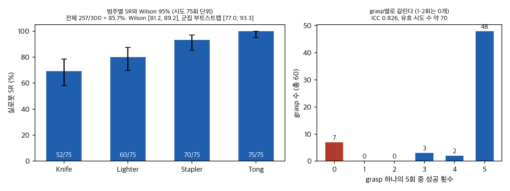
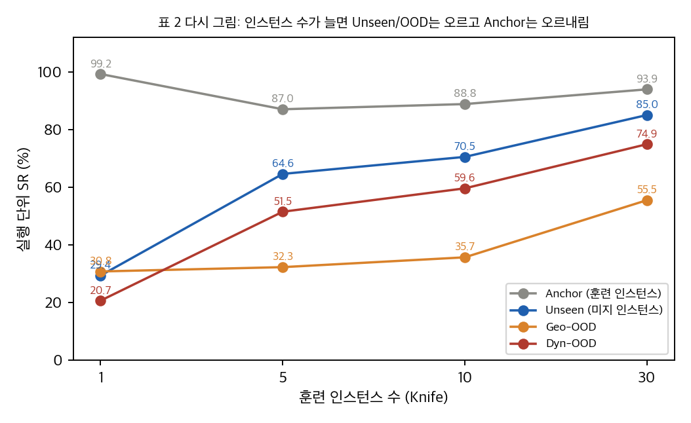
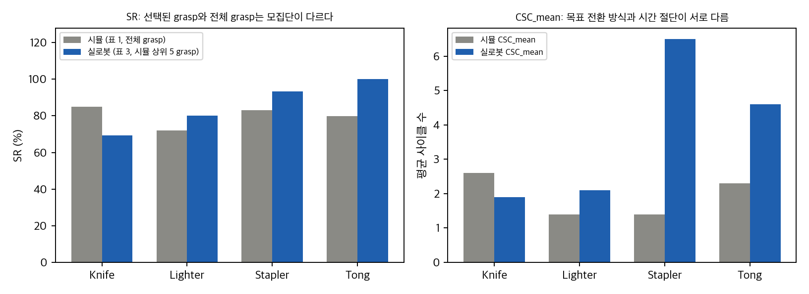

# 03. 수치 재계산, 일관성 검사, 주장 판정

모든 계산은 `analysis/recompute.py`(수 초, numpy와 scipy)가 하고 결과는 `analysis/recompute_results.json`에 있습니다. 표 4(부록 A.1)가 실로봇 시도별 원자료라서 표 3은 전부 다시 만들 수 있습니다. 시뮬레이션 표(Tab. 1, 2, 5)는 요약 값만 있어서 논문이 적은 시행 수(grasp x 100 롤아웃)를 가정합니다. 이 문서의 검사 번호는 **V**(재계산), **K**(일관성), **C**(주장 판정)입니다.

이 폴더에서는 재현(학습, 시뮬레이션 실행)을 하지 않았습니다. 재계산 대상이 요약 표라서 작은 토이 실험도 추가하지 않았습니다(중심 주장 중 CPU에서 직접 검증할 수 있는 단순화가 없음).

## 1. 실로봇 (표 3, 표 4)

### 1.1 표 3을 표 4에서 다시 만들기 (V1–V3)

정의(§4.1)를 그대로 적용했습니다. 시도 하나는 사이클 수 `c ≥ 1`이면 성공, grasp는 5회 중 하나라도 성공이면 성공, `CSC_max`는 인스턴스 안에서 성공 grasp와 시도 전체의 최댓값입니다(식 아래 첨자 `g ∈ S_i, r`).

| 범주 | IC | GC (재계산 / 보고) | CSC_mean | CSC_max | SR (시도 단위) |
|---|---|---|---|---|---|
| Knife | 100% | 73.3 / 73.3 | 1.9 / 1.9 | 3.3 / 3.3 | 52/75 = 69.3 / 69.3 |
| Lighter | 100% | 86.7 / 86.7 | 2.1 / 2.1 | 3.3 / 3.3 | 60/75 = 80.0 / 80.0 |
| Stapler | 100% | 93.3 / 93.3 | 6.5 / 6.5 | 7.0 / 7.0 | 70/75 = 93.3 / 93.3 |
| Tong | 100% | 100 / 100 | 4.6 / 4.6 | 7.0 / 7.0 | 75/75 = 100 / 100 |

- **V1:** 객체별 SR 열 12칸(56, 80, 72, 68, 80, 92, 100, 80, 100, 100, 100, 100%)이 표 4의 시도별 값에서 모두 일치합니다.
- **V2:** 표 3의 범주별 IC, GC, CSC_mean, CSC_max, SR 20칸이 모두 일치합니다. `CSC_max`를 "성공 grasp별 최댓값의 평균"으로 읽으면 스테이플러 6.6, 집게 5.0이 되어 표와 달라지므로, 표는 식에 적힌 대로 **인스턴스 안 전체 최댓값**을 쓴 것입니다.
- **V3:** 합계 257/300 = 85.67%, 범주 SR의 평균 85.65%, GC 평균 88.3%(= 보고값 88.325), 성공 grasp 53/60이 모두 본문 §4.4와 맞습니다. 전 시도 실패 grasp는 7개이고 범주별로 칼 4, 라이터 2, 스테이플러 1, 집게 0으로 App. A.1 서술("7개 중 4개가 칼")과 일치합니다.

### 1.2 시도 단위 독립 가정이 성립하는가 (V4)

grasp별 성공 횟수(5회 중)는 60개 grasp에서 0회 7개, 3회 3개, 4회 2개, 5회 48개이고 1회와 2회는 0개입니다. 시도는 grasp 안에서 거의 같은 결과로 묶여 있습니다(grasp 내 상관 ICC 0.83, 설계 효과 약 4.3, 유효 시도 수 약 70).

| 구간 방법 | 85.7%의 95% 구간 |
|---|---|
| Wilson, 시도 300개를 독립으로 | [81.2, 89.2] |
| 군집 부트스트랩, grasp 60개를 단위로 | [77.0, 93.3] |
| 군집 부트스트랩, 객체 12개를 단위로 | [77.0, 93.7] |
| Wilson, 유효 시도 수 약 70 | [75.7, 92.1] |
| grasp 단위 성공 53/60 | [77.8, 94.2] |
| IC 12/12 (객체 단위) | [75.8, 100] |

즉 "300회 시도"라는 숫자는 시도 수에 비해 정보량이 적습니다. 단위가 되는 것은 60개 grasp(또는 12개 객체)이고, 이 단위로 보면 구간은 약 ±8%p입니다(부트스트랩 5천 번 이상, 시드 고정).

### 1.3 구간 그림

*그래프(우리가 그림). 왼쪽: 표 3·4의 범주별 SR(시도 75회)과 Wilson 95% 구간. 오른쪽: 60개 grasp의 5회 중 성공 횟수 분포.*

### 1.4 사이클 수의 상한 (V5)

스테이플러 시도 75회 중 56회가 정확히 7사이클이고 최댓값도 7입니다. 집게의 최댓값은 10이고 10사이클은 9회입니다. 시도는 40 s이므로 7사이클은 사이클당 약 5.7 s, 10사이클은 4.0 s입니다. 실험자가 수동으로 목표를 전환하므로(§4.1), 이 값은 정책의 한계라기보다 **시도 시간과 전환 속도에 의해 위에서 잘린 값**일 가능성이 있습니다(원인은 확인하지 않았고, 사이클당 소요 시간 기록은 논문에 없습니다). 따라서 스테이플러의 CSC_mean 6.5와 시뮬레이션 1.4(`03` K3)는 같은 척도가 아닙니다.

## 2. 시뮬레이션 (표 1, 2, 5)

### 2.1 표 1 (V6, 시행 수 grasp x 100 가정)

- SR의 정수 실현 가능성: 네 범주 모두 가정한 시행 수(5,400 / 10,100 / 21,300 / 28,700)에서 반올림이 맞는 정수 성공 수가 존재합니다. 칼 4590/5400 = 85.0%는 본문 예시 그대로입니다.
- 독립 시행으로 본 Wilson 95%: 칼 [84.0, 85.9], 라이터 [71.2, 73.0], 스테이플러 [82.7, 83.7], 집게 [79.3, 80.3]. 이 폭은 **롤아웃 무작위화만의 변동**이고, 시험 인스턴스가 5개뿐이므로 인스턴스 간 변동은 포함하지 않습니다. 인스턴스별 값이 없어 군집 구간을 낼 수 없습니다.
- 본문 요약: GC 평균 92.3%(재계산 92.3), CSC_max 범위 5.6–8.6(맞음).
- 표 1의 총 grasp 수는 인스턴스당 평균 칼 10.8, 라이터 20.2, 스테이플러 42.6, 집게 57.4개입니다. 범주마다 5배 가까이 다릅니다. GC는 인스턴스 평균이라서 칼처럼 grasp가 적은 범주는 인스턴스 하나의 비중이 큽니다.
- `CSC_mean ≥ SR`이 모든 범주에서 성립합니다(최소 1.4 대 0.83). 어긋남 없음.

### 2.2 표 2 (V7)

*그래프(우리가 그림). 표 2의 값을 다시 그렸습니다(칼 범주).*

- Unseen, Geo-OOD, Dyn-OOD는 훈련 인스턴스 수에 대해 단조 증가합니다. Anchor만 99.2 → 87.0 → 88.8 → 93.9로 단조롭지 않습니다. 30개 정책의 Anchor 값은 전문가(1개)보다 5.3%p 낮습니다(논문 서술은 "높게 유지한다", §4.3).
- Unseen 30 vs 5, 30 vs 10의 두 비율 차이는 시행 5,400 가정에서 z = 24, 18로 롤아웃 변동만 보면 압도적입니다. 같은 이유로 의미 있는 불확실성은 인스턴스 표본(시험 5개, 학습 1/5/10/30개)에 있고 이 표에서는 알 수 없습니다.
- Dyn-OOD는 모든 행에서 Unseen보다 낮고(−8.7, −13.1, −10.9, −10.1%p) 격차가 비슷합니다. Dyn-OOD 감쇠 범위 [1400, 1800]은 훈련 [700, 1300]과 겹치지 않음을 확인했습니다. 다만 한쪽(큰 쪽)만 외삽합니다. Geo-OOD의 두 링크 크기 범위도 세 축 모두 훈련 범위와 겹치지 않습니다(V12).
- 같은 총 grasp 수나 같은 총 학습 스텝으로 맞춘 비교인지 논문에 적혀 있지 않습니다. "인스턴스 수" 효과에는 총 데이터 양 효과가 섞여 있을 수 있습니다.

### 2.3 표 5 교사 대 학생 (V8)

- 학생 시험 열 네 줄이 표 1과 완전히 같습니다. 일관됩니다.
- 학생 라이터 훈련 IC 96.7% = 29/30(정수 실현 가능), 이때 GC는 29/30 = 96.7% 이하여야 하고 95.3%로 맞습니다.
- 학생 − 교사 평균 차이(시험): GC −4.1%p(−3.1, −5.4, −0.4, −7.4), CSC_mean −1.55(−1.0, −2.8, −0.8, −1.6), CSC_max −0.15(−0.2, +0.2, −0.2, −0.4). 학생 CSC_mean은 교사의 33–72%입니다.
- 훈련 인스턴스에서는 스테이플러 GC가 학생 95.5%로 교사 91.7%보다 높습니다. 즉 IC와 GC만으로는 일관된 하락이 아니고, 가장 분명한 하락은 **CSC_mean**입니다.
- **표 5에는 SR이 없습니다.** 표 1과 표 2, 실로봇 표의 주 지표는 SR인데 교사의 SR이 어디에도 없어서, "증류가 성능 하락의 주원인"(App. A.2)을 SR로는 확인할 수 없습니다.

## 3. 시뮬레이션 대 실로봇

### 3.1 같은 범주, 다른 프로토콜 (V9)

*그래프(우리가 그림). 표 1과 표 3의 값을 다시 그렸습니다. 두 쪽의 모집단과 평가 방식이 다릅니다(K3, D7).*

| 범주 | 시뮬 SR | 실로봇 SR | 시뮬 CSC_mean | 실로봇 CSC_mean | 시뮬 GC | 실로봇 GC |
|---|---|---|---|---|---|---|
| Knife | 85.0 | 69.3 | 2.6 | 1.9 | 93.8 | 73.3 |
| Lighter | 72.1 | 80.0 | 1.4 | 2.1 | 92.8 | 86.7 |
| Stapler | 83.2 | 93.3 | 1.4 | 6.5 | 91.9 | 93.3 |
| Tong | 79.8 | 100 | 2.3 | 4.6 | 90.6 | 100 |

- 칼은 실로봇이 15.7%p 낮고 나머지 세 범주는 높습니다. 시도 단위 독립으로 가정한 Fisher p는 칼 0.0006, 라이터 0.15, 스테이플러 0.019, 집게 1e-7입니다. **참고값**일 뿐입니다. 두 쪽이 같은 모집단이 아니기 때문입니다(K3).
- 가능한 설명들을 확인하지는 않았습니다. 시뮬레이션 쪽에는 공개 코드 기준 무작위 외력과 목표 유지 시간이 들어 있고(`04` D4, D5, D7), 실로봇은 시뮬레이션에서 고른 상위 grasp를 수동 전환으로 평가합니다. 이 차이들이 분리되어 있지 않습니다.

### 3.2 학습 곡선 단위

Fig. 5의 y축은 "평균 누적 성공 횟수"로 2,000M 스텝에서 약 8.4(그림 판독 값)입니다. 평가 지표 CSC_mean(1.4–2.6)과 다른 양이어서(학습 중 에피소드의 성공 목표 개수, 0–2 s의 무작위 유지 시간 포함, `04` D7) 직접 비교하지 않았습니다.

## 4. 학습 예산과 설정 산술 (V10–V12)

- **예산(V10):** 환경 스텝 20억, 병렬 환경 20,000, 호라이즌 16(표 9). 20,000이 전체 수이면 갱신 6,250번, 장비별 수이면(GPU 2장) 3,125번입니다. 20억 스텝을 48시간에 쓰면 평균 약 11,600 스텝/초입니다. 커리큘럼이 끝나는 에폭(100 + 1000 = 1,100)은 전체 학습의 17.6%(또는 35.2%)입니다. 공개 설정(200 + 2000)이면 35.2%(또는 70.4%)입니다.
- **행동 크기(V10):** 논문의 α = 1/40이면 30 Hz에서 관절 목표 이동 최대 0.75 rad/s, 공개 설정의 `dofSpeedScale x dt = 1/120`이면 0.25 rad/s입니다(`04` D1).
- **물리 무작위화 범위(V11):** 표 8의 질량, 감쇠, 강성 범위가 공개 설정의 기본값 x 배율과 모두 일치합니다(감쇠 칼 700–1300 = 1000 x [0.7, 1.3] 등). 표 7의 보상 가중치와 τ도 모두 일치합니다.
- **칼 관절 하한(V12):** 생성기 식 `lower = edge_clearance − 0.5(body_z − slider_z)`에 표 6의 범위를 넣으면 하한 범위가 [−0.0550, −0.0175]로 표 6과 같습니다(경계는 `joint_travel = 0.05`가 허용하는 최대 여유로 잘림).

## 5. 일관성 검사 (K)

| ID | 확인 | 결과 |
|---|---|---|
| K1 | 표 3 ↔ 표 4 | 20칸 모두 일치(V1, V2) |
| K2 | 본문 요약 수치(GC 92.3%, CSC_max 5.6–8.6, GC 88.3%, 257/300, 4590/5400, "7개 중 4개 칼") | 모두 일치 |
| K3 | 시뮬 SR ↔ 실로봇 SR의 모집단 | **다름**: 시뮬은 시험 인스턴스에서 생성된 모든 grasp(54–287개), 실로봇은 시뮬 상위 5개(§4.1). 선택 효과 방향은 실로봇에 유리. 칼은 반대(−15.7%p)라 한 방향으로 정리되지는 않음 |
| K4 | 사이클 수 상한 | 스테이플러 56/75가 7, 집게 최댓값 10. 40 s 시도와 수동 전환에 의한 절단 가능성(V5) |
| K5 | 기준선 비교 | 없음. 비교는 자기 절제(Tab. 2, Fig. 5)뿐. "처음"과 "일반화"의 크기를 외부 기준선으로 가늠할 수 없음 |
| K6 | IC가 정보를 주는가 | 시험 인스턴스 5개이면 GC > 80%일 때 IC = 100%가 이미 함의됨(인스턴스 하나가 0이면 GC가 20%p 깎임). 표 1의 GC는 90.6–93.8%, 표 3(3개)은 칼 73.3%로 이 문턱(66.7%)을 넘음. 즉 IC 100%는 GC에서 따라옴 |
| K7 | GC의 관대함 | grasp 성공이 "100롤아웃 중 하나라도 성공"(§4.1)이라 GC 92.8%와 SR 72.1%(라이터)가 함께 성립. GC는 "쓸 만한 grasp가 있다"를, SR은 "평균 신뢰도"를 말함 |
| K8 | 표 5 IC 96.7% | 학생 라이터 29/30, GC 95.3% ≤ 96.7%로 정합 |

## 6. 주장 판정 (C)

판정 표기: **지지**(수치와 방법이 맞음), **부분**(수치는 맞으나 해석에 조건이 있음), **미검증**(근거가 표에 없음).

| ID | 주장 (위치) | 판정 | 근거와 조건 |
|---|---|---|---|
| C1 | "범주 수준 관절형 in-hand 조작의 첫 방법"(Abstract, §1) | 미검증 | 선행 [9, 21, 22]는 인스턴스나 단일 grasp에 한정된다는 서술(§2.3)이고, 범주 수준 정의에 의존. 외부 기준선 없음(K5) |
| C2 | 미지 인스턴스에 일반화, 네 범주 IC 100%(§4.2, Tab. 1) | 부분 | 수치는 일치(V6). IC 100%는 GC에서 따라옴(K6). SR 72.1–85.0%는 시험 인스턴스 5개, 롤아웃 변동만 반영한 구간(V6) |
| C3 | 훈련 인스턴스가 많을수록 미지 인스턴스 성능이 오른다, SR 29.4 → 85.0%(§4.3, Tab. 2) | 지지(칼 한 범주) | 단조 증가(V7). 범주 하나, 총 grasp 수·학습 스텝 통제 여부 미기재 |
| C4 | OOD(Geo 55.5%, Dyn 74.9%)에서도 30개 정책이 전문가보다 낫다(§4.3) | 지지(칼 한 범주) | 훈련 범위와 겹치지 않음을 확인(V12). 전문가 대비 +24.7, +54.2%p. 외삽 방향이 한쪽 |
| C5 | 12개 실물에 zero-shot 전이, 300회 중 257회 성공 85.7%(§4.4, Tab. 3, 4) | 부분 | 수치 일치(V1–V3). 단위는 grasp 60개이고 구간은 약 [77, 93](V4). 상위 5개 선택, 수동 초기 배치, 라이터 거즈, 물리 파라미터 보정 물체 1개(§4.1, App. C.5) 조건이 붙음 |
| C6 | GC 평균 88.3%, 시뮬 선택 grasp 대부분이 전이(§4.4) | 부분 | 53/60 맞음. 선택 단계가 이미 시뮬 성능으로 거른 결과이고, grasp 성공은 5회 중 1회면 됨 |
| C7 | 스테이플러는 장기 성능이 특히 강하다(§4.4) | 부분 | CSC_mean 6.5 맞음. 56/75가 7사이클에서 멈춰 상한 가능성(V5) |
| C8 | 증류가 성능 하락의 주원인이고 원인은 부분 관측(App. A.2) | 부분 | GC와 CSC_mean 하락은 표 5와 맞음(V8). SR 없음, 부분 관측을 분리한 실험(예: 교사 잠재를 일부만 가린 학생) 없음 |
| C9 | SAPG가 PPO보다 학습 내내 낫다(App. B.1, Fig. 5) | 부분 | 최종 약 8.4 대 7.6(그림 판독 값). 곡선은 초반 약 150M 스텝까지 겹침(그림 판독). 시드 한 줄, 구간 없음 |
| C10 | 기능적 grasp를 빼면 학습이 거의 안 된다(App. B.2, Fig. 5) | 미검증(정의 부재) | 빼는 쪽의 대체 grasp가 무엇인지(무작위, 접촉 제약 없는 Lightning Grasp 등) 적혀 있지 않음 |
| C11 | primitive 디지털 트윈이 과제에 필요한 상호작용 동역학을 담는다(§5) | 미검증 | 메시 트윈과의 비교 없음. 감쇠·강성은 보정 물체 1개의 실효값(App. C.5) |
| C12 | 모든 시도 실패 grasp의 주요인은 손끝 패드 가장자리 접촉(App. A.1) | 미검증 | 접촉 위치를 계측하지 않았다고 논문이 적음(수동 배치 정확도도 미계측). 7개 grasp의 공통점을 관찰한 서술 |
| C13 | 최대 사이클 CSC_max 5.6–8.6은 반복 작동 능력을 보인다(§4.2) | 부분 | 100롤아웃 중 최댓값의 인스턴스 평균. 전형값 CSC_mean은 1.4–2.6 |
| C14 | 학습 비용 RTX 5090 2장, 약 48시간, 20억 스텝(App. C.6) | 지지(산술) | 약 11,600 스텝/초. 환경 수가 장비당인지 합계인지 표 9에 안 적힘(V10) |
