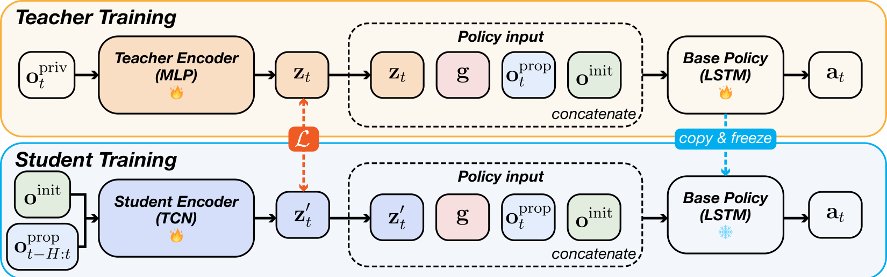
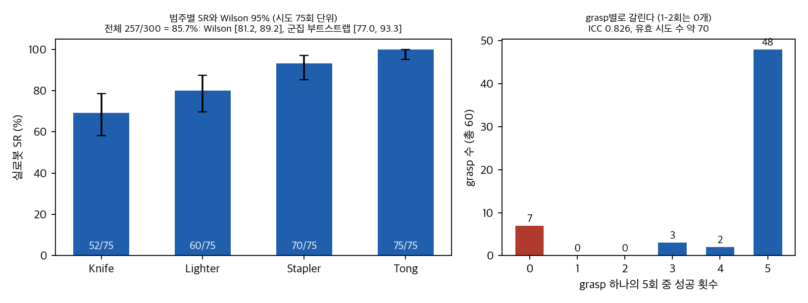
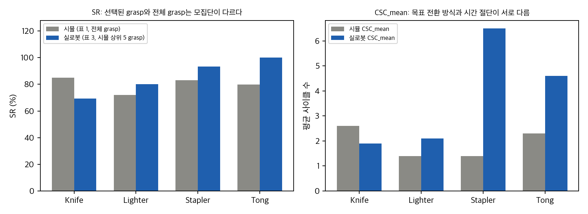
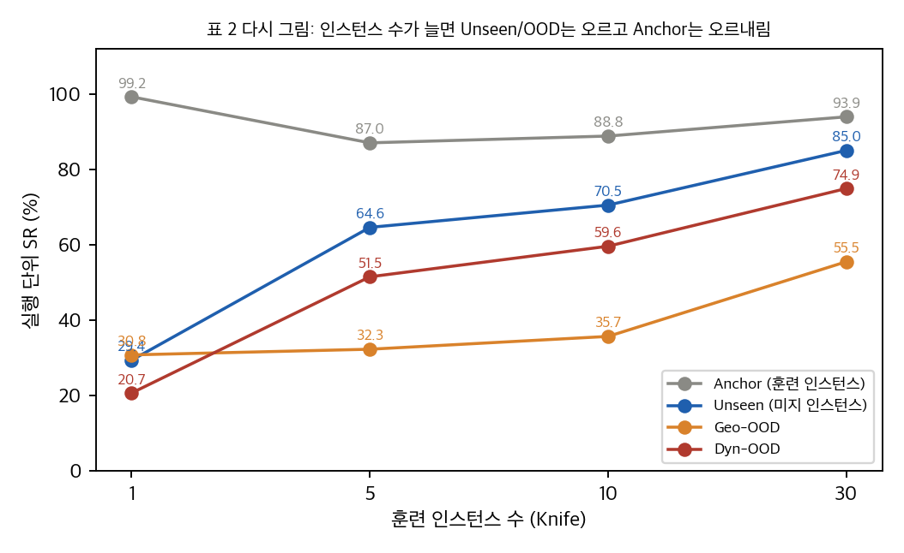
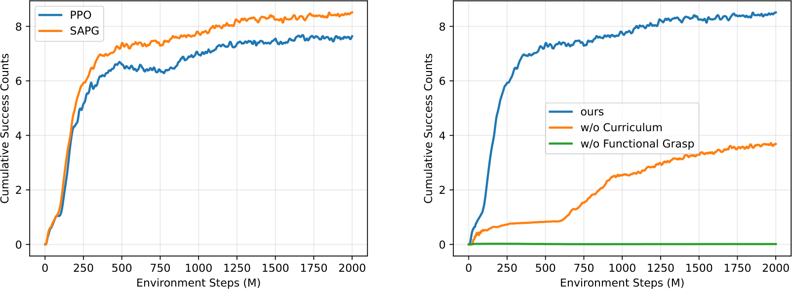

> **논문:** Yang Yang, Tengyu Liu, Puhao Li, Zeyuan Chen, Yuyang Li, Xingwan Wang, Yingying Wu, Zhaopeng Cui, Siyuan Huang. *ArtManip: Category-Level Articulated In-Hand Manipulation.* CoRL 2026 포스터, arXiv:2609.12498 (v1, 2026-09-11).
> 공식 코드는 GitHub youngcv/artgym에 있습니다(루트에 라이선스 파일 없음). 이 글의 그림은 논문 그림 세 장(출처 표기)과 우리가 그린 그래프입니다.

## 논문이 묻는 것

문이나 서랍은 밑동이 고정되어 있습니다. 칼이나 스테이플러를 손에 쥐고 열고 닫는 일은 다릅니다. 손은 자유롭게 떠 있는 물체를 안정적으로 쥐면서, 그 접촉 힘으로 관절을 움직여야 합니다. 어디를 쥐었느냐에 따라 같은 동작이 성공하기도 실패하기도 하므로, 한 물체와 한 grasp에 맞춘 정책으로는 범주 전체를 다루기 어렵습니다.

ArtManip은 이 문제를 세 부분으로 나눕니다. (1) 박스 두 개와 관절 하나로 물체를 절차적으로 생성하고, 손가락별 허용·금지 접촉 영역 템플릿을 얹은 Lightning Grasp로 기능적 grasp를 합성합니다. (2) 관절의 감쇠와 강성을 무작위화하고 안정 보상 가중치에 커리큘럼을 둔 교사 정책(SAPG)을 학습합니다. (3) 특권 정보를 쓴 교사의 잠재 표현을 고유감각 이력으로 증류한 학생 정책을 실물에 올립니다.

*그림 3 위쪽 (논문 원문, 배포 장면 띠는 제외). © 저자, CC BY 4.0, 출처 arXiv:2609.12498.*

## 이 글에서 확인한 것

**1. 표 3은 표 4에서 그대로 다시 만들어집니다.** 부록의 표 4는 12개 객체, grasp 5개, 시도 5회의 사이클 수를 모두 적습니다. 정의대로 계산하면 표 3의 IC, GC, CSC_mean, CSC_max, SR 20칸이 모두 같고, 본문 요약(GC 평균 88.3%, 257/300 = 85.7%)도 맞습니다.

**2. 85.7%의 단위는 시도 300개가 아니라 grasp 60개입니다.** 60개 grasp 중 48개가 5회 모두 성공하고 7개가 5회 모두 실패했으며, 1회나 2회 성공한 grasp는 없습니다. 시도를 독립으로 보면 Wilson 95% 구간이 [81.2, 89.2]이지만, grasp를 단위로 한 군집 부트스트랩에서는 [77.0, 93.3]입니다. 같은 grasp의 시도가 거의 같은 결과를 내기 때문입니다(grasp 내 상관 0.83, 유효 시도 수 약 70).

*그래프 (우리가 그림). 왼쪽은 표 3·4의 범주별 SR와 Wilson 구간, 오른쪽은 60개 grasp의 5회 중 성공 횟수 분포입니다.*

**3. 시뮬 SR과 실로봇 SR은 같은 모집단이 아닙니다.** 시뮬은 시험 인스턴스에서 생성된 모든 grasp(54–287개)를 100번씩 굴린 값이고, 실로봇은 시뮬에서 고른 상위 5개 grasp만 5번씩 돌린 값입니다. 칼은 실로봇이 15.7%p 낮고(69.3 대 85.0%), 나머지 세 범주는 높습니다. 사이클 수도 다릅니다. 공개 코드 기준으로 시뮬 평가는 목표 구간에서 1.0–1.5 s를 유지해야 한 단계로 세지만, 실로봇은 실험자가 수동으로 목표를 바꿉니다.

*그래프 (우리가 그림). 표 1과 표 3을 다시 그렸습니다. 두 쪽의 모집단과 평가 방식이 달라 막대를 직접 비교하기는 어렵습니다.*

**4. 실로봇 사이클 수는 위에서 잘렸을 가능성이 있습니다.** 스테이플러 시도 75회 중 56회가 정확히 7사이클이고, 집게 최댓값은 10입니다. 시도가 40 s이므로 사이클당 약 5.7 s와 4.0 s에 해당합니다. 정책의 한계인지 시도 시간과 수동 전환 속도의 한계인지는 논문 자료로는 구분되지 않습니다.

**5. 훈련 인스턴스가 많을수록 일반화가 오릅니다(칼).** 훈련 인스턴스 1, 5, 10, 30개에서 미지 인스턴스 SR은 29.4, 64.6, 70.5, 85.0%이고 감쇠 OOD는 20.7에서 74.9%로 오릅니다. 단조롭지 않은 것은 훈련 인스턴스(Anchor)로 99.2, 87.0, 88.8, 93.9%입니다. 범주 하나에서 한 줄이고, 총 grasp 수와 학습 스텝을 맞췄는지는 적혀 있지 않습니다.

*그래프 (우리가 그림). 표 2의 값을 다시 그렸습니다(칼).*

**6. 표 5에는 SR이 없습니다.** 교사 대 학생의 시험 인스턴스 평균 차이는 GC −4.1%p, CSC_mean −1.55입니다. 논문은 "증류가 주된 하락"이고 원인이 부분 관측이라고 해석합니다. 표 1과 표 2, 실로봇 표의 주 지표인 SR이 교사에 대해 없어서 이 해석을 SR로는 확인할 수 없고, 부분 관측만 분리한 실험도 없습니다.

*그림 5 (논문 원문). 왼쪽은 PPO 대 SAPG, 오른쪽은 커리큘럼과 기능적 grasp 제거입니다. © 저자, CC BY 4.0, 출처 arXiv:2609.12498.*

**7. IC 100%는 GC에서 따라옵니다.** 시험 인스턴스가 5개이면 인스턴스 하나에 성공 grasp가 없을 때 GC가 20%p 깎입니다. 표 1의 GC는 90.6–93.8%이므로 IC 100%는 이미 함의됩니다. IC는 보고할 수 있지만 새 정보를 주지는 않습니다.

## 공식 코드와 논문의 차이

저장소는 환경, 교사 학습, 증류, 평가, 실배포 코드를 모두 갖추고 있습니다. 보상 가중치, 임계값, 무작위화 범위, 네트워크, PPO 계수, 에셋 범위는 논문 표와 일치했습니다(칼 관절 하한 범위는 생성기 식에서 다시 계산해 표 6과 같음을 확인). 반면 기본 설정이 논문과 다른 곳이 16개 있었고, 영향이 클 수 있는 것은 다음과 같습니다.

- **행동 스케일:** 논문은 α = 1/40(식 2)인데 코드의 기본값은 `dofSpeedScale x dt = 1/120`입니다.
- **물체 외력:** 논문의 무작위화 목록에 없는 무작위 외력이 학습과 평가에 들어갑니다(질량에 비례, 스텝당 확률 0.001–0.1).
- **평가 허용 오차:** 논문은 평가에서 학습 임계값의 2배를 쓴다고 쓰지만 코드에서 이를 적용하는 곳을 찾지 못했습니다.
- **목표 유지 시간:** 학습은 0–2 s 무작위, 평가는 1.0–1.5 s를 유지해야 성공으로 세는데 논문에 서술이 없습니다.
- **증류 손실:** 논문 식 5는 MSE뿐이고 코드는 코사인 항(README 계수 0.1)을 더합니다.
- **학생 입력:** 논문은 손끝 위치를 포함한 59차원 고유감각을 쓰지만 코드의 학생 이력은 스텝당 44차원(손끝 위치 없음)입니다.
- **시험 인스턴스 분할:** 분할 방법이 문서화되어 있지 않아 정적으로 확인하지 못했습니다.

학습에 쓴 설정이 공개 기본값과 다를 수 있으므로 이는 "논문이 틀렸다"가 아니라 저자 확인이 필요한 항목입니다. 체크포인트, 에셋, grasp 캐시는 저장소에 없고 직접 만들어야 합니다. grasp 합성 서브모듈의 라이선스는 CC BY-NC입니다.

## 구현 가능성

교사 학습은 IsaacGym(Linux, CUDA GPU)과 RTX 5090 두 장 약 48시간이 필요하고, grasp 합성은 CUDA 전용으로 범주당 8–24시간, 실로봇은 Sharpa 손이 필요합니다. 이 글의 확인은 모두 표 재계산과 정적 코드 대조이며, 학습이나 시뮬레이션은 실행하지 않았습니다. 가볍게 해 볼 수 있는 것은 에셋 생성기(numpy 수준으로 보임)와, 관절 하나의 물체를 쥔 단순한 손으로 보상 커리큘럼이나 잠재 증류의 효과를 보는 축소 모형입니다(직접 구현에 2–3주 정도로 추정하며 측정 전입니다).

## 남는 질문

- 실로봇 사이클 수의 상한은 시도 시간 때문인가요, 정책 때문인가요?
- 시뮬 상위 5개 grasp의 순위와 실로봇 성공은 얼마나 맞나요? 논문은 순서가 항상 보존되지는 않는다고만 적습니다.
- 교사-학생 격차는 어떤 특권 변수가 가장 크게 만드나요?

## 자료

- [통합 리포트 PDF](report/report_public.pdf)
- [01. ArtManip 논문 분석](analysis/01_paper_analysis.md)
- [02. 선행연구와 관련 저장소](analysis/02_prior_work.md)
- [03. 수치 재계산, 일관성 검사, 주장 판정](analysis/03_analysis.md)
- [04. 공식 코드와 논문 대조](analysis/04_code_verification.md)
