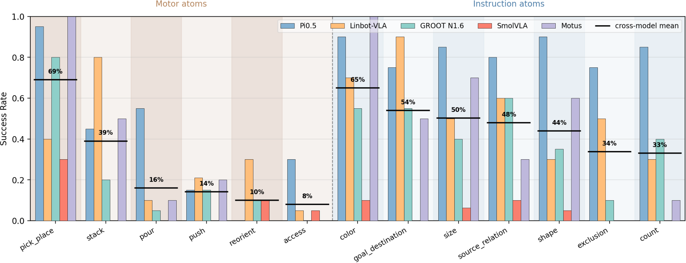
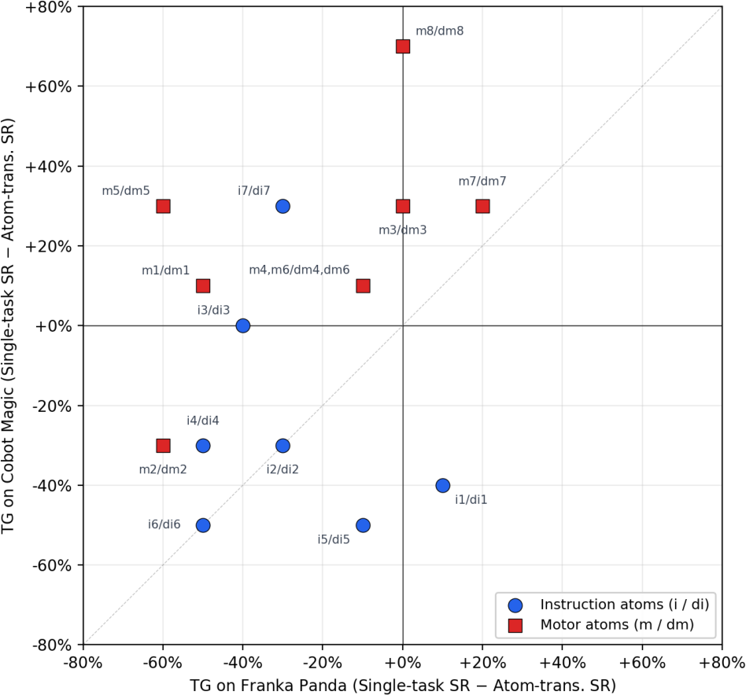
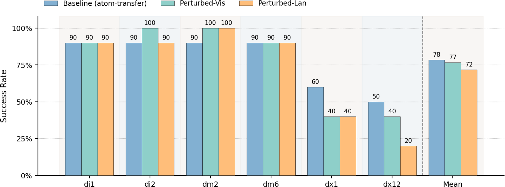

# ATOM-Bench 논문 분석 (arXiv:2606.16826)

*ATOM-Bench: A Real-World Benchmark for Atomic Skills and Compositional Generalization in Manipulation Policies* (Zenan Wu, Bingqing Wei, Lu Liu, Zheqi He 외, Beijing Academy of Artificial Intelligence, Peking University). 분석 대상은 arXiv v1(2026-06-15, 21쪽)입니다. 인용의 "절, 표, 그림 번호"는 모두 이 판 기준입니다.

## 0. 버전, 학회, 라이선스

| 항목 | 내용 |
|---|---|
| arXiv 판 | v1 하나(2026-06-15 제출). abs 페이지의 제출 이력에 v1만 있습니다(2026-11-26 확인). 그래서 판 사이 차이는 없습니다 |
| 학회 | CoRL 2026 스포트라이트. corl.org 공식 채택 목록(2026-11-14 수집본)에 포스터 번호 107, 세션 S6 "Optimization, agentic planning and evaluation", 11월 11일로 올라 있습니다. arXiv 주석(Comments)에는 프로젝트 페이지 주소만 있고 학회 표기는 없습니다 |
| 라이선스 | abs 페이지 "view license" 링크가 `creativecommons.org/licenses/by/4.0/`를 가리킵니다(CC BY 4.0, 2026-11-26 확인) |
| 원문 PDF | 쪽 머리마다 기관 로고 이미지가 있습니다. ©, copyright, All rights reserved 같은 저작권 문구는 PDF 어디에서도 찾지 못했습니다 |
| 프로젝트 페이지 | flageval-baai.github.io/AtomBenchPage (정적 페이지, 논문과 같은 표를 싣고 로봇 영상을 보여 줍니다) |
| 코드 | 공식 코드 저장소를 찾지 못했습니다(2026-11-26). 프로젝트 페이지 저장소(`flageval-baai/AtomBenchPage`)와 Hugging Face 데이터셋 두 개만 확인했습니다(`02` §2) |

## 1. 논문이 묻는 것

일반 조작 정책(VLA)이 "재사용 가능한 기술"을 배우는지, 아니면 과제 템플릿이나 데이터셋의 규칙성을 배우는지를 실로봇에서 가르는 것이 목표입니다(§1). 이를 위해 세 가지를 만듭니다.

1. **원자 분해.** 탁상 조작을 운동 원자(motor atom: pick_place, reorient, push, stack, pour, access)와 지시 원자(instruction atom: color, shape, size, source_relation, goal_destination, count, exclusion)로 나눕니다(§3.1, 부록 E).
2. **통제된 적응 분포.** 정책은 원자 과제에서만 미세조정하고, 원자를 섞은 "조합 과제"를 시연 없이 평가합니다(§4.1).
3. **진단 지표.** 원자 점수 AS와 조합 실패 비율 CFS로 "원자를 못 배워서 실패했는가, 합치지 못해서 실패했는가"를 나누려 합니다(§3.3).

주장은 두 가지로 요약됩니다. (a) 지시 원자는 비교적 쉽고 미세한 운동 원자(붓기, 재배치, 밀기)와 집합 수준 추론(count, exclusion)은 어렵다. (b) 원자 성능이 높아도 조합 과제 성능이 크게 떨어진다(초록, §4.2–4.3).

## 2. 벤치마크 구성

### 2.1 과제 수와 구조 (§3.1, 부록 A 표 3–8)

플랫폼 둘(Franka Panda 단일 팔, Agilex Cobot Magic 양팔)에 각각 운동 과제 8개(m1–m8, dm1–dm8), 지시 과제 7개(i1–i7, di1–di7), 조합 과제 12개(x1–x12, dx1–dx12)가 있습니다. 합치면 원자 과제 30개와 조합 과제 24개입니다(초록, 결론과 일치). 양팔 과제는 단일 팔 과제의 짝이며 손 역할 지정, 팔 사이 협응, 순서가 있는 행동이 더해집니다.

- 운동 과제는 하나의 물리 동작만 요구합니다(예 m5 "컵의 커피콩을 그릇에 붓기").
- 지시 과제는 pick-and-place를 운반 동작으로 두고 언어 제약 하나만 바꿉니다(예 i5 "정확히 블록 두 개를 바구니에").
- 조합 과제는 운동 원자 하나 이상과 지시 원자 둘 이상을 합칩니다(예 x3 "서랍을 열고, 원통 왼쪽의 빨간 물체를 바구니에 넣고, 서랍을 닫기": access + pick_place, color + source_relation).

### 2.2 데이터 수집 (§3.2)

원자 과제마다 사람 원격조작 시연 100개를 30 Hz로 기록합니다. Franka는 3D SpaceMouse로 약 9시간, Cobot Magic은 마스터 암으로 약 12.5시간입니다. 카메라는 RealSense 3대(Franka: 왼쪽, 정면, 손목 / Cobot: 왼팔, 오른팔, 정면)입니다. 총 3,000 시연(원자 과제 30개 × 100)이며 Hugging Face 목록 메타데이터에서 플랫폼당 1,500 에피소드(과제 15개 × 100)가 확인됩니다(`03` V2).

### 2.3 평가 프로토콜 (§3.3, §4.1, 부록 B)

- 과제마다 "공유 물리 시드" 10개로 평가합니다. 시드는 반투명 마스크를 조작자 카메라 화면에 겹쳐 물체를 배치하는 방식으로 재현합니다(부록 B 그림 7). 정책 사이 초기 배치는 "대략 같은" 수준입니다.
- 각 롤아웃은 사람이 점수 지점(score point)을 표시합니다(§6 한계). 시간 제한, 성공 판정자 수와 기준 문서, 채점자 눈가림 여부는 논문에 없습니다.
- 주 프로토콜은 "원자 전이 미세조정(atomic-transfer)"입니다. 한 정책을 플랫폼의 원자 과제 15개 전체(1,500 시연)로 함께 미세조정합니다. 비교용으로 Pi0.5에 한해 과제별 단일 과제 미세조정(100 시연)도 합니다(§4.1, §4.5).
- 정책 다섯 개: Pi0.5, Motus, LingBot-VLA, GR00T N1.6, SmolVLA. 미세조정은 H100에서 공식 코드와 공개 레시피를 따릅니다(부록 D 표 10).

### 2.4 지표 (§3.3)

| 지표 | 정의 |
|---|---|
| SR | 성공 판정을 만족한 롤아웃 비율. 과제 평균(매크로) |
| PSR | 과제별 점수 지점 중 달성한 비율을 롤아웃 평균 |
| AS(X) | 조합 과제 X의 원자 집합 A(X)에 대해 원자별 PSR의 평균. 한 원자에 과제가 여럿이면 그 과제들의 PSR 평균 |
| CFS(X) | max(0, AS(X) − PSR(X)) / (1 − PSR(X)). 낮으면 원자 약함으로, 높으면 합성 단계 실패로 읽는다고 설명 |
| TG | 단일 과제 SR − 다과제(원자 전이) SR. 양수면 과제 특화, 음수면 공동 학습이 낫다는 뜻 |

AS는 원자 과제의 PSR로 만든 값이고, 조합 과제의 SR과는 다른 척도입니다. 이 점은 `03` §3에서 따집니다.

## 3. 실험 결과

### 3.1 원자 습득 (표 1, 그림 3, §4.2)

| 모델 | Franka 운동 SR | Franka 지시 SR | Cobot 운동 SR | Cobot 지시 SR |
|---|---|---|---|---|
| Pi0.5 | 46.2 | 94.3 | 45.0 | 71.4 |
| Motus | 36.2 | 67.1 | 35.0 | 50.0 |
| LingBot-VLA | 37.5 | 54.3 | 26.2 | 21.4 |
| GROOT N1.6 | 28.8 | 57.1 | 23.8 | 27.1 |
| SmolVLA | 17.5 | 11.4 | 10.0 | 5.7 |

(표 1의 SR 열. PSR 열은 논문에 있고 `03`에서 씁니다.) 본문은 "지시 원자가 운동 원자보다 쉽다", "pick-and-place가 가장 쉽고(교차 모델 평균 74 %) 접근 9 %, 재배치 11 %, 밀기 16 %, 붓기 20 %는 어렵다", "color, size, source relation은 쉽고 count와 exclusion이 어렵다"고 서술합니다.

그림: 논문 그림 3 (원자별 성공률). © 저자, CC BY 4.0, 출처 arXiv:2606.16826 (v1). 막대의 합과 표 1을 맞춰 본 결과는 `03` §4입니다.

### 3.2 조합 일반화 (표 2, §4.3)

| 모델 | Franka SR | Franka AS | Franka CFS | Cobot SR | Cobot AS | Cobot CFS |
|---|---|---|---|---|---|---|
| Pi0.5 | 15.8 | 83.3 | 73.7 | 16.7 | 79.5 | 56.8 |
| Motus | 10.8 | 69.3 | 49.4 | 7.5 | 68.5 | 48.3 |
| LingBot-VLA | 3.3 | 60.3 | 54.5 | 0.0 | 47.2 | 29.3 |
| GROOT N1.6 | 3.3 | 66.3 | 61.2 | 1.7 | 48.2 | 38.8 |
| SmolVLA | 0.0 | 33.3 | 28.3 | 0.0 | 32.5 | 27.3 |

본문은 "AS는 보통 중간 이상인데 조합 SR이 낮다. 원자 습득이 조합 능력을 자동으로 주지 않는다"로 읽습니다. 또 Pi0.5가 CFS도 가장 높다는 점을 "남은 실패의 대부분이 조합 자체에서 온다"로 해석합니다.

### 3.3 실패 유형 (§4.4, 그림 5, 6)

실패 롤아웃을 다섯 유형(운동, 참조, 제약, 안전 중단, 시간 초과)으로 주석했고 "운동 + 참조 + 시간 초과가 90 % 이상"이라고 씁니다. 유형별 개수나 비율 표는 논문에 없습니다. 그림 5, 6은 사례 사진이라 이 분석에서는 쓰지 않았습니다.

### 3.4 전이 격차 (그림 4, §4.5)

Pi0.5만 과제별 단일 과제 체크포인트를 만들어 TG를 그렸습니다. Franka에서는 대부분 TG가 음수(공동 학습이 낫다), Cobot에서는 운동 원자 다수가 양수, 지시 원자 다수가 음수라고 서술합니다.

그림: 논문 그림 4 (Pi0.5의 쌍 과제 전이 격차). © 저자, CC BY 4.0, 출처 arXiv:2606.16826 (v1).

### 3.5 섭동 강건성 (부록 C, 그림 8)

Pi0.5 원자 전이 체크포인트를 Cobot에서 배경(흰 천 → 갈색)과 언어(의미 보존 바꿔 쓰기)로 흔들어 재평가했습니다. 과제 여섯 개(원자 4: di1, di2, dm2, dm6, 조합 2: dx1, dx12)에서 평균 SR이 78.3 → 76.7(시각) → 71.7(언어)로 떨어지고, 조합 과제만 크게 떨어진다고 해석합니다.

그림: 논문 그림 8 (Pi0.5 섭동별 SR, Cobot Magic). © 저자, CC BY 4.0, 출처 arXiv:2606.16826 (v1).

### 3.6 학습 설정 (부록 D 표 10)

모델별 설정이 다릅니다. 예를 들어 Franka에서 Pi0.5는 배치 256, 3 에폭, LingBot-VLA는 배치 128, 3 에폭, SmolVLA는 LoRA 9 에폭, Motus는 배치 64, 6 에폭입니다. 스텝 수, 학습 시드 수, 하이퍼파라미터 탐색 여부, GPU 시간은 논문에 없습니다.

## 4. 주장과 근거의 간격 (요약)

자세한 근거는 `03`(재계산 V)과 `04`(주장 C)에 있습니다.

1. **표의 값은 정수 시행 수로 설명됩니다.** 표 1과 표 2의 모든 SR이 과제당 10회 가정의 정수 성공 수와 맞습니다(`03` V1).
2. **모델 순위는 큰 격차에서만 확실합니다.** Pi0.5의 지시 원자 우위는 분명하지만(Franka 66/70 대 47/70, Fisher p = 0.0001), 운동 원자와 조합 SR에서 Pi0.5와 Motus의 차이는 롤아웃 독립을 가정해도 p = 0.26–0.34입니다(Cobot 조합만 p = 0.046). 논문에는 신뢰구간이 없습니다(`03` V4).
3. **"AS 대 SR" 간격은 척도 차이를 포함합니다.** AS는 부분 점수(PSR)의 평균이고 SR은 전부 맞아야 하는 이진 값입니다. 원자 SR의 독립 곱으로 만든 기준선은 Pi0.5에서 27.1 %(구간 20.0–31.8)이고 실제는 16.2 %입니다. 간격은 있지만 AS(81.4 %)가 시사하는 것보다 작습니다(`03` V7).
4. **CFS 해석은 AS 값에 크게 의존합니다.** 평균에 식을 대입하면 보고값보다 최대 9 %p 큽니다(Motus Franka 58.2 대 49.4). 과제별 평균 방식이면 설명되지만 과제별 값이 없어 확인할 수 없습니다(`03` V5).
5. **그림 3과 표 1이 모든 모델에서 맞지는 않습니다.** 막대 합은 Pi0.5와 GROOT에서 표 1과 같고 Motus, LingBot-VLA, SmolVLA에서는 다릅니다. 본문의 교차 모델 평균(74, 9, 11, 16, 20 %)도 그림 라벨(69, 8, 10, 14, 16 %)과 다릅니다(`03` V8).
6. **전이 격차는 과제당 10회라 개별 점이 대부분 노이즈 범위입니다.** 한 과제 점이 유의하려면 가장 유리한 분할에서도 |TG| ≥ 50 %p가 필요하고 30개 점 중 8개만 해당합니다. Franka의 "대부분 음수"는 부호 검정으로 p = 0.023입니다(`03` V10).
7. **섭동 결과는 3회 차이에 기댑니다.** 평균 SR 76.7 대 71.7은 60회 중 46 대 43회이고 Fisher p = 0.68입니다. 기준 재측정이 없습니다(`03` V11).

## 5. 한계

논문 §6이 밝힌 한계: 정책 다섯 개(VLA와 WAM 일부), 탁상 조작 위주(변형체, 도구, 이동 조작, 매우 긴 과제 없음), 사람이 하는 설정, 안전 감시, 점수 지점 주석. 아래는 이 분석에서 추가로 본 것입니다.

- **조합 과제에 "새 값"이 섞여 있습니다.** 훈련에서 size 원자는 "가장 큰"(i3)만 나오는데 조합은 "가장 작은"(x9, x5), "작은 그릇"(x11), "더 작은 그릇"(dx11)을 씁니다. color는 훈련에 파랑(i1), 빨강(i6)이 나오고 조합은 초록(x6, x9)과 갈색(x12)을 씁니다. exclusion은 "빨강이 아닌"(i7)이고 조합은 "보라가 아닌"(x10)도 씁니다(`03` K1). 그러면 조합 실패에는 합성 실패와 원자 값의 일반화 실패가 섞입니다.
- **조합 과제는 더 길고 물체가 더 많습니다.** x3, x4는 서랍 열기, 물체 집기, 놓기, 닫기를 한 번에 합니다. 이 순서 사슬이 원자 과제(예 m6 "서랍을 열고 닫기")와 다르다는 점이 "합성"과 "긴 과제"를 구분하지 못하게 합니다.
- **count와 exclusion은 여러 물체를 옮기는 과제입니다.** i5(정확히 두 개), i7(빨강이 아닌 물체 전부)은 반복 pick-and-place라서 "집합 수준 추론"과 "반복 운동·시간 제한"이 섞입니다. 실패 유형 분포가 없어 가를 수 없습니다.
- **학습 시드와 하이퍼파라미터 탐색이 보고되지 않았습니다.** 모델마다 체크포인트 하나, 설정은 모델별로 다릅니다(표 10). 순위에는 모델 차이와 설정 차이가 함께 들어 있습니다(`03` V12).
- **평가 롤아웃 데이터가 공개되었는지 확인하지 못했습니다.** 초록은 "시연 데이터와 평가 롤아웃 데이터를 공개한다"고 쓰는데, 시연 데이터셋 둘은 확인했지만 평가 롤아웃 데이터의 위치는 확인하지 못했습니다(2026-11-26). 시드별 결과가 있으면 쌍체 검정과 CFS 재계산이 가능합니다.
