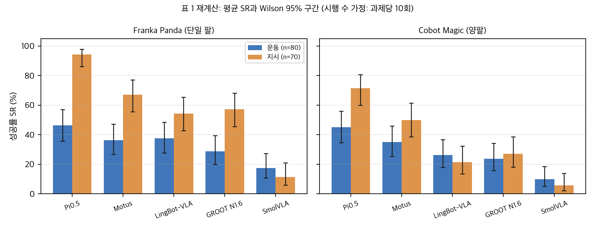
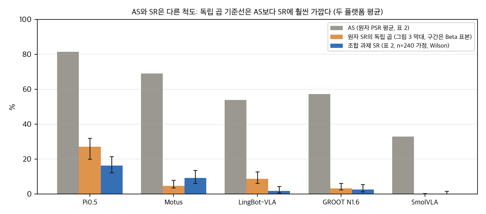
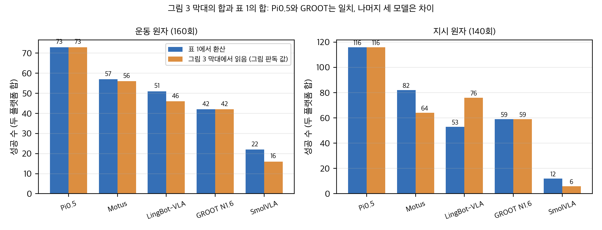

# 03. 수치 재계산과 일관성 검사

이 문서는 논문 표 1, 2, 10과 그림 3, 4, 8의 값을 다시 계산하고, 표, 그림, 본문 사이의 관계를 점검합니다. 실행은 `analysis/recompute.py`(표준 라이브러리만, 수 초)이고 결과는 `analysis/recompute_results.json`에 있습니다. 로봇 실행, 학습, 다운로드는 하지 않았습니다. 번호 V는 수치 검사, K는 설계 검사입니다.

## 0. 가정과 읽는 법

- **시행 수.** 논문 §3.3, §4.1은 "과제당 공유 물리 시드 10개, 과제 평균"이라고 씁니다. 그래서 운동 과제 8개는 80회, 지시 과제 7개는 70회, 조합 과제 12개는 120회로 가정했습니다(시행 수 n 가정). 플랫폼 합산은 160, 140, 240회입니다.
- **쌍별 검정.** Fisher 정확 검정은 롤아웃을 독립으로 놓습니다. 실제로는 같은 10개 시드를 모든 정책이 공유하고 과제 안에서 묶여 있으므로 쌍체 분석이 맞지만 시드별 결과가 공개된 곳을 찾지 못했습니다. 아래 p 값은 낙관적일 수 있습니다.
- **그림 판독.** 그림 3은 PDF 안의 그림 이미지 픽셀에서 막대 높이를 읽었고(눈금 0.0과 1.0 기준, 오차 약 ±0.01), 그림 4는 눈금선에서 10 % 단위로 읽었습니다. 이 값을 쓴 결과에는 "(그림 판독 값)"을 붙였습니다.

## 1. 검사 요약

| 번호 | 검사 | 결과 |
|---|---|---|
| V1 | 표 1, 2의 SR이 정수 성공 수로 표현되는가 | 30칸 모두 가능 (표 1 20칸 + 표 2 10칸) |
| V2 | 롤아웃 수, 시연 수 | 2,700 = 5 × 2 × 27 × 10 맞음. 단일 과제(300)와 섭동(120)은 이 수에 없음. 시연 3,000은 데이터셋 목록과 맞음 |
| V3 | PSR ≥ SR | 20칸 모두 만족 |
| V4 | 모델 간 차이의 구간과 검정 | 지시 원자의 큰 격차는 확실, 운동 원자와 조합에서 Pi0.5 대 Motus는 p = 0.26–0.34 (Cobot 조합 0.046) |
| V5 | CFS 재계산 | 평균값에 식을 대입하면 10칸 모두 보고값 이상 (+0.3 ~ +8.8 %p) |
| V6 | AS가 표 1의 PSR과 맞는가 | 군 평균으로 추정한 값 대비 0 ~ +4.9 %p, 일관 |
| V7 | AS 대 SR, 독립 곱 기준선 | Pi0.5는 기준선 27.1 %(구간 20.0–31.8)에 실제 16.2 % |
| V8 | 그림 3 대 표 1 대 본문 | Pi0.5와 GROOT는 일치, Motus, LingBot-VLA, SmolVLA는 차이. 본문 교차 평균 5개와 그림 라벨이 다름 |
| V9 | "지시 원자가 운동 원자보다 쉽다" | 10칸 중 7칸 (SmolVLA 두 플랫폼과 LingBot-VLA Cobot은 반대) |
| V10 | 전이 격차 TG | Franka 음수 11 / 양수 2 (부호 검정 p = 0.023). 점 하나가 유의하려면 \|TG\| ≥ 50 %p (30점 중 8점) |
| V11 | 섭동 부록 C | 평균 78.3, 76.7, 71.7은 맞음. 차이는 60회 중 3–4회 |
| V12 | 학습 예산(표 10) | 모델과 플랫폼마다 근사 스텝이 약 1.1만–10.5만으로 다름 (프레임 수 가정) |
| K1 | 조합 과제의 새 값 | 단일 팔 7/12, 양팔 6/12 조합 과제에 훈련 프롬프트에 없는 값이 있음 |

## 2. 표 1과 표 2의 정수 성공 수 (V1, V2, V3)

표 1의 Pi0.5 Franka 지시 SR 94.3은 66/70, Motus 67.1은 47/70처럼 모든 칸이 정수 성공 수와 0.05 %p 안에서 맞습니다. 표 2 SR(0.0, 1.7, 3.3, 7.5, 10.8, 15.8, 16.7)은 0/120, 2/120, 4/120, 9/120, 13/120, 19/120, 20/120입니다. 따라서 10회 시드, 과제 평균이라는 서술과 표가 모순되지 않습니다.

두 가지를 짚어 둡니다.

- **롤아웃 수.** 초록과 결론의 "2,700 물리 롤아웃"은 정책 5 × 플랫폼 2 × 과제 27(원자 15 + 조합 12) × 시드 10에 정확히 맞습니다. 그런데 Pi0.5 단일 과제 체크포인트(30 과제 × 10 = 300회)와 부록 C 섭동(6 과제 × 2 조건 × 10 = 120회)은 이 수에 들어 있지 않으므로 논문 전체의 물리 롤아웃은 최소 3,120회입니다(섭동의 기준 조건은 기존 결과를 재사용한다고 가정).
- **시연 시간.** 시연 3,000개는 데이터셋 목록(플랫폼당 에피소드 1,500)과 맞습니다. §3.2의 "Franka 약 9시간, Cobot 약 12.5시간"을 나누면 시연당 평균 약 21.6초, 30초입니다.

## 3. 표 1: 구간과 모델 순위 (V4, V9)


<p class="cap">그래프: 우리가 그린 그래프. 표 1의 SR을 정수 성공 수로 환산해 Wilson 95% 구간을 그렸습니다(시행 수 n 가정: 운동 80, 지시 70).</p>

구간 폭은 큽니다. Pi0.5 Franka 운동 46.2는 [35.7, 57.1], Cobot 지시 71.4는 [59.9, 80.7]입니다. 쌍별 Fisher 검정 결과:

| 비교 | 성공/시행 | p |
|---|---|---|
| Franka 지시, Pi0.5 대 Motus | 66/70 대 47/70 | 0.0001 |
| Cobot 지시, Pi0.5 대 Motus | 50/70 대 35/70 | 0.015 |
| Franka 운동, Pi0.5 대 Motus | 37/80 대 29/80 | 0.26 |
| Cobot 운동, Pi0.5 대 Motus | 36/80 대 28/80 | 0.26 |
| Franka 조합, Pi0.5 대 Motus | 19/120 대 13/120 | 0.34 |
| Cobot 조합, Pi0.5 대 Motus | 20/120 대 9/120 | 0.046 |
| Franka 운동, Motus 대 LingBot-VLA | 29/80 대 30/80 | 1.0 |
| Cobot 지시, LingBot-VLA 대 GROOT N1.6 | 15/70 대 19/70 | 0.55 |
| Franka 운동, SmolVLA 대 GROOT N1.6 | 14/80 대 23/80 | 0.13 |

해석: "Pi0.5가 지시 원자에서 가장 낫다"는 확실합니다. "두 플랫폼에서 Pi0.5가 가장 좋다"(§4.2)는 운동 원자와 Franka 조합에서는 순위의 방향이고 구분 가능한 차이는 아닙니다. 본문이 LingBot-VLA의 Franka 운동 SR 37.5를 Motus 36.2보다 "약간 높다"고 쓴 차이는 80회 중 1회입니다. 중위권(Motus, LingBot-VLA, GROOT N1.6) 사이는 Franka의 운동과 지시, 두 플랫폼의 운동에서 p > 0.16이라 순서를 구분할 수 없습니다. 다만 Cobot 지시에서는 Motus가 LingBot-VLA(15/70 대 35/70, p = 0.0007)와 GROOT N1.6(p = 0.009)보다 확실히 높습니다. SmolVLA가 아래에 있다는 점은 지시 원자에서 모든 모델에 대해 유의하고, 운동 원자와 조합에서는 대체로 유의하지만 모델 쌍마다 다릅니다.

**V9, 지시 대 운동.** "지시 원자가 운동 원자보다 쉽다"(§4.2)는 10칸 중 7칸에서만 지시 SR이 높습니다. 반대인 칸은 SmolVLA Franka(운동 17.5 대 지시 11.4), SmolVLA Cobot(10.0 대 5.7), LingBot-VLA Cobot(26.2 대 21.4)입니다. 주된 모델에서의 경향으로 읽는 것이 맞습니다.

**V3, PSR이 SR 이상.** 20칸 모두 PSR이 SR 이상이라 "PSR은 부분 진행을 잡는다"는 서술과 맞습니다.

## 4. 조합 지표: CFS, AS, 독립 곱 기준선 (V5, V6, V7)

### 4.1 CFS 재계산 (V5)

정의 CFS(X) = max(0, AS(X) − PSR(X)) / (1 − PSR(X))를 표 2의 평균 AS, PSR에 그대로 넣으면 보고값과 다음처럼 다릅니다.

| 플랫폼/모델 | 보고 CFS | 평균에 식 대입 | 차이 |
|---|---|---|---|
| Franka Pi0.5 | 73.7 | 76.0 | +2.3 |
| Franka Motus | 49.4 | 58.2 | +8.8 |
| Franka LingBot-VLA | 54.5 | 54.8 | +0.3 |
| Franka GROOT N1.6 | 61.2 | 61.9 | +0.7 |
| Franka SmolVLA | 28.3 | 28.6 | +0.3 |
| Cobot Pi0.5 | 56.8 | 64.3 | +7.5 |
| Cobot Motus | 48.3 | 54.0 | +5.7 |
| Cobot LingBot-VLA | 29.3 | 30.2 | +0.9 |
| Cobot GROOT N1.6 | 38.8 | 40.0 | +1.2 |
| Cobot SmolVLA | 27.3 | 28.0 | +0.7 |

보고값은 §3.3의 "과제별 CFS를 계산해 평균"으로 만든 것이라면 평균에 식을 대입한 값과 같을 이유가 없습니다. 과제별 AS와 PSR이 공개되어 있지 않아 이 차이가 매크로 평균 때문인지 확인할 수 없습니다. 방향(보고값 ≤ 대입값)은 10칸에서 같습니다. 과제별 값이 공개되면 쉽게 닫힙니다.

CFS에 대해 읽는 법을 두 가지 적습니다.

- AS가 높으면 CFS도 높아지는 구조입니다. AS 대신 AS − PSR로 쓰면 순서가 달라집니다. Franka에서 GROOT N1.6의 AS − PSR은 54.7 %p로 Pi0.5의 52.9 %p보다 크지만 CFS는 61.2 대 73.7로 Pi0.5가 높습니다. "Pi0.5의 CFS가 가장 높다"(§4.3)는 서술은 원자 습득이 좋다는 사실을 반영한 값이기도 합니다.
- AS는 원자 과제의 PSR로, PSR(X)는 조합 과제의 점수 지점으로 만든 값입니다. 두 과제의 점수 지점 구성이 다르면 AS − PSR에는 합성 실패 외에 채점 구성 차이도 들어갑니다. 점수 지점 목록은 논문에 없습니다.

### 4.2 AS 추정 (V6)

표 1의 군 평균 PSR(운동, 지시)을 조합 과제의 원자 수(운동 1–2개, 지시 2–3개)로 가중해 AS를 추정하면 보고 AS와 −0.0 ~ +4.9 %p 차이입니다. 보고 AS가 모든 칸에서 추정치보다 같거나 약간 높고(Franka LingBot-VLA 60.3 대 55.4, GROOT 66.3 대 61.4), 큰 어긋남은 없습니다. 원자별 PSR이 군 평균과 달라서 생기는 차이로 읽을 수 있고 AS 정의 자체와 모순되는 점은 없습니다.

### 4.3 AS 대 SR (V7)


<p class="cap">그래프: 우리가 그린 그래프. AS(표 2), 그림 3 막대(그림 판독 값)로 계산한 원자 SR의 독립 곱, 조합 과제 SR(표 2, n = 240 가정). 독립 곱의 구간은 원자 SR의 Beta 사후 표본 4,000개의 2.5–97.5 % 구간입니다.</p>

AS는 PSR 평균(부분 점수)이고 SR은 모든 점수 지점을 채워야 하는 이진 값이라 두 값의 간격이 곧 "합성 능력의 결손"은 아닙니다. 합성이 없어도 원자가 독립으로 성공한다면 조합 SR은 원자 SR의 곱 정도로 떨어집니다. 그림 3의 원자별 SR을 조합 과제의 원자 목록(표 5, 8)에 곱하면 다음과 같습니다(두 플랫폼 평균).

| 모델 | AS | 독립 곱 기준선 [구간] | 완전 상관(최소) | 실제 조합 SR |
|---|---|---|---|---|
| Pi0.5 | 81.4 | 27.1 [20.0, 31.8] | 37.5 | 16.2 |
| Motus | 68.9 | 4.6 [3.4, 7.8] | 8.3 | 9.2 |
| LingBot-VLA | 53.8 | 8.7 [6.1, 12.7] | 23.3 | 1.6 |
| GROOT N1.6 | 57.2 | 3.2 [2.3, 6.0] | 11.2 | 2.5 |
| SmolVLA | 32.9 | 0.0 [0.0, 0.2] | 0.4 | 0.0 |

읽을 점:

- Pi0.5는 실제 16.2 %가 독립 곱 구간(20.0–31.8)보다 낮습니다(실제 Wilson 구간 12.1–21.4). 합성에서 손실이 있다는 신호입니다. 다만 그 크기는 AS와 SR의 간격(65 %p)이 아니라 곱 기준선 대비 약 11 %p입니다.
- GROOT N1.6과 SmolVLA는 실제 값이 곱 기준선 근처이거나 그 아래 구간이라 "원자를 배웠는데 합치지 못한다"기보다 "원자 SR이 낮으니 곱도 낮다"로 설명됩니다.
- Motus와 LingBot-VLA는 그림 3과 표 1이 맞지 않아(§5) 이 기준선을 신뢰하기 어렵습니다.
- 독립 곱은 지시 원자의 SR에 운반 동작(pick-and-place)의 성공이 이미 들어 있어서 같은 운반을 여러 번 벌점으로 세는 보수적인 값입니다. 완전 상관(최소)이 반대편 한계입니다. 따라서 이 표는 "합성 손실이 없다"는 증명이 아니라, AS와 SR의 직접 비교가 간격을 과대하게 보이게 할 수 있다는 점을 보여 줍니다.

## 5. 그림 3 대 표 1 대 본문 (V8)


<p class="cap">그래프: 우리가 그린 그래프. 그림 3 막대(그림 판독 값, 원자별 시행 수 pick_place와 access 40, 나머지 20)로 만든 모델별 성공 수와 표 1에서 환산한 성공 수의 비교.</p>

그림 3의 설명은 "원자별 SR, 그 원자를 담은 모든 과제(두 플랫폼)"입니다. 운동 원자는 pick_place 4과제, access 4과제, 나머지 2과제씩이고 지시 원자는 2과제씩입니다. 이를 모델별로 합하면 표 1의 합(Franka와 Cobot 합산)과 같아야 합니다.

| 모델 | 운동: 그림 3 → 표 1 | 지시: 그림 3 → 표 1 |
|---|---|---|
| Pi0.5 | 73 → 73 | 116 → 116 |
| GROOT N1.6 | 42 → 42 | 59 → 59 |
| Motus | 56 → 57 | 64 → 82 |
| LingBot-VLA | 46 → 51 | 76 → 53 |
| SmolVLA | 16 → 22 | 6 → 12 |

(그림 판독 값. 한 과제의 막대 읽기 오차는 한 시행보다 작습니다.) 두 모델은 정확히 맞고 세 모델은 맞지 않습니다. 가장 큰 차이는 Motus 지시(64 대 82)와 LingBot-VLA 지시(76 대 53)입니다. 범례에서 두 모델이 서로 바뀐 경우를 가정해 비교해도 값이 맞지 않으므로(LingBot-VLA 지시 76 대 Motus 82, Motus 64 대 LingBot-VLA 53) 단순한 이름 교환으로는 닫히지 않습니다. 그림 3이 표 1과 다른 집계나 다른 평가 시점을 쓴 것인지 저자 확인이 필요합니다.

그림 안에서도 exclusion의 교차 모델 평균 라벨은 34 %이지만 다섯 모델 막대(0.75, 0.50, 0.10, 0, 0)의 평균은 27 %입니다. 나머지 열두 원자는 라벨이 막대 평균과 맞습니다.

**본문 교차 평균과 그림 라벨.** §4.2는 pick-and-place 74 %, access 9 %, reorientation 11 %, pushing 16 %, pouring 20 %라고 쓰지만 그림 3의 라벨은 69, 8, 10, 14, 16 %입니다(막대 평균과 같음). 다섯 값 모두 본문이 1–5 %p 높습니다. 운동 원자 전체 평균도 그림 라벨 기준 29.1 %, 표 1 기준 30.6 %로 다르고, 본문 수를 그대로 쓰면 31.5 %입니다. 지시 원자는 그림 라벨 평균이 46.9 %, 표 1 기준이 46.0 %입니다. 세 값이 서로 다른 집계에서 나왔을 가능성이 있고, 본문의 "가장 어려운 운동 원자" 순서(access < reorient < push < pour)는 두 값에서 모두 같습니다.

## 6. 전이 격차 TG (V10)

그림 4의 점 15개를 읽으면(그림 판독 값, 10 %p 단위) 다음과 같습니다.

| | 음수 | 양수 | 0 | 평균 TG (운동 / 지시) |
|---|---|---|---|---|
| Franka | 11 | 2 | 2 | −21.3 / −28.6 |
| Cobot | 6 | 8 | 1 | +20.0 / −24.3 |

- Franka "대부분 음수"(§4.5): 음수 11, 양수 2의 부호 검정 p = 0.023. 지지됩니다.
- Cobot "양팔 운동 원자 여럿이 양수": 운동 8개 중 7개가 양수(m2/dm2만 −30), 지시 7개 중 5개가 음수, i3/di3은 0, i7/di7은 +30. 지지됩니다.
- **개별 점의 불확실성.** TG는 10회 SR 두 개의 차이입니다. 가장 유리한 성공 수 분할(0 대 5처럼)에서도 Fisher 양측 p < 0.05가 되려면 \|TG\| ≥ 50 %p가 필요합니다(\|TG\| = 40 %p의 최소 p = 0.087). 15점 × 2 플랫폼 = 30점 중 \|TG\| ≥ 50은 Franka 5개(m1, m2, m5, i4, i6), Cobot 3개(m8, i5, i6)뿐입니다. 나머지는 과제 하나만 놓고는 노이즈와 구분되지 않습니다. 논문의 해석("지시 원자는 시각-언어 접지를 공유해서", "양팔 운동은 과제 특화가 낫다")은 과제를 묶은 경향 수준에서 지지됩니다.
- 단일 과제 체크포인트는 100개 시연으로 훈련하고 원자 전이는 1,500개로 훈련하므로 데이터 양이 15배 다릅니다. 논문이 §4.5에서 직접 이 점을 밝힙니다.
- 정합 검사: 그림 4와 그림 3, 그림 8의 값은 서로 모순되지 않습니다. 예를 들어 Pi0.5 reorient는 그림 3에서 두 플랫폼 합 0/20이고 m3의 TG가 0이라 단일 과제 SR도 0이어야 하는데 그림 4에서 TG = 0입니다.

## 7. 섭동 부록 C (V11)

그림 8(Pi0.5, Cobot, 과제당 10회)의 값으로 평균을 다시 계산하면 78.33, 76.67, 71.67로 본문의 78.3, 76.7, 71.7과 맞습니다. 원자 네 과제는 기준 90, 90, 90, 90이고 Perturbed-Vis에서 90, 100, 100, 90, Perturbed-Lan에서 90, 90, 100, 90입니다.

| 비교 | 성공 수 | Fisher p |
|---|---|---|
| dx1, 기준 대 시각 (60 → 40) | 6/10 대 4/10 | 0.66 |
| dx12, 기준 대 언어 (50 → 20) | 5/10 대 2/10 | 0.35 |
| 조합 두 과제 합산, 기준 대 시각 | 11/20 대 8/20 | 0.53 |
| 조합 두 과제 합산, 기준 대 언어 | 11/20 대 6/20 | 0.20 |
| 여섯 과제 합산, 기준 대 언어 | 47/60 대 43/60 | 0.53 |
| 여섯 과제 합산, 시각 대 언어 | 46/60 대 43/60 | 0.68 |

본문의 "언어 바꿔 쓰기가 배경 변경보다 더 해롭다"는 60회 중 46 대 43의 차이(시행 수 n = 60 가정)에 기댑니다. 방향은 일관되지만 이 차이만으로는 구분되지 않습니다. 다음 설계 특성도 해석에 영향을 줍니다.

- 대상 과제를 "이미 높은 성공률을 보인 과제"로 골랐습니다. 높은 값으로 고른 과제를 다시 재면 섭동이 없어도 평균으로 되돌아가는 경향이 있습니다. 기준 조건을 다시 측정한 결과가 없어서 이 효과와 섭동 효과를 가를 수 없습니다.
- 조합 과제 두 개(dx1, dx12)와 원자 과제 네 개(90–100 %, 천장 근처)를 비교하는 구조라 "조합이 원자보다 취약하다"는 일반화는 과제 두 개에 기댑니다.
- 바꿔 쓰기는 과제당 하나만 만들었고, 바꾼 단어가 원자 정의 토큰이 아니라고 하지만(Table 9) 언어 표현 변화가 단어 수준에서 얼마나 큰지는 평가 척도가 없습니다.

## 8. 학습 예산 (V12)

표 10에 스텝 수가 없어서 에폭 × 프레임 수 ÷ 배치로 근사했습니다. 프레임 수는 §3.2의 시간(Franka 9시간, Cobot 12.5시간)과 30 Hz에서 972,000, 1,350,000으로 가정했고(프레임 수 가정), 데이터로더가 매 프레임을 하나의 샘플로 쓴다고 가정했습니다.

| 모델 | Franka (배치 × 에폭) → 근사 스텝 | Cobot (배치 × 에폭) → 근사 스텝 |
|---|---|---|
| Pi0.5 | 256 × 3 → 약 1.1만 | 256 × 3 → 약 1.6만 |
| LingBot-VLA | 128 × 3 → 약 2.3만 | 256 × 3 → 약 1.6만 |
| GROOT N1.6 | 256 × 3 → 약 1.1만 | 256 × 6 → 약 3.2만 |
| SmolVLA (LoRA) | 256 × 9 → 약 3.4만 | 256 × 5 → 약 2.6만 |
| Motus | 64 × 6 → 약 9.1만 | 64 × 5 → 약 10.5만 |

모델마다 에폭 수, 배치, 학습률 스케줄, 미세조정 방식(전체 대 LoRA)이 달라서 모델 간 순위는 "모델 + 설정" 조합의 순위입니다. 탐색 여부와 학습 시드 수는 논문에 없습니다. LingBot-VLA는 Franka(코사인 2.5e-5, 배치 128)와 Cobot(상수 5e-5, 배치 256)에서 설정이 다릅니다.

## 9. 설계 검사 K1: 조합 과제의 값 수준 새로움

조합 과제가 "훈련에서 본 원자를 새 조합으로 쓴다"는 가정은 프롬프트 수준에서 일부만 맞습니다. 훈련 프롬프트(표 3, 4, 6, 7)에 나오지 않는 값을 조합 프롬프트(표 5, 8)가 쓰는 경우는 다음과 같습니다(프롬프트 문장 기준 판독, 훈련 장면에 그 색 물체가 있었는지는 알 수 없음).

| 원자 | 훈련 프롬프트의 값 | 조합 프롬프트에서 새로 나오는 값 |
|---|---|---|
| size | "가장 큰" (i3, di3) | "가장 작은"(x5, x9, dx5, dx9), "작은 그릇"(x11), "더 작은 그릇"(dx11) |
| color | 파랑(i1, di1), 빨강(i6) | 초록(x6, x9, dx6, dx9), 갈색(x12, dx12) |
| source_relation | "원통의 왼쪽" (i4, di4) | "원통의 오른쪽"(x2, dx2) |
| exclusion | "빨강이 아닌" (i7) | "보라가 아닌"(x10) |

이 읽기로 훈련 프롬프트에 없는 값을 포함한 조합 과제는 단일 팔 7개(x2, x5, x6, x9, x10, x11, x12), 양팔 6개(dx2, dx5, dx6, dx9, dx11, dx12)입니다. 그 조합 과제의 실패에는 합성 실패에 더해 값 일반화 실패가 섞일 수 있습니다. 이 점은 조합 SR이 낮은 이유 중 합성의 몫을 낮추는 방향입니다.

또 조합 과제 x3, x4(dx3, dx4)는 운동 원자 두 개(access + pick_place)를 한 번에 요구하는 긴 순서입니다. 서랍을 열고 닫는 사이에 물체를 집어 옮기는 단계가 들어가므로 "합성"과 "더 긴 과제"를 구분하기 어렵습니다.

## 10. 재실행

```bash
python3 analysis/recompute.py          # recompute_results.json
python3 analysis/plot_figures.py       # report/figures/own_*.png
python3 report/crop_figures.py         # 논문 그림 세 장 (paper/paper.pdf 필요)
```
