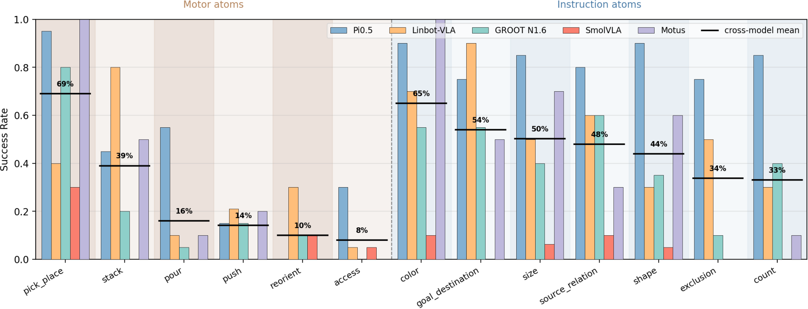
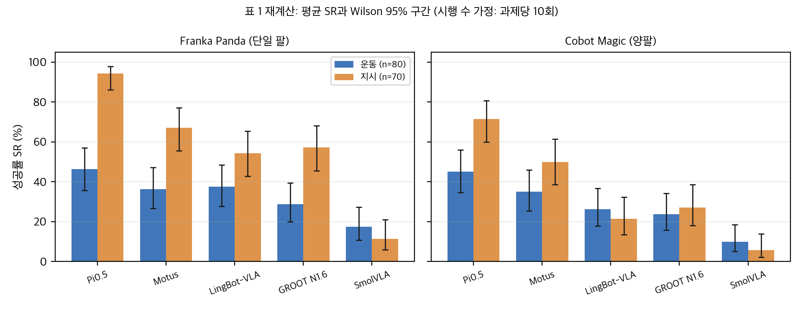
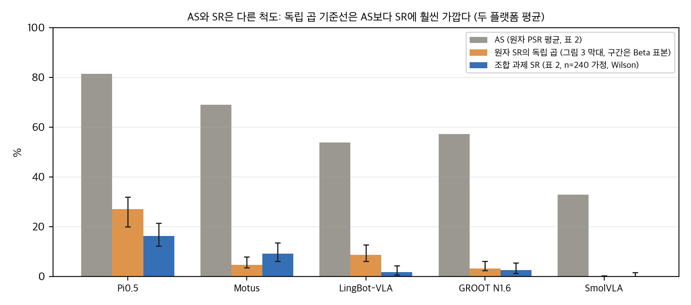
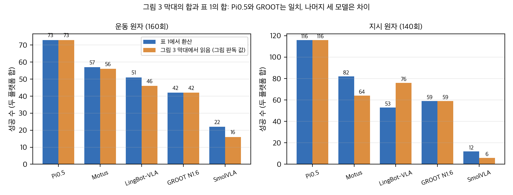
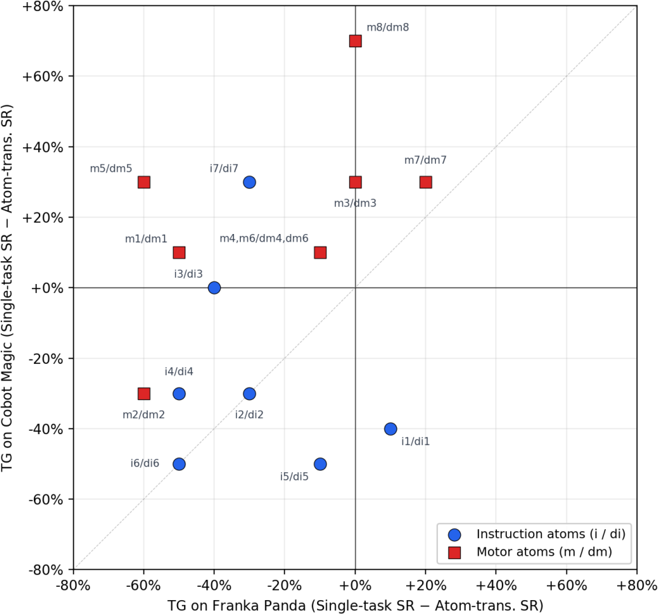
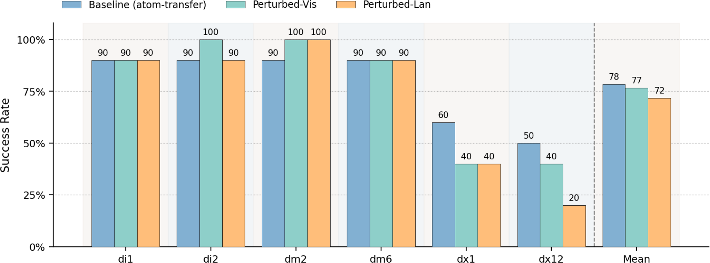

> **논문:** Zenan Wu, Bingqing Wei, Lu Liu, Zheqi He 외. *ATOM-Bench: A Real-World Benchmark for Atomic Skills and Compositional Generalization in Manipulation Policies.* CoRL 2026 스포트라이트, arXiv:2606.16826 (v1, 2026-06-15).
> 공식 코드는 2026-11-26 기준 확인하지 못했고, 시연 데이터는 Hugging Face에 있습니다. 이 글의 그림은 논문 그림 세 장(차트, 출처 표기)과 우리가 그린 그래프입니다.

## 논문이 묻는 것

일반 조작 정책이 재사용 가능한 기술을 배우는지, 과제 템플릿을 외우는지를 실로봇에서 가르는 벤치마크입니다. 탁상 조작을 운동 원자(pick_place, reorient, push, stack, pour, access)와 지시 원자(color, shape, size, count, exclusion 등)로 나누고, 정책은 원자 과제 15개(시연 1,500개)로만 미세조정한 뒤 원자 과제와 시연이 없는 조합 과제 12개를 평가합니다. Franka Panda와 Cobot Magic 두 플랫폼, 정책 다섯 개(Pi0.5, Motus, LingBot-VLA, GR00T N1.6, SmolVLA), 과제당 공유 시드 10개입니다. 새 지표는 원자 점수 AS, 조합 실패 비율 CFS, 전이 격차 TG입니다.

*그림 3 (논문 원문). © 저자, CC BY 4.0, 출처 arXiv:2606.16826.*

## 이 글에서 확인한 것

시행 수는 논문 §3.3에 따라 과제당 10회로 가정했습니다(운동 80, 지시 70, 조합 120회).

**1. 표는 정수 성공 수와 맞습니다.** 표 1과 표 2의 SR 30칸이 모두 정수 성공 수로 표현됩니다. 2,700회는 5 × 2 × 27 × 10에 맞습니다. 다만 Pi0.5 단일 과제 300회와 섭동 120회는 이 수에 들어 있지 않아 전체 물리 롤아웃은 최소 3,120회입니다.

**2. 순위는 지시 원자에서만 분명합니다.** Franka 지시에서 Pi0.5 66/70, Motus 47/70은 Fisher p = 0.0001입니다. 운동 원자는 37/80 대 29/80(p = 0.26), Franka 조합은 19/120 대 13/120(p = 0.34)입니다. 시드를 정책이 공유하므로 쌍체 분석이 맞지만 시드별 결과를 찾지 못해 독립 가정을 썼습니다.

*그래프 (우리가 그림). 시행 수 n 가정.*

**3. AS와 SR의 간격에는 척도 차이가 들어 있습니다.** AS는 부분 점수(PSR)의 평균이고 SR은 모두 맞아야 하는 이진 값입니다. 그림 3 막대(그림 판독 값)로 원자 SR의 독립 곱을 만들면 Pi0.5는 27.1 %(구간 20.0–31.8)이고 실제 조합 SR은 16.2 %, AS는 81.4 %입니다. 합성에서의 손실은 보이지만 크기는 AS와 SR의 간격이 시사하는 것보다 작습니다. 이 곱은 운반 동작을 중복으로 세는 보수적인 값이어서 "손실이 없다"는 증명은 아닙니다.

*그래프 (우리가 그림).*

**4. CFS는 과제별 값이 없어 재계산할 수 없습니다.** 표 2의 평균 AS, PSR에 식을 대입하면 보고값과 같거나 큽니다(최대 +8.8 %p, Motus Franka 58.2 대 49.4). 과제별 CFS를 평균한 값이라면 설명되지만 과제별 점수가 공개되어 있지 않아 저자 확인이 필요합니다.

**5. 그림 3과 표 1이 모델 세 개에서 맞지 않습니다.** 그림 3 막대(그림 판독 값)의 모델별 합은 Pi0.5와 GROOT N1.6에서 표 1과 같습니다(73, 116 / 42, 59). Motus(지시 64 대 82), LingBot-VLA(지시 76 대 53), SmolVLA(6 대 12)는 다릅니다. 본문 §4.2의 교차 모델 평균(74, 9, 11, 16, 20 %)도 그림 라벨(69, 8, 10, 14, 16 %)과 다릅니다. 저자 확인이 필요합니다.

*그래프 (우리가 그림). 그림 판독 값과 표 1 환산 값.*

**6. 조합 과제에는 훈련 프롬프트에 없는 값이 있습니다.** 프롬프트 문장 기준으로 size는 훈련에서 "가장 큰"만 나오는데 조합은 "가장 작은"을 쓰고, color는 훈련의 파랑과 빨강 외에 초록과 갈색, source relation은 "왼쪽"만 나오다 "오른쪽"이 나옵니다. 단일 팔 7개, 양팔 6개 조합 과제가 해당합니다. 조합 실패에는 합성 실패와 값 일반화 실패가 섞일 수 있습니다.

**7. 전이 격차와 섭동은 경향 수준입니다.** 그림 4(그림 판독 값)에서 Franka의 음수 TG는 15개 중 11개(부호 검정 p = 0.023)이고 Cobot 운동 원자 8개 중 7개가 양수입니다. 다만 과제당 10회 두 값의 차이라서 개별 점이 유의하려면 가장 유리한 경우에도 |TG| ≥ 50 %p가 필요하고 30점 중 8점만 해당합니다.

*그림 4 (논문 원문). © 저자, CC BY 4.0, 출처 arXiv:2606.16826.*

부록 C의 섭동 평균 78.3 → 76.7 → 71.7은 산술이 맞습니다. 언어 섭동이 배경 변경보다 해롭다는 서술은 60회 중 46 대 43(p = 0.68)의 차이에 기대고, 기준 조건 재측정이 없으며 성공률이 높은 과제를 골랐습니다.

*그림 8 (논문 원문). © 저자, CC BY 4.0, 출처 arXiv:2606.16826.*

## 이 맥에서 구현할 수 있는가

5개 VLA 미세조정과 실로봇 평가는 GPU와 로봇이 필요해 구현할 수 없습니다. 지표 계산과 통계 재분석은 구현해 끝냈고, 원자와 조합 구조를 재는 작은 시뮬레이션은 노트북에서 가능합니다. 공식 코드를 확인하지 못해 논문과 코드의 대조는 하지 못했습니다.

## 맺으며

벤치마크 설계(원자 분해, 시드 공유, 훈련에 없는 조합)는 실로봇 평가에 유용한 틀입니다. 아쉬운 점은 신뢰구간과 시드별 결과의 부재, 점수 지점 정의의 비공개, 학습 시드 하나입니다. 시드별 결과와 과제별 점수가 공개되면 위의 확인 사항 대부분을 닫을 수 있습니다. 재계산 스크립트와 분석 문서는 함께 게시됩니다.

## 자료

- [통합 리포트 PDF](report/report_public.pdf)
- [ATOM-Bench 논문 분석 (arXiv:2606.16826)](analysis/01_paper_analysis.md)
- [02. 선행연구와 관련 저장소](analysis/02_prior_work.md)
- [03. 수치 재계산과 일관성 검사](analysis/03_analysis.md)
- [04. 주장 검증 (C1–C18)과 구현 가능성](analysis/04_claim_verification.md)
