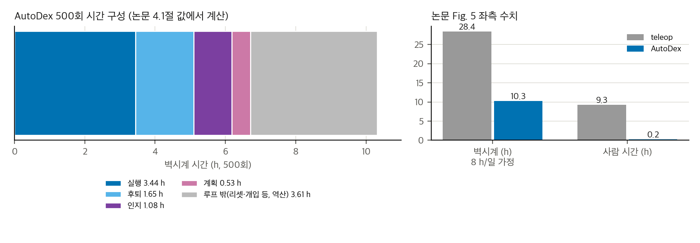
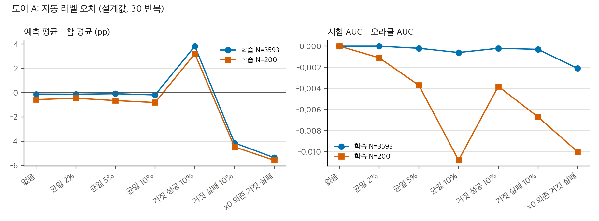
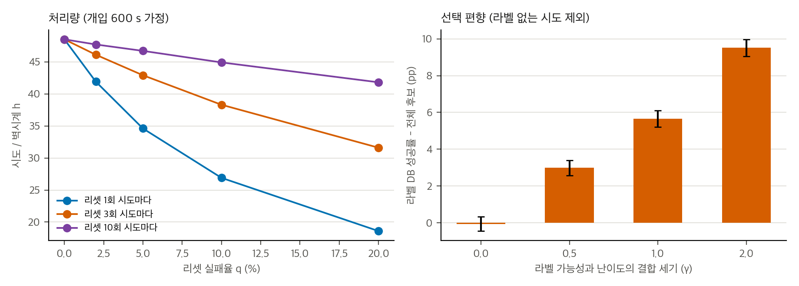

> **논문:** Choi, Kim, Kim, Kim, Ha, Lim, Joo. *AutoDex: An Automated Real-World System for Dexterous Grasping Data Collection.* CoRL 2026 (채택, arXiv:2606.23689 v2).
> 논문 그림은 라이선스(arXiv 비독점 배포) 때문에 싣지 않았습니다. 그림과 영상은 [프로젝트 페이지](https://snuvclab.github.io/AutoDex/)에서 볼 수 있습니다. 이 글의 그래프는 논문 본문의 수치와 직접 만든 토이로 그렸습니다.

## 논문이 묻는 것

시뮬레이션이 만든 다지(multi-finger) 파지 후보는 기하적으로는 맞아도 실제로 물체를 들어 올리지 못하는 경우가 많습니다. AutoDex는 이 후보를 실물 로봇에서 직접 실행하고, 다시점 카메라로 들어 올림 여부를 판정하고, 물체를 다시 놓아 다음 시도를 이어 가는 자동 루프입니다. 20대 카메라 워크셀에서 Allegro와 Inspire 손으로 3,593회를 모았습니다(성공 1,912).

## 결과 재계산

- **처리량.** v1은 텔레옵 49.4 h 대 AutoDex 10.3 h, 4.8×를 측정처럼 썼습니다. v2는 텔레옵 28.4 h를 "8시간 근무일" 추정으로 바꿔 2.8×로 낮췄습니다. 사람 시간 0.2 h 대 9.3 h(46×)는 v2에서 새로 추가됐고 추정치입니다.
- **시간 구성.** 500회 루프 평균 48.2 s는 6.7 h입니다. 나머지 3.6 h(35%)는 본문에 이름이 없습니다.
- **손별 성공률.** Inspire 75.7%(1,367회), Allegro 39.4%(2,226회). 차이는 통계적으로 명백하지만 손과 물체·세션이 섞여 있어 원인으로 읽을 수 없습니다.

## 통계는 어디까지 말해 주나

검증 DB 76%와 모델 선별 34%(515회, 20물체)의 차이는 어떤 분할에서도 p < 10⁻¹⁴입니다. 그래도 독립성이 문제입니다. 같은 물체를 여러 번 시험했는지, 두 팔의 라벨 규칙이 같았는지, 어느 팔이 몇 회 갔는지 논문은 말하지 않습니다. 물체 수준의 군집 분석을 할 수 없습니다.

사람 개입 31회(500회 중)는 정의가 없습니다. 0.2 h 사람 시간을 31회로 나누면 회당 23 s입니다. 개입을 어떻게 셌는지 알아야 처리량 주장을 검증할 수 있습니다.

## 코드를 읽으면 보이는 것

공식 저장소(snuvclab/autodex-code, 커밋 448732d)에서 라벨 규칙이 세 가지로 나옵니다.

1. 본문: 들어 올린 뒤 3 s 동안 5 cm 이상 떠 있으면 성공.
2. 실행 중 코드: 들어 올린 직후 여러 카메라에서 charuco 보드의 모든 코너가 보이면 성공(물체가 탁자에 없다는 간접 기준).
3. 데이터셋 설명서 쪽 코드: 파지 이후 추적 높이의 최댓값이 50 mm 넘으면 성공. 3 s 유지는 보지 않습니다.

자동 라벨의 오차율은 논문에 없습니다. 판독 불가 시도는 코드에서 버려집니다. 자세 품질 게이트로 격리된 시도도 DB에서 빠집니다. 이 세 경로는 모두 DB 성공률을 바꿀 수 있습니다.

저장소와 본문도 어긋납니다. 카메라는 본문 20대, 데이터와 실험 코드 24대입니다. Inspire 시도는 본문 1,367회, 데이터 설명서 384회입니다. 충돌 감지 임계는 본문에 값이 없고, v1 부록의 30 N·m, 코드의 20 N·m과 70 N·m이 서로 다릅니다.

## 토이 두 개

- **라벨 오차 토이.** 자동 라벨의 거짓 성공과 거짓 실패가 10%씩이면 검색 순위(AUC)는 거의 그대로입니다. 그러나 절대 성공률은 ±5 pp 움직입니다. 특징에 따라 오차가 치우치면 어려운 자세의 성공률이 과소 추정됩니다. 토이는 설계값이라 방향만 읽어야 합니다.
- **라벨 규칙 토이.** 공식 코드의 세 가지 규칙을 같은 합성 궤적에 적용하면, 본문 규칙(5 cm·3 s)은 참 값과 96% 일치하지만 charuco 규칙과 최댓값 규칙은 참 값과 절반만 맞습니다. 같은 혼합에서 성공률은 35%와 89%로 갈립니다. 53.2%를 읽을 때는 어떤 규칙이 DB를 만들었는지가 가장 큰 변수입니다. 혼합 비율은 가정이므로 방향만 읽습니다.
- **처리량과 선택 편향 토이.** 개입 31회를 리셋 실패로 설명하려면 매 시도마다 리셋 실패율 6%가 필요합니다. 그러면 개입 한 번이 600 s일 때 벽시계가 15.5 h로 늘어나 10.3 h와 맞지 않습니다. 라벨이 붙는 시도가 난이도와 상관이면 DB 성공률이 최대 9.5 pp 과대 추정됩니다.

## 구현할 수 있나

실물 재현은 이 맥에서도, 공식 코드 그대로도 불가능합니다. 워크셀과 비공개 라이브러리 `paradex`가 필요하고, 추적 서브모듈은 저장소에 비어 있습니다. 라이선스 파일도 없습니다. 라벨, 리셋, 검색의 아이디어는 재구현할 수 있습니다. 시뮬 기반 수집 루프와 검색은 2–4주(추정)면 되고, 실물 루프는 수 개월과 하드웨어가 필요합니다.

## 남은 질문

- 자동 라벨과 사람 라벨의 일치율은 얼마인가? 층화 표본 200회면 충분한가?
- 정책은 AutoDex 데이터로 학습했을 때 시뮬이나 텔레옵 데이터보다 나은가? 논문은 이 질문에 답하지 않습니다.
- 검증 DB의 76%는 물체를 묶은 군집 분석에서도 유지되는가?

## 자료

- [통합 리포트 PDF](report/report_public.pdf)
- [01. 논문 분석: AutoDex (arXiv:2606.23689v2)](analysis/01_paper_analysis.md)
- [02. 선행연구, 가까운 대안, 저장소 대조](analysis/02_prior_work.md)
- [03. 재계산, 유의성, 유도, toy](analysis/03_analysis.md)
- [04. 코드 대조: 논문 ↔ snuvclab/autodex-code (448732d)](analysis/04_code_verification.md)
