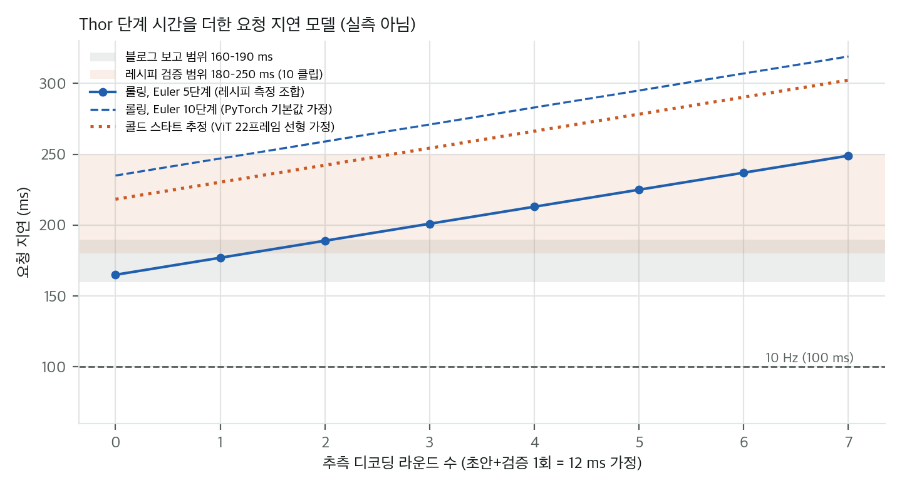
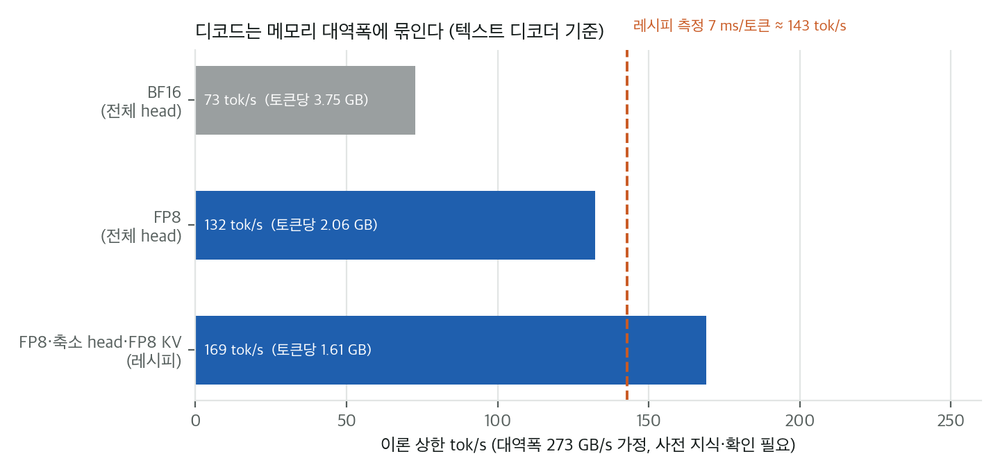
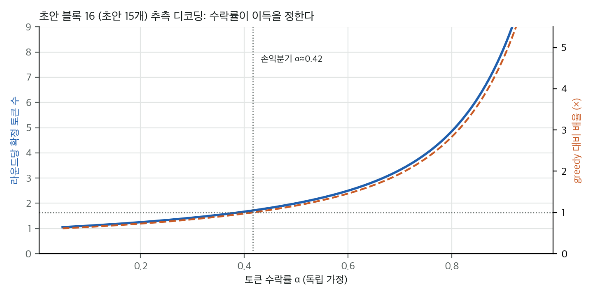

# 03. 수치 재계산과 산술 검산

모든 계산은 CPU에서 수 초 안에 끝납니다. 결과 JSON은 `analysis/*_results.json`에 있습니다.
- `analysis/config_check.py` → `config_check_results.json`: 파라미터, 가중치·KV 바이트, 측정 메모리 산술
- `analysis/latency_toy.py` → `latency_toy_results.json`: 디코드 대역폭 상한, 지연 모델, 추측 디코딩 수학, NOMINAL 민감도
- `analysis/rf_score_check.py` → `rf_score_results.json`: AlpaJudge RF 점수 재계산

가정은 각 절에 적었습니다. 블로그나 레시피에 없는 값에는 "가정"이라고 표시했습니다.

## 1. 파라미터 산술

| 구성 요소 | config로 센 값 (B) | 모델 카드 (B) | 판정 |
|---|---|---|---|
| 텍스트 디코더 (28층, d=2048, MLP relu2, 임베딩·LM head 분리) | 1.963 | 1.96 | 일치 |
| 비전 인코더 (27층, d=1152, 2행렬 MLP) | 0.411 | 0.41 | 일치 |
| projector (2층 MLP 가정) | 0.077 | 0.08 | 일치 (구조는 가정) |
| 백본 합계 | 2.451 | 2.45 | 일치 |
| 액션 expert (28층, d=512, 16/8 헤드) | 0.198 | 0.2 | 일치 |
| **전체** | **2.649** | "2B-parameter" | 명명 차이 (블로그의 "2B"는 공칭 크기) |

AlpaJudge RF는 같은 방식으로 세면 약 **2.06B**(텍스트 1.73B, 비전 24층 0.30B, merger 0.03B)입니다. BF16으로 약 4.1 GB이고, 노트북과 README의 "가중치 약 5 GB"와 같은 자릿수입니다. 차이는 공개되지 않은 구조 세부 때문일 수 있습니다.

## 2. 메모리 산술

| 항목 | 값 | 계산 |
|---|---|---|
| BF16 가중치 | 4.93 GiB | 2.649 B × 2 B |
| FP8 가중치 (전부 FP8) | 약 2.65 GB | 2.649 B × 1 B |
| KV 캐시, 토큰당 BF16 | 114,688 B (112 KiB) | 28층 × 8 KV헤드 × 128 × (K,V) × 2 B |
| 프롬프트 3,236 토큰의 KV, 1벌 | 354 MiB | 3,236 × 114,688 B |
| 같은 KV, 후보 6벌 | 2.07 GiB | 6 × 354 MiB |
| H100 측정 peak allocated | 8.40 GiB (모델 카드) | |
| 잔여분 (활성값·ViT·KV·샘플 버퍼) | 3.47 GiB | 8.40 − 4.93 |

- 잔여분 3.47 GiB 안에 후보 6벌의 KV(2.07 GiB)가 들어갑니다. 활성값과 ViT 버퍼를 생각하면 빠듯하지만 모순은 없습니다. 후보마다 KV를 따로 두는지는 구조가 공개되지 않아 추정입니다.
- 이 맥(통합 메모리 24 GiB)에서 BF16 가중치는 약 21%를 차지합니다. **메모리 용량은 문제가 되지 않습니다.** 문제는 대역폭과 연산 시간입니다(§3–§4).
- 모델 카드의 "최소 16 GB GPU 메모리" 권장과도 맞습니다.

## 3. 지연 모델 (레시피 단계 시간 합)

레시피 README의 Thor 측정표(예시 클립, 22프레임, 약 3,300 프롬프트 토큰, 드래프터 4 라운드, 6 후보, Euler 5단계)입니다.

| 단계 | 시간 (ms) | 비고 |
|---|---|---|
| ViT (최신 6프레임만) | 20 | 롤링 측정. 나머지 16프레임은 시계 시작 전에 인코딩 |
| 프리필 | 75 | |
| 추측 라운드 1회 (초안+검증) | 12 | greedy 토큰은 7 ms |
| 행동 expert (Euler 5 × 후보 6) | 70 | |

요청 지연 = 20 + 75 + 70 + 12 × r = **165 + 12 r** ms (r: 추측 라운드 수, 최소 1회).

| r | 롤링, 5단계 | 콜드 스타트 추정 (ViT 선형 가정) | 롤링, 10단계 (PyTorch 기본값) |
|---|---|---|---|
| 0 | 165 | 218 | 235 |
| 1 | 177 | 230 | 247 |
| 2 | 189 | 242 | 259 |
| 4 | 213 | 266 | 283 |
| 7 | 249 | 302 | 319 |

### 3.1 블로그 범위와 레시피 범위의 대응
- **블로그 160–190 ms**는 r = 0–2에 해당합니다. 하한 160 ms는 **라운드가 0개여도 단계 합 165 ms보다 낮습니다.** 레시피 단계 시간으로는 블로그의 하한을 설명할 수 없습니다.
- **레시피 180–250 ms** (10개 내부 검증 클립, 1–7 라운드)는 r = 2–7에 해당합니다. r = 1(177 ms)은 반올림해서 180으로 적은 것으로 보입니다.
- 레시피 README 본문 첫 줄은 "약 200 ms", 커밋 메시지는 "약 180–250 ms", 결과 절은 "예시 클립 약 220 ms"라고 씁니다. 예시 클립은 r = 4로 단계 합이 213 ms라 "약 220 ms"와 7 ms 차이입니다(반올림 또는 오버헤드 차이).

### 3.2 측정 조건이 지연을 얼마나 바꾸는가

그림 1. 레시피 단계 시간으로 만든 요청 지연 모델(자체 계산). 롤링·콜드·Euler 단계 수에 따른 차이와 블로그·레시피 범위, 10 Hz 기준선.

- **롤링 대 콜드 스타트**: 레시피의 20 ms는 최신 6프레임만 인코딩한 값입니다. 22프레임을 모두 새로 인코딩하면 ViT가 약 3.7배(22/6, 선형 가정)가 되어 약 **53 ms가 늘어** 230 ms 근처가 됩니다. 실제 값은 측정이 필요합니다.
- **Euler 단계**: 공개 PyTorch 예제는 10단계, Thor 엔진은 5단계입니다. 단계를 10으로 늘리면 약 **70 ms**가 더 듭니다. 블로그 코드 예제는 10단계인데 Thor 수치는 5단계 기준이라, 블로그 안에서도 두 조건이 섞여 있습니다.
- **10 Hz (100 ms)**: 단계 합의 하한 177 ms보다 **77 ms 모자랍니다.** Embedl의 "10 Hz" 주장은 파이프라인 병렬화나 프레임 재사용 같은 추가 조건이 있어야 성립합니다. 블로그와 레시피에 그 조건은 없습니다.

### 3.3 NOMINAL 비율에 따른 평균 지연 (블로그 주장의 가정 민감도)
NOMINAL 프레임은 추론 토큰이 없다고 가정하면(r = 0), 평균 지연은 다음과 같습니다.

| NOMINAL 비율 f | 평균 지연 (ms) |
|---|---|
| 0 (항상 CoT 2라운드) | 189 |
| 0.5 | 177 |
| 0.9 | 167 |

NOMINAL 비율을 블로그는 보고하지 않았습니다. 이 민감도는 "적응형 추론이 평균 지연을 얼마나 줄일 수 있나"의 상한 감각만 줍니다. 최악(모든 프레임이 CoT)에서도 r = 2면 189 ms입니다.

## 4. 디코드 대역폭 상한 (메모리 바운드 가정)

토큰 하나를 만들 때 텍스트 디코더의 층 가중치와 LM head를 한 번씩 읽고, 컨텍스트 3,300 토큰의 KV를 읽는다고 가정했습니다.

| 형식 | 토큰당 읽는 바이트 | 상한 tok/s (273 GB/s) | 상한 tok/s (200 GB/s) |
|---|---|---|---|
| BF16, 전체 head, BF16 KV | 3.75 GB | 73 | 53 |
| FP8, 전체 head, BF16 KV | 2.06 GB | 132 | 97 |
| FP8, 축소 head(8192행), FP8 KV (레시피) | 1.61 GB | 169 | 124 |

**273 GB/s는 사전 지식이고 확인하지 않았습니다.** Apple M4 Pro와 DRIVE/Jetson Thor 모두 이 값을 쓰지만, 공식 명세로 다시 확인해야 합니다. 200 GB/s 열은 보수적인 비교용입니다.

### 4.1 레시피의 7 ms/토큰이 말하는 것
레시피 greedy 토큰 7 ms를 레시피 형식(1.61 GB)으로 나누면 실효 대역폭은 **약 231 GB/s**입니다. 273 GB/s의 약 85%입니다. 디코드가 이미 메모리 대역폭 바운드에 가깝게 돌고 있다는 뜻입니다. 대역폭을 더 얻기 어렵다면 **바이트를 줄이는 것**(양자화, 축소 head, KV 양자화) 말고는 빠른 길이 없습니다.

### 4.2 대역폭 그림

그림 2. 토큰당 읽는 바이트와 대역폭 상한(273 GB/s 가정). 레시피의 7 ms/토큰 위치를 함께 표시.

## 5. 추측 디코딩 수학 (블록 16, 초안 15개)

레시피의 방식은 다음과 같습니다. 초안 15개를 제안하고, 한 번의 검증 패스로 맞은 연속 길이 k와 교정 토큰 1개를 확정합니다. 라운드당 확정 토큰은 k + 1입니다. 수락률 α가 토큰마다 독립이라고 하면

  E(α) = Σ_{k=0}^{15} α^k,  greedy 대비 배율 = E(α) × 7 / 12

입니다. 몬테카를로(20,000회)와 식은 α ≤ 0.8에서 0.01 안에서 일치했고, α = 0.9에서는 몬테카를로 분산 때문에 0.09 차이가 났습니다.

| α | E(α) | 몬테카를로 | greedy 대비 배율 |
|---|---|---|---|
| 0.2 | 1.25 | 1.25 | 0.73 (손해) |
| 0.4 | 1.67 | 1.67 | 0.97 |
| 0.5 | 2.00 | 2.01 | 1.17 |
| 0.7 | 3.32 | 3.33 | 1.94 |
| 0.8 | 4.86 | 4.86 | 2.83 |
| 0.9 | 8.15 | 8.06 | 4.75 |

- **손익분기 수락률 α ≈ 0.42** (E = 12/7 = 1.71). 이보다 낮으면 라운드 비용(12 ms)이 greedy 토큰 여러 개(7 ms)보다 비싸서 손해입니다.
- 블로그는 "추측 디코딩으로 가속"이라고만 씁니다. 실제 수락률은 보고하지 않았습니다.

### 5.1 수락률 그림

그림 3. 수락률 α에 따른 라운드당 확정 토큰 E(α)와 greedy 대비 배율(블록 16). 손익분기 α ≈ 0.42.

### 5.2 예시 클립의 4 라운드가 알려 주는 것
예시 클립의 CoT는 "Decelerate and turn right at the intersection to follow our route, as the roadway is clear."입니다. 토큰 수는 보고되지 않았지만 영어 한 문장이라 대략 20–30 토큰으로 추정합니다(확인 필요). 4 라운드에 이 길이를 만들려면 라운드당 약 6–7토큰이 필요하고, 시뮬레이션상 **α ≈ 0.9**에 가깝습니다. 토큰 수가 더 짧으면(약 17토큰) α ≈ 0.8로도 맞습니다. 즉 예시 클립의 수락률은 높았을 가능성이 큽니다. 다만 이것은 추정이며, 다른 클립에서는 달라질 수 있습니다.

### 5.3 CoT 길이에 따른 지연 (α = 0.8 가정, 롤링 5단계)

| CoT 토큰 L | greedy (ms) | 추측 α=0.8 라운드 수 | 추측 α=0.8 (ms) |
|---|---|---|---|
| 10 | 235 | 2.8 | 198 |
| 25 | 340 | 5.9 | 236 |
| 50 | 515 | 11.1 | 296 |
| 100 | 865 | 21.3 | 420 |
| 256 | 1,957 | 53.5 | 806 |

CoT가 길수록 추측 디코딩의 이득이 커지고, 100 토큰이 넘으면 지연이 0.4초를 넘습니다. 로봇 VLA에서 행동 토큰을 자기회귀로 만들 때도 같은 비례 관계가 나타납니다.

## 6. AlpaJudge RF 점수 재계산

노트북에 적힌 부분점수(match 0.791, safe 0.987, grounded 0.994, complete 0.927, causal 0.852)로 공개 식을 다시 계산했습니다.

- action = p_match × (1 + p_safe) / 2 = **0.7859** (기록 0.787)
- component = mean(grounded, complete, causal) = **0.9243** (기록 0.924)
- overall = 0.6 × action + 0.4 × component = **0.8412** (기록 0.842)

노트북은 표시 점수를 "소수 셋째 자리에서 절사"한다고 적었고, 입력 부분점수는 소수 셋째 자리로만 적혀 있습니다. 절사로 보면 overall 가능 범위는 0.8412–0.8425이고, 반올림으로 보면 0.8406–0.8419입니다. **기록값 0.842는 두 규칙 모두와 양립합니다.** RB 0.999는 체크포인트 실행이 필요해서 확인하지 못했습니다.

## 7. 블로그 그림 수치의 산술 (Figure 2, Figure 5)

- 60배: 15.15 / 0.25 = 60.6. "약 60배"는 맞습니다. 다만 분모 0.25의 출처를 확인하지 못했습니다.
- LingoQA: Edge 75.2 대 Qwen 79.4. Edge가 **4.2점 낮습니다.** "모든 주요 과제에서 앞선다"는 제목과 맞지 않습니다.
- Figure 5: 기준선 보상의 자체 평가 13.4% 대 사람 평가 1.8%. 차이 11.6점. AlpaJudge 보상은 자체 평가가 사람보다 1.2점 낮습니다. 이 차이가 보상 설계의 효과인지 판정기 편향인지는 이 그림만으로 알 수 없습니다.
- 데이터 선별(Figure 4): 원자료에서 중간 구간 27%가 샘플링 뒤 81%가 됩니다. 샘플링 가중치 곡선의 정규화 방식은 블로그에 없습니다.

## 8. 기타 정합성 검사

| 검사 | 결과 |
|---|---|
| 카메라 프레임 수: 전방 2대 × 5 + 나머지 4대 × 3 | 22 (블로그·카드 22와 일치) |
| 웨이포인트 64 × 0.1 s | 6.4 s (카드와 일치) |
| 과거 자세 20개, 0.1 s 간격, −1.9–0 s | 20점 (일치) |
| 궤적 토큰 57 = 3축 × 19차분 | 일치 (config `tokens_per_history_traj`=57) |
| 레시피 어휘 2211개 → 8192행 패딩 | 패딩 후 행 수가 어휘보다 크다 (일치) |
| 레시피 DFlash2 드래프터 블록 16, 제안 15 | `speculative.py`의 `block - 1` 구조와 일치 |
