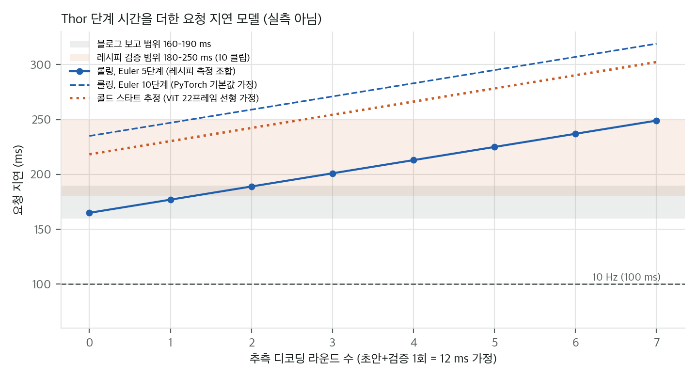
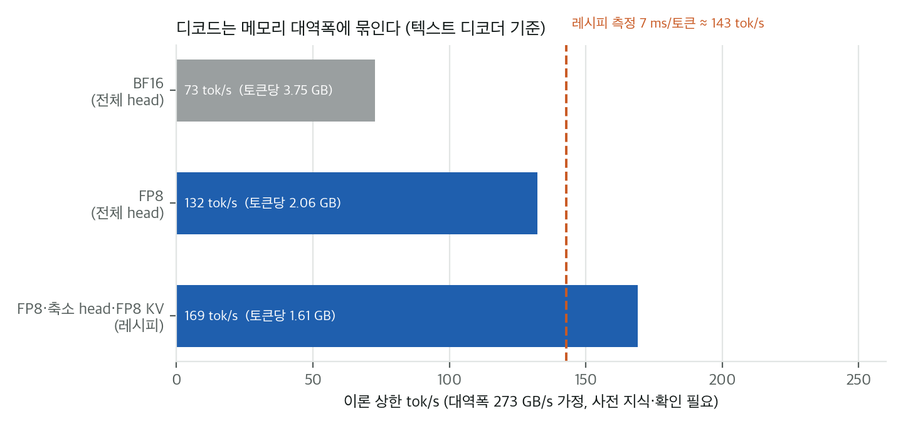
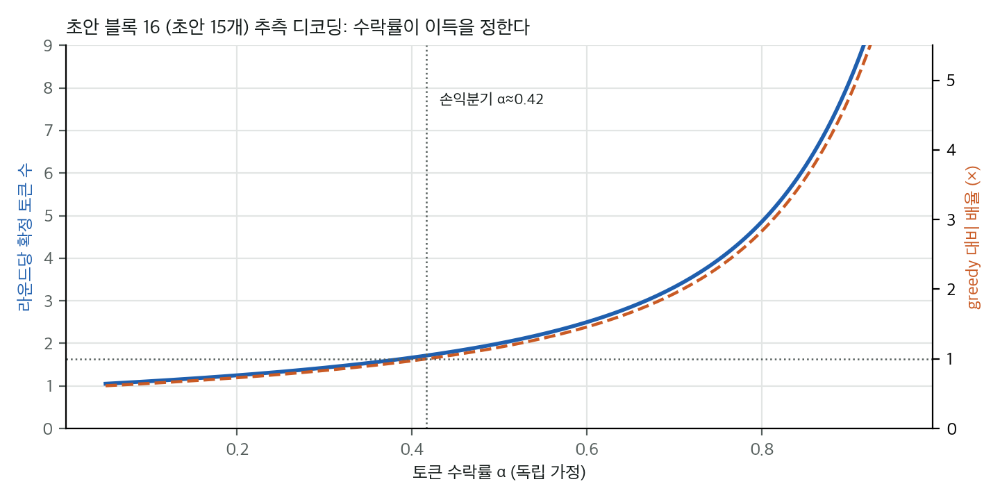

이 글은 NVIDIA 기술 블로그 글을 공개 자료로 점검한 기록입니다. 블로그는 동료심사를 받은 논문이 아니고, 그림과 본문은 NVIDIA의 저작물이라 여기 옮기지 않았습니다. 아래 수치는 모두 블로그, 모델 카드, 공개 저장소에서 가져왔고 출처를 붙였습니다. 가중치는 받지 않았고 공개 코드는 실행하지 않았습니다.

## 무엇을 주장하나

블로그는 **Alpamayo 2 Edge**를 소개합니다. 2B급 추론 VLA로, 6카메라 22프레임과 자세 기록, 내비게이션 문장을 받아 Chain-of-Causation(CoC) 추론과 궤적을 만듭니다. 추론은 필요할 때만 하고(NOMINAL 라벨), 확산 행동 전문가가 궤적을 씁니다. 블로그는 DRIVE AGX Thor에서 **픽셀에서 궤적까지 160–190 ms**를 보고합니다. 판정기 **AlpaJudge**(RB, RF 두 체크포인트)는 추론 품질을 점수로 매겨 데이터 선별과 RL 보상에 씁니다.

## 공개 자료로 확인한 것

**구조와 크기.** 공식 config로 세면 전체는 **2.65B**입니다(텍스트 1.96B, 비전 0.41B, projector 약 0.08B, expert 0.20B). "2B"는 공칭 명칭입니다. 치수는 모델 카드와 맞습니다.

**지연 산술.** 레시피 README의 Thor 단계 시간(ViT 20 ms, 프리필 75 ms, 추측 라운드 12 ms, 행동 expert 70 ms)을 더하면 요청 지연은 **165 + 12r ms**입니다(r은 추측 라운드 수). 블로그의 160–190 ms는 r = 0–2에 해당하지만, 하한 160 ms는 r = 0의 165 ms보다도 낮아서 단계 시간으로는 설명되지 않습니다. 측정 조건(예열, 반복, 롤링 또는 콜드 스타트)은 블로그에 없습니다.

그림 1. 레시피 단계 시간으로 만든 요청 지연 모델(자체 계산). 롤링과 콜드 스타트, Euler 5·10단계의 차이, 블로그와 레시피의 범위, 10 Hz 기준선. 실측이 아니라 단계 시간을 더한 모델입니다.

측정 조건이 지연을 크게 바꿉니다. 콜드 스타트(22프레임 전부 인코딩)는 추정으로 약 53 ms가 늘고, PyTorch 기본값인 Euler 10단계는 약 70 ms가 늘어납니다. 10 Hz(100 ms)는 단계 합보다 77 ms 모자랍니다.

**디코드 대역폭.** 레시피의 greedy 토큰 7 ms를 1.61 GB(FP8, 축소 head, FP8 KV)로 나누면 실효 대역폭은 약 231 GB/s입니다. 273 GB/s 가정의 약 85%입니다. 273 GB/s 값은 사전 지식이라 확인이 필요합니다. 이 디코드는 이미 대역폭 한계에 가깝게 돌고 있어서, 더 빠르게 하려면 읽는 바이트를 줄여야 합니다.

그림 2. 텍스트 디코더의 토큰당 읽는 바이트와 이론 tok/s 상한(대역폭 273 GB/s 가정, 사전 지식이라 확인 필요). 레시피의 7 ms/토큰 위치를 세로 점선으로 표시.

**추측 디코딩.** 초안 15개를 제안하고 한 번에 검증하는 방식이라, 라운드당 확정 토큰은 E(α) = Σ α^k (k = 0..15)입니다. 라운드 비용 12 ms와 greedy 토큰 7 ms를 기준으로 하면 손익분기 수락률은 **약 0.42**입니다. 블로그와 레시피는 수락률을 보고하지 않았고, 초안 모델(DFlash2)은 모델 릴리스에 없어서 블로그 수치를 재현할 수 없습니다.

그림 3. 수락률 α에 따른 라운드당 확정 토큰 E(α)와 greedy 대비 속도 배율(블록 16, 자체 계산). 세로 점선은 손익분기 α ≈ 0.42.

**성능 주장.** 모델 카드의 벤치마크 값은 블로그 Figure 2의 Edge 값과 맞습니다. 폐루프 중대 사고 간 거리는 15.15 km로 Qwen-Drive-1.0(블로그 값 0.25 km)의 약 60배입니다. 다만 LingoQA에서는 Edge 75.2, Qwen-Drive 79.4로 Edge가 낮아서 "모든 주요 과제에서 앞선다"는 제목과 맞지 않습니다. Qwen-Drive의 수치는 공개 자료로 확인하지 못했습니다.

**판정기 점수.** AlpaJudge RF의 식(action = p_match(1+p_safe)/2, overall = 0.6·action + 0.4·component)은 공개 소스와 같습니다. 노트북에 기록된 부분점수로 다시 계산하면 overall은 0.8412이고, 노트북의 0.842와 표시 반올림 범위 안에서 맞습니다. RB 0.999는 체크포인트를 실행해야 해서 확인하지 못했습니다.

**보상과 RL.** 블로그는 AlpaGym의 폐루프 RL로 성능이 48.9% 좋아졌다고 씁니다. 수치의 기준선과 실험 조건은 공개되지 않았습니다. 공개 저장소의 AlpaGym 정책은 Alpamayo 1.5 10B뿐이고, Edge용 RL 경로는 보이지 않습니다. 블로그의 그림은 자체 평가와 사람 평가를 나란히 보여 줍니다. 기준선 보상은 자체 평가 13.4%, 사람 평가 1.8%로 크게 어긋납니다. 판정기가 보상에 맞춰지는 현상을 의심해 볼 만한 패턴입니다.

## 로봇 VLA에 옮길 수 있는 것

- **지연 예산을 고정비와 가변비로 나누고, 측정 조건을 함께 적는 것.** 롤링 대 콜드 스타트와 스텝 수가 지연을 바꾸므로 비교표에 열로 넣어야 합니다.
- **추측 디코딩의 손익분기 식.** 행동 토큰을 자기회귀로 만들 때도 E(α)·(토큰 비용/라운드 비용)으로 이득을 미리 계산할 수 있습니다.
- **판정기 점수를 게이트와 부분 점수로 나누는 구조.** 목표 달성은 게이트로, 과정 품질은 부분 점수로 둡니다. 사람 평가와 함께 봐야 합니다.

## 이 맥에서 구현할 수 있나

**Apple M4 Pro(통합 메모리 24 GiB, MPS, CUDA 없음)에서는 Thor 시스템을 구현할 수 없습니다.** Thor 엔진, FP8 보정, 초안 모델은 자동차용 보드와 NVIDIA GPU, 공개되지 않은 부품에 묶여 있습니다.

- 재계산과 재구현(지연 모델, 추측 디코딩 수학, 판정 점수식)은 가능하고 완료했습니다.
- 모델의 PyTorch 추론은 가중치 BF16 약 4.9 GiB라 메모리에는 들어갑니다. CUDA 호출을 고치면 **조건부로 포팅**할 수 있지만, 프리필 한 번에 수 초가 걸릴 것으로 추정되어 지연 목표와는 거리가 멉니다.
- 노력은 포팅 1–2주(가정)이고, 수치 검증에는 GPU 기준값이 필요합니다.

## 다음 단계

가중치 없이 할 수 있는 확인: 두 모델 리비전(`f8951d09`, `aaaa32c`)의 동일성, 어휘 파일에서 NOMINAL 토큰의 존재. 설치와 다운로드를 승인하면 맥에서 RB 체크포인트를 실행해 노트북의 0.999와 비교하고, Edge 추론을 MPS로 한 샘플 포팅해 봅니다.

## 출처

- NVIDIA 기술 블로그, "Running AV Reasoning Models Within Onboard Compute and Latency Limits", 2026-11-10 (접근 2026-11-12)
- Hugging Face: nvidia/Alpamayo2-Edge (모델 카드, config.json; 가중치 OpenMDW-1.1), nvidia/alpajudge (OpenMDW-1.1)
- GitHub: NVlabs/alpamayo2-edge (Apache-2.0, 커밋 02f55a7), NVlabs/alpamayo-recipes (Apache-2.0, 커밋 622f9d2), NVlabs/alpajudge (Apache-2.0, 커밋 607ae9d), NVlabs/alpagym (Apache-2.0, 커밋 972d160)
- 이 글의 산술과 스크립트: `analysis/` (CPU, 수 초). 게시본의 `git/` 폴더를 보세요.

## 자료

- [통합 리포트 PDF](report/report_public.pdf)
- [01. 블로그 분석: Running AV Reasoning Models Within Onboard Compute and Latency Limits](analysis/01_paper_analysis.md)
- [02. 선행 연구, 공개 저장소, 관련 분석](analysis/02_prior_work.md)
- [03. 수치 재계산과 산술 검산](analysis/03_analysis.md)
- [04. 주장 검증과 구현 가능성](analysis/04_claim_verification.md)
