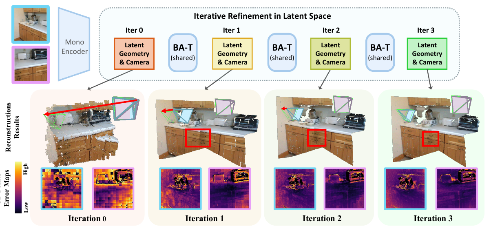
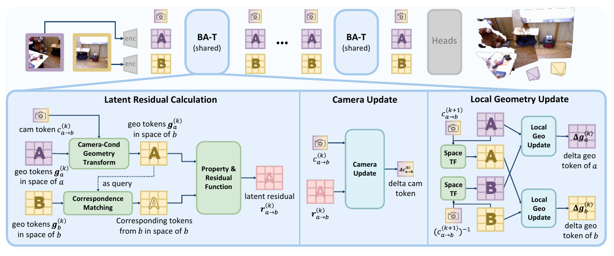
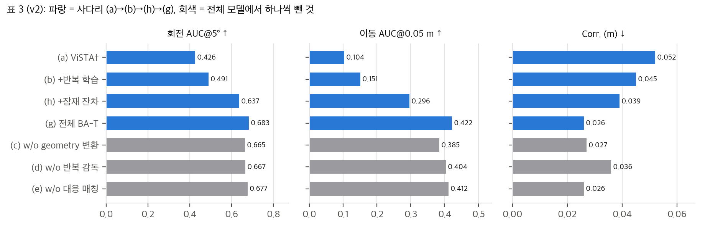
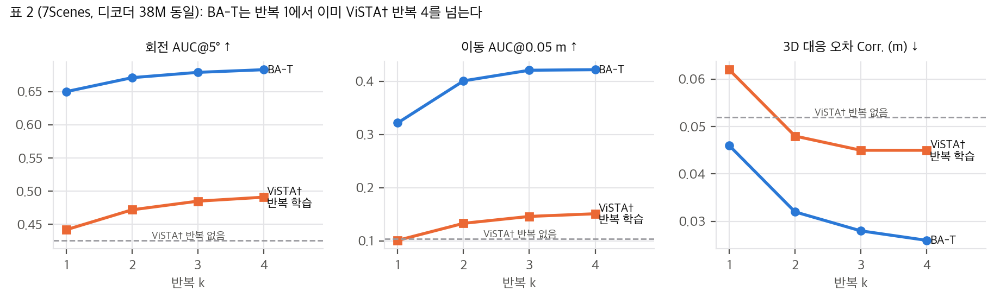
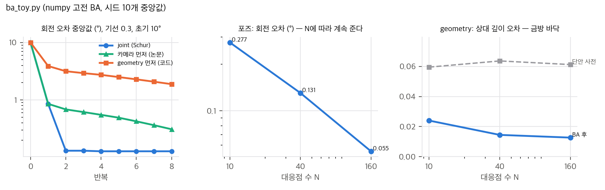

> **논문:** Zhang, Chen, Cremers, Wang. *BA-T: An Iterative Transformer for Two-View Bundle Adjustment.* arXiv:2606.03287v2, NeurIPS 2026. TU Munich, MCML, Ulm University, ETH Zurich.
> 논문 그림은 CC BY 4.0에 따라 출처를 밝히고 실었습니다(© 저자). 나머지 그래프는 논문 표의 수치와 직접 만든 numpy toy로 그렸습니다. 코드: [zhangganlin/BA-T](https://github.com/zhangganlin/BA-T) @ `406d791`.



## 한 줄 요약

DUSt3R, VGGT 같은 feed-forward 3D 복원 모델은 깊게 쌓은 cross-attention 디코더(227M–765M)로 시점 간 일관성을 맞춥니다. BA-T는 그 대신 고전 bundle adjustment의 **정보 흐름**(잔차를 계산하고, 카메라 갱신이 잔차를 모으고, 갱신된 카메라로 geometry를 고친다)을 연결 구조로 가진 **Transformer 층 하나(38M)**를 K번 반복합니다. 풀이기도 야코비안도 없습니다.

## 1. 출발점: Schur 보완이 말해 주는 순서

두 시점 BA의 Gauss-Newton 정규방정식을 카메라 블록과 geometry 블록으로 나누면, Schur 보완으로 카메라를 먼저 풀고 geometry를 역대입합니다(논문 식 3). 점마다의 geometry는 자기 잔차에만 들어가므로 geometry 블록 C가 블록 대각이고, 카메라의 Schur 보완은 점별 합으로 쓸 수 있습니다.

```
S = Σ_i J_c,iᵀ ( I − P_g,i ) J_c,i      P_g,i = 점 i의 깊이로 설명되는 방향의 사영
```

즉 **카메라 갱신은 각 점이 자기 깊이로 흡수하지 못한 잔차 성분만 모아서** 정해집니다. numpy로 두 시점 BA를 만들어 확인하면 식 3의 해와 전체 정규방정식 해의 차이는 1.4×10⁻¹⁴입니다.

BA-T는 이 흐름을 그대로 아키텍처로 옮깁니다.



| 고전 BA | BA-T |
|---|---|
| 공간 변환 π_c | 카메라 토큰이 adaLN으로 geometry 토큰을 조건화 |
| 대응점 | attention 가중합으로 soft 대응 |
| 잔차 | 투영한 두 토큰의 차이에 MLP → 잔차 토큰 N개 |
| 카메라 갱신 (Schur) | 카메라 토큰 1개가 잔차 N개에 cross-attention |
| geometry 갱신 (역대입) | 갱신된 카메라로 옮긴 상대 시점에 cross-attention |

한 가지 차이가 눈에 띕니다. Schur 보완은 **합**이라 대응점이 많을수록 카메라 정밀도가 쌓이지만, attention은 가중치 합이 1인 **평균**입니다.

## 2. 가장 깔끔한 증거: 잠재 잔차 하나

v2에서 새로 넣은 표 3 사다리가 이 논문의 핵심입니다. 모든 행이 같은 38M 디코더, 같은 인코더·데이터·스텝·손실을 씁니다.



일반 디코더(a)에 반복 학습을 더하면(b) 회전 AUC@5가 0.426 → 0.491이고, 여기에 **두 시점 토큰의 차이를 MLP에 넣은 잔차 토큰**만 더하면(h) 0.637이 됩니다. 본문의 비율 9개(25/15/27%, 76/54/75%, 68/46%)는 모두 표에서 다시 계산한 값과 맞습니다. 다만 같은 (b)→(h)의 몫을 3D 대응 오차(Corr.)로 재면 32%, δ1.25로 재면 38%라, 지표를 무엇으로 고르느냐에 따라 "지배적"의 크기가 달라집니다.

반복에 따른 변화(표 2)를 그려 보면, 이득의 대부분은 반복 1에서 이미 납니다.



BA-T 반복 1이 같은 크기 일반 디코더의 반복 4보다 회전 +0.159, 이동 +0.171 높습니다. 반복이 크게 기여하는 것은 이동 AUC(+0.100)와 Corr.(−44%)이고, 회전과 상대 깊이 오차의 개선은 작습니다.

## 3. "38M"과 효율 주장 다시 세기

공개 코드의 모듈 정의로 파라미터를 직접 셌습니다. 전체 344.4M × 4바이트 = 1.378 GB가 Hugging Face 체크포인트 크기와 정확히 같아서, 이 셈을 믿을 수 있습니다.

| 확인 항목 | 결과 |
|---|---|
| 디코더 38M | BA 층 하나가 38.40M. 맞습니다 |
| 부록 A 서술대로라면 | self-attention 3개에 MLP, 잔차 MLP 확장비 4 → 52.6–56.1M. 코드에는 이 MLP들이 없습니다 |
| 전체 모델 | 344.4M (ViT-L 인코더 303M 포함). 크기 비교는 디코더만 셉니다 |
| 연산량 (224², K = 4) | 인코더 245 GFLOP + BA 층 25 GFLOP × 4 → 인코더가 71% |
| 최대 메모리 1.32 | fp32 가중치만 1.283 GiB. 활성값은 약 0.04 GiB뿐이라, 메모리 비교는 사실상 파라미터 비교입니다 |
| "대형 multi-view 모델의 5–6%" | VGGT 6.3%, DA3 5.0%, MapAnything 22.2% |
| ViSTA† "3층 = 38M" | 같은 계열 디코더 층은 9.45M이라 3층은 28.4M입니다 |
| 표 4 BA-T Rel. 0.20 | 같은 설정의 표 2 값은 0.048입니다(다른 지표는 일치) |
| 표 6 "comparable" | 4-view에서 VGGT가 네 정확도 지표 모두 더 좋습니다. 대신 4.5배 빠릅니다 |

## 4. 논문과 코드가 다른 곳

공개 코드의 `BundleAdjustmentLayer`를 논문과 나란히 읽으면 구조가 꽤 다릅니다.

1. **갱신 순서:** 논문은 Schur 순서대로 카메라를 먼저 갱신한다고 씁니다. 코드는 이전 카메라 토큰으로 geometry를 먼저 갱신하고, 새 geometry의 잔차로 카메라를 갱신합니다.
2. **잔차 좌표계:** 논문(Fig. 4)은 view b 공간에서 잔차를 계산합니다. 코드는 view b를 역방향 카메라 MLP로 a 공간에 옮기고 a가 질의합니다.
3. **MLP:** 위 표처럼 self-attention 3개에 MLP가 없고, 잔차 MLP 확장비는 1입니다.
4. **갱신 형태:** 식 4는 T + ΔT지만 코드는 덧셈 뒤 LayerNorm을 합니다.

그 밖에 코드 기본값은 K = 8이고, 기본 체크포인트 `bat.pth`는 4–24회 반복과 다시점으로 추가 미세조정한 모델입니다. 논문 수치는 `bat_paper.pth`, K = 4입니다. 논문 서술만 보고 재구현하면 공개 가중치와 다른 모델이 됩니다.

## 5. 갱신 순서가 정말 중요할까: 고전 BA toy

학습된 층에서 순서의 영향을 직접 잴 수는 없어서, numpy로 두 시점 BA(역깊이 + 상대 포즈, 재투영 잔차 + 단안 깊이 사전)를 만들어 세 가지 갱신 방식을 비교했습니다.



- 200회 돌리면 joint, 카메라 먼저, geometry 먼저가 모두 **같은 해**로 갑니다. 순서는 해가 아니라 **속도**를 바꿉니다.
- 기선이 길어 카메라와 깊이의 결합이 강하면, 번갈아 풀기는 joint(2회)보다 훨씬 느립니다. 그중 geometry 먼저(코드 순서)가 가장 느립니다. 틀린 카메라에 맞춰 깊이가 먼저 끌려가기 때문입니다.
- 대응점이 16배가 되면 회전 오차는 5.1배 줄지만 깊이 오차는 1.9배만 줄고 바닥에서 멈춥니다. "포즈가 geometry보다 잘 좋아진다"는 부록 F.2의 관찰과 같은 방향입니다.

학습된 층은 코드 순서를 전제로 학습되었으므로, 이 toy가 BA-T의 성능을 설명한다고 말할 수는 없습니다.

## 6. 써 볼 수 있나

- **추론:** 공개 체크포인트(1.4 GB)로 두 장 또는 여러 장의 상대 포즈와 point map을 얻을 수 있습니다. 코드가 CPU 경로를 공식 지원하고(xformers와 CUDA RoPE 커널 없이 순수 PyTorch로 대체), K = 8에서 약 450 GFLOP/쌍이라 노트북 CPU로도 쌍당 1초 안팎일 것으로 추정합니다(직접 측정하지는 않았습니다).
- **논문 표 재현:** 평가 쌍 목록과 평가 스크립트가 공개되지 않아 근사만 가능합니다.
- **학습 재현:** 학습 코드가 없고, H100 8장 × 2일, 학습 데이터 6종이 모두 비상업 조건입니다.
- **라이선스:** 가중치와 DUSt3R 파생 코드는 CC BY-NC-SA 4.0입니다.
- **로봇에 쓸 때:** 출력은 224×224, 쌍마다 임의 스케일, 실내·정적 학습 분포입니다. 회전 오차도 대략 1–2°대라, 다시점 삼각측량용 카메라 보정을 대신하기는 어렵습니다.

## 정리

BA-T에서 가져갈 것은 특정 수치보다 **"가중치를 공유한 반복 정제 층에는 명시적 잔차 토큰을 두라"**는 설계 원칙입니다. 표 3의 (b)→(h)가 그 깔끔한 근거입니다. 반면 크기·효율 주장은 디코더만 세는 관행에 기대고 있고, 논문의 BA 비유(카메라 먼저, b 공간 잔차, 덧셈 갱신)는 공개 코드와 세부가 다릅니다. 이 층을 가져다 쓰려면 논문이 아니라 코드를 기준으로 삼아야 합니다.

---

분석 문서, 재계산 스크립트, 리포트는 git 패키지에 있습니다. 모두 CPU에서 몇 초 안에 다시 돌릴 수 있습니다.

## 자료

- [통합 리포트 PDF](report/report_public.pdf)
- [01. 논문 분석: BA-T (arXiv:2606.03287)](analysis/01_paper_analysis.md)
- [02. 선행연구와 계보](analysis/02_prior_work.md)
- [03. 분석: Schur 보완의 의미, 파라미터 산술, 갱신 순서 toy, 효율 해부](analysis/03_analysis.md)
- [04. 코드 검증: 논문 ↔ 구현 대조, 수치 재계산, 구현 가능성](analysis/04_code_verification.md)
