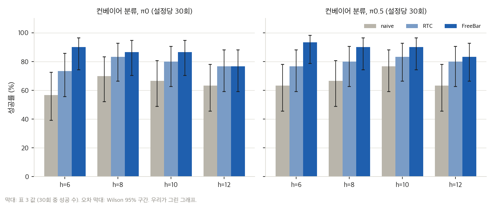
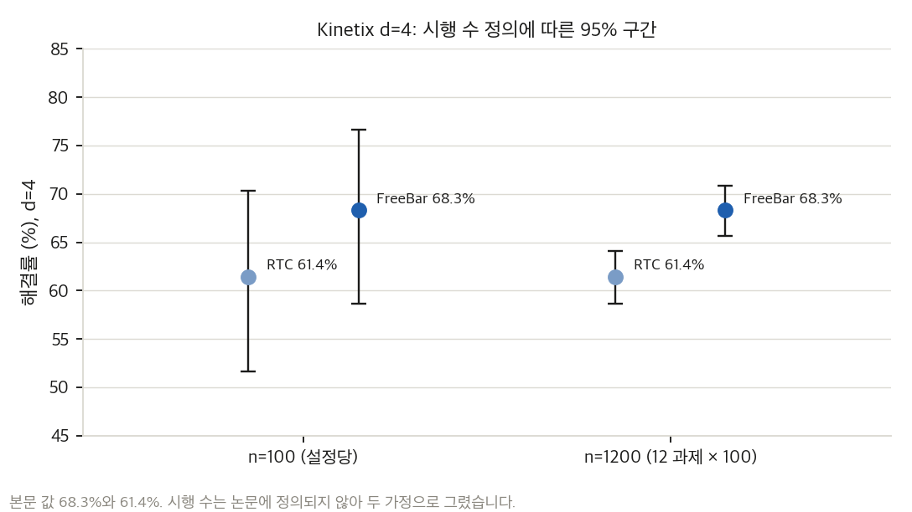
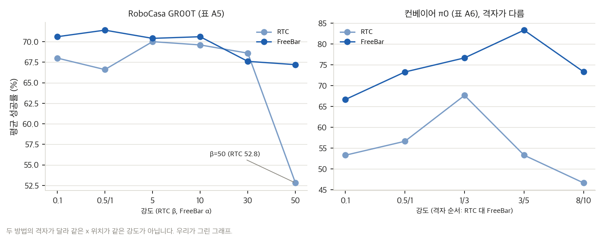

> **논문:** Wenbo Yu, Jifan Li, Wenke Xia, Yuchen Li, Yizhuo Zhang, Pei Ren, Zhengping Che, Di Hu. *Barrier-Constrained Guidance For Real-time Asynchronous VLA Execution.* CoRL 2026 포스터, arXiv:2610.14997 (v1, 2026-10-10).
> 공식 코드는 GitHub NamelessCrew/FreeBar에 있습니다(Apache-2.0). 이 글의 그래프는 논문 표 값으로 우리가 그린 것이며, 논문 그림은 쓰지 않았습니다(arXiv 비독점 라이선스).

## 논문이 묻는 것

비동기 실행에서 VLA는 다음 청크를 만드는 동안 이미 실행 중인 행동을 계속합니다. 그래서 새 청크의 앞부분이 현재 실행 중인 행동과 어긋납니다. 기존 해결책은 두 갈래입니다. 지연을 반영해 다시 학습하거나(구조를 바꾸는 방법 포함), RTC처럼 추론 중에 VJP(벡터-야코비안 곱)로 보정합니다. 후자는 효과가 있지만 스텝마다 역전파 비슷한 계산이 들어갑니다.

FreeBar는 VJP를 없앱니다. 깨끗한 행동 추정과 이전 청크의 차이에서 안내 방향 g를 만들고, 제약 g^T ṽ ≥ b를 만족하도록 속도를 **닫힌형 한 줄**로 고칩니다. 수평선은 세 구간으로 나눕니다. 앞부분(실행된 d칸)은 강하게 맞추고, 중간 구간은 지수적으로 약하게, 뒷부분은 자유롭게 둡니다. 바리어 세기는 생성이 끝날수록 조입니다.

## 이 글에서 확인한 것

**1. 초록의 "10–15% 평균 향상"은 본문 표의 값으로 확인되지 않습니다.** RoboCasa는 GR00T와 π0, 각 세 지연 설정으로 여섯 칸을 줍니다. FreeBar와 naive의 차이는 2.2에서 5.1 pp이고 평균은 +3.6 pp입니다. 실로봇은 설정 합계로 +21 pp입니다. 두 숫자를 합친 평균은 정의되어 있지 않습니다.

**2. RTC 대비 실로봇 우위는 방향만 맞습니다.** 표 3은 설정당 30회입니다. 네 수평선을 합치면 FreeBar는 π0에서 85.0%, RTC는 78.3%입니다(차 6.7 pp, Fisher p=0.24). π0.5는 89.2% 대 80.0%입니다(차 9.2 pp, p=0.07). 본문의 "17–19 pp"는 표 A6, A7의 격자 평균이라서 같은 설정끼리의 차이가 아닙니다.

*그래프: 표 3의 설정별 성공률과 Wilson 95% 구간. 우리가 그린 그래프입니다.*

**3. Kinetix의 d=4 우위는 시행 수 정의에 달려 있습니다.** 68.3%와 61.4%의 차이는 설정당 100회면 p=0.31, 1200회면 p=0.0004입니다. 논문은 "100회 시행"이라고 쓰지만, 12과제 평균인지 설정당 시행인지 정의하지 않습니다.

*그래프: 본문 값 68.3%와 61.4%에 Wilson 95% 구간을 두 가지 시행 수 가정으로 그렸습니다. 우리가 그린 그래프입니다.*

**4. 공식 코드의 Kinetix 경로는 0 패딩 칸의 가중치를 RTC와 다르게 둡니다.** 참조 청크는 실행한 칸만큼 밀리고 뒤쪽은 0으로 채워집니다. RTC는 그 칸의 가중치를 0으로 막지만 FreeBar는 막지 않습니다. 그래서 h가 H의 절반을 넘는 칸(H=8이면 h≥5)에서 중간 구간 가중치가 0 목표에 실립니다. 예를 들어 d=1, h=7에서는 안내 가중치의 63%가 그 칸에 실립니다. 코드를 읽어서 얻은 계산이며, 실행해서 확인하지는 않았습니다.

**5. 코드와 논문의 세부가 다릅니다.** 에너지는 가중치를 제곱해 계산하고(식 (2)는 선형), 수평선 가중치의 분모도 다릅니다. λ 상한은 보정 크기가 아니라 λ 자체에 걸립니다. 논문에는 α와 β의 값이 없습니다. 공식 저장소의 기본값은 β=3, α=10이고, RoboCasa 예시는 α=20입니다.

**6. 민감도의 "강건성"은 한 점에서 생깁니다.** RoboCasa에서 RTC의 표준편차 6.55는 β=50(52.8%) 한 점 때문입니다. 그 점을 빼면 RTC는 평균 68.56, 표준편차 1.35로 FreeBar의 1.77보다 작습니다.

*그래프: 부록 표 A5, A6의 격자별 값. RTC와 FreeBar의 격자가 달라 같은 x 위치가 같은 강도는 아닙니다. 우리가 그린 그래프입니다.*

## 구현 가능성

- **알고리즘은 구현할 수 있습니다.** 핵심 계산은 공식 코드 기준 약 140줄이고, 역전파가 없습니다. 흐름 정책이면 어떤 백본에도 붙일 수 있습니다. 노력은 한두 날 정도로 추정합니다(측정하지 않음).
- **RoboCasa와 실로봇 수치는 일반 개인 장비에서 재현할 수 없습니다.** RoboCasa 평가에는 CUDA, MuJoCo EGL, 약 10 GB의 자산, 공개되지 않은 GR00T 체크포인트가 필요합니다. 실로봇 코드는 저장소에 없습니다.
- **Kinetix는 조건부입니다.** JAX의 CUDA 고정 의존성을 바꾸고 BC 정책을 학습해야 합니다.

## 저장소 상태

공식 저장소는 2026-09-19 "Initial release" 한 커밋입니다. README에는 채우지 않은 템플릿 자리(arXiv 링크 XXXX.XXXXX, 인용 "Coming soon", 연락처 자리)가 남아 있습니다. 실로봇 실험 코드, RoboCasa용 RTC 기준선, 표 2의 가벼운 기준선 코드는 없습니다. 프로젝트 페이지는 찾지 못했습니다.

## 남은 질문

저자에게 물을 것은 네 가지입니다. Kinetix 시행 수의 정의, α와 β의 실험값, RoboCasa 시행 수, 그리고 Kinetix 경로가 참조의 0 패딩을 어떻게 다루는지입니다. 마지막 질문은 결과 표 h≥5 칸에 직접 영향을 줍니다.

## 자료

- [통합 리포트 PDF](report/report_public.pdf)
- [01. 논문 분석: Barrier-Constrained Guidance For Real-time Asynchronous VLA Execution](analysis/01_paper_analysis.md)
- [02. 선행연구, 가까운 대안, 저장소](analysis/02_prior_work.md)
- [03. 수치 재계산, 일관성 검사, 주장 판정](analysis/03_analysis.md)
- [04. 공식 코드 대조 (정적 읽기)](analysis/04_code_verification.md)
