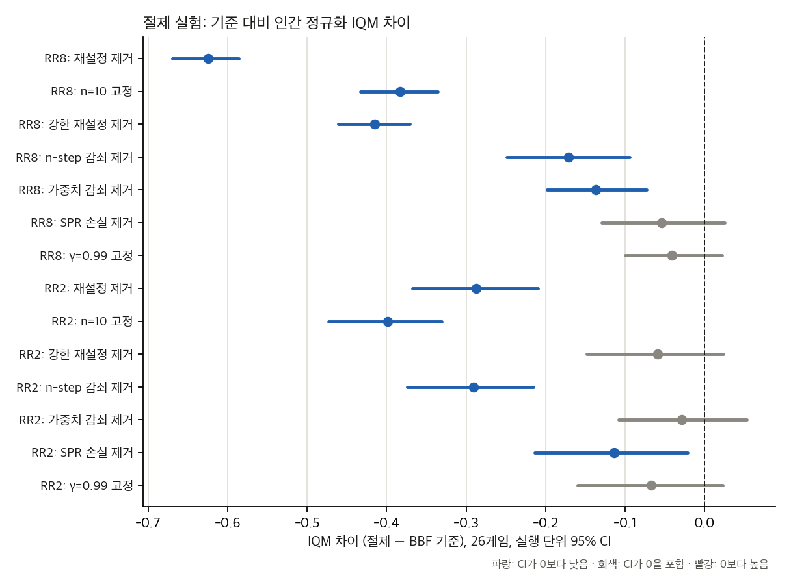
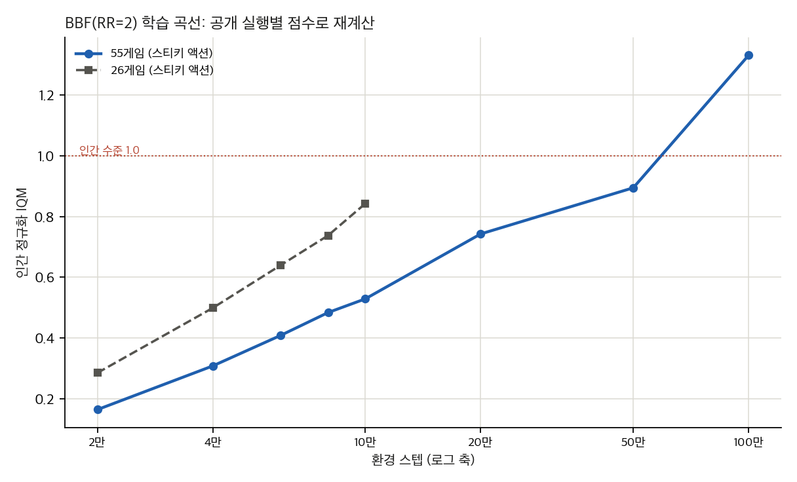

> **논문:** Max Schwarzer, Johan Obando-Ceron, Aaron Courville, Marc G. Bellemare, Rishabh Agarwal, Pablo Samuel Castro. *Bigger, Better, Faster: Human-level Atari with human-level efficiency.* ICML 2023, PMLR 202, arXiv:2305.19452 (v3, 2023-11-13).
> 공식 코드는 google-research 저장소의 `bigger_better_faster/` 폴더입니다. 이 글의 그래프는 공개 점수 파일로 우리가 그린 것이고, 논문 그림은 쓰지 않았습니다.

## 논문이 묻는 것

샘플 효율은 강화학습에서 오래된 과제입니다. Atari 100K는 게임당 10만 스텝, 사람으로 치면 약 두 시간만 플레이하게 합니다. 이 조건에서 효율이 가장 좋았던 모델 기반 에이전트 EfficientZero는 계산 자원이 많이 들었습니다. BBF는 **모델-프리 값 기반 에이전트**로 같은 수준의 효율을 주장합니다. 방법은 새 알고리즘이 아니라 기존 SR-SPR에 몇 가지 설계를 더한 것입니다.

## 무엇을 더했나

- **네트워크 폭 4배의 Impala ResNet**(15층). SR-SPR은 폭을 키우면 성능이 무너지는데, BBF는 4배까지 계속 오릅니다.
- **더 강한 재설정**: 합성곱 층을 50% 방향으로 섞습니다(SR-SPR은 20%).
- **n-step 감쇠**: 재설정 뒤 1만 그래디언트 스텝 동안 n을 10에서 3으로 줄입니다.
- **할인율 증가**: γ를 0.97에서 0.997로 올립니다.
- **NoisyNets 제거**, **EMA 표적망**과 SPR 손실 유지.

## 공개 점수로 다시 계산한 결과

논문 부록 표 A.1은 26게임의 점수를 줍니다. 공식 저장소에는 실행별 점수 파일이 있어서 IQM, 신뢰구간, 절제 검정을 다시 계산했습니다. 학습은 하지 않았고, 공개된 점수만 다뤘습니다.

| 지표 | 논문 표 A.1 | 공개 점수 재계산 |
|---|---|---|
| IQM (리플레이 비율 8) | 1.045 | 1.023 (95% CI 0.993–1.056) |
| Games > Human | 12 | 12 (표 값에서 계산) |
| 게임별 평균 점수 | 표 값 | 최대 13.6% 차이 (frostbite) |

- **초인간 주장은 점 추정으로만 맞습니다.** CI 하한이 1.0보다 조금 낮습니다.
- **표의 게임별 값을 만든 절차는 공개되지 않았습니다.** 앞 50개 시드나 뒤 50개 시드로도 맞지 않았습니다.

*그림: 기준 BBF 대비 인간 정규화 IQM 차이, 26게임, 실행 단위 95% 신뢰구간. 우리가 공개 점수로 그린 그래프입니다.*

절제 실험에서 가장 큰 차이는 재설정 제거(리플레이 비율 8에서 −0.63)와 n=10 고정(−0.38)입니다. SPR 손실 제거는 리플레이 비율 2에서만 신뢰구간이 0을 벗어납니다. 게임 단위 검정과 실행 단위 신뢰구간이 엇갈리는 경우가 있어서, 두 가지를 같이 보고해야 합니다.

*그림: 리플레이 비율 2, 스티키 액션, 공개 점수로 계산한 인간 정규화 IQM 학습 곡선. 우리가 그린 그래프입니다.*

29개 held-out 게임은 26개보다 훨씬 어렵습니다(IQM 0.46 대 1.06). 그래도 절제 효과의 방향은 같습니다.

## 공식 설정에서 확인한 것

- **기본 설정은 리플레이 비율 2입니다.** `BBF.gin`의 리플레이 비율 값 64는 배치 32에서 환경 스텝당 그래디언트 2회입니다. 논문 주 결과는 리플레이 비율 8입니다. 설정 파일 주석이 재설정 주기를 바꾸라고 적고 있어, 주 결과를 재현하려면 두 값을 바꿔야 합니다.
- **논문에 없는 설정이 많습니다.** 학습률, 표적망 계수, 손실 가중치, 증강 방식이 코드에만 있습니다. 논문 본문에는 하이퍼파라미터 표가 없습니다.
- **계산 시간 수치가 맞지 않습니다.** 논문은 같은 에이전트에 대해 "약 6시간, 단일 GPU"와 "10시간, 단일 CPU와 A100 절반"을 둘 다 씁니다.

## 이 맥에서 재현할 수 있나

| 무엇 | 판정 |
|---|---|
| 논문 주 결과 (리플레이 비율 8, 26게임 × 50시드) | 불가. 한 실행 A100 절반으로 10시간, 전체는 약 6,500 A100시간 (추정) |
| 공식 코드 한 게임, 한 시드 | 조건부. 핀된 구버전 환경 설치가 필요하고, Apple Silicon 설치 가능성은 확인하지 못함 |
| PyTorch로 다시 구현해 한 게임 학습 | 조건부. 2–3주 (추정) |

CUDA가 없는 맥에서는 논문 규모 재현이 어렵습니다. 점수 재계산과 구조 확인은 할 수 있습니다.

## 라이선스와 공개 범위

논문의 arXiv 라이선스는 CC BY가 아니라 arXiv 비독점 배포 라이선스 1.0입니다. 그래서 논문 그림은 이 글에 넣지 않았습니다. PDF에는 회사 저작권 표시가 없고, PMLR 표준 저작권 문구만 있습니다.

## 자료

- [통합 리포트 PDF](report/report_public.pdf)
- [01. 논문 분석: BBF (arXiv:2305.19452)](analysis/01_paper_analysis.md)
- [02. 선행연구와 관련 저장소](analysis/02_prior_work.md)
- [03. 수치 재계산, 일관성 검사, 주장 판정](analysis/03_analysis.md)
- [04. 공식 코드 대조와 구현 가능성](analysis/04_code_verification.md)
