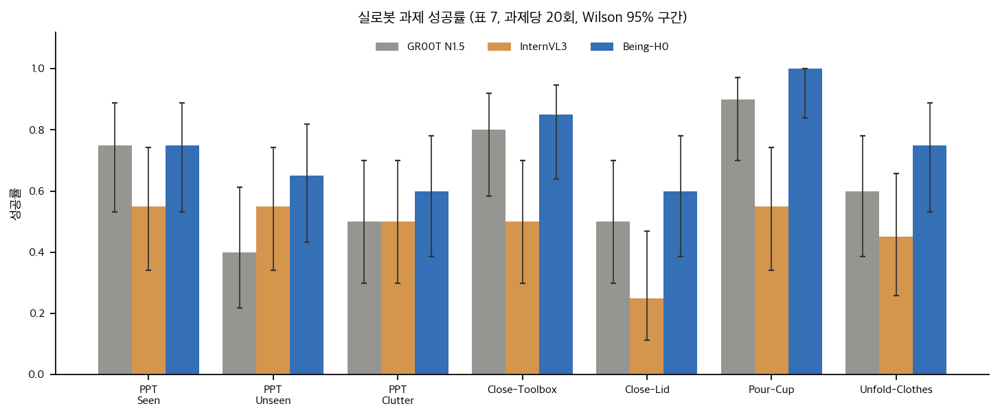
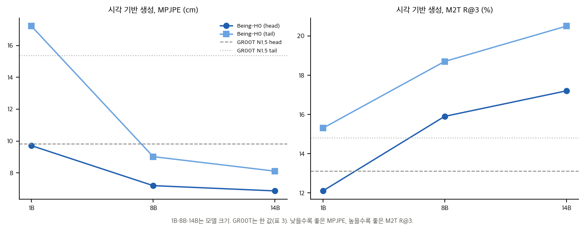
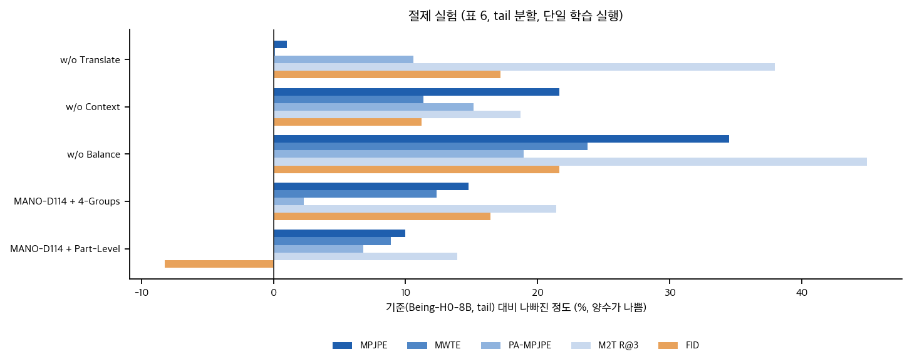

> **논문:** Hao Luo, Yicheng Feng, Wanpeng Zhang, Sipeng Zheng, Ye Wang, Haoqi Yuan, Jiazheng Liu, Chaoyi Xu, Haiweng Xu, Qin Jin, Zongqing Lu. *Being-H0: Vision-Language-Action Pretraining from Large-Scale Human Videos.* ICML 2026 포스터, arXiv:2507.15597 (v1, 2025-07-21).
> 공식 코드는 GitHub BeingBeyond/Being-H0(MIT)에 있습니다. 이 글의 그림은 우리가 그린 그래프 세 장입니다. 논문 그림은 arXiv 라이선스(비 CC BY)라 싣지 않았습니다.

## 논문이 묻는 것

로봇 학습에는 텔레오퍼레이션 데이터가 적고, 시뮬레이션은 현실과 차이가 큽니다. 사람 손 영상은 양이 많고 현실 차이가 작지만, 카메라마다 좌표가 다르고 손 동작을 로봇 행동으로 옮기기 어렵습니다. Being-H0는 손 동작 자체를 예측 대상으로 삼습니다.

흐름은 세 단계입니다. 첫째, 손 자세(MANO)를 손목과 손가락 두 부분으로 나눠 잔차 양자화 토큰으로 바꾸고, 1초에 128 토큰을 만듭니다. 둘째, InternVL3 백본에 이 토큰을 넣어 사람 영상으로 사전학습합니다. 셋째, 로봇 과제에서는 학습 가능한 쿼리와 MLP 헤드가 관절 행동을 L1 손실로 맞춥니다.

*그래프 (우리가 그림). 논문 표 7의 값을 다시 그렸습니다. 과제당 20회입니다.*

## 이 글에서 확인한 것

**1. 실로봇 합계는 기준선보다 확실히 높습니다.** 과제 일곱 개(20회씩)에서 Being-H0는 104/140, 같은 구조의 InternVL3는 67/140입니다. 합계 Fisher 검정 p ≈ 9×10⁻⁶입니다. 과제별로는 컵 붓기 하나만 Holm 보정 후 유의합니다(p = 0.009).

**2. GR00T N1.5와의 차이는 방향만 맞습니다.** 합계 104 대 89, p = 0.070, 95% 구간 −0.1 ~ 21.2%p입니다. 20회 과제에서 0.25 차이를 잡으려면 집단당 약 58회가 필요합니다.

**3. 생성 표는 모델이 커질수록 좋아지지만, 일부 셀은 어긋납니다.** 8B와 14B는 시각 기반과 문맥 기반 생성의 20셀 모두에서 GR00T보다 낫습니다. tail FID에서 1B(13.1)가 8B(13.4)보다 좋고, 문맥 기반 PA-MPJPE에서는 14B가 8B보다 조금 나쁩니다.

*그래프 (우리가 그림). 1B, 8B, 14B의 head와 tail 값입니다. GR00T 값은 참고선입니다.*

**4. 절제에서는 데이터 균형이 가장 큽니다.** 균형을 빼면 tail MPJPE가 34.5% 늘고 M2T는 45% 떨어집니다. 다만 모든 절제는 한 번만 학습했습니다. 0.5 cm 안팎의 차이는 학습 잡음과 구분할 수 없습니다.

*그래프 (우리가 그림). 기준(8B, tail) 대비 나빠진 정도입니다. 양수가 나쁨입니다.*

**5. 본문과 표가 어긋나는 곳이 있습니다.** GR00T가 "훨씬 적은 후처리 데이터"로 졌다는 서술은 같은 논문의 "동일한 데이터"라는 설명과 맞지 않습니다. 문맥 제거가 "모든 지표를 떨어뜨린다"는 것도 FID head에서는 맞지 않습니다. UniHand 프레임 수는 표 1 행의 합이 123.9M인데 본문은 130M입니다.

## 공식 코드로 본 것

공식 저장소는 MIT이고 추론과 토크나이저 설정이 있습니다. 학습 코드와 스크립트는 README 체크리스트에서 아직 미완료입니다. 그래서 논문의 학습 설정(AdamW lr 1e-5, 배치 128, A800 32장)을 확인할 수 없습니다.

설정에는 논문에 없는 항목이 있습니다. 토크나이저 손실에 속도 항(가중치 1.0)과 `l1_smooth`가 들어 있습니다. 행동 헤드도 논문이 설명한 쿼리 방식 외에 다른 방식이 있습니다. 표 3–6을 만드는 평가 스크립트도 없습니다. 지표 함수만 있습니다.

## 구현 가능성

- **이 맥에서 학습과 실로봇 재현은 불가능합니다.** 학습 코드가 없고, 실로봇 장비도 없습니다.
- **추론은 조건부입니다.** 1B(2.4 GB)와 8B(16 GB) 추론은 CPU 경로만 있고 MPS 경로는 없습니다. 14B(31 GB)는 24 GiB 메모리에 들어가지 않습니다.
- **토크나이저 재구성 검사는 조건부입니다.** 0.21 GB 가중치와 MANO 파일 등록, 테스트 데이터 준비가 필요합니다.

이 글은 재현 실험을 하지 않았습니다. 재계산과 검정, 공식 코드의 정적 대조만 했습니다.

## 한계

- 실로봇 시행이 과제당 20회입니다. 과제별 결론은 큰 차이만 말할 수 있습니다.
- 표 2–7에 씨앗 반복과 신뢰구간이 없습니다.
- 소프트 형식 디코딩(표 4)은 매 블록에 정답 궤적을 섞습니다. 자유 롤아웃 오차가 아닙니다.
- 손 모델링은 손만 다루고 물체 포즈는 쓰지 않습니다(논문 스스로 밝힘).

## 출처와 라이선스

- 논문: arXiv:2507.15597 v1. arXiv 라이선스는 nonexclusive-distrib 1.0입니다(CC BY 아님). 그래서 논문 그림은 싣지 않았습니다.
- 그래프 세 장은 본문 표 값을 옮겨 우리가 그렸습니다.
- 공식 코드(MIT)는 정적으로만 읽었습니다. 설치하거나 실행하지 않았습니다. 모델과 데이터는 받지 않았습니다.
- UniHand 원천 데이터와 MANO 파일의 라이선스는 이 글에서 확인하지 않았습니다.

## 자료

- [통합 리포트 PDF](report/report_public.pdf)
- [01. 논문 분석: Being-H0 (arXiv:2507.15597)](analysis/01_paper_analysis.md)
- [02. 선행연구와 관련 저장소](analysis/02_prior_work.md)
- [03. 수치 재계산, 일관성 검사, 주장 판정](analysis/03_analysis.md)
- [04. 공식 코드 대조와 구현 가능성](analysis/04_code_verification.md)
