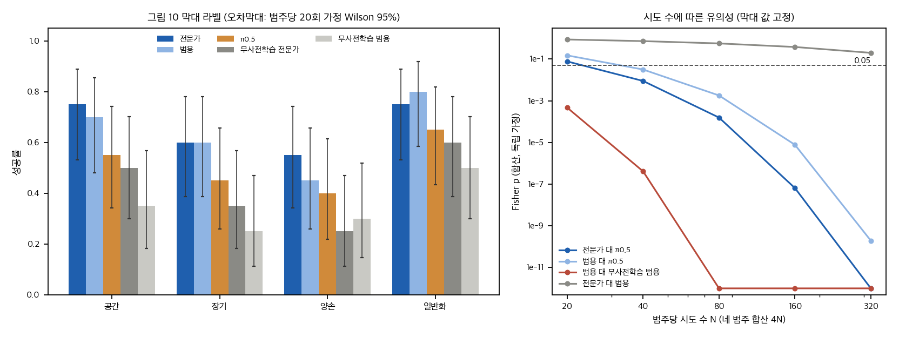
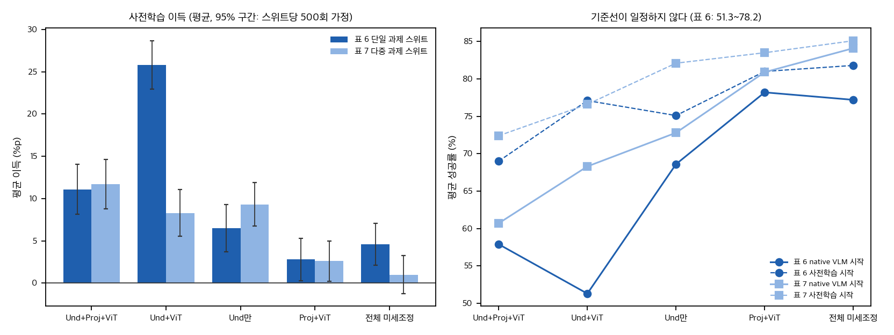
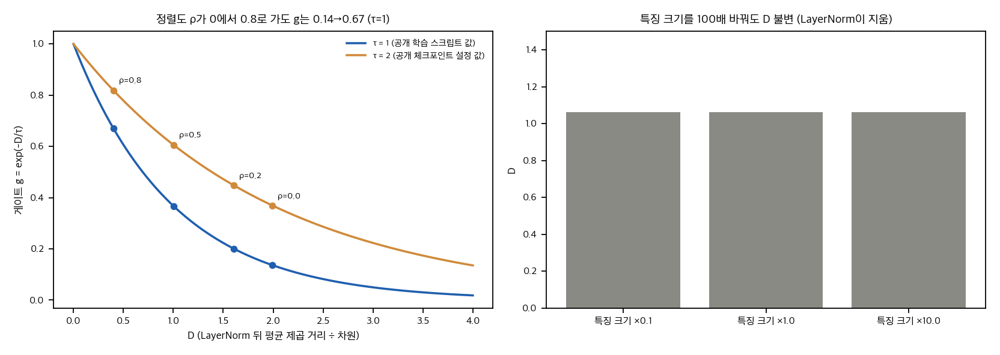

> **논문:** Hao Luo, Ye Wang, Wanpeng Zhang, Sipeng Zheng 외, BeingBeyond Team. *Being-H0.5: Scaling Human-Centric Robot Learning for Cross-Embodiment Generalization.* CoRL 2026 구두 발표, arXiv:2601.12993 (v1, 2026-01-19).
> 공식 코드는 GitHub BeingBeyond/Being-H(Apache-2.0)에 있습니다. 이 글의 그림은 우리가 그린 그래프 세 장입니다. 논문 그림은 arXiv 라이선스(비 CC BY)라 싣지 않았습니다.

## 논문이 묻는 것

로봇마다 행동 공간이 달라 한 모델을 여러 로봇에 쓰기 어렵습니다. Being-H0.5는 사람 손 동작을 공통어로 삼아, 사람 영상 16,000시간과 30종 로봇 14,000시간, 비전-언어 데이터를 섞어 사전학습합니다. 모든 로봇의 상태와 행동을 하나의 슬롯 벡터(공식 코드는 200차원)에 넣고, 흐름 행동 전문가에 Mixture of Flow, 후학습에 슬롯 어댑터, 게이팅(MPG), 비동기 청킹(UAC)을 더합니다. LIBERO 98.9%, RoboCasa 53.9%와 실로봇 5종 결과를 보고합니다.

## 이 글에서 확인한 것

**1. 표 8의 숫자는 본문과 반대입니다.** 본문은 마스크 모션 예측을 빼면 MWDS가 "뚜렷하게 떨어진다"고 쓰지만, 표에서는 빼면 Lab 0.33에서 0.35, Wild 0.20에서 0.28로 오히려 높습니다.

**2. 실로봇 결과에는 시도 수와 오차가 없습니다.** 막대 값이 모두 5의 배수라 칸당 시도 수는 20의 배수여야 합니다. 범주당 20회로 가정하면 π0.5 대비 우위는 네 범주를 합쳐도 유의하지 않고(전문가 p = 0.077, 범용 p = 0.15), 40회부터 유의해집니다. 반면 사전학습 효과(범용 대 무사전학습 범용, +15~35%p)는 20회에서도 합산 p < 0.005로 확실합니다.

*그래프 (우리가 그림). 왼쪽은 그림 10 막대 라벨(범주당 20회 가정 Wilson 구간), 오른쪽은 범주당 시도 수에 따른 합산 Fisher p입니다.*

**3. 사전학습 이득 +25.8%p는 낮은 기준선 하나에서 나옵니다.** 표 6의 같은 native VLM 기준선이 구성마다 51.3~78.2%로 27%p 움직입니다. 표 7의 전체 미세조정 이득 +1.0%p는 p = 0.41(스위트당 500회 가정)로 구별되지 않습니다. 모든 절제는 한 번만 학습했습니다.

*그래프 (우리가 그림). 왼쪽은 평균 이득과 95% 구간(스위트당 500회 가정), 오른쪽은 기준선과 사전학습 시작 모델의 평균입니다.*

**4. LIBERO 98.9는 평균만 1등입니다.** 네 스위트 중 Goal만 1등이고 Long은 X-VLA(97.6)가 높아 캡션의 "Long에서 큰 우위"는 표 값과 맞지 않습니다. EO1 평균은 98.2가 아니라 98.375입니다. RoboCasa는 π0 대비 +11.5%p로 확실하지만 총합 열에 가중 평균과 단순 평균이 섞여 있습니다.

**5. MPG 게이트는 평균 제곱 거리이고 크기 변화에 무반응입니다.** 앵커를 관측 길이로 방송하면 슬라이스드 바서슈타인 거리는 평균 제곱 거리와 같아지고, LayerNorm 때문에 특징 크기를 0.1배나 10배로 바꿔도 값이 변하지 않습니다. 논문에는 분포 이동 아래의 게이트 값이 없습니다.

*그래프 (우리가 그림). 왼쪽은 정렬도에 따른 게이트, 오른쪽은 특징 크기를 바꿨을 때의 D입니다. 공식 코드와 같은 계산을 numpy로 쓴 장난감입니다.*

**6. 규모 수치가 어긋납니다.** UniHand-1.0 대비 "100배, 200배"는 시간 기준 13.9배, 30.3배이고, 시뮬 "26%"는 로봇 시간 기준(전체 시간 기준 10.3%)입니다. 본문의 실로봇 서술 일부(양손에서 범용이 "근소하게" 뒤짐, 일반화가 "덜 치명적")도 막대 값과 맞지 않습니다.

## 공식 코드로 본 것

공개 코드는 InternVL3.5-2B와 0.6B급 흐름 행동 전문가를 LIBERO와 RoboCasa에 후학습하는 경로입니다. 행동 전문가는 라우터가 없는 밀집 구조여서 Mixture of Flow가 없고, 슬롯별 어댑터와 이산 모션 목적(L_MASK), 사람 모션 로더, 두 스레드 배포 코드도 없습니다. UAC의 학습 시뮬레이션 지연은 임베디먼트별이 아닌 전역값이고 모든 공개 레시피에서 꺼져 있으며, 공개 LIBERO 체크포인트는 MPG(λ 0.1)만 켠 설정입니다. 사람 MANO는 로봇 손 슬롯과 다른 슬롯(90–200)에 놓여 손가락 수준의 슬롯 공유가 없습니다. 논문 이후 추론 수정이 두 번 들어갔습니다.

## 구현 가능성

- **논문 전체의 재현은 불가능합니다.** 사전학습 코드가 없고 후학습은 CUDA GPU 4장 규모이며 실로봇 5종 장비가 필요합니다.
- **2B 체크포인트(11.2 GB) 추론은 조건부입니다.** 24 GiB 메모리에는 들어가지만 flash-attn과 flex_attention 경로 포팅이 필요합니다.
- 이 글은 재현 실험을 하지 않았습니다. 재계산, 검정, 정적 대조와 작은 CPU 장난감만 했습니다.

## 한계

- 그림 10·13의 값은 PDF의 막대 라벨을 읽은 것이고 시도 수 가정에 따라 결론이 달라집니다.
- 표 6·7의 스위트별 시도 수는 500회로 가정했습니다. 시드 변동은 어느 표에도 없어 실제 불확실성은 보고된 p보다 큽니다.
- 공개 체크포인트는 설정 파일만 읽었고 가중치는 받지 않았습니다.

## 출처와 라이선스

- 논문: arXiv:2601.12993 v1. arXiv 라이선스는 nonexclusive-distrib 1.0입니다(CC BY 아님). 그래서 논문 그림은 싣지 않았습니다.
- 그래프 세 장은 본문 표와 그림 라벨 값을 옮겨 우리가 그렸습니다.
- 공식 코드(Apache-2.0)는 정적으로만 읽었습니다. 설치하거나 실행하지 않았고 가중치와 데이터는 받지 않았습니다.
- UniHand 원천 데이터와 MANO 파일의 라이선스는 이 글에서 확인하지 않았습니다.

## 자료

- [통합 리포트 PDF](report/report_public.pdf)
- [01. 논문 분석: Being-H0.5 (arXiv:2601.12993)](analysis/01_paper_analysis.md)
- [02. 선행연구, 자료 지도, 관련 분석: Being-H0.5 (arXiv:2601.12993)](analysis/02_prior_work.md)
- [03. 수치 재계산, 일관성 검사, 주장 판정: Being-H0.5 (arXiv:2601.12993)](analysis/03_analysis.md)
- [04. 공식 코드 대조와 구현 가능성: Being-H0.5 (arXiv:2601.12993)](analysis/04_code_verification.md)
