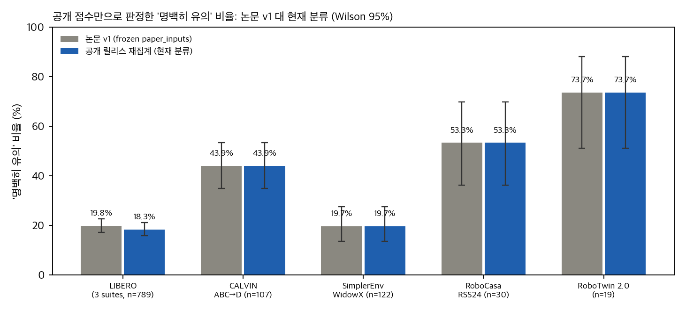
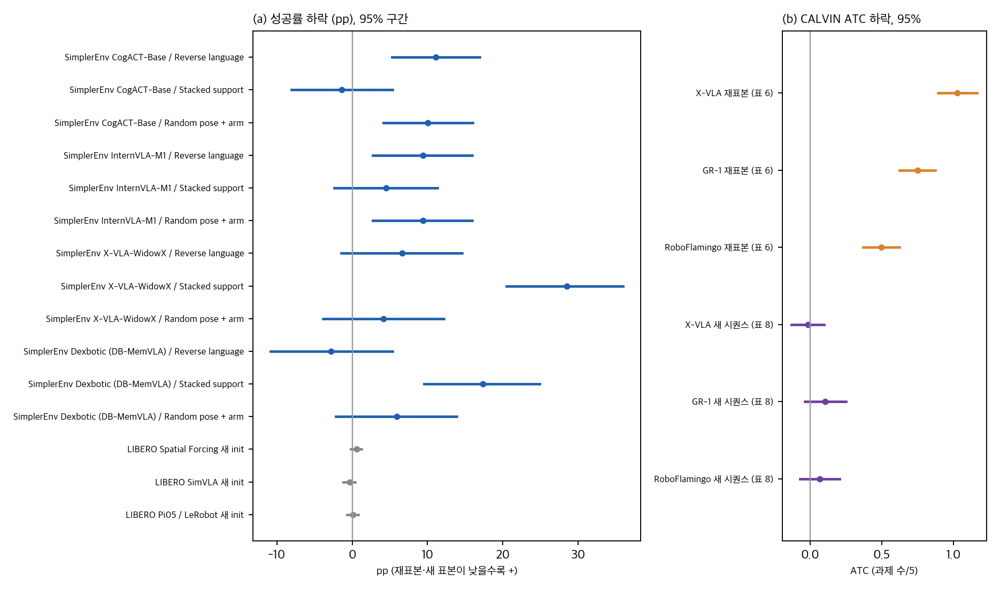
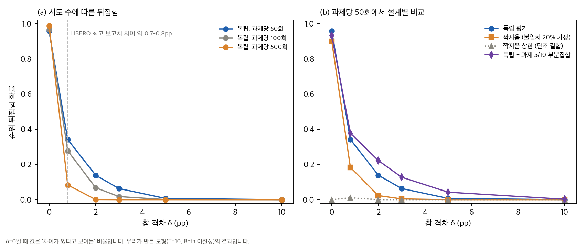

> **논문:** Tianchong Jiang, Xiangshan Tan, Samuel Wheeler, Luzhe Sun, Tewodros W. Ayalew, Matthew Walter. *What Are We Actually Benchmarking in Robot Manipulation?* CoRL 2026 구두 발표, arXiv:2606.04233 (v1, 2026-06-02).
> 공식 코드(MIT)는 정적으로만 읽었고 실행하지 않았습니다. 논문 그림은 싣지 않고, 우리가 만든 그래프만 씁니다.

## 논문이 묻는 것

조작 벤치마크의 점수는 "고정된 평가 조건 하나에서의 성공률"입니다. 그런데 이 점수는 일반 조작 능력의 증거처럼 읽힙니다. 이 논문은 점수가 능력의 증거가 되지 못하는 네 가지 경우를 정하고, 각각에 진단을 하나씩 만들어 LIBERO, CALVIN, SimplerEnv, RoboCasa, RoboTwin 2.0에 적용합니다.

- **지름길.** 언어 인코더가 없는 0.09B 프로브가 LIBERO에서 최고 보고치와 1pp 안에 듭니다.
- **통계적 유의성.** 집계 점수만 있을 때 "명백히 유의", "판정 불가", "무유의"를 나누는 경계를 제시합니다.
- **과적합의 누적.** CALVIN에서 블록 포즈를 학습 범위 안에서 다시 뽑으면 모든 정책의 점수가 내려갑니다.
- **데이터 출처.** SimplerEnv에서 격자 근처 시연 120개로 학습한 22M 정책이 X-VLA 0.9B와 같은 점수(91/96 대 92/96)를 냅니다.

## 이 글에서 확인한 것

**표는 대부분 맞습니다.** 표 2, 3, 5, 6, 7, 8과 LIBERO 다섯 정책의 쌍 불일치(평균 D = 0.03528)는 공개 파일로 같은 값이 나왔습니다. SimplerEnv의 12개 셀은 성공 수, 하락, 95% 구간이 모두 맞고, 가장 큰 차이는 0.005pp입니다.

**그림 3의 LIBERO 헤드라인이 판본마다 다릅니다.** 논문 v1은 LIBERO 789개 비교 중 156개(19.8%)를 "명백히 유의"로 봅니다. 공개 릴리스의 현재 분류는 144개(18.3%)입니다. 행 88개가 다른 범주로 옮겨 갔습니다. 그중 68개는 보고 격차가 정확히 0인 동점이고, v1은 그중 13개를 "명백히 유의"로 넣었습니다. 다른 벤치마크의 수치는 그대로입니다.

그래프: 논문 v1 입력(회색)과 공개 릴리스 재집계(파랑)의 '명백히 유의' 비율과 Wilson 95% 구간. LIBERO에서만 차이가 납니다. 우리가 그린 그래프입니다.

**재표본은 점수를 내리지만 순위는 바꾸지 않았습니다.** CALVIN에서 블록 포즈를 바꾸면 세 정책의 평균 완료 과제 수가 1.027, 0.749, 0.498 내려갑니다. 세 정책 모두 95% 구간이 0을 넘고, 순위는 그대로입니다.

그래프: 공개 파일에서 재계산한 하락량과 95% 구간. (a) SimplerEnv와 LIBERO는 pp, (b) CALVIN은 ATC 단위입니다. 논문 표 5–8과 같은 값입니다.

**0.8pp 차이는 이 설계로 가리기 어렵습니다.** 우리가 만든 모형(과제 10개, 과제당 50회)으로 보면, 독립 평가에서 두 정책의 순위가 뒤집힐 확률은 0.8pp 차이에서 34%입니다. LIBERO 최고 보고치 차이가 0.7–0.8pp 수준이라는 점이 문제입니다. 같은 초기 상태로 짝지으면 18%로 줄고, 과제 5개만 쓰면 38%로 늘어납니다. 짝지음 가정(불일치 20%, 시도 불일치 약 3.7%)은 공개 LIBERO 자료의 실제 쌍 불일치 3.5%와 비슷합니다. 이 모형은 실제 정책의 예측이 아닙니다.

그래프: 참 격차 δ에 따른 순위 뒤집힘 확률. 독립 평가, 짝지음(불일치 20% 가정), 짝지음 상한, 과제 5/10 부분집합. 우리가 만든 모형의 결과입니다.

## 구현 가능성 (이 맥 기준)

이 맥(Apple M4 Pro, 24 GiB, MPS, CUDA 없음)에서 통계와 집계 재현은 구현할 수 있고, 이미 했습니다. 가장 중요한 실험인 LIBERO 무언어 프로브는 설치와 데이터 다운로드를 승인받은 뒤 MPS에서 조건부로 가능합니다. 저자 명령이 CUDA만 쓰므로 MPS 학습 시간은 아직 재지 않았습니다. CALVIN은 대용량 데이터 때문에 우선순위가 낮습니다. SimplerEnv의 외부 정책 4개 재평가는 이 맥에서 현실적이지 않습니다.

## 한계와 남은 질문

- **학습 시드 변동을 재지 않았습니다.** 논문도 체크포인트 한 개의 점수를 씁니다. 그래서 점수 차이가 시드 변동보다 큰지 알 수 없습니다.
- **체크포인트 선택.** 최고 체크포인트를 시험 세트에서 고르면 LIBERO 평균이 97.6%에서 95.1%로 내려갑니다. 논문도 이를 인정합니다.
- **다중 비교.** 그림 3의 비교를 행마다 따로 판정하고 보정하지 않습니다.
- **SimplerEnv 층화.** 과제 4개로 층화하면 24/122, 한 층으로 풀면 27입니다. 본문에 이 민감도가 없습니다.

저자에게 물을 질문은 다음과 같습니다. 그림 3의 격차 0 행을 어떻게 분류했는지, 최종 판본의 값이 무엇인지, SimplerEnv의 층화 방식을 밝힐 수 있는지, CALVIN ABC→D의 완전한 매니페스트를 공개할 수 있는지입니다.

## 링크

- 논문: [arXiv:2606.04233](https://arxiv.org/abs/2606.04233)
- 프로젝트 페이지: [ripl.github.io/manipulation_benchmark_audit](https://ripl.github.io/manipulation_benchmark_audit/)
- 공식 코드 (MIT): [github.com/ripl/ManipulationBenchmarkAudit](https://github.com/ripl/ManipulationBenchmarkAudit)

## 자료

- [통합 리포트 PDF](report/report_public.pdf)
- [What Are We Actually Benchmarking in Robot Manipulation? (arXiv:2606.04233) 분석](analysis/01_paper_analysis.md)
- [02. 선행연구, 가까운 대안, 관련 분석](analysis/02_prior_work.md)
- [03. 재계산, 일관성 검사, 토이](analysis/03_analysis.md)
- [04. 코드와 공개 자료 검증 (정적 읽기)](analysis/04_code_verification.md)
