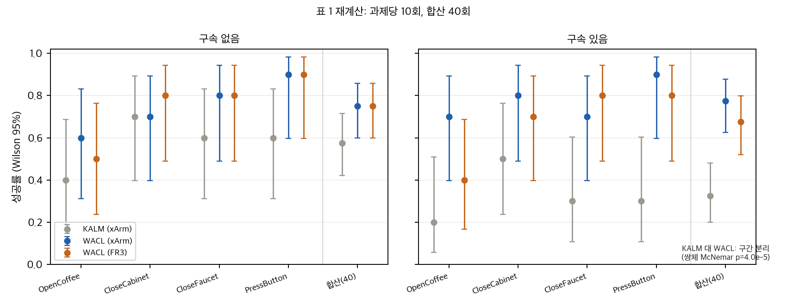
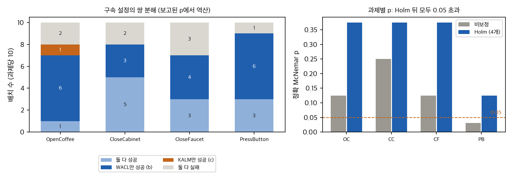
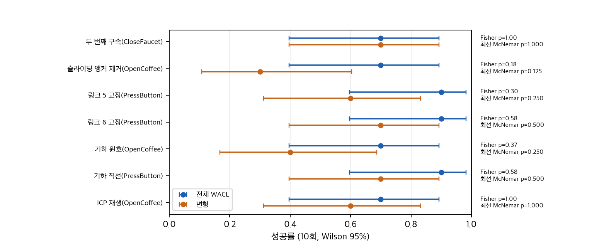
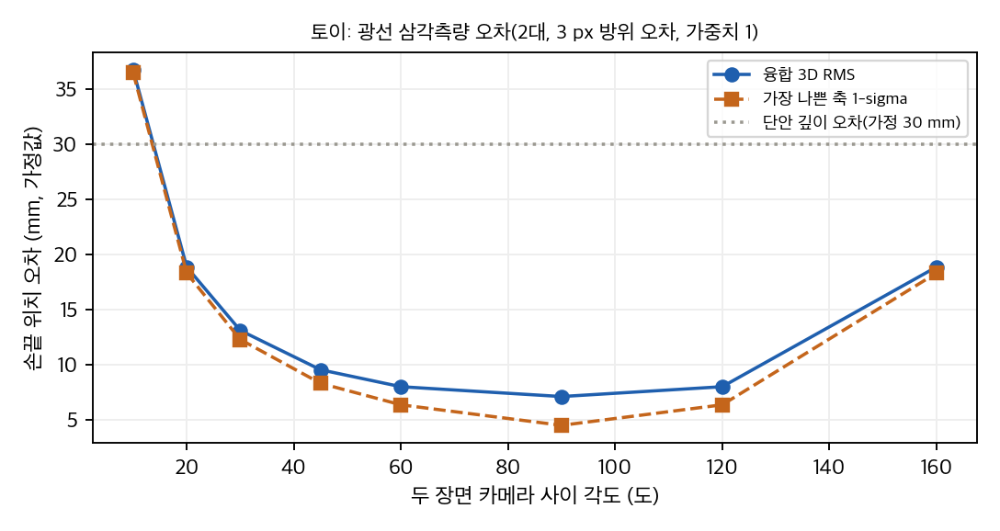

# 03. 수치 재계산과 해석

`analysis/recompute.py`(numpy, scipy, 수 초)가 논문의 표 1, 2, 4, 5, 부록 B.3, B.4, B.7, A.7의 수치를 다시 계산하고 `recompute_results.json`에 저장합니다. 검사에는 **V1–V20** 번호를 붙였습니다. 원자료(배치별 성공 여부)는 공개되지 않아, 쌍 구조는 보고된 p와 주변 합에서 역산했습니다. 토이는 하나(`toy_triangulation.py`, 가정값)입니다.

## 1. 표 1과 B.3

### 1.1 합산과 반올림 (V1, V2, V19, V20)

| 열 | 과제별 성공 수 | 합 | 정확한 비율 | 논문 | 일치 |
|---|---|---|---|---|---|
| KALM 구속 없음 | 4, 7, 6, 6 | 23/40 | 57.5% | 58% | 예 |
| WACL 구속 없음 | 6, 7, 8, 9 | 30/40 | 75.0% | 75% | 예 |
| WACL(FR3) 구속 없음 | 5, 8, 8, 9 | 30/40 | 75.0% | 75% | 예 |
| KALM 구속 | 2, 5, 3, 3 | 13/40 | 32.5% | 33% | 예 |
| WACL 구속 | 7, 8, 7, 9 | 31/40 | 77.5% | 78% | 예 |
| WACL(FR3) 구속 | 4, 7, 8, 8 | 27/40 | 67.5% | 68% | 예 |

- **여섯 열이 모두 맞습니다.** 네 개(58, 33, 78, 68)는 정확히 .5라서 올림으로 반올림한 결과입니다. 초록의 "78% 대 33%"는 77.5%와 32.5%의 올림이고 격차는 45.0 pp로 같습니다(V19). 과제 평균과 합산은 과제당 10회로 같습니다(V20).
- **본문 문장 검사(V2):** "구속에서 KALM이 모든 과제에서 떨어진다" 맞음(OpenCoffee 4→2, CloseCabinet 7→5, CloseFaucet 6→3, PressButton 6→3). "세 과제에서 절반" 맞음(CloseCabinet은 71%). "구속 없음에서 WACL이 모든 과제에서 같거나 높다" 맞음. "WACL은 구속에 거의 영향 없음" 맞음(75% → 77.5%, +2.5 pp). "두 배 넘음" 맞음(31/13 = 2.38).
- Wilson 95% 구간(V5): 구속 합산 KALM [20.1, 48.0], WACL [62.5, 87.7]은 분리됩니다. 구속 없음 합산 KALM [42.2, 71.5], WACL [59.8, 85.8]은 겹칩니다. 논문 그림 8 설명과 같습니다(그림 8의 과제별 구간도 일치).

그림: 우리가 그린 그래프. 표 1의 성공률과 Wilson 95% 구간. 과제당 10회라 구간이 넓고, 구속 합산(40회)에서만 KALM과 WACL이 분리됩니다.

### 1.2 McNemar 쌍 구성 (V3)

논문은 합산에서 구속 설정은 "WACL만 성공 19, KALM만 성공 1, p = 4.0e-5", 구속 없음은 "11 대 4, p = 0.12"라고 씁니다(B.3).

- 주변 합과 맞습니다. 구속: WACL 31 = 둘 다 성공 12 + 19, KALM 13 = 12 + 1, 둘 다 실패 8, 합 40. 구속 없음: WACL 30 = 19 + 11, KALM 23 = 19 + 4, 둘 다 실패 6.
- 정확 McNemar(양측 이항): 구속 p = 4.005e-5, 구속 없음 p = 0.1185. **둘 다 논문 값과 일치.**
- **과제별 p(0.125, 0.25, 0.125, 0.031)에서 쌍을 역산하면 유일하게 정해집니다** (과제별 b, c): OpenCoffee (6, 1), CloseCabinet (3, 0), CloseFaucet (4, 0), PressButton (6, 0). 합은 19와 1로 합산 값과 맞습니다. 이 일치는 논문의 쌍 데이터가 과제별, 합산에서 서로 모순이 없다는 강한 정합성 증거입니다. (구속 없음의 과제별 쌍은 p가 보고되지 않아 역산할 수 없습니다.)
- 과제별 p의 Holm 보정(네 개): 0.375, 0.375, 0.375, 0.125. **보정 후 모든 과제가 0.05를 넘습니다.** 논문도 "보정 없이" 과제별 p를 적고 합산 주장만 한다고 씁니다(B.3). 이 분석이 덧붙이는 것은 PressButton의 0.031이 Holm 뒤 0.125가 된다는 점입니다.

그림: 우리가 그린 그래프. 왼쪽은 구속 설정의 쌍 분해(보고된 p에서 역산), 오른쪽은 과제별 정확 McNemar p의 Holm 보정 전후.

### 1.3 쌍체 t 검정과 비쌍체 검정 (V4, V6)

- 쌍체 t(40 쌍): 구속 t = 5.15, p = 7.74e-6(논문 7.7e-6), 구속 없음 t = 1.86, p = 0.0701(논문 0.07). **일치.** 차이가 {+1, 0, −1}뿐이라 t 검정은 근사에 불과하고 McNemar가 본검정입니다.
- 쌍을 무시한 Fisher(대조): 구속 합산 p = 1.0e-4, 구속 없음 합산 p = 0.155. 쌍체를 써도 결론은 같고, 구속은 p가 약 2.6배 작아집니다(배치마다 성공 확률이 다르므로 쌍체가 효율적).
- 과제별 비쌍체 Fisher(구속): 0.070, 0.350, 0.179, 0.020. 구속 없음: 0.656, 1.0, 0.628, 0.303.

### 1.4 취약성과 검출력 (V7, V8, V17)

- **구속 합산 결론은 단단합니다.** 불일치 쌍 20개 중 WACL만 성공 19, KALM만 성공 1입니다. 이 중 4개를 뒤집어 (15, 5)가 되어도 p = 0.041이고, 5개를 뒤집어 (14, 6)이 되어야 p = 0.115로 0.05를 넘습니다. KALM만 성공이 8개(b는 19로 고정)가 되어야 p = 0.052입니다.
- **구속 없음의 "동등"은 증거가 아닙니다.** (11, 4)에서 KALM만 성공한 쌍 하나가 WACL만 성공으로 바뀌었어도(12, 3) p = 0.035입니다(V7). 추정 효과는 +17.5 pp입니다. 비쌍체 정규근사로 75% 대 57.5%를 80% 검정력으로 구분하려면 팔당 약 **115회**가 필요합니다(V17). 40회로는 부족합니다. 논문도 "구속 없음의 차이는 유의하지 않다"고만 쓰고(§4.2), 서론의 "동등하거나 높다"는 표현은 이 맥락에서 읽어야 합니다.
- **n = 10인 쌍 한 세트가 낼 수 있는 가장 작은 McNemar p(V8):** 성공 수 차이 4 → 0.125, 5 → 0.0625, 6 → 0.031, 7 → 0.0156. 즉 과제 하나에서 10회씩 돌리면 **성공 수 차이가 6 이상**이어야 5% 수준에 닿을 수 있습니다.

## 2. 표 2: 절제, 일반화, 대조 (V9, V10, V17)

| 변형(과제) | 변형 / 전체 | Fisher p | 최선의 McNemar p(차이만큼 b, c = 0) | Wilson 구간(변형) |
|---|---|---|---|---|
| 두 번째 구속(CloseFaucet) | 7/10, 7/10 | 1.00 | 1.00 | [39.7, 89.2] |
| 슬라이딩 앵커 제거(OpenCoffee) | 3/10, 7/10 | 0.179 | 0.125 | [10.8, 60.3] |
| 링크 5 고정(PressButton) | 6/10, 9/10 | 0.303 | 0.250 | [31.3, 83.2] |
| 링크 6 고정(PressButton) | 7/10, 9/10 | 0.582 | 0.500 | [39.7, 89.2] |
| 기하 원호(OpenCoffee) | 4/10, 7/10 | 0.370 | 0.250 | [16.8, 68.7] |
| 기하 직선(PressButton) | 7/10, 9/10 | 0.582 | 0.500 | [39.7, 89.2] |
| ICP 정합 재생(OpenCoffee) | 6/10, 7/10 | 1.00 | 1.00 | [31.3, 83.2] |

그림: 우리가 그린 그래프. 표 2의 일곱 행. 변형과 전체 WACL의 Wilson 95% 구간이 모두 크게 겹치고, 어느 행도 단독으로 검정 가능한 크기가 아닙니다.

- **일곱 행 어디서도 변형과 전체 모델의 차이를 단독으로 검정할 수 없습니다.** 가장 큰 차이(슬라이딩 앵커 4회)의 가장 유리한 쌍 구성도 p = 0.125입니다. 저자도 "유의성 주장이 아니라 메커니즘 발견"이라고 적었고(B.3), 이를 지탱하는 증거는 숫자가 아니라 **로그의 실패 원인**입니다(B.7: 7회 실패 중 5회가 빔이 중간에 사라짐). 이 질적 증거는 숫자보다 설득력이 큽니다.
- **링크 탐색 행의 쌍 구성(V10)은 일관됩니다.** 4 + 2 + 3 + 1 = 10, 링크 5 성공 = 4 + 2 = 6, 링크 6 성공 = 4 + 3 = 7, 합집합 = 9 = 다중 링크 결과 9/10. 그러므로 다중 링크 탐색 결과는 **두 고정 링크의 oracle 최선 선택과 같습니다**(B.7이 oracle이라고 밝힘). "실패 7회가 모두 실행 단계"는 링크 5의 4회와 링크 6의 3회를 합한 실행 횟수이고, 서로 다른 배치 수는 6(= 2 + 3 + 1)입니다.
- **학습 정책 대 ICP 재생(6/10 대 7/10)은 구분할 수 없습니다.** 이 차이를 80% 검정력으로 구분하려면 팔당 358회가 필요합니다(V17). 따라서 "학습된 궤적이 필요하다"는 결론은 OpenCoffee 원호(4/10 대 7/10, 팔당 약 44회가 필요한 크기)에서만 방향이 나오고 재생 대조에서는 나오지 않습니다. 저자의 해석("시연된 동작이 과제를 수행한다", "정책은 정합과 과제별 매개변수 없이 7/10") 그대로 읽으면 됩니다.
- **두 번째 구속 행(7/10 대 7/10)은 변화 없음의 근거로는 약합니다.** 동등성을 보이려면 허용 한계를 먼저 정해야 하고, 7/10의 Wilson 구간이 [39.7, 89.2]이기 때문입니다. 비교 대상 7/10은 표 1의 CloseFaucet(수건) 셀이고, 두 번째 구속 실험은 수건을 컵으로 바꾼 별도 과제이며 상자 높이도 1.40에서 1.00 m로 줄었습니다(표 3). 같은 배치라고 표 2 캡션이 말하지만 물체와 구속이 바뀌었습니다.

## 3. 표 4, B.4, 표 5

### 3.1 제약 생성 감사 (V11)

열 합이 보고 총계와 일치합니다: 구문 100, 유형 100, 완전 정확 94, 과제약 6, 느슨 0, 재요청 8. 94 + 6 + 0 = 100입니다.

- 94/100의 Wilson 95% 구간은 [87.5, 97.2], 느슨 0/100의 상한은 3.7%(Wilson)입니다. PressButton과 두 제약 설정은 각각 17/20이며 구간은 [64.0, 94.8]입니다.
- 이 감사는 **저장된 관측 네 개 위에서 시드를 20번 돌린 것**입니다. 장면 다양성이 아니라 VLM 샘플링 분산을 잽니다. 정답 기준(축 10° 이내, 원뿔 각 2배 이내, 영역이 성공 궤적의 95%를 포함, 적대 시험 거부)은 저자가 만들었습니다. GPT-5.5 스냅샷은 하나이고 식별자가 없어 재현 시 모델이 바뀌면 달라질 수 있습니다.
- 오류의 방향은 안전한 쪽입니다. 6개는 과제약이고 하드 게이트가 "무계획"으로 바꿉니다(B.2). 그러나 **무계획은 실패로 세므로 VLM의 과제약은 표 1의 성공률을 낮춥니다.** PressButton 3/20(15%), 두 제약 3/20은 배포 설정에서 기대 손실이 됩니다.

### 3.2 계획 실패 로그 (V12)

74회 시도 × 후보 2개 = 148(후보 수는 시도당 정확히 2.0), 124 성공, 24 실패. 실패 원인 11 + 8 + 4 + 1 = 24이고 백분율 45.8, 33.3, 16.7, 4.2가 보고된 46, 33, 17, 4와 맞습니다(합 100). 69/74 = 93.2%.
- 74회가 어느 세션인지 본문에 없습니다. 구속 WACL(xArm) 40회 롤아웃에 재계획이 더해진 수로 보이지만 FR3, 절제 포함 여부는 알 수 없습니다. 무계획 시도는 5회(Wilson 95% 구간 상한 14.9%)입니다. 이 세션이 xArm 구속 WACL이라면 실패 9회(40 − 31) 중 최대 5회가 계획 단계이고 나머지는 실행 단계로 읽힙니다.

### 3.3 오프라인 재생 (V13)

p 값 네 개가 모두 **KALM만 성공한 장면이 0개**일 때와 정확히 일치합니다. b = 24, 23, 27, 1이고 c = 0입니다(2 × 0.5^24 = 1.19e-7, 2 × 0.5^23 = 2.4e-7, 2 × 0.5^27 = 1.5e-8, 마지막 행은 p = 1.0이라 b, c 해가 여럿).

- 표 5의 KALM 구속 계획 성공(OpenCoffee 2/30, CloseFaucet 3/30)은 표 1의 KALM 구속 **실행 성공**(2/10, 3/10)과 같은 개수입니다. 이것이 같은 장면에서 나온 것이라면 KALM의 구속 실패는 거의 전부 "무계획"입니다. 즉 구속에서의 78% 대 33%는 **계획기의 실현 가능성 차이**(6자유도 링크 포즈 약속 대 위치·법선 + 링크·앵커 탐색)로 거의 설명되고, 확산 정책의 품질 차이가 아닙니다. 구조적 설명(§4.2)과 일치합니다.
- **"30개 장면"의 출처가 불명확합니다.** 표 1의 셀당 롤아웃은 10회이고 캡션은 "OpenCoffee 장면은 표 1의 것"이라고 합니다. 30은 세 세션(KALM, WACL, FR3) × 10 배치일 수 있습니다. 그렇다면 고유 배치는 10개이고 같은 배치의 관찰이 세 번 세어져 **유효 n이 10에 가까워집니다.** 그러면 p = 1.2e-7 같은 값은 과대평가입니다. 본문만으로는 판단할 수 없어 저자에게 물어야 합니다(`analysis/04_claim_verification.md` §5).
- 표 5로 보는 WACL의 남은 실패: CloseFaucet 구속에서 계획 30/30인데 실행 7/10이므로 세 번의 실패는 모두 실행 단계(지각, 개루프 접촉). OpenCoffee도 계획 26/30(87%)에서 실행 7/10(70%)입니다. **WACL의 오차 예산은 최적화기보다 실행에 있습니다**(B.4와 부합).

## 4. 런타임, 빔 크기, 기호 (V14, V16)

- 제약 사슬 10.88 + 2.76 + 14.68 = 28.32 s, 보고된 장벽 28.31 s(0.01 s 차이는 반올림). 28.31 + 6.32 = 34.63 s로 총합 일치. 전체의 **73.8%가 두 번의 VLM 호출**(10.88 + 14.68), SAM3까지 합하면 81.8%.
- 앵커 준비 6.32 s와 장벽 이후 6.32 s가 같은 값입니다. 그림 6의 막대 길이도 둘 다 약 6.3 s(그림 판독 값)로 표 값과 맞으므로, 서로 다른 두 구간이 같은 값을 가진 것으로 읽습니다.
- 빔: 20 × 32 = 640 후보/단계가 A.5의 640과 일치.
- **수평선 기호:** 본문 T*의 H(§3.1), 정책 궤적 길이 16(A.2), 탐색 수평선 H = 4 또는 8(A.5), "최대 8웨이포인트"(§6)로, 정책 출력 16점을 4–8점으로 줄이는 다운샘플 규칙이 본문에 없습니다.
- **학습 규모(V16):** 100k 반복 × 배치 512 = 5,120만 샘플을 과제당 시연 10개(뷰별로 나누면 최대 30쌍)에 씁니다. 데이터 증강이나 노이즈 설명이 본문에 없으므로 이 모델은 사실상 과제별 암기에 가깝고, "ICP 재생 6/10 대 정책 7/10"이라는 결과와 잘 맞습니다. 이것은 추정이며 증강의 유무는 알 수 없습니다.

## 5. 교차 로봇과 롤아웃 예산 (V15, V18)

- FR3 대 xArm: 구속 없음 30 대 30(p = 1.0), 구속 27 대 31(Fisher p = 0.45). 격차는 OpenCoffee 4/10 대 7/10(p = 0.37)에 집중되고, 차이 순 −4 중 −3이 이 과제입니다. 저자의 "구조적 이유(두꺼운 링크)" 해석은 가능하지만 10회로는 노이즈와 구분되지 않습니다.
- FR3에는 KALM을 돌리지 않았으므로 FR3에서의 WACL 대 KALM 비교는 없습니다. (WACL(FR3) 27/40 대 KALM(xArm) 13/40은 Fisher p = 0.0034이지만 서로 다른 로봇이라 비교로 쓰면 안 됩니다.)
- 보고된 실로봇 롤아웃: 표 1이 6열 × 4과제 × 10 = 240, 표 2가 7행 × 10 = 70, 합 310회. 시연은 WACL 40개(맨손), KALM 40개(GELLO).
- **학습 시드:** 셀당 학습된 모델은 하나이고 시드 변동은 보고되지 않았습니다. 모든 p 값은 롤아웃 변동만 반영하고 학습 변동은 포함하지 않습니다.

## 6. 토이: 다중 뷰 삼각측량 (`toy_triangulation.py`)

**검증하려는 주장:** 단안 손 추정은 깊이가 부정확하지만 다중 뷰 광선 삼각측량이 잔차를 다른 카메라가 구속하는 방향으로 밀어낸다(§3.2.1, A.1). 논문은 융합 손끝 오차의 크기를 보고하지 않습니다.

**설정(모두 가정, 논문에 없음):** 작업 중심 (0.5, 0, 0.15) m, 장면 카메라 둘은 좌우 ±0.7 m 높이 0.6 m, 손목 카메라는 위 0.8 m. 뷰별 방위각 오차 0.005 rad(3 px 상당), 단안 깊이 오차 30 mm(광선 방향). 가중치 1(논문은 실루엣 IoU).

| 구성 | 손끝 3D RMS 오차 |
|---|---|
| 단안 한 대 | 약 30 mm(깊이 방향이 지배) |
| 장면 카메라 두 대(약 115° 간격) | 7.1 mm(몬테카를로 7.06 mm) |
| 세 대(손목 포함) | 5.0 mm(몬테카를로 5.06 mm) |

그림: 우리가 그린 그래프. 두 카메라 사이 각도에 따른 융합 오차(가정값). 각도가 10°이면 단안(30 mm)보다 나쁜 36.8 mm, 20°에서 18.9 mm이고, 60°–120°에서 약 8 mm 이하로 내려갑니다.

- 해석: **카메라 배치가 정확도의 핵심 설계 변수**이고, 두 카메라가 넓게 벌어지면 단안 30 mm가 수 mm로 줄어듭니다. 논문의 주장은 이 가정 하에서 기하학적으로 타당합니다. 한편 접촉 구간 전체가 아니라 접촉 손끝 정점 하나만 쓰고, 손끝 정점이 MANO 정점과 실제 접촉점 사이에서 갖는 편향, 가림(손이 물체에 가려질 때), 캘리브레이션 오차는 넣지 않았습니다. 이 토이는 **실제 오차의 추정이 아니라 민감도 확인**입니다.
- 이 토이는 한 번에 1초 미만으로 돌고 약 5 mm대 오차는 "큰 접촉 패치가 오차를 허용한다"(§4.2)는 서술과 같은 단위입니다. 실제 시스템의 수치는 알 수 없습니다.

토이를 하나만 만든 이유: 표면 접촉 IK와 빔 탐색의 축소판은 로봇 모델(xArm 7 메쉬)이 필요하고 "재현 금지" 범위에 가깝습니다. 구속 아래 성공률의 핵심 주장은 로봇과 계획기가 필요한 주장이라 CPU 토이로 닫히지 않습니다.

## 7. 종합

| 구분 | 결과 |
|---|---|
| 산술(합계, 백분율, 로그 개수, 런타임 합) | 모두 일치, 불일치 0건 |
| 통계(McNemar, t, Wilson, Table 5 p) | 보고된 p가 정확히 재현됨. 과제별 p에서 쌍을 역산하면 합산 19/1과 일치 |
| 서술과 표 | 일치(KALM "세 과제 절반", "두 배 넘음" 등) |
| 모호함 | 표 5의 30장면 출처, B.4의 74회 시도 범위, 수평선 기호 H |
| 효과의 신뢰도 | 구속 합산 효과는 확실. 과제별, 절제, 재생 대조는 n = 10이라 단독으로 확정 불가 |
| 교락 | 시연 방식(맨손 대 GELLO), 앵커 탐색 유무, 링크 선택(텔레오퍼레이터가 고정)이 함께 다름. 저자도 시연 방식은 분리하지 않았다고 명시 |
