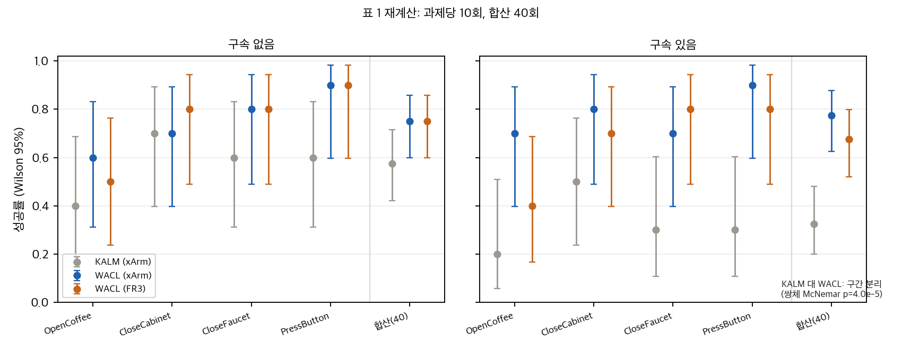
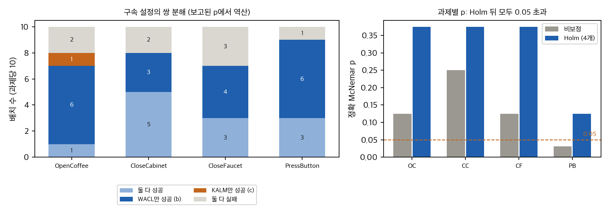
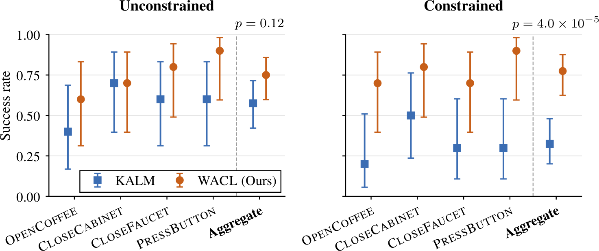
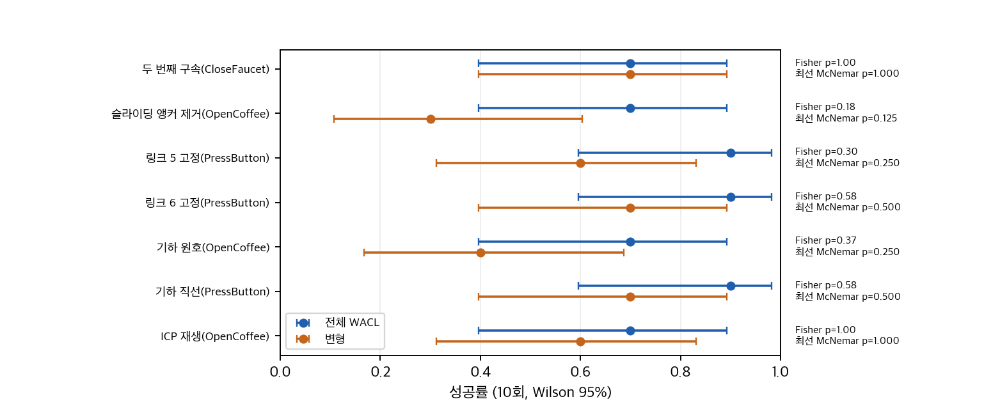
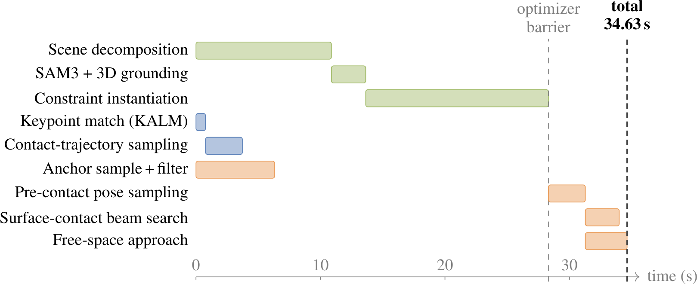
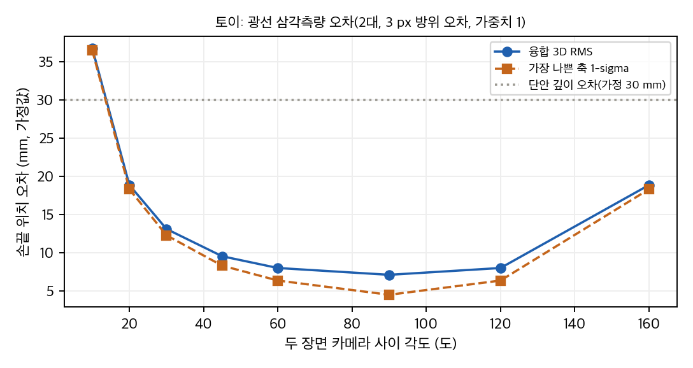

> **논문:** Bo-Ruei Huang, Daniel Seita, Erdem Bıyık. *Beyond the End-Effector: Learning Whole-Arm Contact Manipulation from Human Demonstrations.* CoRL 2026 포스터, arXiv:2610.17802 (v1, 2026-10-13). 논문은 arXiv에서 CC BY 4.0으로 공개되어 있습니다.
> 공식 코드는 공개되지 않았습니다(2026-11-23 확인). 논문 그림은 저자가 만든 그래프 두 장(그림 6, 8)만 출처와 함께 싣고, 나머지는 우리가 그린 그래프입니다.

## 논문이 묻는 것

사람은 손이 차 있을 때 팔꿈치와 팔뚝으로 문을 밀고 서랍을 닫습니다. 로봇은 보통 팔을 이동 수단으로만 쓰고 팔과 환경의 접촉은 피합니다. 이 논문은 그리퍼가 컵을 똑바로 들고 있는 동안 팔의 다른 링크로 커피 머신 손잡이를 드는 식의 **주 작업을 지키며 보조 접촉을 하는** 문제를 다룹니다.

방법인 **WACL**은 과제를 세 가지 로봇 비의존 표현으로 적습니다. 의미 키포인트, 접촉 위치와 법선으로 된 기준 궤적(맨손 시연 10개로 학습), 그리고 비전-언어 모델이 만든 안전 제약(AxisCone, PositionRegion 두 가지)입니다. 로봇의 기구학은 마지막 최적화기에만 들어갑니다. 최적화기는 접촉 링크, 링크 위의 앵커, 관절 구성을 함께 찾습니다. 앵커 후보마다 표면 접촉 IK를 풀고 빔 탐색으로 궤적을 조립합니다. 실험은 7-DoF xArm에서 네 과제를 과제당 10회씩 평가했고, 링크 포즈를 회귀하는 기준선 KALM이 78% 대 33%(구속 아래)로 뒤졌습니다.

## 이 글에서 확인한 것

**표의 숫자는 모두 맞습니다.** 표 1의 여섯 열 합(23, 30, 30, 13, 31, 27 / 40)과 반올림, 구속 합산 McNemar p = 4.0e-5, 쌍체 t 검정 7.7e-6, 표 4의 열 합, 표 5의 p 네 개가 모두 재현됩니다. 과제별 p(0.125, 0.25, 0.125, 0.031)에서 불일치 쌍을 역산하면 과제별로 유일하게 정해지고(OpenCoffee 6 대 1, CloseCabinet 3 대 0, CloseFaucet 4 대 0, PressButton 6 대 0) 합이 합산의 19 대 1과 정확히 맞습니다.

**구속 아래의 효과는 단단하고, 과제별 결론은 그렇지 않습니다.** 불일치 쌍 20개 중 4개를 뒤집어도 p = 0.041입니다. 반면 과제별 p는 Holm 보정 뒤 0.375, 0.375, 0.375, 0.125로 모두 0.05를 넘습니다. 논문도 합산 주장만 한다고 적었습니다. 구속이 없을 때의 75% 대 58%(p = 0.12)는 "동등"의 증거가 아니라 팔당 약 115회가 필요한 크기의 차이입니다.

**절제 일곱 행은 단독으로 검정할 수 없습니다.** 10회 쌍으로 얻을 수 있는 가장 작은 McNemar p는 성공 수 차이가 4일 때 0.125입니다. 슬라이딩 앵커 제거(3/10 대 7/10)는 Fisher p = 0.18이고, 근거는 숫자가 아니라 부록 B.7의 로그입니다(실패 7회 중 5회에서 고정 앵커가 중간에 IK 불가가 되어 빔이 사라짐). 링크 탐색의 9/10은 두 고정 링크(6/10, 7/10)의 합집합과 같습니다.

**학습된 정책의 기여는 입증되지 않았습니다.** 시연 하나를 ICP로 정합해 재생한 대조가 6/10, 정책이 7/10으로 구분되지 않으며, 이를 80% 검정력으로 가르려면 팔당 358회가 필요합니다. 시연 10개에 100k 반복, 배치 512로 학습하므로 과제별 암기에 가까운 모델로 보입니다(추정, 증강 유무는 본문에 없음).

**구속 아래 격차는 계획기의 실현 가능성으로 설명됩니다.** 표 5(오프라인 재생)의 p 네 개는 모두 "KALM만 성공한 장면이 0개"일 때와 정확히 맞고, KALM의 구속 계획 성공 2/30, 3/30은 표 1의 실행 성공 2/10, 3/10과 같은 개수입니다. 6자유도 링크 포즈를 약속한 기준선은 구속이 걸리면 IK가 풀리지 않습니다. 다만 30장면이 세 세션 × 10 배치라면 유효 표본은 10에 가까워져 p가 과대평가됩니다.

**실행 중 구속 준수는 측정되지 않았습니다.** 성공은 계획이 반환되고 하위 목표에 도달한 것이고, 구속(컵 기울기 25° 이내, 영역 안)은 계획 게이트로만 확인합니다. 제약 생성 감사는 94/100이 완전 정확(Wilson 95% 구간 [87.5, 97.2]), 배포본보다 느슨한 것은 0/100이지만 저장된 관측 네 개 위에서 20 시드씩 돌린 것입니다. 추론은 34.63 s이고 그중 73.8%가 두 번의 호스티드 VLM 호출입니다.

**맨손 시연의 3D 정확도는 보고되지 않았습니다.** 논문은 다중 뷰 광선 삼각측량이 단안 깊이 오차를 줄인다고 주장하지만 융합 손끝 오차의 수치가 없습니다. 아래 토이는 카메라 배치와 오차 크기를 가정한 민감도 확인입니다(실제 오차가 아닙니다). 가정 하에서 두 카메라가 넓게 벌어지면 단안 30 mm가 약 7 mm로 줄고, 10°처럼 좁으면 단안보다 나쁩니다.

## 구현 가능성

코드가 없고 실로봇, GPT-5.5 호출, cuRobo(CUDA), SAM3와 손 추적기가 필요해 **논문 수치의 재현은 개인 컴퓨터에서 불가능**합니다. 핵심 알고리즘(표면 접촉 IK + 링크·앵커 빔 탐색 + 구속 게이트)의 축소판은 처음부터 새로 짜면 시뮬레이션에서 구현할 수 있습니다. 노력은 3–4주로 추정하지만 측정하지 않았습니다.

## 한계

- 공식 코드가 없어 구현 세부(앵커 샘플러, 빔 탐색, 게이트)는 논문 서술로만 확인했습니다.
- 배치별 성공 여부가 공개되지 않아 McNemar 쌍은 보고된 p와 주변 합에서 역산했습니다. 구속 없음의 과제별 쌍은 역산할 수 없습니다.
- 삼각측량 토이의 카메라 배치와 오차 크기는 가정입니다.
- 프로젝트 페이지의 PDF는 arXiv v1과 문장과 참고문헌 두 건이 다르고(숫자는 같음), 이후 arXiv에 개정판이 올라올 수 있습니다.

재계산 스크립트와 분석 문서는 함께 올린 자료(`git/`)에 있습니다.

## 자료

- [통합 리포트 PDF](report/report_public.pdf)
- [01. 논문 분석: Beyond the End-Effector (WACL)](analysis/01_paper_analysis.md)
- [02. 선행 연구와 관련 자료](analysis/02_prior_work.md)
- [03. 수치 재계산과 해석](analysis/03_analysis.md)
- [04. 주장 검증과 구현 가능성](analysis/04_claim_verification.md)
