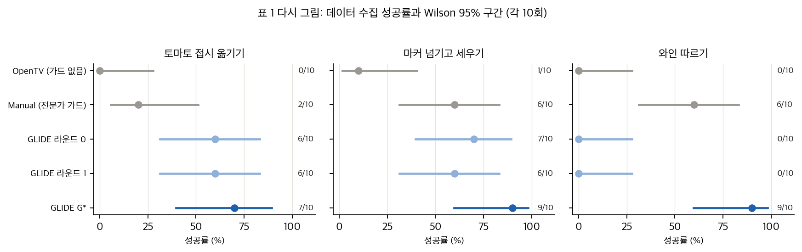
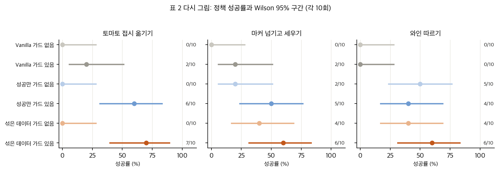
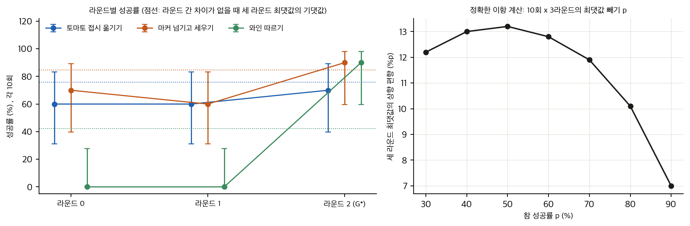

# 03. 수치 재계산, 일관성 검사, 주장 판정

재현 실험은 하지 않았습니다. 논문 표 1·2의 수치를 다시 계산하고 서로 맞춰 본 것이 이 문서의 내용입니다. 스크립트는 `analysis/recompute.py`(결과 `recompute_results.json`)와 `analysis/toy_selection_and_filter.py`(결과 `toy_selection_and_filter_results.json`)이고 둘 다 수 초 안에 끝납니다.

**전제.** 논문은 모든 셀을 10회로 적습니다(4.1절 Metrics "fraction out of ten trials", 4.2절 M = 10, 표 2 캡션 "ten evaluation trials"). 아래 검정은 이 10회를 그대로 쓰고, 시행별 결과가 없어 시행을 독립으로 가정한 Fisher 정확 검정(양측)과 Wilson 95% 구간을 씁니다. 표 2의 가드 유무 비교는 같은 정책을 같은 과제 순서로 돌린 쌍이라 짝 검정이 맞지만 시행별 데이터가 없어 독립 Fisher로 대신했습니다. 표 2의 행 복원은 `01` §3.3에 적었습니다.

## 1. 표 1 (데이터 수집)

### 1.1 Wilson 구간과 두 방법 비교 (V1, V2)

10회 중 k회의 Wilson 95% 구간(%): 0회 0–27.8, 1회 1.8–40.4, 2회 5.7–51.0, 6회 31.3–83.2, 7회 39.7–89.2, 9회 59.6–98.2. 표의 모든 성공률은 10회로 나누어 떨어지는 값이라 정수 조건에는 문제가 없습니다.

| 비교 | 토마토 (횟수, p) | 마커 | 와인 | 세 과제 합산 (30회 대 30회) |
|---|---|---|---|---|
| G\* 대 OpenTV | 7 대 0, p = 0.0031 | 9 대 1, p = 0.0011 | 9 대 0, p = 0.0001 | 25 대 1, p = 1e-10 (CMH p = 4e-9) |
| G\* 대 Manual | 7 대 2, p = 0.070 | 9 대 6, p = 0.30 | 9 대 6, p = 0.30 | 25 대 14, p = 0.0061 (CMH p = 0.0057, 공통 오즈비 7.1) |
| Manual 대 OpenTV | 2 대 0, p = 0.47 | 6 대 1, p = 0.057 | 6 대 0, p = 0.011 | - |
| G(0) 대 G\* | 6 대 7, p = 1.0 | 7 대 9, p = 0.58 | 0 대 9, p = 0.0001 | - |
| G(0) 대 Manual | 6 대 2, p = 0.17 | 7 대 6, p = 1.0 | 0 대 6, p = 0.011 | - |

세 과제에 걸친 Holm 보정(3개 비교)을 하면 G\* 대 OpenTV는 0.0031, 0.0022, 0.0004로 모두 유의합니다. G\* 대 Manual은 0.21, 0.61, 0.61로 유의하지 않습니다. 세 과제를 합산하면 유의하지만 이 합산은 과제가 서로 다른 시행이라는 가정(30개의 독립 시행)에 기댑니다. CMH(과제로 층화) 결과도 같습니다.

읽기: G\*가 가드 없는 원격조작(OpenTV)보다 높다는 결론은 셀 하나하나에서 확실합니다. "전문가가 손으로 짠 가드(Manual)보다 높다"는 방향이 세 과제에서 같고 합산으로는 유의하지만, 한 과제씩 보면 10회로는 구분되지 않습니다(토마토만 p = 0.07). Manual은 마커와 와인에서 이미 60%이고 OpenTV와도 와인에서만 구분됩니다(p = 0.011).

그래프: 우리가 그린 그래프. 표 1의 방법별 성공률과 Wilson 95% 구간(각 10회).

### 1.2 토마토 평균 남은 개수의 정수 가능 범위 (V5)

논문은 "성공"의 정의를 "토마토를 쏟지 않음"이라고만 적고 개수 기준은 적지 않습니다(4.1절 과제 설명, "keeping the plate stable ... so tomatoes are not spilled"). 성공이면 8개가 모두 남는다고 **가정하면**, 10회의 남은 개수 합은 8k 이상 8k + 7(10 − k) 이하여야 합니다. 표 1과 표 2의 11개 값(소수 첫째 자리 반올림 ±0.5 허용)이 모두 이 범위 안입니다. 예: G(0)은 60%, 평균 7.4라 합 74가 [48, 76] 안에 있고, 실패 4회의 평균 남은 개수는 6.5가 됩니다. G\*는 합 67이 [56, 77] 안이고 실패 3회의 평균 남은 개수는 3.7입니다. 이 가정은 논문에 없는 것이므로 불일치 판정에는 쓰지 않았습니다.

라운드 사이의 변화: 평균 남은 토마토는 G(0) 7.4 → G(1) 7.1 → G\* 6.7로 줄었고 성공률은 60 → 60 → 70%입니다. 본문은 "비이진 지표도 같은 패턴"이라 쓰는데(4.2절), 토마토 평균 남은 개수는 OpenTV·Manual 대비로는 높지만 GLIDE 라운드끼리는 증가하지 않았습니다(표 1에서 열 최댓값 굵은 글씨도 G(0)의 7.4입니다).

### 1.3 처리량으로 환산한 경과 시간 (V6)

처리량을 "성공 횟수 ÷ 경과 시간(분)"이라고 **가정하면**(4.1절 정의: "successful completions per elapsed minute") 10회 전체의 경과 시간이 나옵니다(처리량의 소수 첫째 자리 반올림 구간 포함).

- 마커: OpenTV 1.8–2.2분, Manual 2.1–2.2분, G(0) 3.3–3.4분, G(1) 2.3분, G\* 2.3분. 표 2의 여섯 행도 1.7–2.2분 범위입니다. G(0)만 다른 행보다 1분 정도 깁니다(3.2절은 이 라운드를 필터 지연이 문제였던 라운드로 서술합니다).
- 와인: Manual 9.2–10.9분, G\* 9.5–10.6분, 표 2의 네 행 7.3–13.3분.

시행당 환산 시간은 마커 약 13–14초, 와인 약 60초입니다. 공개 데이터셋 카드와 비교하면 같은 크기입니다(§5, V7).

## 2. 표 2 (정책 배치)

### 2.1 가드 유무와 학습 데이터 비교 (V3)

| 비교 (횟수 앞이 기준) | 토마토 | 마커 | 와인 | 합산 (30 대 30) |
|---|---|---|---|---|
| 가드 효과, Vanilla (무 대 유) | 0 대 2, p = 0.47 | 0 대 2, p = 0.47 | 0 대 0, p = 1.0 | 0 대 4, p = 0.11 |
| 가드 효과, 성공만 | 0 대 6, p = 0.011 | 2 대 5, p = 0.35 | 5 대 4, p = 1.0 | 7 대 15, p = 0.060 |
| 가드 효과, 섞은 데이터 | 0 대 7, p = 0.0031 | 4 대 6, p = 0.66 | 4 대 6, p = 0.66 | 8 대 19, p = 0.0089 (CMH p = 0.011) |
| 섞은 데이터 대 성공만 (가드 있음) | 6 대 7, p = 1.0 | 5 대 6, p = 1.0 | 4 대 6, p = 0.66 | 15 대 19, p = 0.43 |
| 섞은 데이터 대 성공만 (가드 없음) | 0 대 0, p = 1.0 | 2 대 4, p = 0.63 | 5 대 4, p = 1.0 | - |
| 섞은 데이터·가드 대 Vanilla·가드 | 2 대 7, p = 0.070 | 2 대 6, p = 0.17 | 0 대 6, p = 0.011 | - |

읽기:

- 가드가 정책 성공률을 높인다는 방향은 섞은 데이터 정책에서 세 과제 모두 같습니다(0 대 7, 4 대 6, 4 대 6). 한 과제씩 구분되는 것은 토마토(p = 0.003, 성공만 p = 0.011)뿐이고, 합산하면 섞은 데이터에서 유의합니다(p = 0.009).
- 와인의 성공만 정책은 가드가 없을 때 5회, 있을 때 4회입니다. 본문도 이 점을 적습니다(4.3절, "unguarded success-only execution reaches 50% ... versus 40%").
- **"섞은 데이터가 성공만보다 낫다"**(4.3절, 3.3절)는 가드를 켰을 때 7 대 6, 6 대 5, 6 대 4회이고 세 과제 합산 19 대 15회(p = 0.43)입니다. 가드가 없을 때는 0 대 0, 4 대 2, 4 대 5로 방향이 섞입니다. 방향은 가드 있을 때 일관되지만 이 시행 수로는 구분되지 않습니다. 또한 섞은 데이터는 에피소드가 더 많아 교란됩니다(토마토 30 대 19, 마커 30 대 22, 와인 60 대 30. 3.3절).
- 와인의 섞은 데이터·가드 정책 60%는 Vanilla·가드 0%보다 높습니다(p = 0.011). 토마토 7 대 2는 p = 0.070입니다.

그래프: 우리가 그린 그래프. 표 2의 학습 데이터와 가드 유무별 성공률과 Wilson 95% 구간(각 10회).

### 2.2 본문 서술과 표의 대조

4.3절의 숫자 서술은 표 2와 모두 맞습니다(Vanilla 0%와 20·20·0%, 성공만 0 → 60과 20 → 50, 와인 50 대 40, 섞은 데이터 0·40·40 대 70·60·60). 굵은 글씨(열 최댓값)도 PDF의 글꼴로 확인한 결과 토마토 남은 개수 6.3, 마커 처리량 2.9, 와인 처리량 0.6(성공만·무가드 행)과 성공률 70·60·60%이고, 본문의 "highest tomato retention and marker throughput"과 일치합니다(와인 처리량은 최대가 아닙니다).

## 3. 라운드 사이 변화와 최댓값 선택 (토이 S)

식 4는 성공률이 가장 높은 라운드의 가드를 G\*로 정합니다. 세 과제에서 최댓값 라운드는 모두 마지막(k = 2)이라 이 규칙이 결과를 바꾸지는 않았습니다. 다만 최댓값으로 보고되는 G\*의 성공률은 참값에 비해 위쪽으로 기울 수 있으므로 그 크기를 정확한 이항 분포로 계산했습니다.

- 10회 × 3라운드의 최댓값의 상향 편향은 참 성공률 p가 같을 때 p = 0.3–0.9에서 약 7–13 %p입니다(p = 0.5에서 13.2 %p, p = 0.9에서 7.0 %p).
- 라운드 사이에 차이가 없다고 해도(풀링 p), 토마토는 최댓값 기댓값이 75.9%이고 관측된 최댓값(7회) 이상이 나올 확률이 0.85입니다. 마커는 기댓값 84.7%이고 최댓값(9회) 이상이 나올 확률이 0.50입니다. 즉 토마토와 마커의 60 → 70%, 70 → 60 → 90%는 라운드 사이 차이가 없을 때도 흔히 나오는 범위입니다(Cochran-Armitage 추세 p = 0.64, 0.31).
- 와인은 다릅니다. 0, 0, 9회는 라운드 간 차이가 없다는 가정에서 나올 수 없는 값입니다(추세 p < 1e-4, 정확 계산에서 최댓값 9 이상 확률 0.000). 두 번의 수정으로 0%에서 90%가 된 것은 확실한 변화입니다.

그래프: 우리가 그린 그래프. 왼쪽은 표 1의 GLIDE 세 라운드 성공률과 Wilson 구간(점선은 라운드 간 차이가 없다고 가정한 세 라운드 최댓값의 기댓값이고, 와인은 가정이 성립하지 않아 참고용). 오른쪽은 정확한 이항 계산으로 구한 최댓값 선택의 상향 편향.

읽기: "자기 개선이 최종 신뢰도를 올린다"는 서술(4.2절)이 확실하게 지지되는 것은 와인뿐입니다. 토마토와 마커에서는 라운드 간 개선이 이 시행 수로는 구분되지 않습니다. 이것은 개선이 없다는 뜻이 아니고 10회로는 판단할 수 없다는 뜻입니다.

## 4. 일관성 검사 (K)

| ID | 검사 | 결과 |
|---|---|---|
| K1 | 초록의 "0–10% → 70–90%", "70%, 60%, 60%"와 표 1·2 | 일치 (표 1 OpenTV 0·10·0 → G\* 70·90·90, 표 2 섞은·가드 70·60·60) |
| K2 | 4.3절 "30개 에피소드, 성공 19개와 22개"와 표 1의 라운드 합 | 일치 (토마토 6+6+7 = 19, 마커 7+6+9 = 22, 3×10 = 30) (V4) |
| K3 | 표 1 캡션 "굵은 글씨 = 열 최댓값" | 일치. 토마토 평균 남은 개수는 G(0) 7.4가 굵음 (§1.2) |
| K4 | 3.2절 "다음 10개 에피소드 중 9개가 마커를 세웠으나 놓을 때 쓰러졌다"와 표 1 G(1) 마커 60% | 한 문장에 두 읽기가 가능합니다. "10개 중 9개가 쓰러졌다"면 성공 ≤1회라 G(1)의 6회와 맞지 않고, "9개가 세웠고 그중 일부가 쓰러졌다"면 맞을 수 있습니다. 부록 D의 로그 진단은 G(0)의 실패(3개)와 G(1)의 실패(4개)를 각각 서술합니다. 어느 라운드의 데이터인지 저자 확인이 필요합니다 |
| K5 | 와인 G\*의 표 1 값 9/10과 4.3절 G\*로 모은 별도 60 에피소드의 성공 30개(30/60 = 50%) | 두 수가 다릅니다. Fisher p = 0.035, 30/60의 Wilson 구간 37.7–62.3%. 60개가 수집한 전부인지, 성공 30개와 불완전 30개를 균형 있게 고른 것인지 논문에 없습니다. 같은 가드의 서로 다른 시기 값일 수 있으므로 판정하지 않고 확인이 필요한 항목으로 둡니다 |
| K6 | 처리량으로 환산한 시행당 시간 (V6)과 데이터셋 카드의 평균 에피소드 길이 (V7) | 같은 크기 (마커 13–14초 대 카드 14.2초, 와인 60초 대 60.1초) |
| K7 | 4.3절 "섞은·가드 정책이 가장 높은 토마토 보존과 마커 처리량" | 일치 (6.3, 2.9가 열 최댓값). 와인 처리량은 해당 없음 |
| K8 | 4.2절 "비이진 지표도 같은 패턴" | OpenTV·Manual과의 비교로는 맞고 GLIDE 라운드끼리는 토마토 평균 남은 개수가 줄었습니다(§1.2) |
| K9 | 부록 D 마커 1단계 diff `pen-gripper-max-speed 0.80 → 1.20`에 붙은 주석 "softer release speed" | 값은 높아졌습니다. 같은 단계에서 열림 속도 상한(0.90)을 따로 둔 것은 2단계입니다. 주석과 값의 관계는 확인이 필요합니다 |
| K10 | G\*의 선택 규칙(식 4)과 표 1 | 세 과제 모두 k\* = 2 (마지막 라운드). 동률 없음 |
| K11 | 식 5 표기 | "arg max E[log π(ã \| s, ℓ)]"로 적었지만 π0.5는 흐름 정합 손실을 쓰므로 표기상 근사입니다(실질 영향 없음, 표기 문제) |
| K12 | 3.3절 "D_pool = ∪ D(k), K = 2"와 알고리즘 1 | 일치 (k = 0, 1, 2의 세 라운드, 수정은 두 번) |

## 5. 공개 데이터셋 카드와의 대조 (V7)

데이터셋 카드(Hugging Face README 표)의 에피소드 수와 논문의 수가 일치합니다.

| 부분집합 | 에피소드 | 프레임 / fps | 기록 시간 | 평균 길이 | 논문 |
|---|---|---|---|---|---|
| lift_plate_mixed / success | 30 / 19 | 13,170 / 8,508 (30) | 7.3 / 4.7분 | 14.6 / 14.9초 | 30개, 성공 19 |
| stand_marker_mixed / success | 30 / 22 | 12,769 / 9,216 (30) | 7.1 / 5.1분 | 14.2 / 14.0초 | 30개, 성공 22 |
| pour_wine_mixed / success | 60 / 30 | 162,158 / 83,240 (45) | 60.1 / 30.8분 | 60.1 / 61.7초 | 60개, 성공 30 |

마커의 세 라운드 처리량에서 환산한 경과 시간의 합은 7.8–8.1분이고 카드의 30에피소드 기록 시간은 7.1분입니다(리셋 등을 포함한 경과 시간이 기록 시간보다 약 10% 길다고 읽으면 맞는 크기입니다). 와인은 시행당 환산 60초가 카드의 평균 60.1초와 같습니다.

카드에는 OpenTV, Manual, Vanilla 기준선 데이터와 표 1의 평가 에피소드 일부(와인의 앞 두 라운드 등)가 없습니다. 토마토와 마커의 30개는 세 라운드를 합친 것이라 표 1의 평가 에피소드가 곧 학습 데이터입니다(4.3절).

## 6. 시행 수와 검정력 (V8)

Fisher 정확 검정(양측, α = 0.05)의 검정력을 이항 분포로 정확히 계산했습니다.

- Manual 60%와 G\* 90%(마커·와인의 관측 차이)를 구분하려면: 셀당 10회에서 검정력 15%, 20회 49%, 30회 71%, 40회 85%입니다. 80%에는 약 36–40회가 필요합니다.
- Manual 20%와 G\* 70%(토마토의 관측 차이): 10회 43%, 15회 68%, 20회 85%입니다.

따라서 G\* 대 Manual의 한 과제 차이가 유의하지 않은 것은 10회 설계의 검정력 문제와 겹칩니다. 반대로 OpenTV와의 큰 차이는 10회로도 확실합니다.

## 7. 주장 판정 (C)

| ID | 주장 (위치) | 판정 | 근거 |
|---|---|---|---|
| C1 | GLIDE 가드가 가드 없는 원격조작보다 데이터 수집 성공률이 높다 (4.2절, 표 1) | 지지 | 7 대 0, 9 대 1, 9 대 0, p = 0.0001–0.003 (V2) |
| C2 | GLIDE 가드가 전문가 가드보다 높다 (초록, 4.2절) | 방향은 같으나 과제별로는 구분 안 됨 | 7 대 2 (p = 0.07), 9 대 6, 9 대 6 (p = 0.30). 합산 25 대 14 (p = 0.006). 10회로는 검정력 15% (V2, V8) |
| C3 | 자기 개선이 최종 신뢰도를 올린다 (4.2절) | 와인만 확실 | 와인 0, 0 → 9. 토마토 6 → 7, 마커 7 → 9는 라운드 간 차이가 없을 때도 흔한 범위 (§3) |
| C4 | G\*가 전문가 가드를 넘는 창발적 가드를 담는다 (4.2절, 부록 B) | 서술은 코드와 부분적으로 일치. 인과는 확인 안 됨 | 개별 제약의 절제(제거) 실험이 없어 어떤 제약이 성공률 차이를 만드는지 알 수 없음. 전문가 가드의 공통 제약이 오히려 더 엄격한 항목도 있음 (`04` D8) |
| C5 | 가드가 정책의 자율 실행을 개선한다 (4.3절, 표 2) | 섞은 데이터에서 방향 일치, 토마토만 확실 | 섞은 데이터 0 대 7 (p = 0.003), 마커·와인 4 대 6 (p = 0.66). 합산 8 대 19 (p = 0.009) |
| C6 | 섞은 품질 데이터가 가드 아래에서 성공만 학습보다 낫다 (3.3절, 4.3절) | 방향은 일관되나 구분 안 됨, 데이터 양 교란 | 7 대 6, 6 대 5, 6 대 4. 합산 19 대 15 (p = 0.43). 에피소드 수가 더 많음 |
| C7 | GLIDE 데이터로 학습한 정책이 OpenTV 데이터(Vanilla) 정책보다 낫다 (4.3절) | 부분 지지 | 가드 유 기준 2 대 7 (p = 0.07), 2 대 6, 0 대 6 (p = 0.011) |
| C8 | 런타임 가드만으로는 부족하다 (4.3절) | 지지 | Vanilla·가드 20·20·0% (섞은·가드 70·60·60%보다 낮음) |
| C9 | 사람이 쓴 진단 없이 에이전트가 진단한다 (3.2절) | 확인 불가 | 진단 로그는 부록 D의 요약만 있고 에이전트 종류·버전과 사람의 개입 범위가 본문에 없음 |
| C10 | 새 과제에 수동 튜닝 없이 적용할 수 있다 (1절) | 확인 불가 | 세 과제, 와인은 2번의 수정이 필요했음. 새 과제에 대한 시험 없음 |
| C11 | 정책이 직접 시연이 불가능한 과제에서 70%, 60%, 60%에 이른다 (초록) | 표와 일치. 조건 명시 필요 | 가드가 있고 섞은 데이터를 쓰며 셀당 10회. 가드 없는 같은 정책은 0%, 40%, 40% |
| C12 | 불가능한 시연이 "가능해진다" (제목, 1절) | 가드 보조 시연 기준으로 지지 | 사람 시연의 성공이 아니라 필터를 거친 시연의 성공이며, 정책 성공률(60–70%)은 가드 보조 시연의 성공률(70–90%)보다 낮음 |

## 8. 하지 않은 것과 한계

- 시행별 결과와 조작자·순서 정보가 없어 짝 검정, 조작자 효과, 연습 효과(뒤 라운드가 유리할 가능성)는 검사하지 못했습니다.
- 표 2의 행 복원(데이터 열 아이콘)은 본문 서술로 했고 PDF 이미지로 직접 확인하지는 않았습니다.
- 처리량 환산(V6), 토마토 정수 범위(V5)는 위에 적은 가정 위의 계산입니다.
- 와인의 K5는 논문에 정보가 없어 판정하지 않았습니다.
