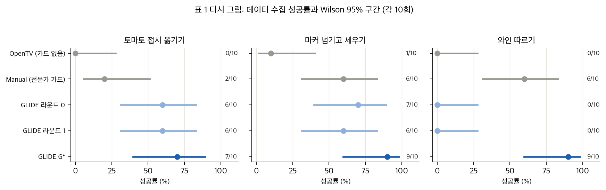
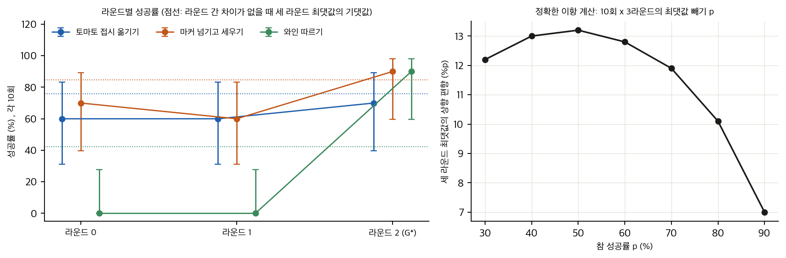
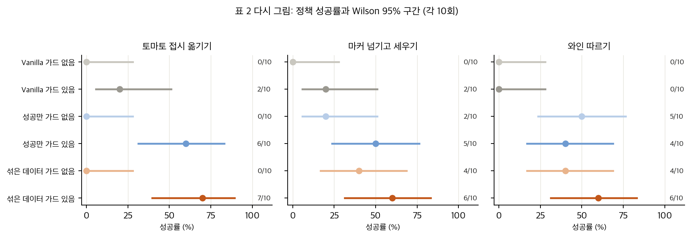

> **논문:** Yuchen Song, Aditya Mittal, Unnat Jain. *Learning Beyond What Humans Can Demonstrate.* CoRL 2026 포스터, arXiv:2609.24996 (v1, 2026-09-21).
> 공식 코드(Apache-2.0)와 데이터(CC BY 4.0)가 공개되어 있습니다. 이 글의 그래프는 논문 표를 다시 그린 것이고 논문 그림은 쓰지 않았습니다.

## 논문이 묻는 것

로봇 모방 학습은 사람이 원격조작으로 성공 시연을 모을 수 있다고 가정합니다. 접시에 담은 토마토 여덟 개를 옮기기, 마커를 한 그리퍼에서 다른 그리퍼로 넘겨 세우기, 15자유도 손이 든 잔에 병으로 와인 따르기는 VR 원격조작으로는 성공률이 0–10%입니다. 숙련 조작자도 접시가 기울거나 마커가 쓰러지는 것을 막지 못합니다.

GLIDE는 이런 과제에서 "무엇이 잘못되는지는 말할 수 있다"는 점을 씁니다. 코딩 에이전트에게 과제 설명과 원격조작 코드를 주고, 조작자 명령을 실행 직전에 걸러 주는 가드레일 함수를 쓰게 합니다(식 1–2). 10 에피소드를 모은 뒤 영상과 궤적을 에이전트에게 보여 가드를 고치기를 두 번 합니다(식 3). 이렇게 얻은 가드로 모은 시연으로 π0.5를 미세조정하고, 배치할 때도 같은 가드로 정책 출력을 거릅니다(식 6).

## 이 글에서 확인한 것

모든 셀이 10회라는 점(논문 4.1–4.2절)을 전제로, 시행을 독립으로 가정한 Fisher 정확 검정과 Wilson 95% 구간을 썼습니다.

**1. 가드 없는 원격조작과의 차이는 확실합니다.** 데이터 수집 성공률이 OpenTV 0, 10, 0%에서 GLIDE 최종 가드 70, 90, 90%가 됩니다(표 1). 세 과제 모두 Fisher p = 0.003, 0.001, 0.0001입니다.

*표 1의 성공률을 우리가 다시 그린 그래프입니다(각 10회, Wilson 95% 구간).*

**2. 전문가가 짠 가드(Manual)와의 차이는 과제별로는 구분되지 않습니다.** G\* 대 Manual은 토마토 7 대 2(p = 0.07), 마커 9 대 6(p = 0.30), 와인 9 대 6(p = 0.30)입니다. 세 과제를 합치면 25 대 14로 p = 0.006이라 방향은 일관됩니다. 다만 60% 대 90%를 셀당 10회로 구분할 확률(검정력)은 15%이고, 80%에는 셀당 약 36–40회가 필요합니다.

**3. 자기 개선의 효과는 와인에서만 확실합니다.** 와인은 0, 0, 9회로 라운드 사이 차이가 없다는 가정에서는 나올 수 없는 값입니다. 토마토(6, 6, 7)와 마커(7, 6, 9)는 라운드 사이 차이가 없을 때도 세 라운드의 최댓값이 7회 이상(토마토, 확률 0.85), 9회 이상(마커, 확률 0.50) 나오는 범위입니다. 10회 x 3라운드의 최댓값은 참 성공률보다 평균 7–13 %p 높게 나옵니다(정확한 이항 계산). 최댓값 라운드가 세 과제 모두 마지막 라운드여서 선택 규칙이 결과를 바꾸지는 않았습니다. 이것은 개선이 없다는 뜻이 아니라 10회로는 판단할 수 없다는 뜻입니다.

*왼쪽은 표 1의 GLIDE 세 라운드 성공률과 Wilson 구간입니다. 점선은 라운드 사이 차이가 없다고 가정했을 때 세 라운드 최댓값의 기댓값이고, 와인은 그 가정이 성립하지 않아 참고용입니다. 오른쪽은 정확한 이항 계산으로 구한 최댓값 선택의 상향 편향입니다(우리가 그린 그래프).*

**4. 정책 결과는 가드가 있을 때 방향이 일관되고, 섞은 데이터의 이득은 구분되지 않습니다.** 섞은 데이터로 학습한 정책에 가드를 켜면 토마토 0 → 70%(p = 0.003), 마커 40 → 60%, 와인 40 → 60%(둘 다 p = 0.66)입니다. "성공만 쓴 것보다 섞은 데이터가 낫다"는 가드를 켰을 때 7 대 6, 6 대 5, 6 대 4회이고 세 과제 합산 19 대 15회(p = 0.43)입니다. 섞은 데이터는 에피소드 수도 더 많아서(30 대 19, 30 대 22, 60 대 30) 데이터의 질과 양이 함께 바뀝니다(4.3절).

*표 2의 성공률을 우리가 다시 그린 그래프입니다. 표의 데이터 열 아이콘은 텍스트에 없어 4.3절 본문의 수치로 행을 복원했습니다.*

**5. 와인의 두 수가 다른 크기입니다.** 표 1의 최종 가드는 와인에서 9/10입니다. 4.3절은 같은 최종 가드로 모은 별도 60 에피소드가 성공 30개와 불완전 30개라고 적습니다(30/60 = 50%, Fisher p = 0.035). 60개가 수집한 전부인지 성공과 불완전을 균형 있게 고른 것인지 논문에 적혀 있지 않아 저자 확인이 필요합니다.

**6. 수치의 안쪽 일관성은 대체로 맞습니다.** 초록의 범위, 본문의 에피소드 합계(19, 22, 30), 굵은 글씨 열 최댓값이 표와 일치합니다. 처리량을 성공 횟수 나누기 경과 시간으로 환산하면 마커 시행당 약 13–14초, 와인 약 60초이고 공개 데이터 카드의 평균 에피소드 길이(14.2초, 60.1초)와 같은 크기입니다. 3.2절의 한 문장("다음 10개 에피소드 중 9개가 마커를 세웠으나 놓을 때 쓰러졌다")은 표 1 G^(1)의 60%와 함께 읽으면 두 가지로 해석됩니다. 어느 라운드를 가리키는지 저자 확인이 필요합니다.

## 공식 코드를 정적으로 읽은 결과

복제한 저장소(커밋 `8ebb33a`)를 실행하지 않고 읽었습니다.

- **파라미터는 논문 표와 일치합니다.** 접시(표 3), 마커(표 4), 와인(표 5)의 속도, 가속도, 각도, 임계값이 코드 기본값과 같고, 정책용 복사본의 기본값도 같습니다.
- **논문에 없는 값이 있습니다.** 접시 필터는 좌우 간격 편차에 이득 0.03을 곱해 쓰므로 "높이 차 0.8 cm 이하" 클램프는 조작자 입력의 높이 차가 26.7 cm를 넘어야 작동합니다. 실제 효과는 상한보다 이득이 정합니다. 마커 놓기 단계의 1.05초 유지 시간, 와인 정렬 보조의 강도 0.65와 기울기에 따른 증가도 표에 없습니다.
- **기본 설정이 논문 서술보다 느슨한 곳이 있습니다.** 와인의 "정렬이 맞아야 병을 크게 기울인다"는 게이트는 기본값이 꺼져 있고, 병 입구와 잔 테두리 오프셋 기본값이 0이라 검사 지점이 팔 끝 좌표입니다. 논문은 "can use"라고 적어 모순은 아닙니다.
- **문서와 코드가 어긋나 보이는 곳이 있습니다.** 두 그리퍼 정책 클라이언트의 `--guarded`는 가드 구현 파일을 고르지만 필터 활성 플래그를 넘기지 않는 것으로 읽힙니다(정적 판독이고 실행해 확인하지 않았습니다). `README`가 가리키는 `.env.example`은 저장소에 없습니다. 저자 확인이 필요합니다.
- **저장소의 범위입니다.** 가드의 최종 형태와 실행기만 있고, 에이전트 호출과 프롬프트 파일, 라운드별 가드, 정책 학습 설정과 평가 로그는 없습니다. 논문에도 코딩 에이전트의 종류와 버전이 적혀 있지 않습니다.
- **공개 데이터의 에피소드 수는 논문과 일치합니다**(30/19, 30/22, 60/30).

## 읽고 나서

GLIDE는 "모델을 다시 학습하지 않고 명령 경로에 코드 한 겹을 얹어 데이터와 배치 행동을 바꾼다"는 구조를 실로봇 세 과제에서 보인 좋은 사례입니다. 가드 없는 원격조작보다 낫다는 결과는 10회로도 확실합니다. 반면 "전문가 가드를 넘는 창발적 가드"와 "섞은 데이터가 더 낫다"는 주장은 개별 제약을 하나씩 끈 실험이 없고 시행 수가 적어, 과제별로는 지금 표만으로 확정할 수 없습니다. 어떤 제약이 효과를 내는지 분해한 실험과 시행 수를 늘린 비교가 다음 단계입니다. 이 글의 모든 계산은 논문에 적힌 시행 수(10회)와 표 값, 공개 데이터 카드의 메타데이터에서 나왔고, 가정한 부분은 본문에 적었습니다.

## 자료

- [통합 리포트 PDF](report/report_public.pdf)
- [01. 논문 분석: Learning Beyond What Humans Can Demonstrate (GLIDE)](analysis/01_paper_analysis.md)
- [02. 선행연구, 코드와 저장소, 관련 분석](analysis/02_prior_work.md)
- [03. 수치 재계산, 일관성 검사, 주장 판정](analysis/03_analysis.md)
- [04. 공식 코드 대조와 구현 가능성](analysis/04_code_verification.md)
