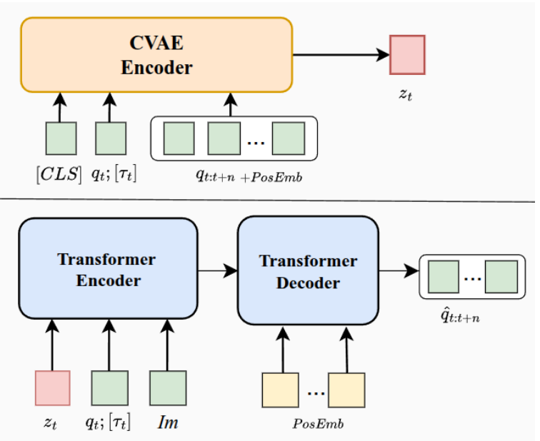
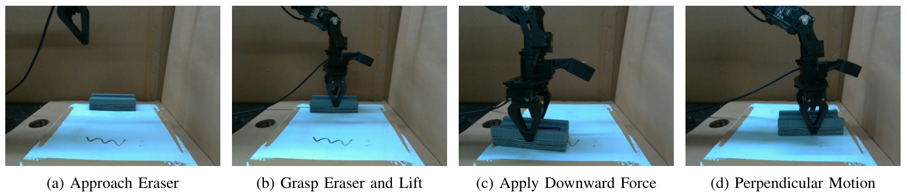
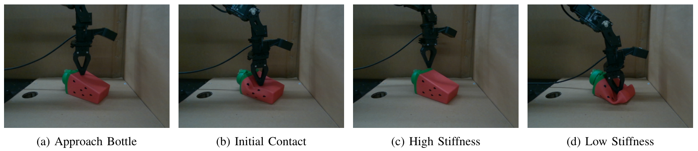
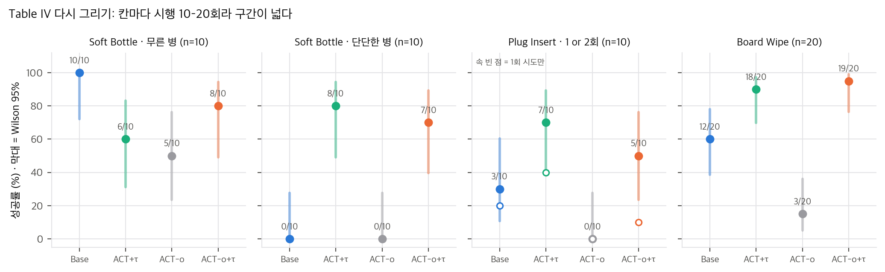

# 01. 논문 분석: Beyond Implicit Force (arXiv:2607.14578)

| 항목 | 내용 |
|---|---|
| 제목 | Beyond Implicit Force: Evaluating Explicit Force-Torque Proxies in Action Chunking with Transformers |
| 저자 | King Hang Wong, Lingqiao Liu, Feras Dayoub (Australian Institute for Machine Learning, Adelaide University) |
| 버전 | arXiv:2607.14578**v1** (2026-07-16 제출, cs.RO), 8쪽 |
| 학회 | **IROS 2026** 채택 (arXiv comments: "Accepted to IROS 2026") |
| 라이선스 | **CC BY 4.0** (arXiv abs 페이지). PDF 안에 다른 권리 표기 없음 |
| 코드·데이터 | 공개되지 않음(2026-11-09 확인). 기반 코드는 ACT·ALOHA 공개 저장소(`02` §5) |
| 분석일 | 2026-11-09 |

## 1. Abstract (한 줄 요약과 주장)

**한 줄 요약:** ALOHA식 leader-follower 원격조작으로 모은 데이터에서 ACT가 보이는 "힘을 아는 듯한" 행동은, 학습 목표인 leader 관절각과 실제 follower 관절각의 차이 δ = q_leader − q_follower에서 나온다고 보고, (1) 목표를 follower의 미래 상태로 바꾼 **ACT-o**로 이 단서를 지우면 접촉 과제가 무너지는지, (2) 모터 전류로 만든 관절 토크 대리값 τ = k_t I를 입력에 넣으면 되살아나는지를 실물 ALOHA Solo의 과제 4개로 시험한 연구입니다.

주장(Sec. I 기여 목록, Abstract):
1. **암묵적 단서의 분리:** ACT-o로 원격조작이 만든 불일치 신호를 없애면 접촉 과제 성능이 무너진다.
2. **명시적 토크 대리값:** 외부 F/T 센서 없이 전류 기반 토크만으로 접촉 행동을 회복한다.
3. **과제 수준 분석:** 표면 추종, 삽입, 강성 판별, 힘 기반 정지에서 반응성과 안정성을 정량·정성으로 보고하고, 토크 대리값을 ACT에 넣는 실용 지침을 준다.

결론 문장은 "토크 신호가 있으면 단순한 대리값이 암묵적 단서와 같거나, 넘어서거나, 더 강화한다(matches, surpasses, or further enhances)"입니다(Abstract).

## 2. Method

### 2.1 문제 설정: 암묵적 상호작용 단서 (Sec. III-A)

ALOHA에서는 사람이 leader 팔을 움직이고, follower 팔이 위치 제어로 leader 관절각을 따라갑니다. 기록되는 행동은 leader 관절각, 관측은 follower 관절각입니다. 접촉 중 follower가 막히면 둘 사이에 위치 차이가 생기는데, 논문은 이를 **암묵적 상호작용 단서(implicit interaction cue)**라 부릅니다. 단서는 "명시적 힘 모델은 아니지만 자유 공간 운동과 큰 하중 접촉을 가르는 잠재 신호"입니다(Sec. I).

이 단서가 없는 수집 방식으로 kinesthetic teaching(사람이 로봇을 직접 잡고 움직임, leader가 없음)과 추종 오차를 줄인 고투명 인터페이스를 듭니다(Sec. I, III-A). 질문은 "ACT의 접촉 성능은 이 단서에 얼마나 기대는가, F/T 센서 없는 플랫폼에서 내장 토크 신호가 그것을 대신할 수 있는가"입니다.

### 2.2 ACT (Sec. III-B, Eq. 1)

CVAE encoder E_φ가 현재 상태와 목표 행동 열을 latent z로 보내고, Transformer decoder D_θ가 z와 현재 관측으로 행동 chunk를 복원합니다.

```
L_ACT = E_z~Q [ ‖a_{t:t+n} − â_{t:t+n}‖² ] + β D_KL( Q(z | s_t, a_{t:t+n}) ‖ P(z | s_t) )      (Eq. 1)
```

표준 ACT의 목표는 leader 관절각 A = {q_leader,t, …, q_leader,t+n}이고, 이 목표가 δ를 품고 있다는 것이 논문의 출발점입니다(Sec. III-B "Implicit Force via Joint Discrepancy").

### 2.3 ACT-o: 목표를 follower 미래 상태로 (Sec. IV-A, Eq. 3)

decoder 목표를 follower의 미래 관절각 Q = {q_follower,t+1, …, q_follower,t+n}으로 바꾸고, CVAE encoder도 leader 행동 대신 Q를 받습니다(Sec. IV-C).

```
L_rec = E_{z,O,Q} [ ‖Q − Q̂(z, O)‖² ]                                                (Eq. 3)
L_CVAE = L_rec + β D_KL[ q(z | Q, [τ]) ‖ p(z) ]                                       (Eq. 5)
```

[τ]는 토크 변형에서만 들어가는 항입니다. 실행할 때는 예측한 follower 관절각을 그대로 위치 명령으로 보냅니다(Table I, II).

### 2.4 명시적 토크 대리값 (Sec. III-C, IV-B, Eq. 2, 4)

ViperX follower의 서보가 주는 effort(전류)를 제조사 토크 상수로 바꿔 τ = k_t I를 씁니다(Sec. V-A). 관절 토크와 말단 외력의 관계는 다음과 같습니다.

```
τ = J(q)ᵀ F_ext + τ_dyn(q, q̇, …)                                                    (Eq. 2)
τ_total = M(q) q̈ + C(q, q̇) q̇ + G(q) + τ_ext                                         (Eq. 4)
```

준정적(|q̈|, |q̇| → 0)이면 G(q)와 τ_ext만 남습니다. 논문은 중력·마찰 보상 모델 없이 **τ_total을 그대로 입력**하고, 정책이 G(q)를 암묵적으로 보정하기를 기대합니다(Sec. IV-B). "τ_dyn을 따로 계산할 필요가 없다"는 것도 주장입니다(Sec. III-C).

**주입 방식(Sec. IV-B "Injection Method"):** 관절각 7개와 effort 7개를 이어 붙인 14차원 벡터를 공유 임베딩 ℝ¹⁴ → ℝ^{d_hidden}으로 투영해 CVAE encoder와 Transformer encoder에 넣습니다(Fig. 3). 공개 ACT 코드는 양팔 ALOHA용으로 상태 차원 14를 하드코딩해 두었으므로(`detr/models/detr_vae.py:230`, `state_dim = 14 # TODO hardcode`), 한 팔 7 + effort 7은 구조 변경 없이 같은 자리에 들어갑니다(`04` D3, 추정).


<p class="cap">논문 Fig. 3: 토크 변형의 CVAE encoder(위)와 Transformer(아래). q_t; [τ_t]가 같은 토큰으로 들어간다. © 저자, CC BY 4.0.</p>

### 2.5 네 변형 (Table II)

| 변형 | 목표 | 힘 정보 |
|---|---|---|
| Base ACT | leader (A) | 암묵적(δ) |
| ACT-o | follower (Q) | 없음(δ 제거) |
| ACT + τ | leader (A) | 혼합(δ + τ) |
| ACT-o + τ | follower (Q) | 명시적(τ만) |

## 3. Experiments

### 3.1 설정 (Sec. V-A, V-E, Table III)

- **하드웨어:** ALOHA Solo, Interbotix ViperX-300s follower + WidowX-250s leader(각 6-DoF + 그리퍼). 카메라 3대(높은 각도의 BEV, 낮은 측면, follower 손목). 데이터 수집과 추론은 모두 **50 Hz**, 관절 공간 제어.
- **학습:** RTX 4090, A6000, A5000에 나눠 학습, 추론은 RTX 4090. 하이퍼파라미터는 epoch 8,000, chunk 100, batch 16, lr 2×10⁻⁵, d_ff 3,200, d_hidden 512, KL β 10(Table III). ACT 공개 README의 예시 값과 비교하면 batch(8 → 16), epoch(2,000 → 8,000), lr(1×10⁻⁵ → 2×10⁻⁵)이 다릅니다(`03` §8).
- **초기 배치:** 제한된 영역 안에서 물체 시작 자세를 SE(2)로 무작위화하고, 위에서 본 오버레이로 분포 안 평가를 확인(Sec. V-E).
- **하이퍼파라미터 확인 방식:** "과제마다 적어도 한 변형이 꾸준히 눈으로 보기에 성공하는 rollout을 만드는지"로 확인했다고 적었습니다(Sec. V-E). 평가 과제로 설정을 고른 셈입니다.
- **시연 수, 학습 시드, 평가 순서는 적혀 있지 않습니다.**

### 3.2 과제 (Sec. V-C, V-E, Fig. 5–8)

| 과제 | 시험하는 것 | 성공 기준 |
|---|---|---|
| Board Wipe (Fig. 5) | 표면 추종 + 수직력 | 표시가 완전히 지워지거나, 지나간 자리에 눈에 보이는 줄무늬가 남음 |
| Plug Insert (Fig. 7) | 기울어진 플러그를 톡톡 쳐서 세운 뒤 수직으로 눌러 꽂기 | 꽂힘. 첫 시도가 플러그에 닿고 실패하면 두 번째 시도를 허용하고 두 번을 한 rollout으로 셈(Table IV 캡션) |
| Soft Bottle Press (Fig. 6) | 같은 모양 병의 두 상태: 잠김(High-Stiffness), 열림(Low-Stiffness) | 열린 병은 끝까지 누르고, 잠긴 병은 저항을 느끼면 물러남 |
| Foam Stop (Fig. 8) | 무늬 없는 검은 폼에 가볍게 닿으면 멈춤, 폼 높이 3단 | 성공률 대신 말단 F_x 곡선(Fig. 4) |


<p class="cap">논문 Fig. 5: Board Wipe. 지우개를 잡고 들어 옮긴 뒤 아래로 누르며 옆으로 닦는다. © 저자, CC BY 4.0.</p>


<p class="cap">논문 Fig. 6: Soft Bottle Press. 첫 접촉 뒤 잠긴 병이면 물러나고(c), 열린 병이면 끝까지 누른다(d). © 저자, CC BY 4.0.</p>

### 3.3 결과 (Table IV)

| 변형 | Bottle 전체 | 무른 병 | 단단한 병 | Plug 1회 | Plug 1 or 2회 | Wipe |
|---|---|---|---|---|---|---|
| Base ACT | 50% | **100%** | 0% | 20% | 30% | 60% |
| ACT + τ | 70% | 60% | **80%** | **40%** | **70%** | 90% |
| ACT-o | 25% | 50% | 0% | 0% | 0% | 15% |
| ACT-o + τ | **75%** | 80% | 70% | 10% | 50% | **95%** |

시행 수는 Bottle 모드마다 10회(변형당 20), Plug 10회, Wipe 20회입니다(Table IV 머리글·캡션). 이 표를 Fisher 정확검정, Holm 보정, 과제 합산 Mantel–Haenszel 검정으로 다시 본 결과는 `03` §6에 있습니다. 요약하면 **단서 제거(Base → ACT-o)와 토크 회복(ACT-o → ACT-o + τ)은 통계적으로 뚜렷하고, 토크가 Base ACT를 개선한다는 주장은 과제 하나씩으로는 유의하지 않으며 세 과제를 합쳐야 유의합니다.**


<p class="cap">직접 그림: Table IV 성공률과 Wilson 95% 구간. Bottle은 모드별로 나눠 그렸다.</p>

### 3.4 Foam Stop (Fig. 4)

Fig. 4는 변형마다 10 rollout × 높이 3단(총 120회)의 말단 F_x(effort 단위) 평균 곡선입니다. 저자는 "모든 모델이 폼을 뚫거나 뜨지 않고 대략 맞는 높이에서 멈췄고, 토크 변형이 시연의 평형 F_x에 더 가깝게 수렴했다"고 씁니다(Sec. VI-B4). 그림을 눈으로 읽으면(±50 effort) 끝 구간(t ≈ 300)에서 시연과의 차이 평균은 토크 변형이 더 작지만, 높이 1에서는 ACT-o가 시연에 가장 가깝습니다. 신뢰 띠는 ±200 정도로 겹칩니다(`03` §7). F_x는 중력을 보상하지 않은 effort에서 J(θ)로 환산한 값이라(Sec. V-D), 멈춘 자세가 다르면 접촉력이 같아도 값이 달라집니다.

### 3.5 정성 관찰 (Sec. VI-A, VI-B)

- **ACT-o:** 닦기에서 아래로 누르지 못하고 떠 있는 "hovering", 병과 플러그에서 멈칫하거나 아예 시작하지 않는 "hesitant" 궤적.
- **Base ACT:** 병 강성을 구분하지 못하고 무른 병 행동(끝까지 누름)에 과적합. 플러그에서는 정렬은 하지만 충분히 누르지 못하거나 닿자마자 굳음.
- **토크 변형:** 플러그에서 부드러운 "adjustment-tap"을 여러 번 하며, 이 탭이 두 시도에 걸쳐 완성되는 경우가 많음(Sec. VI-B3).

## 4. Limitations

### 4.1 저자가 밝힌 한계 (Sec. VIII)
- 관절 쪽 토크 추정과 모터 전류만 썼고, 6축 F/T나 광학 촉각의 고주파 해상도가 없다.
- 저데이터 영역만 봤고, 데이터 규모를 키웠을 때 대리값의 효용과 안정성은 다루지 않았다.
- 향후: 정규화한 토크 대리값의 플랫폼 간 전이, VLM 계획 + 힘 ACT 헤드, 일부러 두드려 보는 능동 감지.

### 4.2 분석하면서 추가로 발견한 한계와 의문점

1. **δ의 역할을 "감지"와 "구동"으로 나누지 않았습니다.** Base ACT의 입력에는 δ가 없습니다. ACT는 현재 follower 관절각 한 프레임과 이미지만 받습니다(공개 코드 `imitate_episodes.py`, `04` D2). δ는 **목표에만** 들어 있고, P 게인만 쓰는 위치 서보(공개 ALOHA 코드의 Position P gain 800, I gain 0, `04` D1)에서는 δ가 곧 누르는 힘을 만드는 명령 여유입니다(`03` §1). ACT-o의 실패는 "힘을 감지하지 못해서"보다 "누르는 명령을 낼 수 없어서"로 더 직접 설명됩니다.
2. **ACT-o + τ가 어떻게 누르는지 설명이 없습니다.** 목표가 follower 위치라면, 시연에서 follower가 실제로 있었던 위치보다 깊은 명령은 학습 목표에 없습니다. P 서보에서 이 범위의 명령은 중력 처짐과 표면 변형만큼의 힘만 냅니다(`03` §5). Wipe 95%는 성공 기준(줄무늬가 보이면 성공)이 약한 접촉으로도 채워졌을 가능성이 있는데, 접촉력은 보고되지 않았습니다.
3. **"토크가 Base ACT를 개선한다"는 과제별로는 유의하지 않습니다.** Wipe 18/20 vs 12/20(Fisher p = 0.065), Plug 7/10 vs 3/10(p = 0.18), Bottle 14/20 vs 10/20(p = 0.33). 세 과제 합산 MH p = 0.0034입니다. 단단한 병만 보면 8/10 vs 0/10(p = 0.0007)로 뚜렷합니다(`03` §6).
4. **ACT + τ와 ACT-o + τ는 구분되지 않습니다**(모든 과제 p ≥ 0.65). "혼합이 명시적보다 낫다"는 증거는 없습니다.
5. **Plug의 두 번째 시도 규칙이 토크 변형에 유리합니다.** 재시도로 얻은 점수는 Base +10%p, ACT + τ +30%p, ACT-o + τ +40%p입니다(`03` §6). 저자가 말한 "두 시도에 걸친 adjustment-tap"을 성공으로 세는 규칙입니다. 1회 기준으로는 ACT-o + τ(10%)가 Base(20%)보다 낮습니다.
6. **Soft Bottle Press의 "전체 50%"는 판별 능력 0입니다.** Base ACT는 무른 병 100%, 단단한 병 0%로, 항상 누르는 정책과 같습니다(Youden J = 0). 전체 성공률보다 판별 지표가 맞습니다(`03` §6).
7. **동기로 든 상황을 시험하지 않았습니다.** kinesthetic teaching과 고투명 인터페이스가 동기지만, 실험은 모두 같은 leader-follower 데이터에서 목표만 바꾼 것입니다. ACT-o는 "단서가 없는 데이터"의 대용인데, 사람이 저항을 느끼며 조작한 흔적(속도 변화, 멈춤)은 follower 궤적에 그대로 남아 있습니다.
8. **재현 정보가 빠졌습니다.** 시연 수, 학습 시드 수, effort 정규화, temporal ensembling 사용 여부, chunk 실행 방식, 평가 순서, Foam Stop의 J(θ) 계산 세부, F_x 중력 기준값이 없습니다(`04` §3).
9. **Fig. 1의 체크 표는 정성 요약입니다.** "Policy Expressivity"나 "Force Precision"을 재는 지표는 본문에 없습니다.
10. **사소한 서술 오류:** "kinematically identical leader-follower"(Fig. 2, Sec. III-C)라 했지만 WidowX-250s와 ViperX-300s는 관절 구성은 같고 링크 길이가 다릅니다. 관절 공간 1:1 대응이라는 뜻으로 읽어야 합니다(내 사전 지식).
