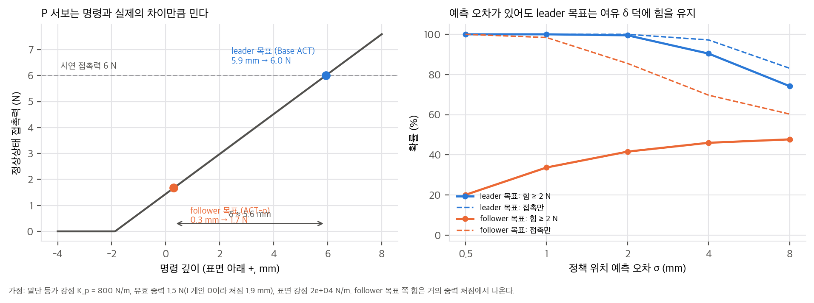
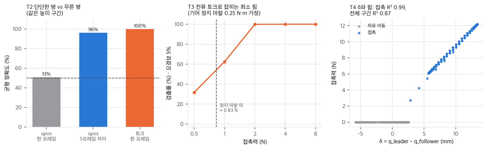
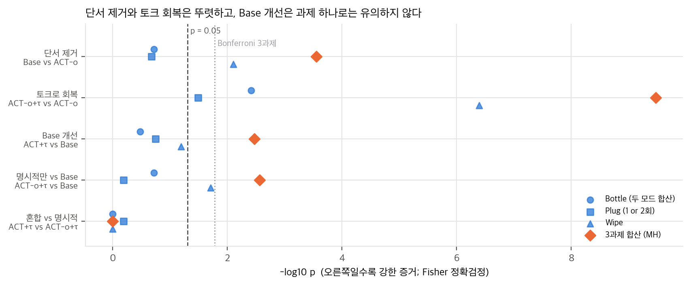
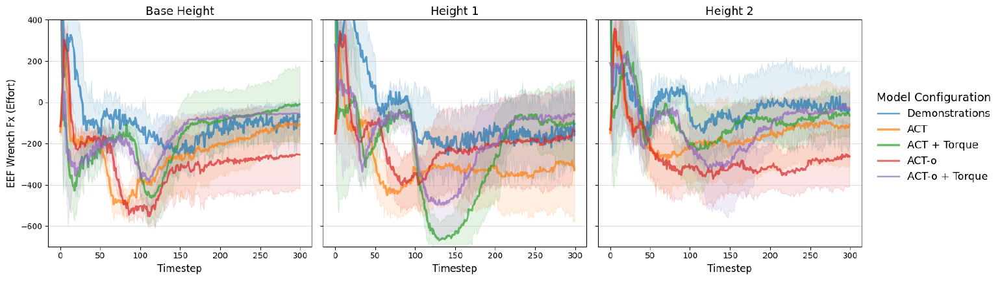
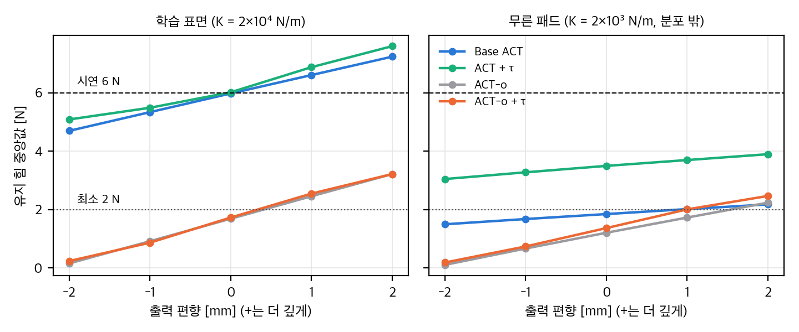

# 03. 물리 해석과 재계산

스크립트는 `analysis/table_check.py`(Table IV·하이퍼파라미터 재계산, 결과 `table_check_results.json`), `analysis/force_proxy_toy.py`(1-DoF 물리 toy T1–T4, 결과 `force_proxy_toy_results.json`), `analysis/plot_figures.py`(그래프 4장)입니다. 모두 numpy·scipy, 단일 스레드, CPU에서 1–2초 안에 끝납니다. toy의 강성·질량·마찰 값은 **가정**이므로, 절대값이 아니라 비와 경향으로 읽어야 합니다.

## 1. δ는 감지 신호이기 전에 구동 명령이다

### 1.1 P 게인만 쓰는 위치 서보의 정상상태

공개 ALOHA 코드는 follower 서보를 Position P gain 800, I gain 0으로 설정합니다(`aloha_scripts/robot_utils.py:174-175`, `04` D1). 적분항이 없으면 하중이 걸린 정상상태에서 오차가 0으로 가지 않습니다. 관절 하나를 말단 등가 강성 K_p로 근사하면, 명령 q_cmd를 받은 follower의 준정적 평형은 다음과 같습니다.

```
K_p (q_cmd − q) + m g = F_contact            (아래 방향 +, 1-DoF)
접촉면 강성 k_e:  F_contact = k_e · max(q − q_surface, 0)
```

ALOHA 원격조작에서 q_cmd = q_leader이므로 **K_p δ = F_contact − m g**입니다. 사람이 "충분히 눌렀다"고 느낄 때까지 leader를 밀면, 그 leader 위치에는 시연 접촉력이 K_p로 나뉜 만큼의 여유가 들어갑니다. 학습된 Base ACT가 leader 목표를 재생하면 같은 δ가 다시 생기고, 같은 힘이 다시 나옵니다. **δ는 정책이 읽는 입력이 아니라, 정책이 내보내는 명령 속에 들어 있습니다.** ACT의 입력은 현재 follower 관절각 한 프레임과 이미지뿐이라(`04` D2) δ를 볼 수 없습니다.

### 1.2 DexForce의 force-informed target과 같은 구조

DexForce(arXiv:2501.10356)는 kinesthetic 시연에서 관측 위치 x_o에 측정 힘을 더한 목표 x_f = x_o + k_f f를 행동으로 씁니다. 재생 힘 배율은 G(k_f, k_e) = (1/k_e + k_f)/(1/k_p + 1/k_e)이고, k_f = 1/k_p일 때 G = 1, k_f = 0(관측 위치 그대로)이면 G = k_p/(k_p + k_e) ≈ 0입니다(`dexforce/analysis/03_analysis.md` §1).

leader-follower 원격조작은 이 목표를 **센서 없이 자동으로** 만듭니다. q_leader = q_follower + (F − m g)/K_p이므로, Base ACT의 목표는 k_f = 1/K_p인 force-informed target과 같습니다(사람이 직접 맞췄으니 G = 1). ACT-o의 목표는 k_f = 0인 경우입니다.

### 1.3 toy T1: leader 목표 vs follower 목표

가정: K_p = 800 N/m(말단 등가값, P gain 레지스터 800을 환산한 값이 아님), 유효 중력 1.5 N(I 게인 0이라 처짐 1.9 mm), 시연 접촉력 6 N, 닦기에 필요한 최소 힘 2 N.

| 표면 강성 k_e (N/m) | follower 위치 (mm) | leader 위치 (mm) | 여유 δ (mm) | follower 목표 재생 힘 | 시연 대비 |
|---|---|---|---|---|---|
| 2,000 (무른 패드) | 3.00 | 8.62 | 5.63 | 2.79 N | 0.46 |
| 20,000 (지우개 + 보드) | 0.30 | 5.93 | 5.63 | 1.67 N | 0.28 |
| 200,000 (거의 강체) | 0.03 | 5.66 | 5.63 | 1.52 N | 0.25 |

leader 목표 재생은 모든 경우 6.0 N입니다. follower 목표의 힘은 거의 **중력 처짐**에서 나옵니다. 중력을 빼면 k_e = 20,000에서 0.23 N(DexForce의 G(0) = 800/20,800 = 0.038)입니다. 수직으로 누르는 과제라 중력이 ACT-o를 돕는 방향이고, 옆이나 위로 미는 과제에서는 이 도움도 없습니다.

정책의 위치 예측에 오차 σ가 있을 때(k_e = 20,000):

| σ (mm) | 0.5 | 1 | 2 | 4 | 8 |
|---|---|---|---|---|---|
| leader 목표: 힘 ≥ 2 N | 1.00 | 1.00 | 0.995 | 0.90 | 0.74 |
| follower 목표: 힘 ≥ 2 N | 0.20 | 0.34 | 0.42 | 0.46 | 0.48 |
| follower 목표: 접촉만 | 1.00 | 0.98 | 0.86 | 0.70 | 0.60 |

leader 목표는 여유 δ ≈ 5.6 mm 덕분에 예측이 몇 mm 틀려도 누르는 힘을 유지합니다. follower 목표는 접촉 여부부터 예측 오차에 좌우되고, 위로 틀리면 떠 버립니다. 논문이 본 ACT-o의 "hovering"(Sec. VI-B1)과 같은 모양입니다.


<p class="cap">직접 그림(T1): 왼쪽은 명령 깊이와 정상상태 접촉력, 오른쪽은 위치 예측 오차에 따른 힘 유지 확률.</p>

## 2. 감지: 한 프레임 관절각으로는 강성을 가를 수 없다

ACT는 현재 시점의 qpos 하나만 받습니다(속도·이력 없음, `04` D2). 무른 병과 단단한 병을 같은 속도로 누르면, 단단한 병에서는 follower가 멈추고 무른 병에서는 계속 내려갑니다. 하지만 **같은 높이**를 지나는 순간만 보면 두 경우의 qpos는 같습니다.

toy T2(20 mm/s 하강, 무른 병 150 N/m, 단단한 병 3,000 N/m, qpos 잡음 0.2 mm, 토크 잡음 0.15 N, 단단한 병이 멈춘 높이 이하 구간 2,965프레임):

| 특징 | 균형 정확도 |
|---|---|
| qpos 한 프레임 | 0.51 (우연 수준) |
| qpos 5프레임 차이(속도에 해당) | 0.96 |
| 토크 한 프레임 | 1.00 |

Base ACT가 단단한 병에서 0/10인 것(Table IV)과 맞습니다. Base ACT는 leader 목표로 누르는 힘은 낼 수 있지만, 지금 누르는 병이 어느 쪽인지는 입력에서 알 수 없습니다. 그래서 다수 모드(끝까지 누름)로 갑니다. 토크를 입력에 넣으면 이 정보가 한 프레임에 들어옵니다. **토크는 δ를 "대신"한다기보다, δ가 원래 주지 않던 감지 정보를 보탭니다.** 다만 이 toy는 이력을 넣은 qpos(0.96)도 거의 같은 정보를 준다는 것을 보여 줍니다. 논문에는 "qpos 이력" 대조군이 없습니다.

## 3. 전류 토크 대리값의 물리

### 3.1 전류에서 관절 토크까지

```
τ_motor = k_t I
τ_joint = N η k_t I − τ_friction(q̇, 부하)            (N: 감속비, η: 기어 효율)
τ_joint = J(q)ᵀ F_ext + G(q) + M(q) q̈ + C(q, q̇) q̇     (Eq. 2, 4)
```

논문은 τ = k_t I(Sec. V-A)만 쓰고 기어 손실과 마찰을 다루지 않습니다. 이 식에서 대리값의 오차원은 셋입니다.
- **정지 마찰 띠:** 멈춰 있을 때 마찰은 [−τ_c, τ_c] 안의 아무 값이나 될 수 있어서, 같은 접촉력에서 전류가 이력(hysteresis)을 가집니다. 최소 검출 힘은 대략 τ_c / L(L: 관절에서 접촉점까지 거리)입니다.
- **중력 G(q):** 보상하지 않으면 자세에 따라 수 N·m가 더해집니다. 논문은 정책이 G(q)를 암묵적으로 배우게 둡니다(Sec. IV-B).
- **동역학·점성 마찰:** 움직이는 동안의 M q̈, C q̇, 점성 마찰. ACT 입력에는 qvel이 없어서, 정책은 빠르게 닦을 때의 점성 마찰과 접촉을 구분할 단서가 qpos·이미지뿐입니다.

### 3.2 toy T3: 마찰과 중력 속에서 잡히는 최소 힘

가정: 지렛대 0.30 m, 기어 정지 마찰 0.25 N·m(균일 분포), 전류 잡음 0.05 N·m, 오경보 5% 문턱.

| 접촉력 (N) | 0.5 | 1 | 2 | 4 | 8 |
|---|---|---|---|---|---|
| 검출률 | 0.32 | 0.62 | 1.00 | 1.00 | 1.00 |

정지 마찰 띠는 약 0.83 N입니다. **수 N 이상의 사건(병 저항, 닦기 압력)은 전류로 충분히 잡히고, 1 N 아래의 가벼운 닿음은 잘 잡히지 않습니다.** Foam Stop은 시연자가 "가벼운 저항"에서 멈추는 과제라 이 띠 근처에 있을 가능성이 큽니다. 모든 변형이 대략 맞는 높이에서 멈췄다는 결과(Sec. VI-B4)는 토크보다 시각·운동학이 높이를 알려 줬다는 해석과도 맞습니다.

중력: 자세가 −1 ~ 1 rad로 바뀌는 관절(τ_g = 2 cos q + 0.6 sin 2q)에서 접촉 토크 0.6–2.4 N·m를 같은 규칙으로 가르면, 보상 없이 검출률 0.84, 비접촉 구간으로 자세 특징(cos q, sin q, cos 2q, sin 2q)을 선형 회귀해 빼면 1.00입니다. 정책이 G(q)를 암묵적으로 배울 수 있다는 논문의 가정은 원리상 가능하지만, 그만큼의 표현력과 데이터를 쓰게 됩니다. 명시적으로 빼는 쪽이 싸고, 저자가 향후 과제로 든 "정규화된 대리값의 플랫폼 간 전이"에도 필요합니다.

## 4. δ ∝ 접촉력은 준정적 접촉에서만 성립한다

논문은 추종 오차가 "접촉 시작, 제약 위반, 외부 저항과 상관한다"고 씁니다(Sec. I). toy T4는 공중 왕복(0–2 s) → 접근(2–3 s) → 누르며 닦기(3–6 s) 궤적을 1차 지연 서보(대역폭 12 rad/s)로 따라가게 했습니다.

| 지표 | 값 |
|---|---|
| 접촉 구간만 δ–힘 R² | 0.995, 기울기 0.807 N/mm(≈ K_p) |
| 전체 구간 δ–힘 R² | 0.874 |
| 자유 운동 중 최대 \|δ\| | 5.75 mm |
| 접촉 중 δ 중앙값 | 9.54 mm |

빠른 자유 운동의 추종 지연과 중력 처짐도 δ를 만듭니다. 이 toy에서 자유 운동 δ(최대 5.8 mm)는 접촉 δ(중앙값 9.5 mm)의 절반이 넘습니다. 그래서 δ는 "힘 + 속도 지연 + 중력"의 혼합이고, 힘 신호로 깨끗하지 않습니다. 이 점에서도 δ는 감지 신호보다 구동 여유로 읽는 편이 맞습니다.


<p class="cap">직접 그림: T2 강성 판별, T3 마찰 속 검출률, T4 δ와 접촉력.</p>

## 5. 풀리지 않은 질문: ACT-o + τ는 어떻게 누르는가

ACT-o + τ의 목표도 follower 위치입니다. 학습 목표 안에는 시연에서 follower가 실제로 도달한 위치보다 깊은 명령이 없습니다. §1의 식으로 보면, 명령이 시연 follower 위치 범위 안에 있는 한 정상상태 힘은 follower 목표 재생 힘(T1에서 시연의 0.25–0.46배, 대부분 중력)을 넘지 못합니다. 토크 입력이 할 수 있는 일은 두 가지로 보입니다.

1. **접촉 찾기:** 떠 있을 때 토크가 낮으면, 시연의 접근 구간(토크 낮음 → 다음 위치는 더 아래)과 비슷한 상태가 되어 계속 내려갑니다. hovering을 고치는 데는 충분합니다.
2. **모드 고르기:** 단단한 병에서 토크가 튀면 물러나는 모드를 고릅니다.

둘 다 시연 수준의 힘을 만들 필요는 없습니다. 그래서 Board Wipe의 95%는 "줄무늬가 보이면 성공"(Sec. V-E)이라는 기준이 약한 접촉으로도 채워졌기 때문일 수 있습니다. 대안 설명은 (a) 지우개·보드의 변형이 커서 follower 위치에 힘이 이미 들어 있거나(k_e가 작으면 0.46배까지), (b) 정책이 학습 범위 밖으로 더 깊은 위치를 외삽하는 경우입니다. **논문은 닦기 중 접촉력을 보고하지 않아서 어느 쪽인지 알 수 없습니다.** 검증 가능한 예측은 "같은 과제에서 ACT-o + τ의 닦기 수직 effort가 Base ACT보다 작다"입니다.

## 6. Table IV 통계

과제별 성공 수(Bottle은 두 모드 합산 n = 20, Plug은 "1 or 2회" n = 10, Wipe n = 20)로 Fisher 정확검정을 하고, 비교마다 과제 3개에 Holm 보정을, 과제를 층으로 한 Mantel–Haenszel(MH) 검정을 했습니다.

| 비교 | Bottle | Plug | Wipe | MH 합산 p (공통 OR) |
|---|---|---|---|---|
| 단서 제거: Base vs ACT-o | 10 vs 5, p = 0.19 | 3 vs 0, p = 0.21 | 12 vs 3, **p = 0.0079** (Holm 0.024) | **2.8×10⁻⁴** (5.6) |
| 토크 회복: ACT-o + τ vs ACT-o | 15 vs 5, **p = 0.0039** | 5 vs 0, **p = 0.033** | 19 vs 3, **p = 4.1×10⁻⁷** | **3.4×10⁻¹⁰** (23.1) |
| Base 개선: ACT + τ vs Base | 14 vs 10, p = 0.33 | 7 vs 3, p = 0.18 | 18 vs 12, p = 0.065 (Holm 0.19) | **0.0034** (3.8) |
| 명시적만 vs Base: ACT-o + τ vs Base | 15 vs 10, p = 0.19 | 5 vs 3, p = 0.65 | 19 vs 12, p = 0.020 (Holm 0.059) | **0.0027** (4.0) |
| 혼합 vs 명시적: ACT + τ vs ACT-o + τ | 14 vs 15, p = 1.0 | 7 vs 5, p = 0.65 | 18 vs 19, p = 1.0 | 1.0 (1.0) |

- 단단한 병만 보면 ACT + τ vs Base 8/10 vs 0/10(p = 0.0007), ACT-o + τ vs ACT-o 7/10 vs 0/10(p = 0.0031)입니다.
- "토크가 Base ACT를 개선한다"는 **방향은 세 과제 모두 같지만** 과제 하나로는 Holm 뒤에 유의하지 않습니다. 과제를 합치면 유의합니다. 시드가 하나인지 여럿인지 모르므로, 이 p는 정책 학습의 분산을 포함하지 않습니다.


<p class="cap">직접 그림: 비교별 과제 Fisher p(파란 점)와 3과제 합산 MH p(주황 마름모).</p>

**2×2로 보면 δ와 τ는 서로를 대신한다.** 실험은 목표(leader/follower) × 입력(q/q + τ)의 2×2입니다. 성공률 차이(%p)로 효과를 나누면 다음과 같습니다.

| 과제 | τ 효과 (leader 목표) | τ 효과 (follower 목표) | 목표 효과 (τ 없음) | 목표 효과 (τ 있음) |
|---|---|---|---|---|
| Bottle | +20 | +50 | +25 | −5 |
| Plug (1 or 2회) | +40 | +50 | +30 | +20 |
| Wipe | +30 | +80 | +45 | −5 |

leader 목표(δ)는 τ가 없을 때만 25–45%p를 벌어 주고, τ가 있으면 차이가 거의 사라집니다. τ의 효과도 δ가 없을 때 더 큽니다. 두 신호가 겹치는 정보를 준다는 뜻이고, 저자 결론("proxy matches, surpasses, or further enhances")과 맞습니다. 다만 칸마다 10–20회라 상호작용 자체를 검정할 힘은 없습니다(서술 통계).

**Soft Bottle Press를 판별 문제로:** 무른 병에서는 누르고 단단한 병에서는 물러나야 성공이므로, 항상 누르는 정책의 전체 성공률은 50%입니다. Youden J = (무른 병 성공률) + (단단한 병 성공률) − 1로 바꾸면 Base ACT 0(항상 누르는 정책과 같음), ACT-o −0.5, ACT + τ 0.4, ACT-o + τ 0.5입니다. Base ACT의 "전체 50%"는 판별 능력 0이라는 뜻입니다.

**Plug의 두 번째 시도:** 1회 → 1 or 2회로 얻은 점수는 Base +10%p, ACT + τ +30%p, ACT-o 0, ACT-o + τ +40%p입니다. 토크 변형의 이득 상당 부분이 재시도 규칙에서 나옵니다. 1회 기준으로 ACT + τ vs Base는 4/10 vs 2/10(Fisher p = 0.63)입니다.

## 7. Fig. 4 판독 (Foam Stop)

끝 구간(t ≈ 300 스텝 = 6 s) 평균 F_x를 눈으로 읽었습니다(±50 effort, 픽셀 판독 아님).

| 높이 | 시연 | ACT | ACT + τ | ACT-o | ACT-o + τ |
|---|---|---|---|---|---|
| Base | −70 | −110 | −10 | −250 | −60 |
| Height 1 | −150 | −320 | −100 | −150 | −60 |
| Height 2 | −20 | −100 | −70 | −280 | −50 |
| 시연과 차이 평균 | — | 약 100 | 약 55 | 약 150 | 약 45 |

평균으로는 토크 변형이 시연에 더 가깝습니다. 하지만 Height 1에서는 ACT-o가 시연과 거의 같고, ACT-o + τ는 90 정도 벗어납니다. 신뢰 띠(±200 정도)도 크게 겹칩니다. 더 중요한 점은 F_x가 **중력을 보상하지 않은 effort**를 J(θ)로 환산한 값이라는 것입니다(Sec. V-D). 시연이 0이 아닌 값에 머무는 것(캡션 "settles into a steady, non-zero value")도 이 때문으로 보입니다. 멈춘 자세가 몇 cm만 달라도 중력 성분이 달라지므로, 이 그림은 접촉력 비교로는 깨끗하지 않습니다.


<p class="cap">논문 Fig. 4: Foam Stop 말단 F_x(effort 단위) 평균, 높이 3단. © 저자, CC BY 4.0.</p>

## 8. 하이퍼파라미터와 chunk 실행

| 항목 | ACT 공개 README 예시 | 논문 Table III |
|---|---|---|
| KL β, chunk, d_hidden, d_ff | 10, 100, 512, 3,200 | 같음 |
| batch | 8 | 16 |
| epoch | 2,000 | 8,000 |
| lr | 1×10⁻⁵ | 2×10⁻⁵ |

chunk 100은 50 Hz에서 **2.0 s**입니다. 논문은 temporal ensembling 사용 여부를 적지 않았습니다. 쓰지 않으면 chunk를 끝까지 실행하는 동안 최대 2 s가 열린 루프입니다. 쓰면 공개 코드의 가중(w_i = exp(−0.01 i), i = 0이 가장 오래된 예측, `imitate_episodes.py:255`)에서 실행 명령의 평균 나이가 **1.15 s**입니다. 어느 쪽이든 단단한 병의 토크 스파이크에 반응해 물러나는 데는 수백 ms 이상의 지연이 생길 수 있습니다. 반응 지연은 판별 성공률에 직접 영향을 주는데 보고되지 않았습니다.

## 추가 검증 (2026-11-11)

### 추가 검증 1: 1-DoF 폐루프에서 정책 네 변형의 재생 힘

**목적.** §5의 열린 질문(ACT-o + τ가 어떻게 누르는가)과 §1의 구동 toy를 폐루프로 확인한다. 시연을 만들고 정책 네 변형(Base ACT, ACT + τ, ACT-o, ACT-o + τ)을 학습한 뒤 P 서보에서 재생해, 유지 힘이 시연(6 N)을 얼마나 복원하는지, 접촉은 찾는지 본다. 표면 강성이 바뀌는 경우와 예측 편향·잡음에 대한 민감도도 함께 본다.

**설정.** `analysis/extra_closedloop.py` (numpy, 약 4초, 단일 스레드).
- 서보: 말단 등가 P 강성 800 N/m, 유효 중력 1.5 N, 1차 지연 대역폭 12 rad/s, 50 Hz. 접촉은 준정적 평형으로 계산했다(§1과 같은 모델).
- 시연: 사람이 leader를 2.5–3.5 cm/s로 내리다가 표면에 닿으면, 보이는 힘(k_e·z_f)이 6 N이 되도록 leader를 민다. 시연은 6개, 표면 강성은 2×10⁴ N/m(지우개+보드). 시연 정상상태는 leader 5.93 mm, follower 0.30 mm, 힘 6.0 N이다.
- 정책: RBF 능선 회귀(위치 중심 48개, 폭 2 mm, 토크 입력은 중심 9개·폭 1 N). 행동은 10스텝(0.2 s) 앞의 목표다. Base ACT와 ACT + τ는 leader 목표를, ACT-o와 ACT-o + τ는 follower 목표를 예측한다. 관측은 follower 위치(잡음 0.2 mm)이고, 토크 입력은 접촉력 + 잡음 0.15 N이다.
- 폐루프: 매 스텝 정책을 다시 호출한다. ACT처럼 chunk를 열린 루프로 실행하지는 않았다.
- 시험: (E1) 학습과 같은 표면, (E2) 무른 패드 2×10³ N/m(학습 분포 밖), (E3) 출력 편향 −2…+2 mm와 출력 잡음 0·1·2 mm의 격자(시드 10개). E1, E2는 시드 20개다.

**결과.**

| 정책 | E1 학습 표면: 유지 힘 (N) | E1 접촉률 | E2 무른 패드: 유지 힘 (N) | E2 접촉률 |
|---|---|---|---|---|
| 이상적 재생 (목표 위치를 그대로 명령) | leader 6.00 / follower 1.67 | — | leader 4.46 / follower 1.24 | — |
| Base ACT | 5.97 | 1.00 | 1.84 | 1.00 |
| ACT + τ | 6.02 | 1.00 | 3.50 | 1.00 |
| ACT-o | 1.69 | 1.00 | 1.21 | 1.00 |
| ACT-o + τ | 1.73 | 1.00 | 1.37 | 1.00 |

편향 민감도(잡음 0, 학습 표면, 유지 힘 중앙값): 편향 −2 mm에서 Base 4.7 N, ACT + τ 5.1 N, ACT-o 0.2 N(접촉 없음), ACT-o + τ 0.2 N(접촉 없음). +2 mm에서는 Base 7.2 N, ACT + τ 7.6 N, ACT-o 3.2 N, ACT-o + τ 3.2 N이다. 기울기는 leader 목표가 약 0.6 N/mm, follower 목표가 약 0.7 N/mm다.


<p class="cap">직접 그림(추가 검증 1): 출력 편향에 따른 유지 힘 중앙값(시드 10). 왼쪽은 학습 표면, 오른쪽은 학습 분포 밖의 무른 패드다. 점선은 시연 6 N과 최소 힘 2 N이다.</p>

**결론.**
- leader 목표를 예측하는 정책(Base ACT, ACT + τ)은 학습 표면에서 시연 힘 6 N을 복원했다. 여유 δ가 약 5.6 mm라서 예측 편향 ±1 mm에도 힘은 약 ±0.6 N만 움직였다. §1.3(T1)의 결론과 맞는다.
- ACT-o + τ는 접촉을 찾았지만(접촉률 1.00), 유지 힘은 1.7 N으로 시연의 약 28%였다. 토크를 넣어도 follower 목표의 힘 한계는 바뀌지 않았다. §5의 "접촉은 찾지만 시연 수준의 힘은 못 낸다"는 가설과 맞는다. 다만 이 toy의 ACT-o는 호버링하지 않았다. 행동을 미래 목표로 두면 정책이 아래로 내려가 접촉에 닿는다. 논문의 호버링은 chunk 실행이나 학습 분포 차이에서 올 수 있는데, 이 toy로는 구분하지 못했다.
- 분포 밖(무른 패드)에서 토크 입력은 leader 목표 정책의 유지 힘을 1.8 N에서 3.5 N으로 올렸다. 그래도 이상적 재생 4.5 N(시연의 약 75%)에는 미치지 못했다. 토크가 힘 한계를 넘는 효과는 이 toy에서 확인되지 않았다.
- 한계: 표면·질량·마찰은 가정이고 회귀 정책은 RBF 능선 회귀이며 시연은 6개뿐이다. 논문의 ACT와 구조가 다르므로 정량 비교가 아니라 경향으로만 읽어야 한다.
