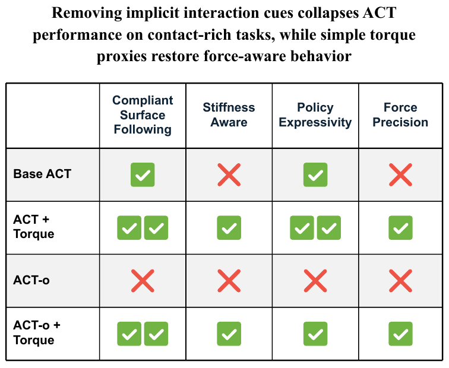
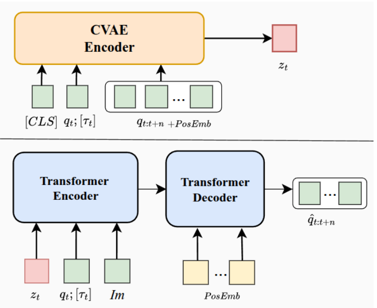
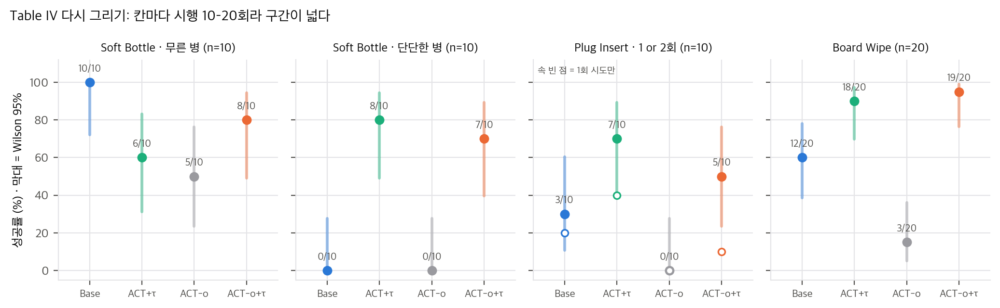
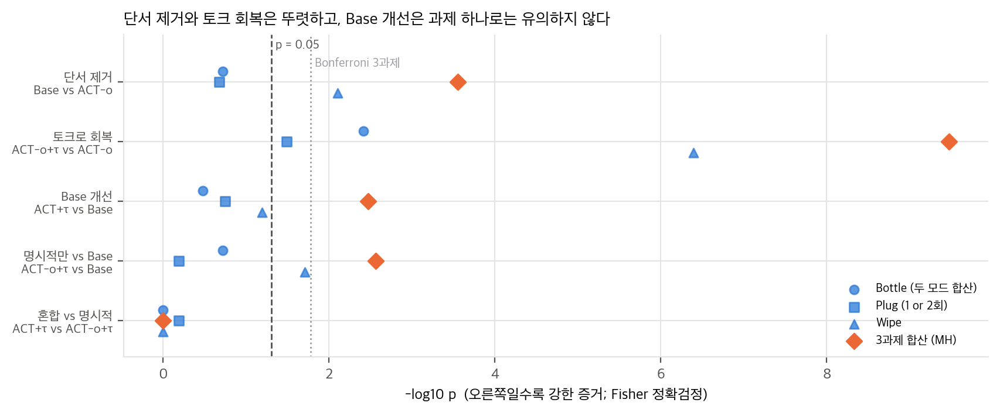
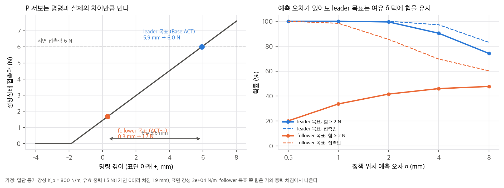
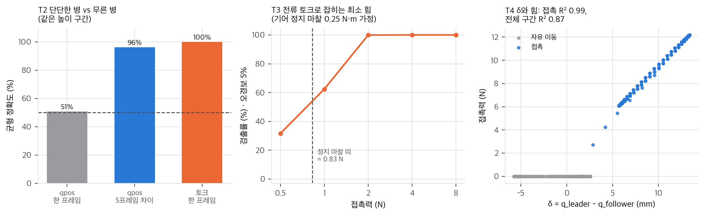
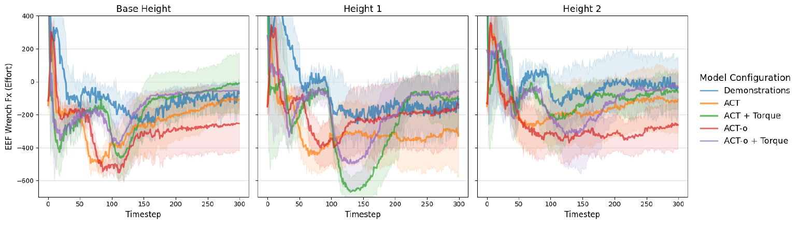

> **논문:** Wong, Liu, Dayoub. *Beyond Implicit Force: Evaluating Explicit Force-Torque Proxies in Action Chunking with Transformers.* arXiv:2607.14578v1 (2026), IROS 2026. Australian Institute for Machine Learning, Adelaide University.
> 논문 그림은 CC BY 4.0에 따라 출처를 밝히고 실었습니다(© 저자). 나머지 그래프는 논문 수치와 numpy toy로 직접 그렸습니다. 공식 코드는 공개되지 않았습니다(2026-11-09 확인).



## 한 줄 요약

ALOHA에서 사람은 leader 팔을 움직이고, follower 팔은 위치 서보로 leader 관절각을 따라갑니다. ACT는 leader 관절각을 행동으로 배웁니다. 접촉 중에는 follower가 막혀서 두 관절각이 벌어지는데(δ = q_leader − q_follower), 저자들은 이 차이가 ACT의 "암묵적 힘 인지"라고 봅니다. 그래서 (1) 목표를 follower의 미래 상태로 바꾼 **ACT-o**로 δ를 지우고, (2) 서보 전류로 만든 관절 토크 τ = k_t I를 입력에 붙여 회복되는지를 실물 과제 4개에서 시험했습니다.

## 1. 실험은 2×2입니다



| 변형 | 학습 목표 | 입력 | 힘 정보 (Table II) |
|---|---|---|---|
| Base ACT | leader 관절각 | q + 이미지 | 암묵적 (δ) |
| ACT + τ | leader 관절각 | [q, τ] + 이미지 | 혼합 |
| ACT-o | follower 미래 관절각 | q + 이미지 | 없음 |
| ACT-o + τ | follower 미래 관절각 | [q, τ] + 이미지 | 명시적 (τ만) |

관절각 7개와 effort 7개를 이어 붙여 14차원 공유 임베딩으로 넣습니다. 공개 ACT 코드는 양팔용으로 상태 14차원을 하드코딩해 두었기 때문에, 한 팔 + effort는 구조를 바꾸지 않고 같은 자리에 들어갑니다. 원조 ALOHA 수집 코드는 effort를 이미 기록하고 있어서, 기존 데이터로도 같은 실험을 할 수 있습니다.

## 2. Table IV를 통계로 다시 보면



칸마다 시행이 10–20회라 구간이 넓습니다. 변형 쌍마다 Fisher 정확검정을 하고, 세 과제를 층으로 한 Mantel–Haenszel 검정으로 합쳐 봤습니다.



- **δ를 지우면 무너진다:** 합산 p = 2.8×10⁻⁴. 다만 대부분 Board Wipe(12/20 → 3/20)에서 나옵니다.
- **토크로 회복된다:** 세 과제 모두 유의하고, 합산 p = 3.4×10⁻¹⁰입니다.
- **토크가 Base ACT도 개선한다:** 방향은 세 과제 모두 같지만 과제별 p는 0.065–0.33입니다. 합쳐야 p = 0.0034로 유의합니다. 단단한 병만은 0/10 → 8/10(p = 0.0007)로 뚜렷합니다.
- **ACT + τ와 ACT-o + τ는 구분되지 않습니다**(모든 과제 p ≥ 0.65).

2×2라서 상호작용도 볼 수 있습니다. leader 목표(δ)는 τ가 없을 때만 25–45%p를 벌어 주고, τ가 있으면 차이가 거의 사라집니다(Bottle −5, Plug +20, Wipe −5%p). 두 신호가 겹치는 정보를 준다는 뜻입니다.

두 가지는 따로 짚어 둘 만합니다. Soft Bottle Press의 Base ACT "전체 50%"는 무른 병 100% + 단단한 병 0%라서, 항상 누르는 정책과 같습니다(Youden J = 0). Plug Insert는 첫 시도가 실패하면 두 번째 시도를 허용하는데, 이 규칙으로 얻은 점수가 Base +10%p, 토크 변형 +30–40%p입니다.

## 3. δ는 감지 신호이기 전에 누르는 명령입니다

이 논문을 읽으면서 가장 중요하다고 본 점입니다. ACT의 입력은 현재 follower 관절각 한 프레임과 이미지뿐입니다. **δ는 입력에 없고 학습 목표에만 있습니다.** 그리고 원조 ALOHA는 follower 서보를 Position P gain 800, I gain 0으로 설정합니다. 적분항이 없는 위치 서보에서는 정상상태에서 다음이 성립합니다.

```
K_p (q_leader − q_follower) + m g = F_contact
```

사람이 충분히 눌렀다고 느낄 때까지 leader를 밀면, 그 leader 위치에 누르는 힘에 해당하는 여유가 들어갑니다. Base ACT가 leader 목표를 재생하면 같은 힘이 다시 나옵니다. 이것은 DexForce가 손끝 F/T 센서로 만든 force-informed target x_f = x_o + k_f f와 같은 구조입니다. 원격조작은 k_f = 1/K_p인 목표를 센서 없이 만들고, ACT-o는 k_f = 0인 경우입니다.



1-DoF toy(가정: 말단 등가 강성 800 N/m, 유효 중력 1.5 N, 시연 접촉력 6 N)에서 follower 위치를 그대로 재생하면 시연 힘의 0.25–0.46배만 나오고, 그것도 대부분 중력 처짐입니다. 위치 예측이 몇 mm 틀려도 leader 목표는 여유 덕분에 힘을 유지하지만, follower 목표는 위로 틀리면 떠 버립니다. 논문이 본 ACT-o의 "hovering"과 같은 모양입니다. 그래서 ACT-o의 붕괴는 "힘을 감지하지 못해서"보다 "누르는 명령을 낼 수 없어서"로 더 직접 설명됩니다.

## 4. 그러면 토크는 무엇을 보태는가



- **한 프레임 강성 판별:** 무른 병과 단단한 병을 같은 속도로 누를 때, 같은 높이만 보면 qpos 한 프레임으로는 둘을 가를 수 없습니다(toy 균형 정확도 0.51). 토크 한 프레임은 1.00, qpos 5프레임 차이도 0.96입니다. Base ACT의 단단한 병 0/10과 맞습니다. 논문에는 qpos 이력 대조군이 없습니다.
- **전류 대리값의 한계:** τ = k_t I에는 기어 정지 마찰이 섞입니다. 마찰 0.25 N·m, 지렛대 0.3 m를 가정하면 0.5 N 접촉은 32%, 1 N은 62%만 잡히고 2 N 이상은 거의 다 잡힙니다. 병 저항이나 닦기 압력 같은 수 N 사건에는 충분하지만, 가벼운 닿음에는 약합니다. 중력은 자세 회귀로 빼면 쉽게 정리됩니다.
- **δ도 깨끗한 힘 신호는 아닙니다:** 준정적 접촉에서는 δ와 힘의 R²가 0.995지만, 빠른 자유 운동의 추종 지연이 섞이면 0.874로 떨어집니다.

## 5. 남는 질문: ACT-o + τ는 어떻게 누르는가

ACT-o + τ의 목표도 follower 위치입니다. 학습 목표에는 시연에서 follower가 실제로 있었던 곳보다 깊은 명령이 없으므로, 위치 서보에서 시연 수준의 힘을 내기 어렵습니다. 토크 입력이 할 수 있는 일은 (1) 떠 있을 때 계속 내려가 접촉을 찾고, (2) 저항이 튀면 물러나는 모드를 고르는 것으로 보입니다. Board Wipe의 성공 기준은 "줄무늬가 보이면 성공"이라 약한 접촉으로도 채워질 수 있습니다. 논문은 닦기 중 접촉력을 보고하지 않아서 확인할 수 없습니다. 검증 가능한 예측은 "ACT-o + τ의 닦기 수직 effort가 Base ACT보다 작다"입니다.

추가 검증으로 1-DoF 폐루프 toy를 만들어 보니, ACT-o + τ는 접촉에는 닿았지만(접촉률 1.00) 유지 힘이 1.7 N으로 시연 6 N의 28%에 그쳤습니다. 토크를 넣어도 follower 목표의 힘 한계는 바뀌지 않았습니다. 다만 이 toy의 ACT-o는 호버링하지 않아서, 논문의 호버링은 재현되지 않았습니다.

MuJoCo 한 팔(관절 2개, 위치 서보)에서 같은 질문을 확인하니, 닦기에서는 토크를 넣은 leader 목표 정책이 Base보다 성공률이 높았지만(1.00 대 0.66), follower 목표 계열은 모두 접촉 힘이 3 N 안팎에 머물렀습니다. 강성 판별에서는 토크를 넣어도 무른 병과 단단한 병을 구분하지 못했는데, 접촉이 처음 생기는 순간의 토크가 두 병에서 거의 같기 때문입니다. 따라서 이 시뮬레이션(비전 없음, 작은 MLP, 시연 100회)은 논문 Table IV의 "토크로 강성을 구분한다"는 주장을 지지하지 않았습니다.

Contact-Grounded Policy(arXiv:2603.05687)는 미래의 실제 로봇 상태를 예측한 뒤, 학습된 매핑으로 그것을 compliance 제어기의 목표로 바꿉니다. ACT-o + τ는 이 변환 단계가 빠진 형태로 볼 수 있습니다. leader가 없는 데이터라면 τ를 입력에 넣는 것보다, q_target = q_follower + K_p⁻¹(τ − τ_g(q))처럼 목표에 넣는 쪽이 더 직접적입니다.

## 6. Foam Stop 그림



끝 구간 F_x를 눈으로 읽으면(±50 effort) 시연과의 평균 차이는 토크 변형이 약 45–55, 토크 없는 변형이 약 100–150으로 저자 서술과 방향이 같습니다. 다만 Height 1에서는 ACT-o가 시연에 가장 가깝고, 신뢰 띠가 크게 겹칩니다. F_x는 중력을 보상하지 않은 effort를 자코비안으로 환산한 값이라, 멈춘 자세가 다르면 접촉력이 같아도 값이 달라집니다.

## 7. 정리

| 주장 | 판정 |
|---|---|
| δ를 지우면 접촉 과제가 무너진다 | 맞음(합산 p = 2.8×10⁻⁴, Wipe가 주도) |
| 토크가 ACT-o를 회복한다 | 맞음(세 과제 모두 유의) |
| 토크가 Base ACT도 개선한다 | 합산으로만 유의 |
| 실패 원인은 암묵적 힘 인지의 상실 | 구동 여유의 상실로 보는 편이 더 직접적 |
| 토크로 시각적으로 같은 강성을 구분 | 맞음(이력 대조군은 없음) |
| 보상 없는 전류 토크로 충분 | 수 N 이상 사건에는 맞음 |
| 혼합(δ + τ)이 명시적보다 낫다 | 근거 없음 |

재현에 필요한 정보 중 시연 수, 시드 수, effort 정규화, temporal ensembling 사용 여부(chunk 100은 50 Hz에서 2 s), 닦기 접촉력이 빠져 있습니다. 공식 재현은 코드가 없고 ALOHA Solo가 필요해서 불가능하지만, 아이디어 자체는 ACT나 LeRobot에서 입력 차원과 목표 열만 바꾸면 되므로 쉽습니다. 어려운 것은 평가입니다. 접촉력, 여러 시드, qpos 이력 대조군, 판별 과제의 Youden J, 재시도 없는 성공률을 함께 봐야 이 논문의 빈칸이 채워집니다.

검증 스크립트(표 재계산, 물리 toy, 그래프)는 함께 공개한 분석 노트에 있습니다.

## 자료

- [통합 리포트 PDF](report/report_public.pdf)
- [01. 논문 분석: Beyond Implicit Force (arXiv:2607.14578)](analysis/01_paper_analysis.md)
- [02. 선행연구와 계보](analysis/02_prior_work.md)
- [03. 물리 해석과 재계산](analysis/03_analysis.md)
- [04. 주장 검증: 공개 기반 코드 대조, 표 재계산, 물리 toy, 구현 가능성](analysis/04_claim_verification.md)
