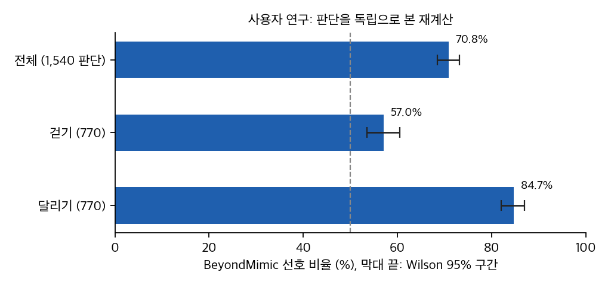

> **논문:** Qiayuan Liao, Takara E. Truong, Xiaoyu Huang, Yuman Gao, Guy Tevet, Koushil Sreenath, C. Karen Liu. *BeyondMimic: From Motion Tracking to Versatile Humanoid Control via Guided Diffusion.* arXiv:2508.08241 (v4, 2025-11-13). 학회 표기 없음.
> 공식 코드(MIT)는 저장소가 아카이브되어 있습니다. 이 글의 그림은 우리가 그린 그래프 한 장입니다. 논문 그림은 이 글에 싣지 않습니다(논문 라이선스가 CC BY가 아닌 비독점 배포).

## 논문이 묻는 것

휴머노이드가 사람 동작을 자연스럽고 역동적으로 따라 하게 하려면, 동작마다 보상을 손으로 맞추는 방식은 확장되지 않습니다. 이 논문은 두 가지를 보입니다. 첫째, 동작마다 같은 보상 식과 하이퍼파라미터로 추종 정책을 학습할 수 있다는 것입니다. 둘째, 학습한 동작들을 확산 모델로 묶어 두면, 학습하지 않은 과제를 테스트 시점의 비용 함수 그래디언트로 풀 수 있다는 것입니다.

## 방법 요약

- **추종 보상.** 위치, 자세, 선속도, 각속도의 가우시안 형태 추종 항 네 개와 정규화 세 개(관절 한계, 행동 변화, 자기 충돌)입니다. 관절 목표는 앵커 기준으로 만들고, PD 게인은 반사 관성에서 `k_p = Iω²`, `k_d = 2ζIω`로 정합니다(ω = 10 Hz, ζ = 2).
- **확산 제어.** 상태와 잠재 표현을 함께 모델링합니다. VAE 잠재 32차원, 예측 지평 0.64 s입니다. 테스트 시점에 웨이포인트, 조이스틱, 장애물 회피, 키프레임 비용을 더해 궤적을 조정합니다.

## 재계산한 것

사용자 연구(N = 77, 쌍 20개)의 선호율과 p 값은 다시 계산해도 맞습니다. 전체 판단 1,540개 중 70.8%가 BeyondMimic을 골랐습니다. 걷기는 57.0%, 달리기는 84.7%입니다. 다만 판단을 독립으로 본 검정이라, 참가자 군집을 고려하면 걷기 우위는 약해질 수 있습니다. 설계효과 4를 가정하면 걷기의 95% 구간이 50%에 닿습니다. 이 가정은 논문에 없는 예시입니다.

*그림. 사용자 연구 선호 비율의 재계산. 우리가 그린 그래프이며 논문 그림이 아닙니다.*

보고된 Cohen's h도 우리 몫과 Unitree 몫(p 대 1−p)으로 계산하면 재현됩니다. 0.5 대비로 계산하면 절반이 나오므로, 계산 기준을 밝혀야 합니다.

## 공식 코드와 논문의 차이

추종 보상과 PPO 설정, 게인 공식, 종료 임계값은 공식 코드와 논문이 일치합니다. 그러나 코드에는 논문 설명에 없는 설정이 있습니다.

- 정책 관측에 잡음이 들어갑니다. 앵커 위치 ±0.25, 관절 속도 ±0.5 등입니다. 논문은 도메인 무작위화를 세 가지로만 설명합니다.
- 리셋할 때 관절 위치를 ±0.1 rad 섭동합니다.
- 적응 샘플링의 커널이 1입니다. 논문은 조회 구간 세 개를 씁니다.

이 차이들은 실로봇 전이에 영향을 줄 수 있으므로, 재현할 때 따로 검증해야 합니다.

## 근거의 한계

- 잠재 확산 절제의 시뮬 성공률(5% 대 95%)에는 시도 수가 없습니다. 방향은 분명하지만 차이의 크기를 말할 수 없습니다.
- 실로봇 결과는 대부분 영상과 정성적 설명입니다. 과제 성공률과 시도 수가 보고되지 않았습니다.
- 공식 저장소는 2026-10-16에 아카이브되었습니다. 확산 제어 코드와 학습 가중치는 저장소에 없습니다. 후속 프레임워크는 mjlab(Apache-2.0)으로 옮겨졌습니다.

## 이 맥에서 할 수 있는 것

추종 학습은 NVIDIA GPU와 Isaac Lab 또는 mjlab이 필요해서 이 맥에서는 불가능합니다. 실로봇 배포도 불가능합니다. CPU로 할 수 있는 것은 보고 수치의 재계산, 게인 공식 검산, 그리고 2차원 점 궤적으로 분류기 안내를 보여 주는 장난감 모델입니다.

## 함께 보면 좋은 것

- 같은 제1저자의 SuperMimic(CoRL 2026)은 BeyondMimic의 추적 보상을 가져와 일부를 바꿉니다.
- SONIC은 BeyondMimic을 추종 기준선으로 씁니다. 두 논문의 데이터가 달라서 직접 비교는 조심해야 합니다.

## 자료

- [통합 리포트 PDF](report/report_public.pdf)
- [01. 논문 분석: BeyondMimic (arXiv:2508.08241)](analysis/01_paper_analysis.md)
- [02. 선행연구와 관련 자료: BeyondMimic](analysis/02_prior_work.md)
- [03. 재계산과 일관성 검사: BeyondMimic](analysis/03_analysis.md)
- [04. 공식 코드 대조: BeyondMimic](analysis/04_code_verification.md)
