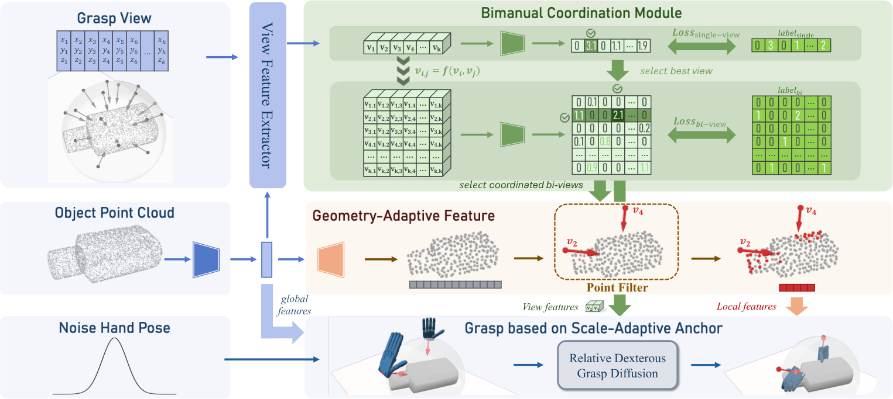
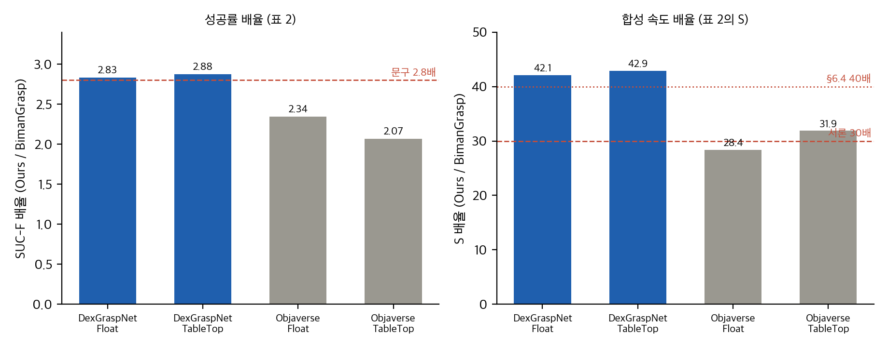
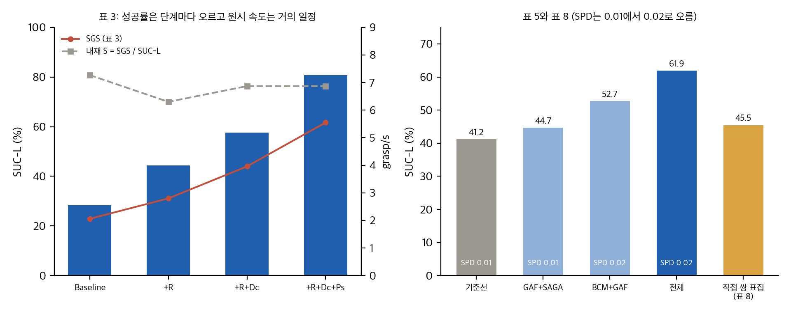
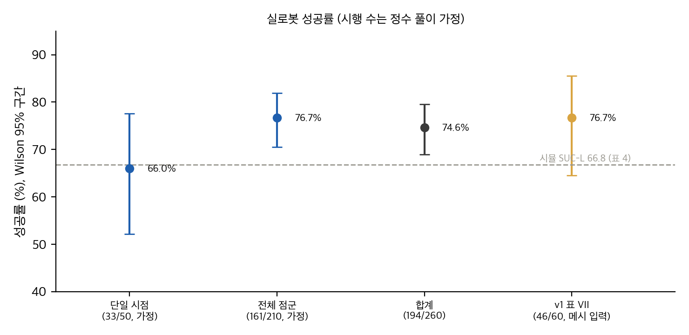
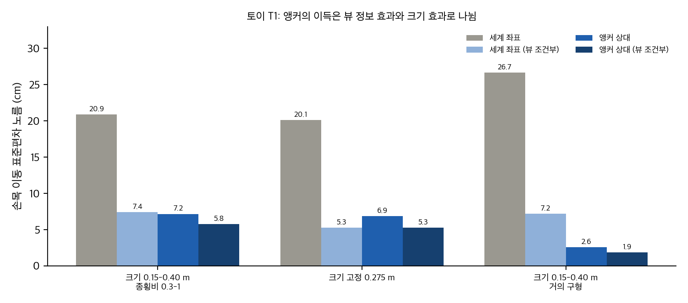

> **논문:** Mu Lin, Yi-Lin Wei 외. *BiDexGrasp: Coordinated Bimanual Dexterous Grasps across Object Geometries and Sizes.* CoRL 2026 Spotlight, arXiv:2604.06589 (v2, 2026-09-08).
> 공식 코드는 아직 없습니다(프로젝트 페이지에 "Coming soon"). 이 글의 그림은 논문 그림 한 장(출처 표기)과 우리가 그린 그래프입니다.

## 논문이 묻는 것

30–80 cm 큰 물체는 한 손으로 잡기 어렵습니다. 양손 파지는 탐색 공간이 두 손 합쳐 커지고, 두 손의 에너지를 한꺼번에 최적화하면 한쪽 손만 일하는 해로 빠지기 쉽습니다. 논문은 두 가지를 냅니다. 6,351개 물체 × 11개 크기, 9.53 M 파지의 데이터셋과, 이 데이터로 학습하는 생성 모델입니다.

합성 파이프라인은 세 단계입니다. 영역 쌍을 파지 wrench 공간(GWS)의 안정 점수로 거르고, 두 손의 QP 에너지를 손별 항으로 나눠 최적화하며, IK와 MuJoCo로 검증합니다. 생성 모델은 윗반구 16개 후보 뷰에서 첫째 뷰와 그에 어울리는 둘째 뷰를 차례로 예측하고(BCM), 뷰 방향이 물체 외접구와 만나는 점을 앵커로 삼아 손목을 상대 자세로 확산 생성합니다.

*그림 3 (논문 원문). © 저자, CC BY 4.0, 출처 arXiv:2604.06589.*

## 이 글에서 확인한 것

**1. 표 값은 대부분 서로 맞습니다.** 물체 수는 2,397 + 3,954 = 6,351이고, 표 3의 SGS(성공 파지/초)는 표 2의 S와 SUC-L의 곱과 일치합니다. 표 3 마지막 행에서 SGS를 SUC-L로 나눈 내재 S는 6.87로 표 2 DexGraspNet 행의 S와 같습니다.

**2. 배율 문구는 데이터셋에 따라 다릅니다.** 성공률 "2.8배"는 DexGraspNet(2.83, 2.88배)에서 성립하고 Objaverse에서는 2.07–2.34배입니다. 합성 속도는 서론이 30배, §6.4가 40배라고 쓰고, 표 2의 S 비는 28.4–42.9배입니다. BimanGrasp의 속도는 원논문 인용값이라 하드웨어가 다릅니다.

*그래프 1. 표 2의 SUC-F 배율과 S 배율. 점선은 본문 문구입니다. 우리가 그린 그래프입니다.*

**3. 절제에서 성공 파지 속도가 오르는 것은 성공률이 오르기 때문입니다.** 표 3에서 SGS는 2.06에서 5.55로 오르지만 내재 원시 속도는 7.27에서 6.87로 거의 일정합니다. 표 5에는 BCM만 켠 행이 없어 BCM과 GAF의 기여가 섞여 있고, 본문이 GAF와 SAGA가 SPD를 줄인다고 쓰는 부분에서 표 5의 SPD는 0.01에서 0.02로 오릅니다. 부록 표 8(뷰 쌍을 직접 표집하면 45.5, 조건부 표집이면 61.9)이 BCM의 가장 직접적인 증거입니다.

*그래프 2. 표 3의 SUC-L과 내재 S(SGS / SUC-L), 표 5와 표 8의 SUC-L. 값은 논문 표입니다.*

**4. 실로봇 74.6 %는 시행 수로 가중한 평균입니다.** 본문은 260회, 단일 시점 66.0 %, 전체 점군 76.7 %, 평균 74.6 %라고 씁니다. 정수 조건으로 풀면 가능한 해는 단일 시점 33/50, 전체 점군 161/210, 합계 194/260 하나입니다(시행 수는 이 풀이로 구한 가정). 두 입력의 차이 10.7 %p는 Fisher p = 0.15입니다. v1은 물체 10개 × 6회, 46/60 = 76.7 %를 표로 보고했고, v2는 이 표를 본문 서술로 바꿨습니다. 물체와 손·팔 조합별 결과는 v2에 없습니다.

*그래프 3. 실로봇 성공률과 Wilson 95% 구간(시행 수 가정). v1 값은 표 VII에서 복원했습니다.*

**5. 평가의 물체 질량 설정은 코드 없이 확인되지 않습니다.** 논문은 밀도 2.5 kg/m³를 적고, 마찰(0.6/0.02)과 성공 임계(5 cm, 15°)가 같은 BODex 평가 도구(DexGraspBench)는 질량을 크기와 무관하게 0.1 kg으로 고정합니다. 밀도 2.5 kg/m³의 속 찬 정육면체는 30 cm에서 0.07 kg, 80 cm에서 1.3 kg이라서, 어느 쪽인지에 따라 큰 물체의 조건이 달라집니다. 저자 확인이 필요합니다.

## 토이: 앵커는 무엇을 좁히나

논문 그림 6(a)는 세계 좌표의 손목 이동이 앵커 좌표보다 넓게 퍼진다고 보여 줍니다. 이 감소가 어디서 오는지 인공 타원체 분포(4,000개, 크기 0.15–0.40 m, 뷰 16개)로 나눠 봤습니다.

*그래프 4. 토이의 손목 이동 표준편차 노름. 인공 분포라 논문 수치와 비교할 수 없습니다.*

세계 좌표 20.9 cm가 앵커 상대 7.2 cm로 약 2.9배 좁아집니다. 다만 뷰가 이미 주어진 조건에서는 세계 좌표 7.4 cm 대 앵커 5.8 cm로 차이가 22 %입니다. 크기를 고정하면 앵커의 추가 이득은 없고, 거의 구형인 물체에서는 7.2 대 1.9 cm로 커집니다. 앵커의 이득이 뷰 정보와 크기 변동에 나뉘어 있다는 뜻이며, 표 5의 학습 효과(+3.5 %p)와 같은 방향의 작은 이득입니다.

## 남은 질문

- SUC 분모(파지 수)와 반복 횟수, 표 3 절제의 데이터셋
- 시험 파지 139,956개의 (물체, 자세, 크기) 조합 수(46,652조합 × 3은 11이나 6으로 나누어지지 않습니다)
- 실로봇의 시행 수 분해와 조합별 결과, 표 5의 BCM 단독 행, 평가 질량 설정
- 코드와 데이터 공개 시점

## 구현할 수 있는가

이 논문의 수치를 재현하려면 합성에 3090 8장(약 60시간, 추정), 실험에 양손 로봇이 필요합니다. 코드와 데이터가 공개되지 않아 대조는 논문 안의 표와 본문 사이에서만 했습니다. 분리 QP나 뷰 쌍 표집 같은 핵심 아이디어의 소형 재구현은 CPU로 가능합니다.

## 자료

- 논문: <https://arxiv.org/abs/2604.06589> (CC BY 4.0)
- 프로젝트: <https://frenkielm.github.io/BiDexGrasp.github.io/>
- 분석 노트와 재계산 스크립트는 같은 저장소의 `bidexgrasp/` 폴더에 있습니다.

## 자료

- [통합 리포트 PDF](report/report_public.pdf)
- [01. 논문 분석: BiDexGrasp (arXiv:2604.06589)](analysis/01_paper_analysis.md)
- [02. 선행연구, 구성 요소의 출처, GitHub 자료](analysis/02_prior_work.md)
- [03. 수치 재계산, 일관성 검사, 토이](analysis/03_analysis.md)
- [04. 주장 대조 (공식 코드 없음)](analysis/04_claim_verification.md)
