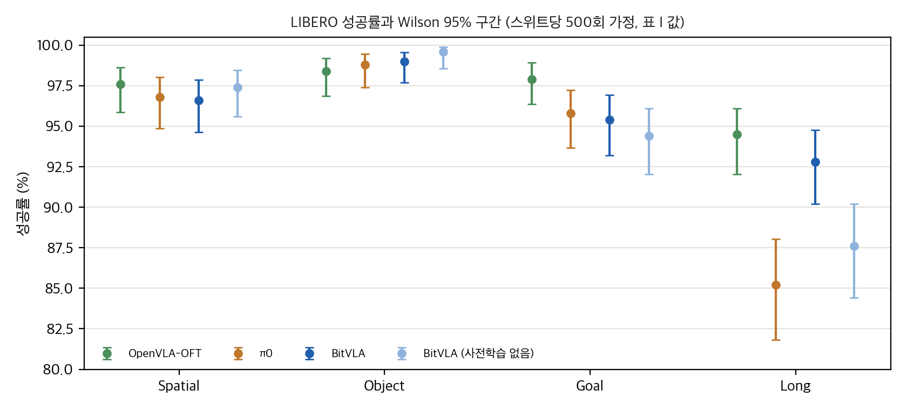
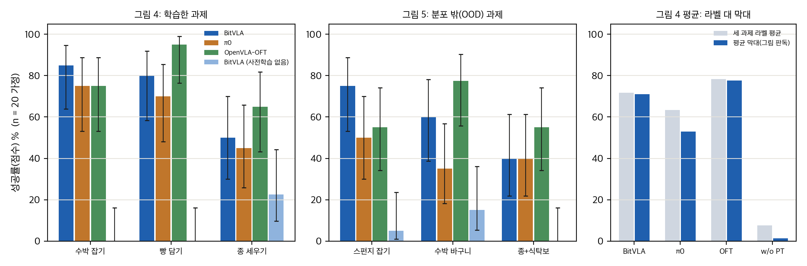
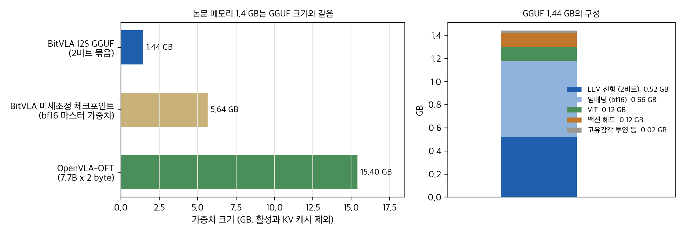
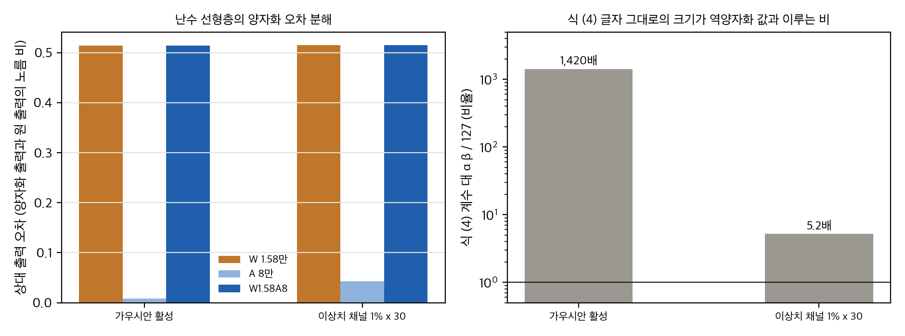

# 03. 수치 재계산, 일관성 검사, 토이

이 문서는 논문 표와 본문의 수치를 다시 계산하고(§1–§5), 식 (1)–(4)를 난수 선형층으로 확인하며(§6), 불일치를 항목 번호로 모으고(§7), 주장을 판정합니다(§8). 재계산은 `analysis/recompute.py`, 토이는 `analysis/toy_quant.py`이고 결과는 같은 이름의 `*_results.json`에 있습니다. 검사 항목 번호는 V(재계산), K(일관성), C(주장), Q(토이)입니다.

## 0. 가정

- **LIBERO 시행 수.** 스위트당 500회(과제 10개 x 50회)로 가정합니다. 공식 평가 스크립트의 기본값이며, BitVLA 행의 모든 값이 0.2%p 단위(500회 정수 비율)로 만들어집니다(V2). 논문은 시행 수를 쓰지 않습니다. 시드 수도 쓰지 않아 한 번의 평가로 읽었습니다.
- **기준선 값.** 표 I의 기준선 값은 각 원 논문의 보고값을 인용한 것입니다(표 I 캡션). 일부는 500회 정수 비율이 아니어서(V2), 비정수 값은 가장 가까운 정수 개수로 반올림해 검정했습니다.
- **실로봇 시행 수.** 4 x 5 격자(IV-C), 격자점당 1회로 보아 **셀당 n = 20**으로 가정합니다. 부분 점수(0.5 단위)가 있는 과제는 점수 합을 20으로 나눈 값으로 읽고, 검정에는 가장 가까운 정수로 반올림한 값을 넣었습니다(근사).
- **그림 판독 값.** 그림 4의 평균 막대는 PDF를 300 dpi로 렌더링하고 눈금(0–80)에서 읽었습니다. 소수 첫째 자리까지는 신뢰할 수 없습니다.
- **검정.** 비율은 Fisher 정확검정과 Newcombe 차이 구간, 구간은 Wilson 95%입니다. 모두 양측이며 다중 비교 보정은 하지 않았습니다.

## 1. 표 재계산 (V1–V5)

### 1.1 표 I 행 평균 (V1)

13개 행 중 11개는 네 스위트 평균이 보고 평균과 0.05%p 안에서 맞습니다.

| 행 | 네 스위트 평균 | 보고 평균 | 차이 |
|---|---|---|---|
| CoT-VLA | 83.93 | 81.1 | −2.8%p (K1) |
| 4D-VLA | 88.53 | 88.6 | +0.07%p (반올림 경계, K2) |

BitVLA 두 행(94.75 → 94.8, 95.95 → 96.0)은 맞습니다.

### 1.2 LIBERO 값의 정수 가능성 (V2)

스위트당 500회이면 값은 0.2%p 단위여야 합니다.

- **모든 칸이 500회 정수 비율인 행:** BitVLA 두 행, π0, SmolVLA, GR00T-N1, NORA-Long, UnifiedVLA. 표 II의 PTQ 행(OpenVLA·OFT의 INT8, INT4) 16칸도 모두 0.2%p 단위입니다.
- **500회 정수 비율이 아닌 칸이 있는 행:** OpenVLA(Spatial 84.7 = 423.5회, Long), CoT-VLA(Spatial), UniVLA(Spatial 96.5 = 482.5회), OpenVLA-OFT(Goal 97.9 = 489.5회, Long 94.5 = 472.5회), SpatialVLA(Object, Long), 4D-VLA(세 칸). 시행이 1,500회(3시드 x 500회)이면 소수 첫째 자리로 반올림한 어떤 값도 정수 비율로 만들 수 있어서(1/1500 = 0.067%p < 0.1%p) 이 칸들과 모순되지 않습니다. 원 논문의 평균 방식이 BitVLA 쪽과 다를 가능성이 있고, 이 비교의 시행 수는 확인되지 않았습니다.
- 따라서 표 I의 "BitVLA 대 OFT" 비교는 BitVLA는 한 번의 500회, OFT는 시드 평균일 수 있는 비대칭 조건입니다.

### 1.3 메모리 열 (V3)

- 표 I의 배율은 모두 "GB / 1.4"로 맞습니다(15.1/1.4 = 10.79 등 13행 일치).
- 메모리 값은 대부분 파라미터 수 x 2 byte(bf16 가중치 크기)와 0.2 GB 안에서 맞습니다(7.7B → 15.4, 3.5B → 7.0, 2.3B → 4.6, 2.2B → 4.4). 활성과 KV 캐시는 포함하지 않는 가중치 크기입니다.

### 1.4 표 II (V4)

- 행 평균: OpenVLA INT8 76.9, INT4 72.65 → 72.7, OFT INT4 96.85 → 96.9는 맞습니다. **OFT INT8은 평균이 96.85인데 보고는 96.7입니다**(K3). 이 값은 v1 표 2에도 같습니다.
- 메모리 배율(5.29, 5.50, 3.14, 3.36)은 GB / 1.4와 맞습니다. 1.4/4.7 = 29.8%이고 "3분의 1 미만"은 맞습니다.
- 표 II에서 INT4 OFT의 평균은 96.9, BitVLA는 96.0입니다. 차이 −0.9%p(Fisher p = 0.15, 스위트당 500회 가정). "비슷하다"는 서술과 구분되지 않는 차이입니다.

### 1.5 본문의 차이 수치 (V5)

- Long: BitVLA − π0 = 92.8 − 85.2 = 7.6, 사전학습 이득 92.8 − 87.6 = 5.2, OFT와 평균 격차 97.1 − 96.0 = 1.1. 세 수치 모두 표와 맞습니다.
- 메모리 11.0배 = 15.4/1.4. 2비트 묶음 GGUF의 실제 크기 1.4402 GB로 나누면 **10.7배**입니다(V12). 1.4가 반올림 값이라 11.0은 10.7–11.3 범위를 덮습니다.
- v1의 "29.8%"는 1.4/4.7이고, v1의 "π0보다 Long 2.4%p"는 87.6 − 85.2입니다. 모두 맞습니다.

## 2. LIBERO 검정 (V6, 스위트당 500회 가정)

Wilson 95% 구간(%): BitVLA Spatial 94.6–97.9, Object 97.7–99.6, Goal 93.2–96.9, Long 90.2–94.8, 평균(2,000회) 95.0–96.7. OpenVLA-OFT 평균 96.3–97.7, π0 평균 93.0–95.1.

| 비교 | 스위트 | 차이(%p) | Fisher p | Newcombe 95% (%p) |
|---|---|---|---|---|
| BitVLA 대 OFT | Spatial | −1.0 | 0.45 | −3.2 ~ +1.2 |
| | Object | +0.6 | 0.58 | −0.9 ~ +2.2 |
| | **Goal** | **−2.5** | **0.032** | −5.0 ~ −0.4 |
| | Long | −1.7 | 0.37 | −4.7 ~ +1.5 |
| | 평균(2,000회) | −1.15 | 0.057 | −2.3 ~ −0.0 |
| BitVLA 대 π0 | Spatial / Object / Goal | −0.2 / +0.2 / −0.4 | 1.0 / 1.0 / 0.88 | 모두 0 포함 |
| | **Long** | **+7.6** | **0.0002** | +3.7 ~ +11.5 |
| | 평균 | +1.8 | 0.011 | +0.5 ~ +3.2 |
| BitVLA 대 OFT INT4 (표 II) | 평균 | −0.9 | 0.15 | −2.1 ~ +0.3 |
| BitVLA 사전학습 대 사전학습 없음 | Long | +5.2 | 0.0076 | +1.5 ~ +8.9 |
| | 평균 | +1.2 | 0.084 | −0.1 ~ +2.5 |
| 사전학습 없는 BitVLA 대 OFT v1 사전학습 없음 (v1 표 1) | 평균 | +2.85 | 0.0004 | +1.3 ~ +4.4 |

읽는 법

- **OFT와의 비교.** 평균은 BitVLA가 약 1.1%p 낮고, 평균 격차의 95% 구간 상한이 0 근처입니다. OFT를 3시드 평균(1,500회)으로 읽으면 같은 격차가 p = 0.012가 됩니다. Goal은 단독 p = 0.032(보정 없음, 네 스위트를 보면 약한 신호)이고 3시드 읽기에서 p = 0.004입니다. "같은 성능"이라는 서술은 점추정이 1.1%p 낮다는 뜻으로 읽는 편이 맞습니다.
- **π0와의 비교.** 평균 +1.8%p는 거의 Long(+7.6%p)에서 나옵니다. 나머지 세 스위트는 구분되지 않습니다.
- **사전학습의 효과.** LIBERO에서는 Long에서만 뚜렷하고(p = 0.008) 평균은 구분이 약합니다(p = 0.084). 사전학습 없는 행은 Spatial과 Object에서 사전학습 행보다 높습니다(−0.8, −0.6%p, p > 0.4).
- **같은 조건 비교(v1 값).** 사전학습 없는 BitVLA(94.8)는 사전학습 없는 OFT(v1에서 91.9)보다 +2.85%p 높고(p = 0.0004), 스위트별로는 Object +4.4%p, Spatial +3.1%p에서 큽니다. 이 비교의 OFT 값은 v2에 없습니다.
- **검출 한계.** 스위트당 500회에서 80% 검정력으로 구분되는 최소 차이는 기준 성공률 95%에서 약 3.2%p, 90%에서 약 4.7%p, 85%에서 약 5.8%p입니다(정규 근사). 평균 2,000회로는 95%에서 1.8%p입니다. 즉 스위트별 1–2%p 차이는 한 번의 500회 평가로는 구분하기 어렵습니다.
- **선택 효과.** Spatial, Object, Goal은 학습률 세 개({5e-5, 1e-4, 3e-4}) 중 "최고 결과"를 보고합니다(부록). LIBERO에는 별도의 검증 평가가 없어, 최고 값 보고는 같은 500회로 고르고 보고하는 구조일 수 있습니다. 세 설정의 모든 결과가 공개되어 있지 않아 크기는 추정할 수 없습니다.

## 3. 실로봇 (V8, V9)

### 3.1 정수 가능성과 평균 막대 (V8)

- 그림 4와 5의 모든 라벨 값(0, 5, 15, 22.5, 35, 40, 45, 50, 55, 60, 65, 70, 75, 77.5, 80, 85, 95)은 n = 20에서 0.5점 단위로 만들어집니다. 종 세우기(그림 4)와 빵 담기, 수박 바구니의 소수 값(22.5, 77.5)은 부분 점수 때문입니다. n = 20 가정과 모순되는 값은 없습니다.
- **그림 5의 평균 막대**는 세 과제 라벨 평균과 맞습니다(사전학습 없음 6.7, BitVLA 58.3, π0 41.7, OFT 62.5).
- **그림 4의 평균 막대**는 BitVLA(71.7 대 막대 약 71)와 OFT(78.3 대 약 78)는 라벨 평균과 맞지만, π0은 라벨 평균 63.3인데 막대는 약 53(그림 판독), 사전학습 없는 변형은 라벨 평균 7.5인데 막대는 약 1.3입니다(K4). 라벨 평균을 쓰면 BitVLA − π0 격차는 +8.3%p이고 막대 값을 쓰면 약 +18%p입니다. 어느 값이 의도한 평균인지 저자 확인이 필요합니다(평균을 다른 가중치로 낸 경우 등 가능성). 그림 1의 실로봇(SFT) 막대도 π0을 약 53(그림 판독 값)으로 그려 그림 4의 평균 막대와 같은 쪽입니다.

### 3.2 과제별·합산 검정 (V9, n = 20 가정)

| 비교 | 과제 | BitVLA | 상대 | Fisher p |
|---|---|---|---|---|
| 그림 4 | 수박 잡기 | 85 | π0 75 / OFT 75 | 0.69 / 0.69 |
| | 빵 담기 | 80 | π0 70 / OFT 95 | 0.72 / 0.34 |
| | 종 세우기 | 50 | π0 45 / OFT 65 | 1.0 / 0.52 |
| 그림 5(OOD) | 스펀지 잡기 | 75 | π0 50 / OFT 55 | 0.19 / 0.32 |
| | 수박 바구니 | 60 | π0 35 / OFT 77.5 | 0.20 / 0.30 |
| | 종 + 식탁보 | 40 | π0 40 / OFT 55 | 1.0 / 0.53 |
| 합산(60) 그림 4 | 세 과제 | 71.7 | π0 63.3 / OFT 78.3 | 0.44 / 0.53 |
| 합산(60) 그림 5 | 세 과제 | 58.3 | π0 41.7 / OFT 62.5 | 0.10 / 0.71 |

- 과제별로는 BitVLA의 π0 대비 우위(방향은 모든 과제에서 같거나 높음)가 어느 칸에서도 p < 0.05에 닿지 않습니다. 합산(60회)도 그림 4에서 p = 0.44, 그림 5에서 p = 0.10입니다. OFT와의 차이도 구분되지 않으며 합산 차이의 95% 구간은 −21.8 ~ +8.8%p(그림 4), −21.8 ~ +12.2%p(그림 5)입니다.
- 사전학습 효과(수박 잡기 85 대 0, 빵 담기 80 대 0, 스펀지 75 대 5 등)는 p < 0.001로 확실합니다.
- **검출 한계.** n = 20이면 50% 기준에서 80% 검정력으로 구분하려면 약 38%p, 75% 기준에서 약 27%p 차이가 필요합니다. 시뮬레이션으로는 0.85 대 0.75의 검출력이 약 7%, 0.85 대 0.40이 약 81%였습니다. 이 규모에서 서술은 "방향이 일치한다" 정도가 증거가 지지하는 범위입니다.
- 실로봇 π0과 OFT의 학습·미세조정 설정(스텝 수, 데이터)은 본문에 쓰여 있지 않습니다. 같은 50회 시연으로 학습했는지 확인되지 않습니다.

## 4. 효율과 메모리 (V10, V12)

### 4.1 지연과 처리량 (V10)

- 처리량 = 청크 길이 K / 지연(K = 25)으로 BitVLA 342.5(보고 341.1, +0.4%), OpenVLA-OFT+ 77.9(77.9), π0 290.7(291.6), RDT-1B 84.2(84.1)가 맞습니다. **Diffusion Policy는 277.8인데 보고는 267.4**(+3.9%)로, 지연 90 ms 대신 93.5 ms였다면 맞습니다(K9).
- 배율: 321/73 = 4.40, 341.1/77.9 = 4.38. 본문의 "4.4배"는 맞습니다.
- 기준선 지연은 OpenVLA-OFT 논문의 보고값을 인용한 것입니다(IV-C). BitVLA 값은 BitBLAS 커널로 같은 종류의 A100에서 잰 것이라고 읽히며(III-A, IV-C), 이 커널 경로는 공개 PyTorch 코드에 없습니다(`04` D8).
- 공식 README는 robot.cpp 추론을 따로 보고합니다. LIBERO 2이미지 입력 한 청크가 RTX 3090에서 39 ms, 같은 조건에서 PyTorch eager 377.8 ms, `torch.compile` 209.2 ms입니다(377.8/39 = 9.7배, 209.2/39 = 5.4배, RTX 4090 17 ms = 58.8 Hz는 모두 산술이 맞습니다). 설정(GPU, 이미지 수, 청크 길이)이 논문 그림 6과 다릅니다. 논문의 73 ms(A100, 이미지 3장)와 직접 비교할 수 없습니다.

### 4.2 메모리 1.4 GB의 구성 (V12)

공개 config의 값(LLM 30층, 은닉 2560, 중간 6912, 어휘 128,268, ViT 26층, 은닉 1152)으로 부품별 파라미터를 세었습니다.

| 부품 | 파라미터 | 저장 |
|---|---|---|
| LLM 선형층(양자화 대상) | 2,084,044,800 | 2비트 묶음 0.521 GB (1.58비트 이론 0.413 GB) |
| 입력 임베딩 | 328,366,080 | bf16 0.657 GB |
| ViT 선형층(양자화 대상) | 395,845,632 | 2비트 묶음 0.099 GB |
| 커넥터 | 9,507,840 | bf16 약 0.02 GB |
| lm_head (사전학습 체크포인트에만) | 328,366,080 | 미세조정 체크포인트와 GGUF에는 없음 |

- 허브 메타데이터와의 대조: 사전학습 체크포인트(`lxsy/bitvla-bf16`) 3,147,925,664 = 위 부품 + lm_head, 차이 약 41만 개(0.01%). 미세조정 체크포인트 2,819,549,344 = lm_head 제외, 차이 약 40만 개. 행동 헤드와 고유감각 투영은 별도 파일입니다.
- GGUF 4개 파일 합계 118,237,952(행동 헤드) + 1,187,325,312(LLM) + 13,169,536(고유감각) + 121,491,936(비전) = **1,440,224,736 byte = 1.44 GB**. LLM 파일에서 2비트 선형층 0.521 GB를 빼면 0.666 GB로 임베딩 한 벌(0.657 GB)과 맞습니다.
- 따라서 **표 I·II의 "1.4 GB"는 2비트 묶음 오프라인 파일 크기와 일치**합니다. 1.58비트 이론값으로 줄이면 1.30 GB 안팎(행동 헤드 0.13 GB 포함)이고, 이 경우 OFT 대비 배율은 11.9배입니다. 반올림한 1.4로 나눈 11.0배, 실제 GGUF로 나눈 10.7배, 이론 삼진 묶음으로 나눈 11.9배가 모두 같은 서술의 범위에 있습니다.
- 반대로 **공개 PyTorch 체크포인트는 마스터 가중치**입니다. 사전학습 모델 6.30 GB, LIBERO 미세조정 모델 5.64 GB(bf16, 허브 메타데이터)이고, README는 "온라인 양자화를 한다"고 적습니다. 이 경로로 PyTorch를 돌리면 가중치 메모리는 OFT 15.4 GB의 약 37%(5.64 GB)입니다. 논문의 11배는 오프라인 묶음 포맷에서 성립합니다.
- 메모리 비교의 조건: 표 II의 PTQ 행은 bitsandbytes로 불러 측정한 값으로 읽히고, BitVLA 값은 파일 크기와 같습니다. 두 값이 같은 측정 방법(예: 프로세스 상주 메모리)이 아닐 수 있습니다(논문에 측정 방법이 없음).
- 파라미터 수 "3.0B"는 허브 메타데이터와 대조해 2.82B(미세조정, lm_head 제외)–3.15B(사전학습, lm_head 포함) 사이입니다.

## 5. 학습 규모 산술과 VQA 절제 (V7, V11)

### 5.1 표 III (V7)

- 행별 다섯 벤치마크 평균이 보고 평균과 맞습니다(53.04 → 53.0, 51.5, 50.70 → 50.8, 42.46 → 42.4). 50.7과 50.8의 0.1 차이는 칸 값의 반올림이 합쳐질 수 있는 한계(0.1) 이내입니다.
- 본문 수치: 1.5%p 하락(53.0 → 51.5), L_aux 이득 42.4 → 50.8(+8.4%p), 토큰 5B → 10B +0.7%p는 맞습니다.
- L_aux를 뺀 행에서 SeedBench가 69.1에서 52.9(−16.2%p)로 가장 크게 떨어집니다. 이 절제는 시드 하나, 신뢰 구간 없음입니다. 5B 대 10B의 0.7%p는 이 크기의 벤치마크(MMMU 검증 900문항 등)에서 구분 가능한 차이인지 알 수 없습니다. v1의 LIBERO 절제는 v2에 없습니다(`01` §6).

### 5.2 부록 하이퍼파라미터와 시간 (V11)

- 단계 I: 25k x 256 = 6.4M 샘플 = LLaVA-558k의 11.5 에폭. 단계 II: 40k x 256 = 10.24M = 1,000만 샘플의 1.02 에폭. 단계 III: 20k x 256 = 5.12M 샘플, 시퀀스 2048 기준 약 10.5B 토큰으로 "최대 100억 토큰"과 맞고, 5B 변형은 10k 스텝에 해당합니다.
- VLM 세 단계는 85k 스텝, 8 x 7일 = 1,344 GPU시간(H800)입니다. v1의 14일 x 8 A100 = 2,688 GPU시간과 다른 하드웨어 기준입니다.
- 로봇 사전학습: 200K 스텝 x 2,048 = 4.1억 샘플, 16 x 14일 = 5,376 GPU시간, 스텝당 약 6.05초(GPU당 약 21 샘플/초).
- "약 100만 샘플"의 의미: 사전학습 체크포인트 config의 `norm_stats`에는 OXE 데이터셋 27개가 있고 궤적 수 합이 957,161, 전이(스텝) 수 합이 56,532,302입니다. 허브 카드는 "약 100만 로봇 에피소드"라 쓰므로 "샘플"은 **궤적 수**로 읽힙니다(`norm_stats`가 학습 혼합과 같다고 가정). 그러면 4.1억 샘플은 전이 수 대비 7.25 에폭입니다.
- LIBERO 미세조정: 배치 64 x 10K 스텝 = 64만 샘플(공식 스크립트는 2 x 누적 8 x GPU 4 = 64). Long 100K 스텝은 640만 샘플입니다. 스위트당 시연이 500개, 스텝 수는 수만이어서 에폭 수는 크지 않으나 학습 길이가 스위트별로 10배 다릅니다.

## 6. 토이: 식 (1)–(4)의 선형층 (Q1–Q4)

난수 가중치(가우시안, 512 x 1024)와 난수 활성(256 토큰)에 논문의 양자화를 적용했습니다(`analysis/toy_quant.py`, 1초 미만, numpy). 학습된 BitNet 가중치가 아니므로 오차 크기는 실제 모델의 값이 아닙니다.

- **Q1 식 (4)의 계수.** 식 (1)–(2)의 정의에서 정수 곱 Qw·Qa를 원래 크기로 되돌리는 계수는 αβ/127입니다(이때 출력의 상대 오차는 아래 Q2와 같음). 식 (4)의 글자 그대로의 계수 127α/β를 쓰면 출력이 중앙값 기준 (127/β)²배가 됩니다(가우시안 활성 β 중앙값 3.4에서 약 1,420배, 이상치 채널 1% x 30에서 5.2배). 공개 코드의 순전파는 αβ/127에 해당하는 역양자화를 하므로(`04` D10) 식 (4)의 표기가 정의와 달라 보이는 부분입니다. 코드와 결과에는 영향이 없습니다.
- **Q2 오차 분해.** W1.58A8의 상대 출력 오차는 0.51이고 거의 전부가 가중치 삼진화에서 옵니다(W만 0.51, 활성 8비트만 0.008). 활성에 이상치 채널(1% 채널 x 30)이 있으면 활성 8비트의 오차가 0.042로 5배 커지지만 가중치 오차가 지배합니다. 난수 가중치에서 삼진화 오차가 큰 것은 정상이고, QAT(양자화 인식 학습)가 이 오차를 보상하도록 학습하는 것이 BitVLA의 전제입니다.
- **Q3 삼진 통계.** absmean 양자화의 영(0) 비율은 가우시안 31.0%, 라플라스 39.4%, 학생 t(3) 38.0%이고, 세 값 분포의 엔트로피는 1.57–1.58비트로 log₂3 = 1.585에 가깝습니다. 분포가 이 정도면 엔트로피 부호화로 얻는 추가 압축은 거의 없습니다.
- **Q4 묶음.** 공개 코드의 `quantize_to_int2`와 같은 구조(값 + 1을 2비트로, 4개를 1바이트)는 왕복이 정확하고 정확히 2.0비트/가중치입니다. 5개 삼진수를 한 바이트(3⁵ = 243 ≤ 256)에 넣으면 1.6비트/가중치로 왕복이 정확합니다. LLM 선형층 20.8억 개에서 2비트 0.521 GB, 1.6비트 0.417 GB, 이론 0.413 GB입니다. 즉 "1.58비트"라는 이름과 2비트 묶음의 저장 크기 사이에 약 20%의 여유가 있고, 전체 메모리에서는 임베딩(0.657 GB)이 더 큰 항입니다.

## 7. 일관성 항목 (K)

| 번호 | 위치 | 내용 | 영향 |
|---|---|---|---|
| K1 | 표 I CoT-VLA 행 | 네 스위트 평균 83.9, 평균 열 81.1(−2.8%p). 다른 12행은 0.07%p 안 | 기준선 행 하나. 비교 결론은 바뀌지 않음. 값이 원 논문에서 온 것인지 확인 필요 |
| K2 | 표 I 4D-VLA | 88.525 → 88.6(반올림 경계) | 없음 |
| K3 | 표 II OFT INT8 | 평균 96.85, 보고 96.7(−0.15). v1 표 2도 같음 | 기준선 행 하나, 결론 무관 |
| K4 | 그림 4 평균 막대 | π0 라벨 평균 63.3 대 막대 약 53, 사전학습 없음 7.5 대 약 1.3(그림 판독) | π0 대비 우위 크기(+8.3 또는 약 +18%p)가 읽는 값에 따라 다름 |
| K5 | 식 (4) | Y = (127α/β)·Qw·Qa. 정의(식 1–2)로 되돌리려면 αβ/127. v1은 Qa 안에 β/127 포함 | 표기. 토이 Q1 |
| K6 | 식 (5) 대 IV-A | 식 (5)는 λ, 본문은 "γ = 0.1" | 표기 |
| K7 | 그림 5 캡션 | 캡션은 그림 4의 과제 이름(수박 잡기, 빵 담기, 종 세우기)을 쓰지만 패널과 부록(과제 4–6)은 스펀지 잡기, 수박 바구니, 종 + 식탁보 | 캡션 표기 |
| K8 | 표 I 크기 3.0B | 허브 메타데이터로 2.82B(미세조정, lm_head 제외)–3.15B(사전학습) | 크기 열이 대략값 |
| K9 | 그림 6 Diffusion Policy | 처리량 267.4 대 K/지연 277.8(+3.9%). 다른 네 행은 0.4% 안 | 기준선 행 하나 |
| K10 | 그림 6, 그림 4 설정 | 지연은 K = 25, 14차원 상태, 이미지 3장. 실로봇은 청크 10, 이미지 1장. LIBERO는 K = 8, 이미지 2장 | 비교 대상 설정이 그림마다 다름 |
| K11 | III-A "SigLIP-L, 224" | 공개 config의 ViT(은닉 1152, 중간 4304, 26층, 패치 14, 토큰 256)는 SigLIP So400m/14 계열 크기이고 표 III의 BF16 ViT 0.8 GB(약 4억 파라미터)와 맞음. SigLIP-L/16 224는 196토큰, 약 3억 | 이름 표기. 0.8 GB, 256토큰은 config와 맞음 |
| K12 | 본문 11.0배 | 1.4 GB는 반올림. 실제 GGUF 1.4402 GB면 10.7배 | 반올림 범위 안 |

## 8. 주장 판정 (C)

| 번호 | 주장 (출처) | 판정 | 근거 |
|---|---|---|---|
| C1 | LIBERO에서 OpenVLA-OFT와 같은 수준(초록, IV-B) | 부분 확인 | 평균 −1.1%p, p = 0.057(500회 가정). Goal −2.5%p p = 0.032. OFT 시행 조건은 불명(V6, V2) |
| C2 | 3B 기준선 π0, SmolVLA를 앞선다(IV-B) | 부분 확인 | 평균 +1.8%p(p = 0.011)는 Long +7.6%p(p = 0.0002)에서 나옴. 나머지 세 스위트는 차이 없음 |
| C3 | 메모리 11.0배 감소(초록, 표 I) | 확인 (조건부) | 2비트 묶음 GGUF 1.44 GB에서 성립(10.7배). 공개 PyTorch 체크포인트는 5.64 GB(V12) |
| C4 | 지연·처리량 4.4배(그림 6) | 산술은 확인 | 321/73 = 4.40. 측정 경로는 공개 코드에 없음, 기준선 값은 OFT 논문 값(V10) |
| C5 | 실로봇에서 π0보다 모든 과제에서 높다(IV-C) | 방향만 확인 | 과제별 p = 0.19–1.0, 합산 p = 0.44(그림 4), 0.10(그림 5). K4 |
| C6 | 실로봇에서 OFT와 견줄 만하다(IV-C) | 구분 안 됨 | 합산 차이 95% 구간이 −22 ~ +9%p. 검출 한계 약 27–38%p |
| C7 | 로봇 사전학습이 필요하다(IV-C) | 실로봇은 확인, LIBERO는 약함 | 실로봇 85 대 0 등은 p < 0.001. LIBERO 평균 +1.2%p p = 0.084, Long만 p = 0.008 |
| C8 | Quantize-then-Distill이 다중모달 능력을 보존(1.5%p 하락)(V) | 수치 확인 | 53.0 → 51.5. 시드 하나, 구간 없음 |
| C9 | 정렬 손실의 효과(42.4 → 50.8)(V) | 수치 확인 | 계산 일치. v1의 LIBERO 절제(평균 +0.7%p)는 v2에 없음 |
| C10 | 데이터 확대(5B → 10B)가 성능을 올린다(V) | 방향만 | VQA 평균 +0.7%p, 시드 하나 |
| C11 | INT4 PTQ OFT와 비슷하며 메모리 1/3 미만(IV-B) | 확인 | 평균 −0.9%p, p = 0.15. 메모리 비 29.8% |
| C12 | 인과 마스크가 양방향보다 실로봇에서 낫다(III-B c) | 확인 불가 | 절제 결과가 논문에 없음. 코드는 양방향 경로를 켬(`04` D1) |
| C13 | 산술 에너지가 줄어든다(VI) | 확인 불가 | 에너지 측정 없음. 논의로만 서술 |
| C14 | RTX 3050 Ti 노트북(4 GB)에서 배포 가능(IV-B) | 확인 불가 | 측정이 논문에 없음. 가중치 1.44 GB는 맞고 활성·KV 캐시·런타임은 미측정 |
| C15 | 사전학습 데이터 약 100만 샘플(IV-A) | 궤적 수로 확인 | config norm_stats 957,161 궤적, 56.5M 전이(V11). "샘플"의 의미를 궤적으로 읽을 때 |
| C16 | 첫 완전 네이티브 1비트 VLA(초록) | 범위 밖 | 이 분석에서는 선행 사례를 조사하지 않았습니다 |

## 9. 한계

- 시행 수(LIBERO 500, 실로봇 20)와 한 번의 평가라는 가정 위에서의 검정입니다. 가정이 달라지면 p가 바뀝니다(OFT 3시드 읽기 등은 위에 병기).
- 실로봇 검정은 부분 점수를 정수로 반올림한 근사이고, 그림 판독 값(막대)은 ±1–2포인트 오차가 있을 수 있습니다.
- 메모리 구성은 공개 config와 허브 메타데이터로 계산했고 모델 파일을 열어 확인하지 않았습니다(가중치를 받지 않음).
- 토이는 난수 가중치입니다. 학습된 BitNet의 분포, 증류의 효과, 양자화 오차의 보상은 시험하지 않았습니다.
- 기준선(OFT, π0 등)의 원자료와 시드별 값은 없어 시도 단위 검정을 하지 못했습니다.
