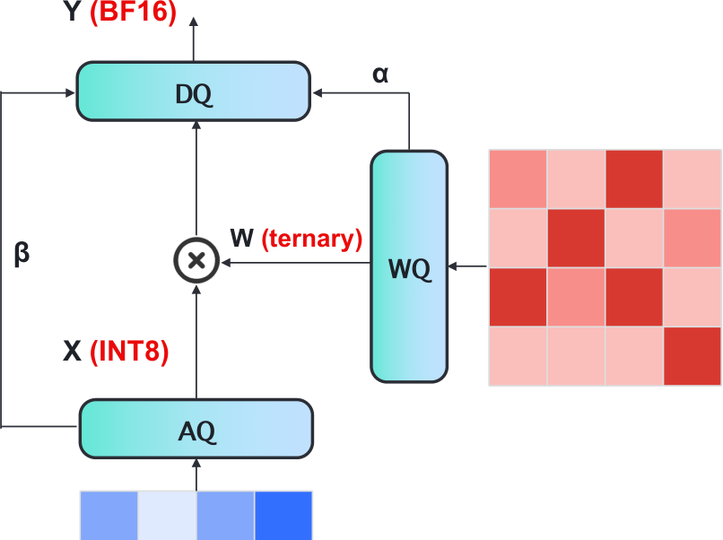
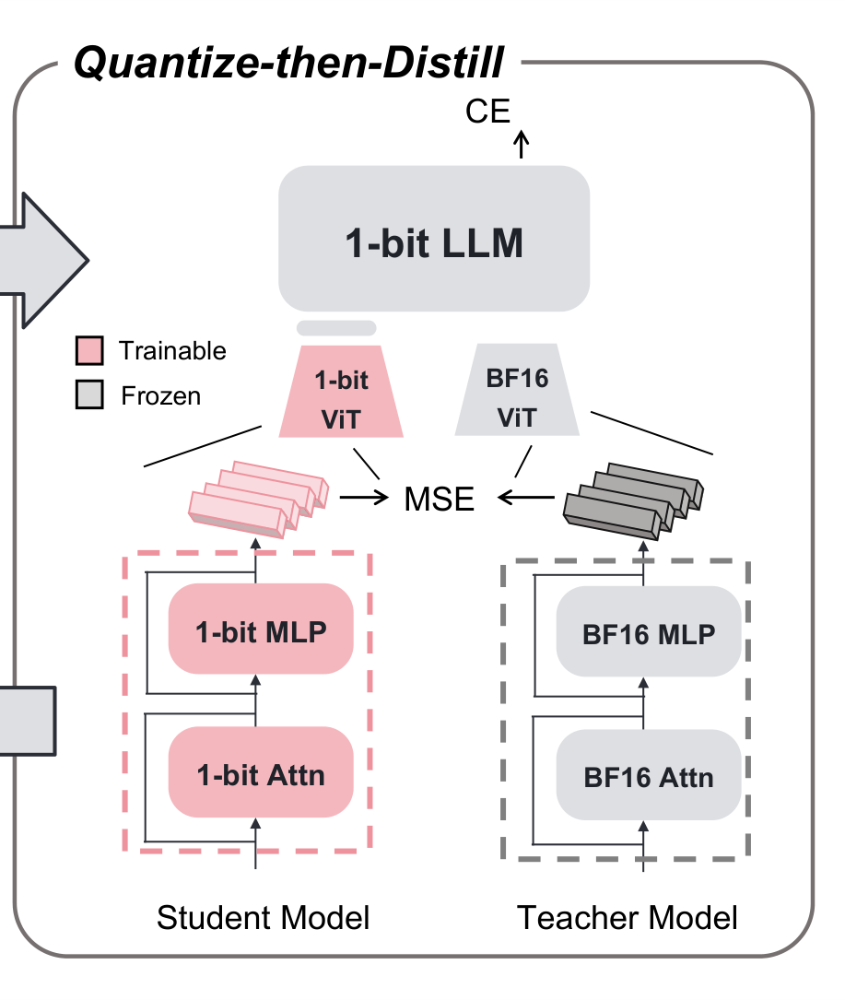
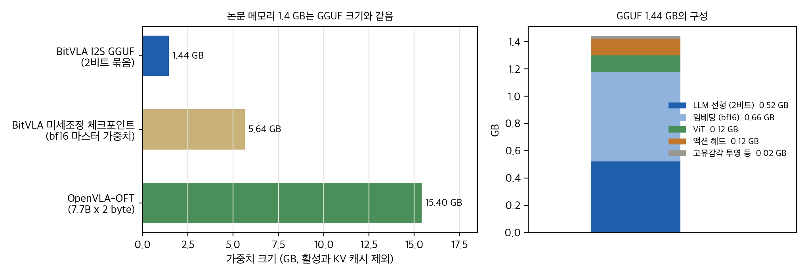
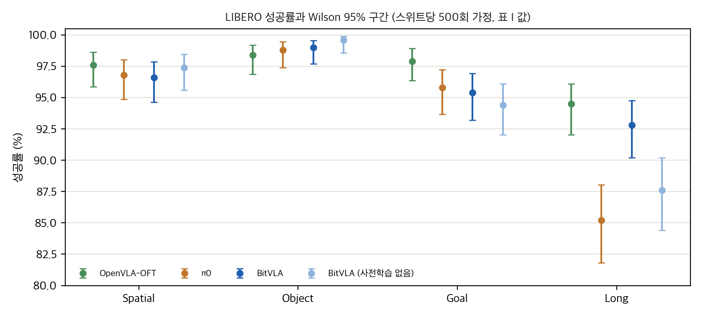
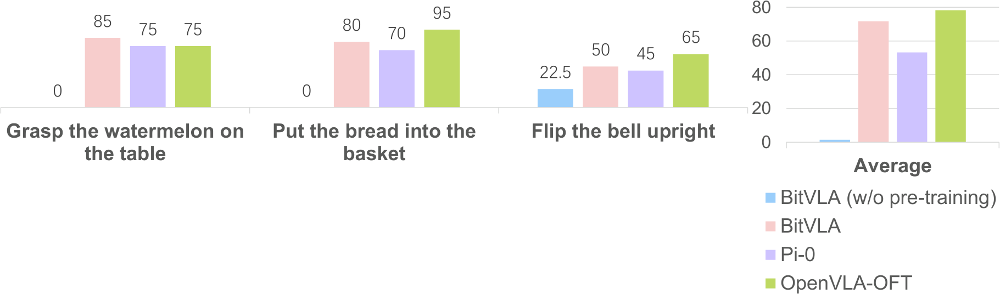
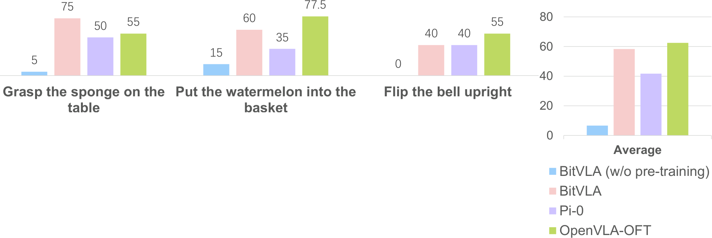
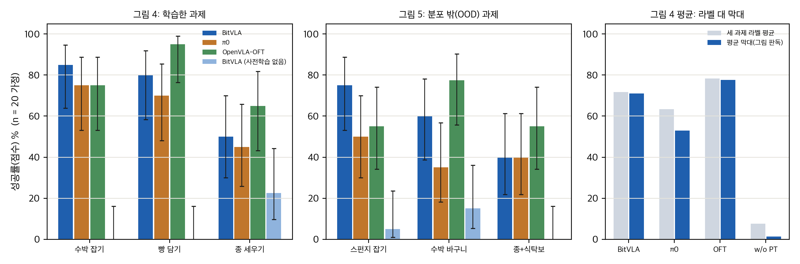
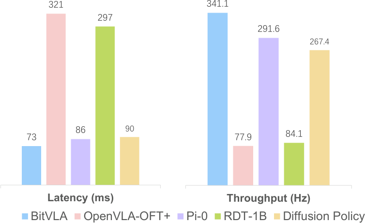
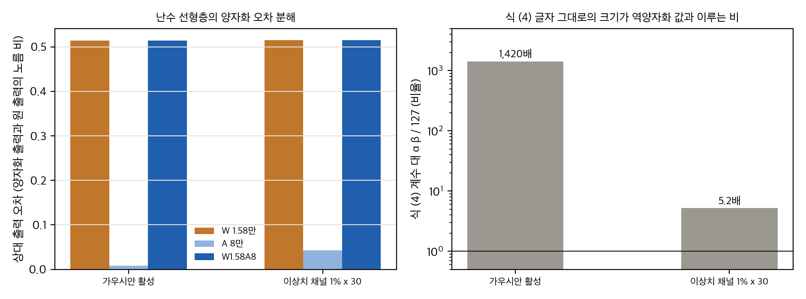

> **논문:** Hongyu Wang, Chuyan Xiong, Ruiping Wang, Xilin Chen. *BitVLA: 1-bit Vision-Language-Action Models for Robotics Manipulation.* CoRL 2026 스포트라이트, arXiv:2506.07530 (v2, 2026-03-01).
> 공식 코드는 GitHub ustcwhy/BitVLA(MIT)에 있습니다. 이 글의 그림은 논문 그림(출처 표기)과 우리가 그린 그래프입니다. 시행 수를 논문이 쓰지 않은 곳은 글 안에 가정을 적었습니다.

## 논문이 묻는 것

VLA를 로봇 위에서 돌리려면 메모리와 지연이 문제입니다. 사후 양자화는 정확도를 잃기 쉽습니다. BitVLA는 가중치가 모두 {−1, 0, +1}인 1비트(1.58비트) LLM인 BitNet b1.58 2B4T에 SigLIP 계열 비전 인코더를 붙입니다. 비전 인코더도 Quantize-then-Distill로 삼진 가중치와 INT8 활성으로 줄입니다. 그 뒤 Open X-Embodiment 부분집합으로 로봇 사전학습을 하고 OpenVLA-OFT 방식으로 미세조정합니다. 주장은 LIBERO 평균 96.0%로 OpenVLA-OFT(97.1%)와 비슷하면서 메모리 11.0배, 지연 4.4배를 줄였다는 것입니다.

*그림 3 (논문 원문). © 저자, CC BY 4.0, 출처 arXiv:2506.07530.*

*그림 2 중 Quantize-then-Distill 패널 (논문 원문). © 저자, CC BY 4.0, 출처 arXiv:2506.07530.*

## 이 글에서 확인한 것

**1. 1.4 GB는 2비트 묶음 파일의 크기입니다.** 공개 허브 메타데이터에서 BitVLA용 I2S GGUF 네 파일의 크기를 더하면 1,440,224,736 byte입니다. LLM 선형층(2비트) 0.52 GB, 임베딩(bf16) 0.66 GB, ViT 0.12 GB, 행동 헤드 0.12 GB로 나뉩니다. 공개 PyTorch 체크포인트는 마스터 가중치(bf16)여서 미세조정 모델이 5.64 GB, 사전학습 모델이 6.30 GB입니다. 실제 GGUF 크기로 나누면 OpenVLA-OFT(15.4 GB) 대비 10.7배이고, 논문의 11.0배는 1.4 GB를 반올림한 값입니다. 임베딩이 선형층보다 크다는 점도 눈에 띕니다.

*우리가 그린 그래프. 파라미터 수는 공개 config로 세었고 허브 메타데이터의 파라미터 총합과 약 0.01% 안에서 맞습니다.*

**2. LIBERO에서 OFT와의 평균 격차는 −1.1%p입니다.** 스위트당 500회(논문에 시행 수 없음, 공식 평가 스크립트 기본값) 가정에서 평균 차이의 Fisher p는 0.057, Goal 스위트는 −2.5%p(p = 0.032)입니다. π0 대비 평균 +1.8%p는 거의 Long(+7.6%p, p = 0.0002)에서 나오고 나머지 세 스위트는 구분되지 않습니다. 표 I의 OFT 값 일부는 500회 정수 비율이 아니어서 원 논문의 평균 방식(시드 평균 등)이 다를 가능성이 있습니다.

*우리가 그린 그래프 (표 I 값, 스위트당 500회 가정).*

**3. 실로봇 비교는 모델을 구분하지 못합니다.** 4 x 5 격자에서 평가했다고 쓰여 있어 셀당 20회(시행 수 n = 20 가정)로 보면, BitVLA의 π0 대비 우위는 방향은 같지만 과제별 p가 0.19–1.0이고 세 과제 합산은 0.44(그림 4), 0.10(그림 5)입니다. 사전학습 유무(85 대 0 등)는 확실합니다. 그림 4의 평균 막대는 π0이 약 53(그림 판독 값)으로 그려져 과제별 라벨 세 값의 평균 63.3과 다릅니다. 어느 쪽이 의도한 값인지 저자 확인이 필요합니다.

*그림 4의 막대 그래프 (논문 원문, 사진 띠는 자름). © 저자, CC BY 4.0, 출처 arXiv:2506.07530.*

*그림 5의 막대 그래프 (논문 원문, 사진 띠는 자름). © 저자, CC BY 4.0, 출처 arXiv:2506.07530.*

*우리가 그린 그래프 (셀당 20회 가정, 부분 점수는 점수 합 / 20). 오른쪽은 평균 막대(그림 판독 값)와 라벨 평균.*

**4. 지연 4.4배의 산술은 맞고 측정 경로는 공개 코드 밖에 있습니다.** 321 ms / 73 ms = 4.40이고 처리량은 청크 길이 25를 지연으로 나눈 값과 네 행이 0.4% 안에서 맞습니다(Diffusion Policy 행은 3.9% 차이). 논문은 BitBLAS 커널로 쟀다고 쓰는데 공개 PyTorch 코드는 bf16 안에서 양자화-역양자화를 하는 구현이며 커널이 없습니다. README는 robot.cpp 추론(RTX 3090, 이미지 2장)을 따로 보고하며 논문의 설정(A100, 이미지 3장)과 다릅니다.

*그림 6 (논문 원문). © 저자, CC BY 4.0, 출처 arXiv:2506.07530.*

**5. 공개 코드와 논문 서술이 다른 곳이 있습니다.** 논문 v2는 인과 마스크를 유지한다고 쓰는데 코드는 `use_bi_attn = True`로 호출하고(eager 경로에서만 양방향, flash 경로는 이 플래그를 무시), LIBERO-Long 스크립트는 10,001 스텝(논문 표는 100K)이며, Goal 학습률 2e-4는 논문의 탐색 집합에 없습니다. 증류와 로봇 사전학습 코드는 공개되어 있지 않습니다. 양자화 함수(absmean 가중치, 토큰 단위 absmax 활성), 양자화 대상 층, 평가 프로토콜은 논문과 맞습니다.

**6. v1과 v2의 BitVLA는 다른 모델입니다.** v1(94.8)은 로봇 사전학습이 없었고, v2(96.0)는 사전학습을 더했습니다. v1에 있던 "사전학습 없는 OFT"(91.9) 행은 v2에 없습니다. 둘 다 사전학습이 없는 조건에서는 BitVLA가 +2.85%p 높습니다(p = 0.0004, v1 값, 500회 가정).

**7. 식 (4)의 계수.** 식 (1)–(2)의 정의에서 정수 곱을 되돌리는 계수는 αβ/127인데 식 (4)에는 127α/β가 적혀 있습니다. 난수 선형층 토이에서 αβ/127을 쓰면 출력이 원래 크기로 돌아옵니다. 공개 코드의 역양자화는 이 크기와 같고, 표기의 문제로 보입니다.

*우리가 그린 그래프. 난수 가중치와 활성의 토이이므로 오차 크기는 학습된 모델의 값이 아닙니다.*

## 한계

시행 수(LIBERO 500, 실로봇 20)와 한 번의 평가라는 가정 위의 검정이며, 그림 판독 값에는 오차가 있습니다. 가중치를 받지 않았고 코드를 실행하지 않았습니다. 논문 재현은 학습 GPU 시간과 실로봇이 필요해 하지 않았습니다. 이 글은 논문과 코드를 비판하기보다 표와 서술이 서로 어떻게 맞물리는지 확인한 기록이며, 물어볼 항목(마스크 경로, Long 스텝 수, 96.0 행에 해당하는 체크포인트, 그림 4 평균 막대)은 저자 확인이 필요합니다.

## 자료

- [통합 리포트 PDF](report/report_public.pdf)
- [01. 논문 분석: BitVLA (arXiv:2506.07530 v2)](analysis/01_paper_analysis.md)
- [02. 선행연구, 구성 요소의 출처, 코드 자료](analysis/02_prior_work.md)
- [03. 수치 재계산, 일관성 검사, 토이](analysis/03_analysis.md)
- [04. 공식 코드 대조와 구현 가능성](analysis/04_code_verification.md)
