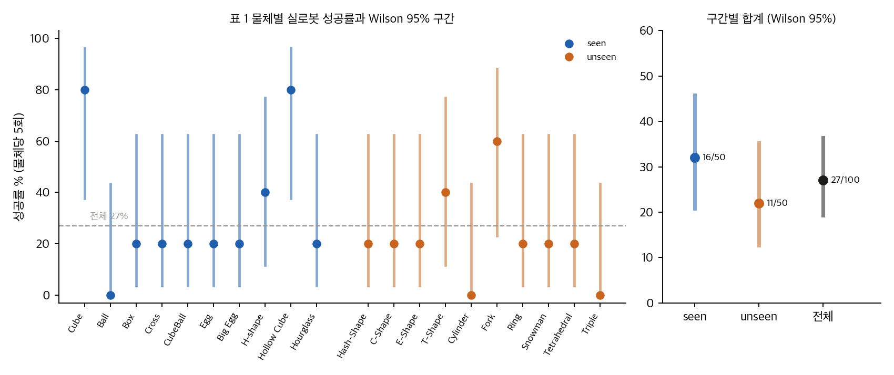
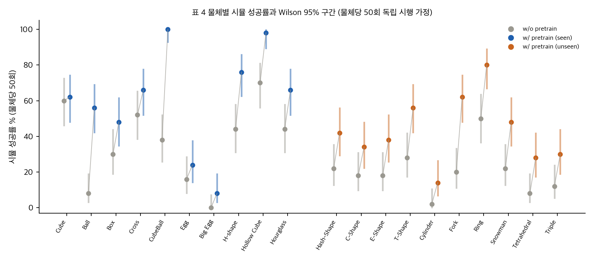
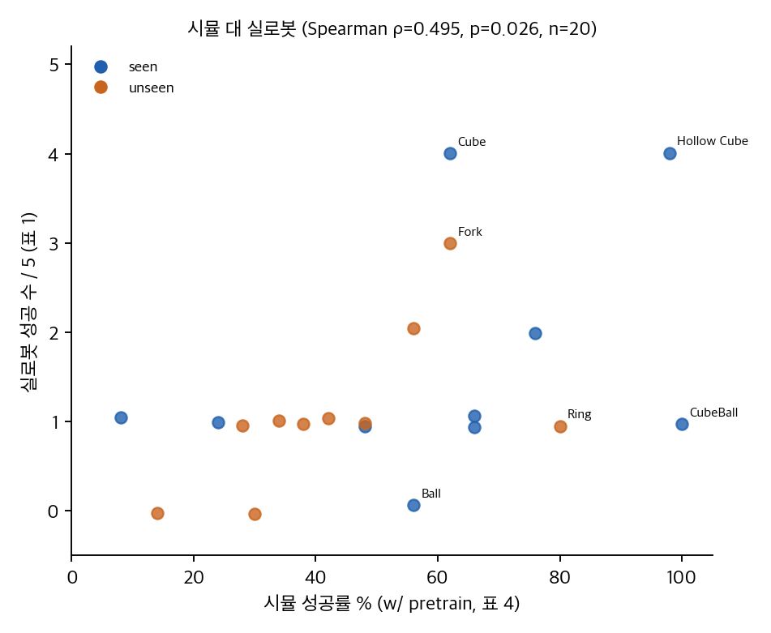
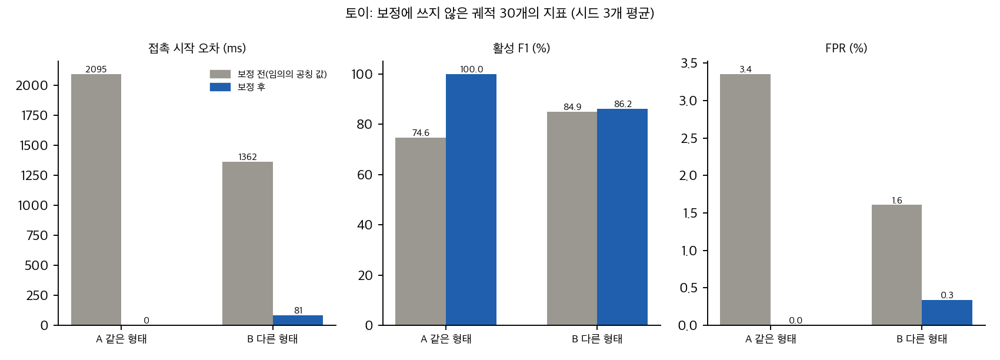

# 03. 수치 재계산, 일관성 검사, 토이 실험

재계산은 `analysis/recompute.py`(수 초), 토이는 `analysis/toy_event_calibration.py`(약 40초)입니다. 결과는 같은 폴더의 `*_results.json`에 있습니다. 검사 번호는 V(재계산), K(표·본문 사이 일관성), T(토이)이고, 주장 판정 C는 `04`에 있습니다.

## 0. 가정

- 실로봇: 물체당 5회(부록 B.1), seen·unseen 각 50회, 전체 100회입니다. 시행은 독립 이항으로 봅니다.
- 시뮬레이션: 물체당 50회, split당 500회(부록 B.1)입니다. 표 4의 백분율을 50회에서의 성공 수(= 백분율 / 2)로 되돌려 검정에 씁니다.
- 시뮬 표(표 3, 4, 6, 7, 8)의 시행은 하나의 학습된 정책에서 나온 것으로 보입니다. 학습 시드 수는 논문에 없습니다. 아래 p 값은 시행 사이 변동만 반영하고 학습 시드 사이 변동은 반영하지 않으므로, 실제 불확실성은 더 큽니다.
- 구간은 Wilson 95%, 비교는 Fisher 정확 검정(비율 둘)과 정규 근사 두 비율 검정(500 대 500)입니다. 여러 비교는 Holm으로 보정합니다.

## 1. 재계산 결과

### 1.1 V1: 표 1 실로봇

| 항목 | 논문 | 재계산 |
|---|---|---|
| seen 성공 합 | 16/50 | 16/50 (4+0+1+1+1+1+1+2+4+1) |
| unseen 성공 합 | 11/50 | 11/50 (1+1+1+2+0+3+1+1+1+0) |
| 전체 | 27% | 27/100 |

- Wilson 95%: seen 32% [20.8, 45.8], unseen 22% [12.8, 35.2], 전체 27% [19.3, 36.4].
- 물체 20개를 단위로 복원추출한 군집 부트스트랩(20,000회)에서 전체 성공률 95% 구간은 [18.0, 37.0]입니다.
- **seen 대 unseen:** 32% 대 22%, Fisher p = 0.37입니다. 이 차이(10 %p)를 80% 검정력으로 가르려면 팔당 약 308회가 필요합니다(양측 5%, 정규 근사). 현재 시행 수로는 일반화 격차가 있다고도 없다고도 말할 수 없습니다.
- 물체별: 5회에서 한 물체의 Wilson 95% 구간은 폭이 약 60 %p입니다(1/5 → [3.6, 62.4]). Cube와 Hollow Cube(4/5)가 seen 성공의 절반(8/16)을 차지합니다. 물체 사이 이질성(공통 확률 0.27 가정, 카이제곱 24.9, 몬테카를로 p = 0.20)은 구분되지 않습니다. 5회로는 물체 간 차이도 확정하기 어렵습니다.



*그림: 표 1의 물체별 성공 수(5회)와 Wilson 95% 구간, 구간별 합계. 우리가 그린 그래프이며 논문 표 1을 다시 그렸습니다.*

### 1.2 V2: 표 4 시뮬 사전학습 절제

- 모든 값이 2의 배수(50회의 정수 성공 수)이므로 정수로 가능합니다. 평균은 seen 36.2 → 60.4, unseen 20.0 → 43.2, 전체 28.1 → 51.8이 재계산과 일치합니다. "Improve." 열 20개도 모두 일치합니다.
- 20개 물체 모두 개선(부호 검정 p = 1.9e-6). 물체별 평균 개선 23.7 %p, SD 14.3 %p. 대응 t 검정 p = 5.3e-7, Wilcoxon p = 1.9e-6입니다.
- 물체별로 따로 보면(Fisher, 50 대 50, Holm 보정) 유의한 것은 6개(Ball, CubeBall, H-shape, Hollow Cube, Fork, Ring)이고 나머지 14개(Cube +2, Egg +8, Big Egg +8, Box +18, Cross +14 등)는 구분되지 않습니다. 물체별 50회는 20 %p 안팎 차이를 단독으로 가르기에는 작습니다.
- split 합산(500 대 500)은 seen, unseen, 전체 모두 p < 1e-13입니다. 방향과 크기는 확실합니다. 단, 한 정책의 시행이므로 학습 시드 변동은 포함되지 않습니다(§0).



*그림: 표 4의 시뮬 성공률 (w/o 대 w/ 사전학습)과 Wilson 95% 구간(물체당 50회 가정). 우리가 그린 그래프입니다.*

### 1.3 V3: 표 5 실로봇 사전학습 비교

- 전체 6/100 대 27/100: Fisher p = 9.0e-5. seen 4/50 대 16/50 p = 0.005, unseen 2/50 대 11/50 p = 0.015.
- 사전학습 효과는 실로봇에서도 큽니다. 이 비교의 해석 주의는 K2(보정 조건)에 있습니다.

### 1.4 V4: 표 9 실패 모드

- 20개 물체 모두 행의 EG + SL + ES가 "Fail." 열과 같고, 그 값이 5 − (표 1 성공 수)와 같습니다. seen 합 11/11/12 = 34, unseen 합 4/24/11 = 39, 전체 15/35/23 = 73, 73 + 27 = 100이 맞습니다. 비율 20.5%, 47.9%, 31.5%도 맞습니다(35/73 = 47.95%).
- unseen의 실패 중 미끄러짐이 24/39(61.5%)로, seen의 11/34(32.4%)보다 큽니다. 부록 D는 부드럽거나 둥근 물체(공, 원기둥)에서 미끄러짐이 많다고 쓰며, 표 9에서 Ball과 Cylinder 모두 5/5가 미끄러짐입니다. Triple도 5/5입니다.

### 1.5 V5: 시뮬 대 실로봇

- 평균 성공률의 비는 seen 0.32/0.604 = 0.53, unseen 0.22/0.432 = 0.51, 전체 0.27/0.518 = 0.52입니다. 실로봇은 시뮬의 약 절반입니다. 단, 성공 기준이 다릅니다(시뮬 1.5 cm 이상 들어 올려 1 s, 실로봇 3.0 cm 이상 1 s, 부록 B.1). 같은 기준이라면 격차가 더 클 수도 작을 수도 있습니다.
- 물체별 순위 상관(시뮬 w/ pretrain 대 실로봇 성공 수, n = 20): Spearman ρ = 0.50(p = 0.026). seen만 ρ = 0.40(p = 0.25), unseen만 ρ = 0.72(p = 0.019). 시뮬에서 쉬운 물체가 실로봇에서도 대체로 쉽다는 정도의 약한 일치입니다. CubeBall(시뮬 100%, 실로봇 1/5)과 Ball(시뮬 56%, 실로봇 0/5)이 대표적인 불일치입니다.
- 시뮬 성공률을 물체별 기대 확률로 두고 실로봇 5회의 하한 꼬리 확률이 5% 미만인 물체는 Ball, Cross, CubeBall, Hourglass, Ring 5개입니다(전체 비 0.52를 감안하지 않은 참고 계산).



*그림: 시뮬 성공률(표 4, w/ 사전학습) 대 실로봇 성공 수(표 1). 점이 겹치지 않도록 세로로 조금 흩었습니다. 우리가 그린 그래프입니다.*

### 1.6 V6: 표 2와 보정 데이터

- 시작 오차 426 → 96 ms(77.5% 감소), F1 64.2 → 70.5(+6.3 %p), FPR 4.2 → 2.2(0.52배). 이 세 값은 논문이 보고한 것 외에 시행 수, 구간, 분산이 없어 검정할 수 없습니다.
- **시간 해상도:** 보정 데이터는 약 10 Hz(프레임 주기 100 ms)입니다(부록 A). 보정 후 평균 시작 오차 96 ms는 한 프레임 주기보다 작습니다. 이 해상도에서는 대부분의 택셀이 0~1프레임 안에서 일치한다는 뜻으로 읽을 수 있고, 그 이하의 시간 차이는 구별되지 않습니다. 정책 제어 주기는 논문에 없습니다.
- **F1과 FPR의 관계:** F1 = 2TP / (P + TP + FP)(P는 실제 활성 택셀-시간 수)입니다. 실제 활성 비율을 가정하면 F1과 FPR로 재현율이 정해집니다. 활성 비율이 10%라면 재현율은 보정 전 0.651, 후 0.652로 같고 F1 상승이 FPR 감소로만 설명됩니다. 20%라면 0.552 → 0.592, 5%라면 0.85 → 0.77로 오히려 줄어듭니다. 따라서 표 2의 F1 상승이 "같은 택셀을 더 잘 켠다"인지 "엉뚱한 활성을 줄인다"인지는 활성 비율이나 TP/FP/FN 값 없이 가를 수 없습니다. 또 표 2의 값이 모두 성립하려면 실제 활성 비율이 3.6% 이상이어야 합니다(재현율 1에서도 F1 64.2, FPR 4.2에 도달하는 하한).
- 보정 데이터 산술: 구 3,255프레임(325.5 s × 10 Hz) + 원기둥 2,419(241.9 s × 10 Hz) = 5,674 프레임, 궤적 9개의 평균 길이 63 s로 모두 일치합니다.
- 그림 6은 FSR 6개 궤적과 지문 택셀 4개 궤적(합 10)을 보여 주는데 본문과 그림 5 캡션은 궤적 9개입니다(K4). 두 센서 군이 한 궤적을 공유한다면 일치할 수 있습니다.

### 1.7 V7: 구성 수치의 내적 일관성

- 채널: 4 × 8 + 12 = 44. 자유도: 6 + 16 = 22, 위치와 속도 44. 사전학습 점 출력: 64 질의 × 16점 = 1,024. FFN/은닉 = 1,536/384 = 4. 헤드 차원 384/6 = 64. DP 전역 조건 896 = 384(촉각) + 512(저차원 MLP 출력으로 추정, 본문에 없음). 모두 맞습니다.
- PPO 전문가 계산량: 물체별 2억 스텝 × 10 전문가(seen 물체 10개 가정) = 20억 환경 스텝(추정). 병렬 환경 2,048개.
- 시뮬 시행 수: 표 3의 500회 × 2 split = 1,000회가 표 4의 20개 물체 × 50회와 일치합니다. 실로봇 시행: 표 1(100회) + 표 5 w/o(100회) = 200회를 합니다. 두 배치에서 쓰인 위치 영역이 다릅니다(K7).

## 2. 일관성 검사 (K)

| 번호 | 내용 | 위치 | 판정 |
|---|---|---|---|
| K1 | 같은 수치의 재사용: 표 3 w/ = 표 4 평균 = 표 6 binary(seen) = 표 7 DP(seen, unseen) = 부록 C 본문의 60.4/43.2/51.8. 표 3 w/o = 표 8 FK-grounded = 36.2/20.0/28.1 | 표 3, 4, 6, 7, 8 | 한 정책의 평가를 여러 표가 공유하는 구조로 읽힙니다. 이 경우 표 6–8의 비교 대상(연속 신호, BC, ACT, 원시 벡터)만 별도 학습이고 시드 반복은 없습니다 |
| K2 | **표 5 w/ Pretrain 행이 표 1과 같음.** 표 5는 "보정을 끈" 실로봇 결과이고(부록 C.1), 표 1은 "보정된 시뮬과 사전학습을 쓴 전체 시스템"(표 1 캡션)인데 둘 다 seen 16/50, unseen 11/50, 전체 27/100 | 표 1 캡션, 부록 C.1, 표 5 | 두 조건에서 우연히 같은 값이 나왔거나, 같은 시행을 가리키거나, 캡션이 다릅니다. 어느 쪽이든 실로봇에서 보정 유무의 효과를 이 표들로 읽을 수는 없습니다. 저자 확인이 필요합니다 |
| K3 | **표 7 BC 평균 45.8** 대 (59.4 + 30.2)/2 = 44.8. ACT 34.9, DP 51.8, 표 8의 두 평균은 일치 | 부록 C.3, 표 7 | BC 한 칸만 1.0 %p 다릅니다. 두 칸 중 하나가 다른 값일 가능성이 있습니다. 해석에는 영향이 없습니다(DP 대 BC 평균 차이 6.0 대 7.0 %p, unseen에서 +13.0 %p) |
| K4 | **보정 방법 서술:** 식 2와 §3.1은 세 파라미터의 격자 탐색인데, 그림 5 캡션은 "촉각 정렬 네트워크 g_φ가 실제 촉각을 시뮬 호환 접촉 특징으로 사상"한다고 씁니다. 본문 식 2와 격자 탐색에는 g_φ가 없습니다. 궤적 수는 본문·캡션 9개, 그림 6의 FSR 6 + 지문 4 | §3.1, 그림 5·6, 부록 A | 실제로 쓴 방법이 격자 탐색인지 학습된 사상인지 문서만으로는 가릴 수 없습니다 |
| K5 | 프로젝트 페이지의 "Success rates for all 20 objects across 5 trials each, comparing policies with and without privileged tactile pretraining"는 값(62%, 56%, ...)이 표 4와 같습니다. 5회로는 20% 단위 값만 나옵니다 | 프로젝트 페이지 표, 부록 B.1 | 값은 표 4(시뮬, 물체당 50회)와 같고 "5"는 실로봇의 물체당 시행 수와 같은 숫자입니다. 어느 쪽을 가리키는지 저자 확인이 필요합니다 |
| K6 | 참고문헌: [3]과 [26]이 같은 논문(Rotating without Seeing)의 arXiv 판과 RSS 판, [6]과 [24]가 같은 논문(Church 외 CoRL 2021)입니다. [1]의 저자 표기가 이름 순서입니다("C. Roberto, O. Andrew ..."). §1의 "binary tactile signals ... [8, 9]"에 인용된 두 논문 제목은 시각 기반 촉각 시뮬레이터(Taccel, Taxim)입니다 | 참고문헌, §1 | 인용 정리가 필요한 곳입니다. [8, 9]가 이진 신호를 다루는지는 본문을 확인하지 않아 판단하지 않습니다 |
| K7 | 시작 위치 범위: 평가(시뮬과 실로봇)는 4 cm × 4 cm 영역(부록 B.1), PPO 전문가 학습은 ±5 cm(부록 E). 그림 3B 캡션은 "학습과 보류 물체 배치 영역으로 공간 일반화를 평가"한다고 쓰지만 공간 일반화 결과는 본문·부록에 없음 | 부록 B.1·E, 그림 3B | 평가 영역이 학습 범위 안쪽입니다. 공간 일반화 평가는 보고되지 않았습니다 |
| K8 | 성공 기준: 시뮬 1.5 cm 이상, 실로봇 3.0 cm 이상(둘 다 1 s 유지) | 부록 B.1 | 시뮬 수치와 실로봇 수치를 같은 척도로 비교할 수 없습니다(V5) |

## 3. 토이 실험

### 3.1 T1: 이진 접촉 이벤트 보정이 맞추는 것과 못 맞추는 것 (numpy, 약 40초)

논문의 보정 모델(식 1–2)을 1차원 택셀 8개 배열로 줄였습니다(`analysis/toy_event_calibration.py`). 시뮬은 SDF 임계 λ_con, 지수 전파 α, 택셀 임계 λ_pre를 쓰고, 합성 "실제 센서"는 두 가지를 만들었습니다. A는 같은 형태(참 파라미터 λ_con = 0.15, α = 0.35, λ_pre = 0.55), B는 형태가 다른 센서(80 ms 지연, 켜는 임계 0.9 > 끄는 임계 0.4의 히스테리시스, 120 ms 시상수의 느린 해제)입니다. 보정 데이터는 약 10 Hz로 줄인 9개 궤적, 평가는 보정에 쓰지 않은 30개 궤적, 시드 3개입니다. 지표는 부록 B.2의 세 가지입니다.

| 조건 | 시작 오차 (ms) 전 → 후 | F1 (%) 전 → 후 | FPR (%) 전 → 후 |
|---|---|---|---|
| A 같은 형태 | 2,095 → 0 | 74.6 → 100.0 | 3.36 → 0.00 |
| B 다른 형태 | 1,362 → 81 | 84.9 → 86.2 | 1.61 → 0.34 |

(보정 전 "공칭" 값은 임의로 정한 (0.0, 0.5, 0.2)라서 보정 전 수치 자체는 의미가 없고, 전후의 변화 양상만 봅니다.)

- A: 모델이 맞으면 격자 탐색이 세 파라미터를 정확히 되찾고(세 시드 모두 (0.15, 0.35, 0.55)) 모든 지표가 보정 데이터 바깥에서도 완전히 맞습니다.
- B: 시작 오차는 1,362 → 81 ms로 한 프레임(100 ms) 아래로 줄지만 F1은 약 1.3 %p만 오릅니다(84.9 → 86.2). 해제 시점과 히스테리시스는 임계값 조정으로 맞출 수 없어 F1이 모델 형태의 한계에 머뭅니다. 선택된 λ_con은 세 시드 모두 격자 하한(0.0)이고, 손실이 최소의 2% 안인 격자점이 시드마다 1–3개로, 임계값들이 서로 상쇄합니다.
- 읽는 법: 시작 오차가 100 ms 미만으로 내려간 것과 F1이 70% 안팎에 머무는 것은 함께 나타날 수 있는 패턴입니다. 논문의 표 2(96 ms, F1 70.5)가 이 이유 때문이라는 증거는 아닙니다. 이 토이는 보정이 줄일 수 있는 오차(켜는 시점)와 줄이기 어려운 오차(해제, 형태 차이)가 갈릴 수 있음을 보일 뿐이고, 논문 수치의 원인에 대한 결론은 아닙니다. 1차원, 합성 센서, 한 가지 불일치 구성입니다.



*그림: 토이 T1의 보정 전후 지표(보정에 쓰지 않은 궤적 30개, 시드 3개 평균). 보정 전은 임의로 정한 공칭 값입니다. 우리가 그린 그래프입니다.*

## 4. 요약

| 대상 | 재계산 결과 |
|---|---|
| 합계(27%, 16/50, 11/50, 표 3·4·8 평균, 표 9 합) | 모두 일치 |
| 표 7 BC 평균 | 45.8 대 재계산 44.8 (K3) |
| 사전학습 효과 | 시뮬(20/20 물체, p < 1e-13)과 실로봇(6/100 대 27/100, p = 9e-5) 모두 큼 (V2, V3) |
| 일반화 격차(seen 대 unseen) | p = 0.37, 구분 불가 (V1) |
| 보정 효과 | 센서 수준 지표만 있고 정책 수준 증거 없음 (V6, K2) |
| 재현성 정보 | 시드 수, θ*, 격자 범위, 표 2의 시행 수 없음 |

## 5. 재실행

```bash
python3 analysis/recompute.py
python3 analysis/toy_event_calibration.py   # 약 40초
python3 analysis/plot_figures.py
```
