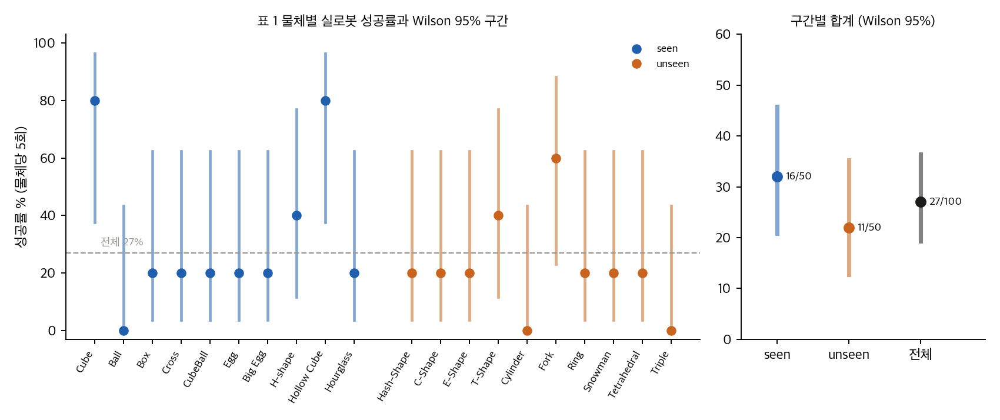
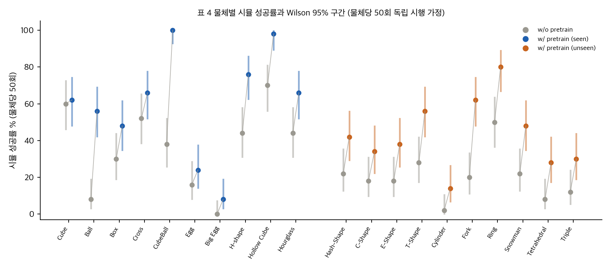
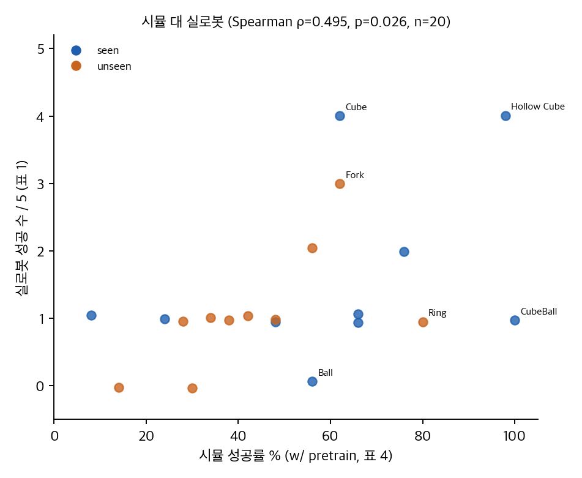
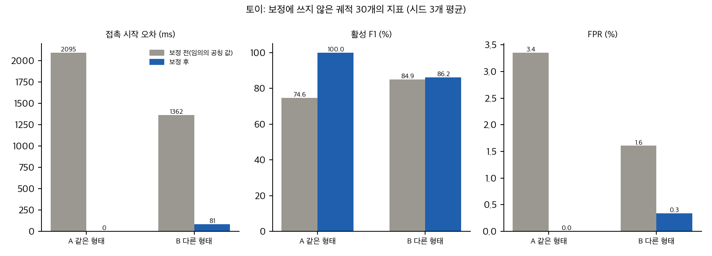

> **논문:** Shengcheng Luo, Xiyan Huang, Zhe Xu, Wanlin Li, Ziyuan Jiao, Chenxi Xiao. *Blind Dexterous Grasping via Real2Sim2Real Tactile Policy Learning.* CoRL 2026 포스터, arXiv:2606.11767 (v2, 2026-06-11).
> 공식 코드는 공개되어 있지 않습니다(프로젝트 페이지의 Code 링크가 비어 있고 하드웨어 저장소는 "coming soon"으로 표기). 이 글의 그림은 모두 우리가 그린 그래프입니다. 논문은 arXiv 비독점 배포 라이선스(CC 아님)라서 논문 그림은 싣지 않았습니다.

## 논문이 묻는 것

시각 없이 촉각만으로 다지 손이 물체를 집어 올릴 수 있을까요? 이 논문은 LEAP Hand에 지문 센서 4개(채널 8개씩)와 압력 센서(FSR) 12개를 달아 **이진 촉각 44채널**만으로 정책을 만듭니다. 학습은 모두 시뮬레이션에서 하고 실제 로봇에는 영점으로 옮깁니다. 구성은 세 가지입니다.

1. **Real2Sim 보정.** 접촉이 켜지고 꺼지는 시점을 맞추도록 시뮬레이터의 촉각 파라미터 세 개(접촉 여유, 전파 감쇠, 활성 임계)를 격자 탐색으로 찾습니다(식 1–2).
2. **택셀 위치를 붙인 촉각 인코더.** 각 택셀의 순운동학 3D 위치와 이진값을 한 줄로 묶고, 시뮬 전용 정답(물체 점군, 자세, 접촉 등)으로 사전학습합니다.
3. **전문가 → 확산 정책.** 물체별 PPO 전문가의 성공 궤적을 모아 하나의 Diffusion Policy로 증류합니다.

## 이 글에서 확인한 것

**1. 실로봇 27%는 산술이 맞고, 구간은 넓습니다.** 20개 물체 × 5회에서 27/100(seen 16/50, unseen 11/50)입니다. Wilson 95% 구간은 [19.3, 36.4]입니다. seen 32%와 unseen 22%의 차이는 Fisher p = 0.37이라 이 시행 수로는 일반화 격차가 있다고도 없다고도 말하기 어렵습니다(격차를 80% 검정력으로 가르려면 팔당 약 300회). 물체당 5회라서 물체별 구간 폭은 약 60 %p입니다(시행 수 5회, 논문 부록 B.1).

*그래프 (우리가 그림). 논문 표 1의 성공 수를 다시 그렸습니다.*

**2. 사전학습 효과는 시뮬과 실로봇 모두에서 큽니다.** 시뮬레이션(물체당 50회 가정)에서 20개 물체 모두 성공률이 올랐고 평균 28.1%가 51.8%가 되었습니다(부호 검정 p = 1.9e-6). 물체별로 따로 보면 Holm 보정 뒤에도 구분되는 것은 6개이고, 나머지는 50회로는 구분되지 않습니다. 실로봇에서는 6/100이 27/100이 됩니다(Fisher p = 9e-5). 시뮬 표는 한 정책의 평가를 쓰고 학습 시드 수가 적혀 있지 않아, 위 p 값은 시행 사이 변동만 반영합니다.

*그래프 (우리가 그림). 논문 표 4를 다시 그렸습니다(물체당 50회 가정).*

**3. 보정의 정책 수준 효과는 이 논문에서 가를 수 없습니다.** 표 2는 접촉 시작 오차 426 → 96 ms, F1 64.2 → 70.5, FPR 4.2 → 2.2를 보고합니다. 세 값 모두 센서 수준 지표입니다. 보정 유무에 따른 성공률 비교는 실로봇에도 시뮬에도 없습니다. 게다가 표 5의 "w/ Pretrain" 행(부록 C.1은 보정을 끈 조건이라고 설명)이 표 1(보정을 켠 전체 시스템)과 같은 16/50, 11/50입니다. 두 조건의 값이 우연히 같은지, 같은 시행을 가리키는지 저자 확인이 필요합니다.

**4. 표 2의 F1 상승은 읽는 방식에 따라 다릅니다.** F1은 재현율과 FPR이 함께 정합니다. 실제로 활성인 택셀-시간 비율이 10%라고 가정하면 재현율은 보정 전 0.651, 후 0.652로 같고 F1 상승은 FPR 감소로만 설명됩니다(20% 가정이면 0.552 → 0.592). 그리고 보정 데이터가 약 10 Hz(프레임 100 ms)라서 96 ms는 한 프레임보다 작은 값입니다. TP, FP, FN 값과 평가 궤적이 보정 궤적과 분리됐는지가 함께 보고되면 좋겠습니다.

**5. 표 7의 BC 평균과 표 8의 FK 위치 효과.** BC의 seen 59.4와 unseen 30.2의 평균은 44.8인데 표에는 45.8이 있습니다. 표 8에서 택셀 위치를 붙인 입력과 원시 벡터의 차이는 seen +2.4 %p, unseen +0.2 %p이고 500회 가정에서 구분되지 않습니다(p = 0.43, 0.94). 확산 정책의 unseen 우위(43.2 대 BC 30.2)는 큽니다.

**6. 시뮬과 실로봇은 약 절반입니다.** 시뮬 51.8%에 실로봇 27%로 비가 0.52입니다. 다만 성공 기준이 다릅니다(시뮬 1.5 cm, 실로봇 3.0 cm 들어 올림, 부록 B.1). 물체별 순위는 약하게 일치합니다(Spearman ρ = 0.50, p = 0.026, n = 20).

*그래프 (우리가 그림). 시뮬 성공률 대 실로봇 성공 수. 점이 겹치지 않게 세로로 조금 흩었습니다.*

## 합성 토이로 본 것: 보정이 맞추는 것과 못 맞추는 것

논문의 보정 모델(식 1–2)을 1차원 택셀 8개 배열로 줄여 합성 센서에 적용했습니다(numpy, 약 40초). 센서가 모델과 같은 형태이면 격자 탐색이 파라미터를 정확히 되찾습니다. 센서가 다른 형태(80 ms 지연과 히스테리시스를 넣음)이면 접촉 시작 오차는 1,362 → 81 ms로 한 프레임 아래로 줄지만 F1은 84.9 → 86.2로 거의 오르지 않았습니다. 켜는 시점은 임계값으로 맞출 수 있지만 해제 시점과 히스테리시스는 맞추기 어렵기 때문입니다. 이 토이는 논문 수치의 원인에 대한 증거가 아니라, 시작 오차와 F1이 따로 움직일 수 있다는 가능성을 보인 것입니다.

*그래프 (우리가 그림). 합성 센서 두 종류, 보정에 쓰지 않은 궤적 30개, 시드 3개 평균. 보정 전 값은 임의로 정한 공칭 값입니다. 실로봇 결과가 아닙니다.*

## 구현 가능성 (Apple M4 Pro, CUDA 없음)

- **논문 수치의 재현: 불가.** 공식 코드, 보정 값(θ*와 격자 범위), 센서 설계, 실로봇이 공개되어 있지 않습니다.
- **축소판 구현: 부분적으로 가능.** 접촉 모델과 보정 토이, 표 재계산은 이 글에서 했습니다. 인코더 사전학습과 전문가-증류 축소판은 합성 환경이나 손 모델 확보 뒤에 시작할 수 있고, 전체를 4–6주로 어림합니다(추정, 측정 전).

이 글은 재현 실험을 하지 않았습니다.

## 한계

- 물체당 5회, 시드 정보와 신뢰구간이 없어 소규모 비교는 방향만 읽을 수 있습니다.
- 시뮬 표는 한 정책의 평가를 공유하는 것으로 보이며, 학습 시드 변동은 위 p 값에 들어 있지 않습니다.
- 보정 θ*, 격자 범위, 이진화 임계값, 표 2의 시행 수와 평가 궤적, 정책 제어 주기는 논문에 없습니다.
- 토이는 1차원 합성 센서이고 논문 실험의 재현이 아닙니다.

## 출처와 라이선스

- 논문: arXiv:2606.11767, arXiv 비독점 배포 라이선스(abs 페이지의 license 링크 확인). 논문 그림은 싣지 않았습니다.
- 표 값은 인용과 재계산을 위해 옮겼습니다. 그래프, 토이, 분석 문서와 스크립트는 이 저장소 작성자가 만들었습니다.
- 코드, 가중치, 데이터는 받지 않았고, 어떤 코드도 실행하지 않았습니다.

## 자료

- [통합 리포트 PDF](report/report_public.pdf)
- [01. 논문 분석: Blind Dexterous Grasping via Real2Sim2Real Tactile Policy Learning (arXiv:2606.11767)](analysis/01_paper_analysis.md)
- [02. 선행연구와 관련 저장소](analysis/02_prior_work.md)
- [03. 수치 재계산, 일관성 검사, 토이 실험](analysis/03_analysis.md)
- [04. 주장 검증과 구현 가능성 (공식 코드 없음)](analysis/04_claim_verification.md)
