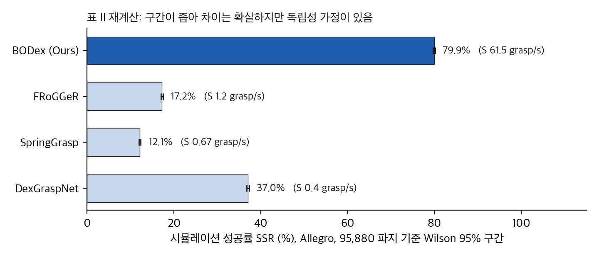
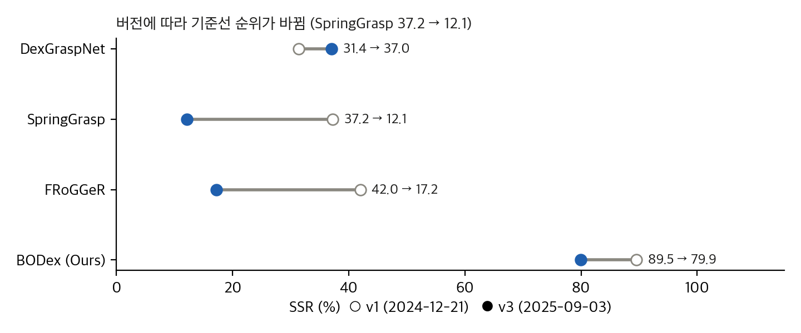
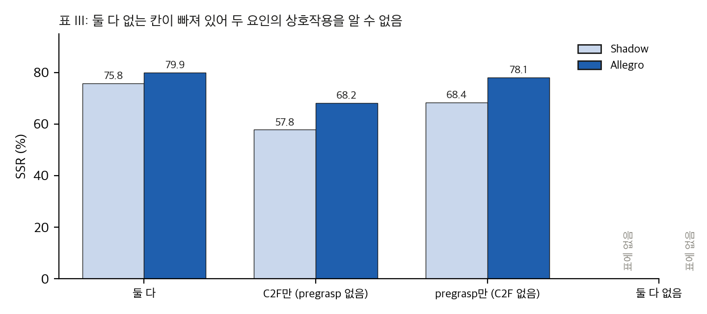

> **논문:** Jiayi Chen, Yubin Ke, He Wang. *BODex: Scalable and Efficient Robotic Dexterous Grasp Synthesis Using Bilevel Optimization.* IEEE ICRA 2025, arXiv:2412.16490 (v3, 2025-09-03).
> 공식 코드는 GitHub JYChen18/BODex에 있습니다 (cuRobo 기반, NVIDIA License와 CC BY-NC 4.0). 이 글의 그림은 모두 우리가 그린 그래프입니다. 논문 그림은 넣지 않았습니다.

## 논문이 묻는 것

다지 손 파지 데이터를 많이 모으려면 손 자세를 무작위로 뽑아 평가하는 방식은 너무 비쌉니다. 20자유도가 넘는 손에서는 대부분의 자세가 물체와 닿지 않거나 관통합니다. 그래서 경사 기반 최적화로 자세를 물체 쪽으로 밀어 넣는 방법이 주목받았지만, 기존 방법은 세 가지 한계를 가졌습니다. 접촉 힘을 균등하고 마찰 없다고 가정하는 에너지, 몇 개 물체에서만 검증한 실험, 느린 속도입니다. 또 손, 시뮬레이터, 지표가 달라서 서로 비교하기도 어려웠습니다.

BODex는 이 문제를 **이중 최적화**로 풉니다. 위층은 손 자세를 경사 하강으로 옮기고, 아래층은 각 접촉의 힘을 QP로 정해 목표 wrench에 가장 가깝게 만듭니다. 아래층이 힘을 자유롭게 정하므로 "접촉 힘은 균등하다"는 가정이 필요 없습니다. 여기에 cuRobo의 GPU 충돌 질의와 배치 ReLU-QP를 붙였고, 접촉 질의를 구 (빠름)에서 메쉬 (정확함)로 바꾸는 두 단계 구조를 씁니다. 수치로는 3090 한 장에서 초당 49 파지입니다.

## 이 글에서 확인한 것

**1. 표 II의 차이는 통계적으로 확실합니다.** 95,880 파지 (2,397 물체 × 4 크기 × 10개)에서 Ours의 성공률 79.9%의 95% 구간은 79.65–80.15%입니다. DexGraspNet 37.0%, FRoGGeR 17.2%, SpringGrasp 12.1%와의 차이는 독립 가정을 두어도 확실합니다. 같은 물체의 파지가 상관되어 있다고 가정해도 구간은 79.5–80.3%입니다.

*그래프: 우리가 그림. 논문 표 II 값을 사용했습니다.*

**2. 버전이 바뀌면 기준선 값도 바뀝니다.** v1 (2024-12)과 v3 (2025-09)를 비교하면 SpringGrasp는 37.2%에서 12.1%로, FRoGGeR는 42.0%에서 17.2%로 내려갔습니다. 우리 방법은 89.6%에서 79.9%로 내려갔습니다. 기준선 순위도 바뀌었습니다. v1의 CD 지표 (관통 시 0)와 v3의 CDC 지표는 정의가 다르므로, 버전을 섞어서 쓰면 안 됩니다. 반면 v2와 v3의 본문과 표는 같습니다.

*그래프: 우리가 그림. 값은 논문 표 II (v1, v3).*

**3. 절제 실험에는 빠진 칸이 있습니다.** 표 III은 coarse-to-fine (C2F)과 사전 파지 (pre-grasp)를 켜고 끈 여섯 칸을 보여 줍니다. 두 요인을 모두 끈 칸이 없습니다. "둘 다 있을 때 가장 좋다"는 말은 맞지만, 두 요인의 상호작용은 알 수 없습니다. Allegro에서 pre-grasp만 켠 칸 (78.1%)과 둘 다 켠 칸 (79.9%)의 차이는 1.8 pp입니다. 이 차이를 80% 검정력으로 잡으려면 팔당 약 8,000회가 필요합니다. 표에는 시도 수가 없으므로 이 차이가 확실한지는 판단하지 못했습니다.

*그래프: 우리가 그림. 빈 칸은 논문 표에 없습니다.*

**4. 공식 코드는 논문과 여러 곳에서 다릅니다.** 저장소의 `qp.py`와 설정 파일을 읽었습니다. 논문의 식 7은 목표 wrench의 크기 β를 고정 하이퍼파라미터로 두지만, 코드는 이를 변수 k로 두고 k ≥ 0.2의 하한만 줍니다. 합성 마찰 계수는 0.1입니다 (평가에서 쓰는 0.6과 다릅니다). QP는 다섯 반복에 한 번만 풀고, 힘 제약에는 논문에 없는 부분 집합 제약 (엄지 ≥ 0.5 등)이 붙습니다. 최적화기는 논문이 쓴 경사 하강이 아니라 L-BFGS입니다. 초기 자세 생성 규칙도 논문에 없습니다. 이 차이들이 결과에 얼마나 영향을 주는지는 아직 측정하지 않았습니다.

**5. 초록의 주장은 대부분 표와 맞습니다.** "초당 49 파지"는 Shadow 손의 속도 (49.8)와 맞습니다. "Shadow, Allegro, Leap 모두 75% 이상"에서 Leap의 수치는 표에 없습니다. FVR (PCA 첫 주성분이 설명하는 분산 비율, 낮을수록 다양함)은 BODex (33.2)가 FRoGGeR (28.9)보다 나쁩니다. 실로봇 81%는 20개 물체에서 5회씩, 100회 기준입니다. 95% 구간은 72–88%입니다.

## 구현 가능성 (Apple M4 Pro, CUDA 없음)

- **공식 파이프라인은 이 맥에서 돌지 않습니다.** 설치가 CUDA 12.1과 cuRobo CUDA 확장을 요구합니다. 논문 규모의 데이터 (4.09 M 파지)는 3090에서 약 23 GPU 시간입니다.
- **식과 3단계 최적화를 소형으로 옮기는 것은 가능합니다.** 물체 한두 개에서 torch로 QP 에너지와 스케줄을 재현할 수 있습니다. 노력은 2–3주로 추정합니다 (측정 전).
- **시뮬 성공률 재평가는 조건부입니다.** 평가 코드는 이 저장소에 없고 별도 저장소 (DexGraspBench)에 있습니다. 그 저장소의 README는 main 브랜치가 논문과 설정이 다르다고 씁니다.

## 한계

논문이 밝힌 한계는 네 가지입니다. 접촉 구를 손끝에만 둡니다. 군집 장면을 다루지 않습니다. 생성된 파지는 기능적이지 않습니다. 데이터셋에 있는 충돌 없는 궤적을 학습에 쓰지 않습니다. 우리가 보기에 추가 한계도 있습니다. 실로봇 검증은 한 가지 모델, 20개 물체, 100회입니다. 표 IV의 학습 비교에는 시도 수가 없습니다. 기준선 속도는 다른 하드웨어에서 잰 값입니다.

## 출처와 라이선스

- 논문은 arXiv에 CC BY 4.0으로 공개되어 있습니다. PDF에 저작권 표시는 없습니다.
- 공식 저장소의 LICENSE는 NVIDIA License이고 README는 나머지 부분을 CC BY-NC 4.0이라고 씁니다. 코드와 데이터셋은 비상업 조건으로 봐야 합니다.
- 논문 그림은 조건이 확실하지 않아 넣지 않았습니다. 이 글의 그래프는 논문 표 값으로 우리가 그렸습니다.
- 이 글은 공식 코드를 실행하지 않았고 데이터셋과 가중치를 받지 않았습니다. 데이터셋 크기는 Hugging Face의 헤더 정보로만 확인했습니다.

## 자료

- [통합 리포트 PDF](report/report_public.pdf)
- [01. 논문 분석: BODex](analysis/01_paper_analysis.md)
- [02. 선행연구, 구성 요소, 공식 저장소](analysis/02_prior_work.md)
- [03. 수치 재계산, 일관성 검사, 주장 판정](analysis/03_analysis.md)
- [04. 공식 코드 대조 (정적 읽기)](analysis/04_code_verification.md)
