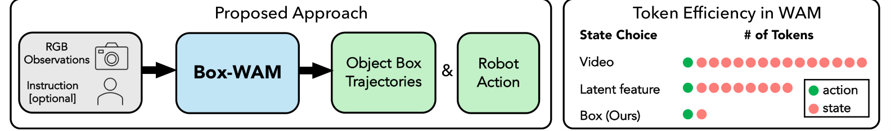
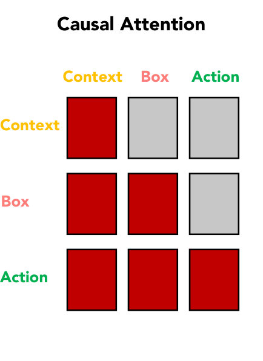
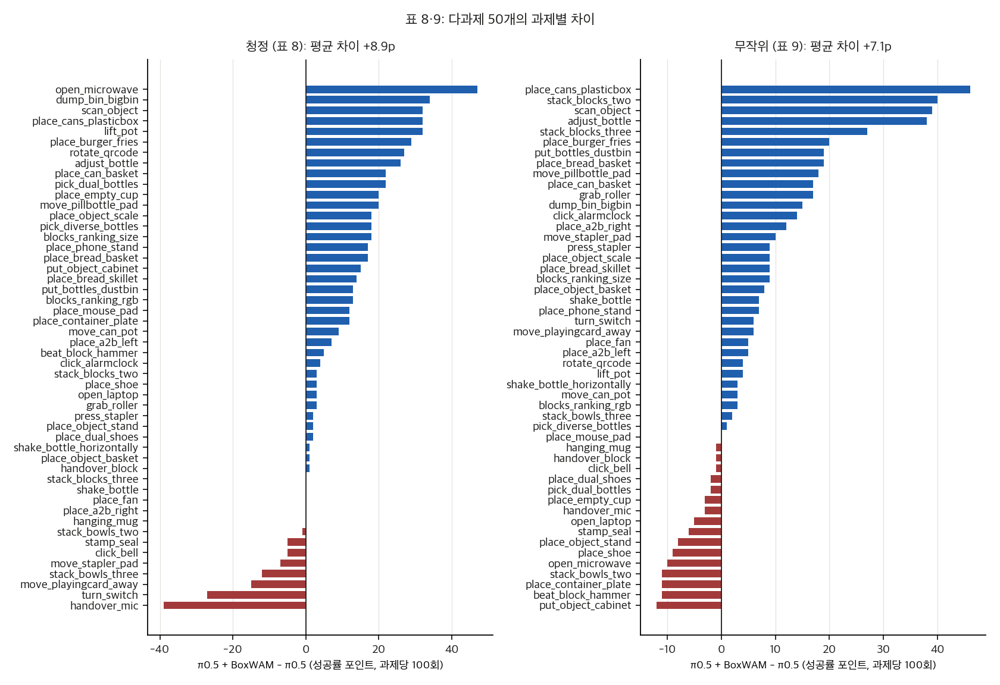
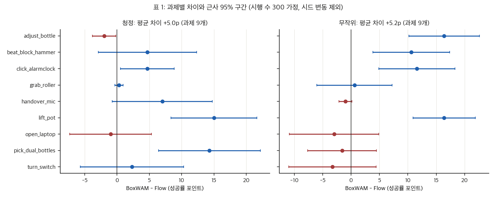
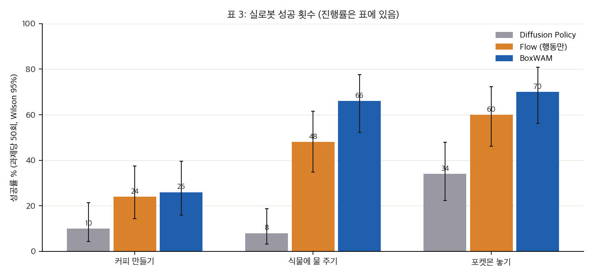
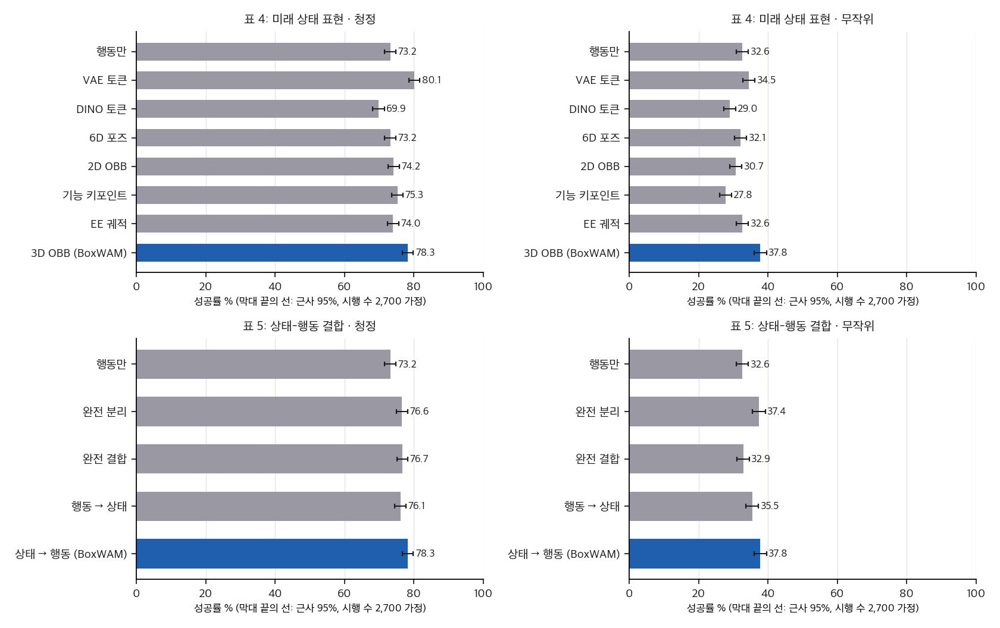
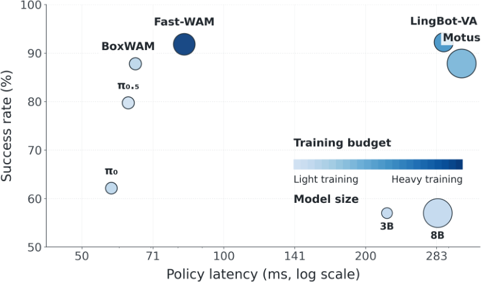

> **논문:** Qinxi Yu, Wenzhou Ding, Gloria X. Wang, Albert J. Zhai, Shenlong Wang (UIUC). *Box Trajectories as Compact State Representations for World Action Models.* CoRL 2026 포스터, arXiv:2610.17526 (v1, 2026-10-13, 유일한 판본).
> 논문 그림은 CC BY 4.0에 따라 출처를 밝히고 도식·차트 세 장만 실었고(© 저자), 나머지 그래프는 논문 표 값으로 직접 그렸습니다. 코드 대조는 공식 저장소 커밋 `7afa9c6`(2026-10-15) 기준이며 코드를 실행하지는 않았습니다.

## 논문이 묻는 것

월드 액션 모델(WAM)은 행동과 함께 미래 상태를 예측해 행동 생성을 돕는 정책입니다. 미래 상태를 영상 프레임으로 두면 배경과 조명까지 예측해야 해 비싸고, 잠재 표현은 학습이 어렵고 해석이 안 됩니다. BoxWAM은 이렇게 묻습니다. 지금 조작 중인 물체의 **3D 방향 경계 상자 여덟 꼭짓점을 화면에 투영한 16개 수**만 미래 상태로 예측하면 충분한가요?

*그림 1. 입력(RGB, 지시)에서 상자 궤적과 행동을 함께 내는 구성(왼쪽)과 미래 상태 선택에 따른 토큰 수 비교(오른쪽). 논문 그림 1의 아래쪽 도식만 잘랐습니다. © Yu 외, CC BY 4.0, 출처 arXiv:2610.17526.*

## 방법에서 기억할 세 가지

**첫째, 미래 상태는 능동 물체의 상자 하나(양팔이면 슬롯 둘)입니다.** 학습 때 능동 물체는 지금 조작 중인 물체이고 없으면 다음에 접촉할 물체입니다. 추론 때는 정답 상자도 접촉 순서도 받지 않고 RGB, 고유감각, 지시만 받아 상자 궤적을 스스로 예측합니다.

**둘째, 상자와 행동을 정류 흐름 트랜스포머 하나가 함께 디노이즈합니다.** 동결된 DINOv3가 만든 문맥 토큰과, 잡음이 섞인 미래 상자 토큰 H개, 행동 토큰 H개를 한 시퀀스로 처리합니다. 손실은 상자와 행동의 속도 오차를 같은 가중치로 더합니다.

**셋째, 어텐션은 한 방향입니다.** 행동 토큰은 상자 토큰을 볼 수 있고 상자 토큰은 행동 토큰을 볼 수 없습니다. 상자 궤적이 "물체 운동 계획"처럼 행동을 이끈다는 설명입니다.

*그림 2. 문맥, 상자, 행동 토큰 사이의 어텐션(빨강은 볼 수 있음, 회색은 볼 수 없음). 논문 그림 2의 오른쪽 도식만 잘랐습니다. © Yu 외, CC BY 4.0, 출처 arXiv:2610.17526.*

## 결과를 다시 계산하면

표의 평균은 전부 일치했습니다. 표 1의 평균 열 열두 개는 과제 아홉 개의 평균과 소수 둘째 자리 안에서 같고, 표 8·9의 50과제 평균은 표 2의 52.6 / 61.5 / 26.9 / 34.0을 다시 만듭니다. 아래는 같은 값으로 차이의 크기를 본 것입니다. 시행 수를 논문에 적힌 대로 두고 성공 횟수를 "백분율 × 시행 수"로 복원했으며(시행 수 가정), 모든 구간은 학습 시드 변동을 포함하지 않습니다.

### 다과제 π0.5: 방향이 일관됩니다

π0.5에 상자 토큰 50개를 더해 2,500 시연으로 30,000 스텝 미세조정한 표 2는 청정 52.6 → 61.5, 무작위 26.9 → 34.0입니다. 과제 50개의 값(표 8·9, 과제당 100회 한 시드)으로 보면 청정에서 37개 과제가 오르고 8개가 내려(부호 검정 p = 1.5e-5, 과제 부트스트랩 95% 구간 +4.5–13.0p), 무작위에서는 33개가 오르고 16개가 내립니다(p = 0.021, +3.5–10.9p). 이득이 큰 과제는 open_microwave(33 → 80), place_cans_plasticbox(25 → 71, 무작위), stack_blocks_two(1 → 41, 무작위)이고, handover_mic(61 → 22)과 turn_switch(57 → 30)는 청정에서 내려갑니다. 논문도 "개선은 과제마다 고르지 않다"고 적습니다.

*그림 3. 표 8·9의 과제별 성공률 차이(π0.5 + BoxWAM − π0.5). 우리가 그린 그래프입니다.*

### 단일 과제 표 1: 청정은 두 과제, 무작위는 네 과제가 평균을 만듭니다

BoxWAM은 같은 구조의 행동 전용 변형(Flow)보다 청정 평균 +5.0p(과제 7개 상승, 2개 하락), 무작위 +5.2p(5개 상승, 4개 하락)입니다. 각 셀의 시행 수를 300(3 시드 × 100회)으로 가정해 Fisher 검정을 하면, Holm 보정 후 청정에서 유의한 과제는 lift_pot(+15.0)과 pick_dual_bottles(+14.3)이고 무작위에서는 adjust_bottle(+16.4), beat_block_hammer(+10.6), click_alarmclock(+11.6), lift_pot(+16.4)입니다. 무작위의 평균 차이 +5.2p는 이 네 과제의 합(+55.0p)이 아홉 과제의 합(+46.7p)보다 크다는 점에서, 이 네 과제에 기대고 있습니다. 과제 평균의 t 검정은 p = 0.10입니다. 논문의 서술("청정에서는 DP3 제외 최고, 무작위에서는 평균 최고")은 표와 맞습니다.

*그림 4. 표 1의 과제별 BoxWAM − Flow 차이와 근사 95% 구간(시행 수 300 가정). 우리가 그린 그래프입니다.*

표 1의 36개 셀(Flow, BoxWAM)은 300회로 정수로 만들 수 있고 150회(3 × 50)로는 20개가 만들어지지 않습니다. 반면 4.3절은 절제를 "시드당 50회"로 평가했다고 적으면서 표 4·5의 두 행이 표 1의 평균과 같은 값(73.2 / 32.6, 78.3 / 37.8)입니다. 같은 평가의 값을 두 표에 쓴 것인지 다른 평가인지는 저자 확인이 필요합니다.

### 실로봇: 방향은 같지만 과제당 50회로는 구분되지 않습니다

표 3의 성공 횟수를 50회 기준으로 복원하면 BoxWAM 대 Flow는 Make Coffee 13 대 12, Water Plant 33 대 24, Place Pokemon 35 대 30이고, 세 과제 합계 81/150 대 66/150은 Fisher p = 0.11입니다. Diffusion Policy 대비(81/150 대 26/150)는 p < 1e-10입니다. 4.2절이 적듯 행동 전용 변형이 DINOv3를 쓰는 점이 이 격차에 섞여 있습니다. 50회 대 50회로 80% 검정력으로 구분할 수 있는 최소 차이는 약 24–28p(합계는 약 16p)입니다. 한 가지 더, Diffusion Policy의 Water Plant 진행률 9.4는 50회, 하위 목표 3개의 격자(14/150 = 9.33)에 없는 값이고 가장 가까운 값은 9.3입니다. 표의 Average는 성공률과 진행률 여섯 값의 평균이어서 BoxWAM이 60.85(표 60.9, 본문 60.85)입니다.

*그림 5. 표 3의 성공률과 Wilson 95% 구간(과제당 50회). 우리가 그린 그래프입니다.*

### 절제: 상자는 컴팩트 표현 중 가장 높고, 방향 선택의 이득은 작습니다

표 4에서 상자(78.3 / 37.8)는 6D 자세, 2D OBB, 키포인트, EE 궤적보다 두 설정에서 모두 높고 무작위가 최고입니다. 청정에서는 VAE 토큰(80.1)이 1.8p 높습니다. 시행 수를 2,700(3 × 100 × 9)으로 가정하면 상자 우위는 대부분 p < 0.01이고, 1,350으로 가정하면 키포인트 청정 +3.0p(p = 0.065)와 VAE 무작위 +3.3p(p = 0.074)는 5%를 넘습니다. 밀집 표현(VAE, DINO)은 15,000 스텝, 나머지는 6,000 스텝 학습했다고 적혀 있습니다. 표 5에서 "상태 → 행동" 방향과 "완전 분리"의 차이는 청정 +1.7p, 무작위 +0.4p로 검출 한계(약 4p) 안이고, 완전 결합 대비로는 무작위 +4.9p(p = 1.7e-4)가 분명합니다. 논문도 "분리 예측이 경쟁적"이라고 적습니다.

*그림 6. 표 4(미래 상태 표현)와 표 5(상태-행동 결합)의 성공률과 근사 95% 구간(시행 수 2,700 가정). 우리가 그린 그래프입니다.*

지연은 행동만 168.3 ms, 상자 172.4 ms(+4.1 ms, +2.4%), VAE 250.5 ms, DINO 251.4 ms입니다. 다과제 표 2에서는 55.3 → 57.7 ms(+2.4 ms)입니다. 효율의 근거는 지연 쪽이 분명하고, 학습 비용은 스텝 수와 그림 6의 추정 GPU 시간뿐이며 하드웨어가 맞춰져 있지 않습니다.

### 큰 설정

27,500 시연, 말단장치 제어로 35,000 스텝 미세조정한 π0.5 + BoxWAM은 Easy 87.94%, Hard 87.62%, 지연 64.9 ms, 3.35B 파라미터라고 적습니다. 그림 6의 거품 차트에서 읽은 값은 BoxWAM 약 87.8%와 약 65 ms(그림 판독 값)로 본문과 맞고, Fast-WAM은 약 92%에 약 83 ms, π0.5는 약 80%(그림 판독 값)입니다. 같은 설정의 π0.5 기준선 값은 본문에 없습니다. 이 설정은 성능 최고를 주장하기보다 성능-지연 균형을 보이는 것으로 읽힙니다.

*그림 7. 27,500 시연 설정에서 성공률(Easy와 Hard 평균), 지연(RTX Pro 6000), 모델 크기와 학습 예산의 비교. 논문 그림 6을 잘랐습니다. © Yu 외, CC BY 4.0, 출처 arXiv:2610.17526.*

## 공식 코드를 읽으면

저장소(MIT)는 단일 과제 구현, π0.5용 openpi 포크, RoboTwin 포크, 실로봇 학습 설정 세 개를 담고 있습니다. 어텐션 규칙, 시각 표집, 추론 일정, 6,000 스텝(20 에폭 × 300)은 논문과 같습니다. 논문에서 읽을 수 없는 차이는 다음과 같습니다.

- **빈 슬롯 처리.** 논문은 대상이 없는 팔의 슬롯을 상태 손실에서 마스크한다고 쓰지만, 코드(π0.5 포크)는 슬롯별 마스크 없이 0 목표로 학습한다고 주석에 적고 있습니다.
- **상자 정의.** 논문은 "최소 부피 방향 경계 상자"라고 쓰고, RoboTwin 포크의 주석 스크립트는 메시 로컬 축 정렬 상자를 투영합니다.
- **능동 물체.** 라벨러는 그리퍼 값, 거리, 이동량의 임계값으로 접촉 구간을 정하고 마지막 대상을 이후에도 유지합니다.
- **학습 시드와 체크포인트.** 평가의 시드는 환경 시드이고 체크포인트는 과제당 하나로 읽힙니다. 검증 분할은 에피소드의 2%이고 `best.pt`는 검증 행동 오차 기준입니다.
- **논문에 없는 값.** 예측기 깊이 12, 폭 768, 입력 224, 배치 384, 정지 구간 제거 필터 등이 코드에만 있습니다.
- **공개 범위.** 표 4의 VAE, DINO, 자세, 키포인트 변형과 표 2의 설정(2,500 시연, 관절 제어)은 공개되지 않았습니다.

## 정리

표의 산술은 맞습니다. 다과제 π0.5 설정의 향상은 과제 단위에서도 방향이 일관되고, 단일 과제의 향상은 청정에서는 두 과제, 무작위에서는 네 과제에 크게 의존합니다. 실로봇의 BoxWAM 대 Flow 차이는 과제당 50회로는 구분되지 않습니다. 상자가 컴팩트 표현 중 가장 높다는 서술은 표 4와 맞지만 시행 수 표기(100회와 50회)와 학습 시드 변동은 저자 확인이 필요합니다. 방법이 단순하고 코드가 공개되어 있어 일부 비교 변형과 표 2의 설정이 공개되면 검증이 더 쉬워질 것입니다.

## 자료

- [통합 리포트 PDF](report/report_public.pdf)
- [01. 논문 분석: Box Trajectories as Compact State Representations for World Action Models (BoxWAM)](analysis/01_paper_analysis.md)
- [02. 선행연구와 자료: BoxWAM (arXiv:2610.17526)](analysis/02_prior_work.md)
- [03. 수치 재계산과 일관성 검사: BoxWAM (arXiv:2610.17526)](analysis/03_analysis.md)
- [04. 논문과 공식 코드의 대조: BoxWAM (arXiv:2610.17526)](analysis/04_code_verification.md)
