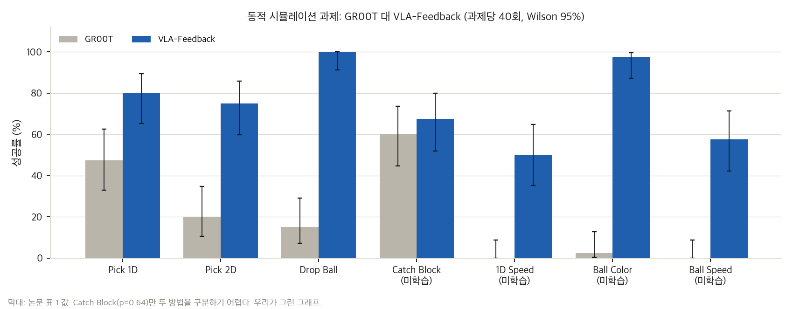
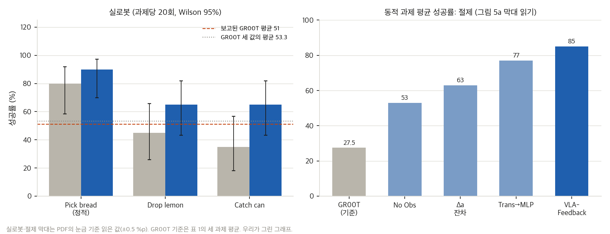
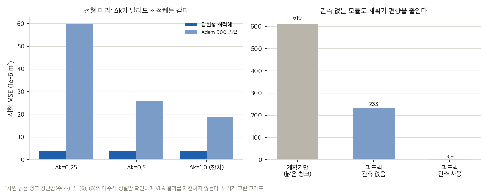
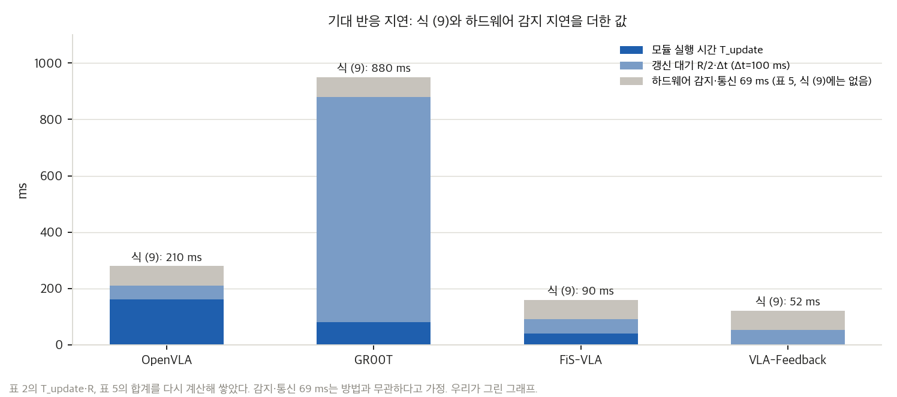

> **논문:** Yiheng Ji, Xingru Zhou, Luis Sentis, Mingyo Seo. *Catch Me If You Can: Real-Time Feedback Denoising for Responsive VLAs.* CoRL 2026 포스터, arXiv:2609.21022 (v1, 2026-09-17).
> 공식 코드는 GitHub jidaxian010/VLA-Feedback-release에 있습니다(Apache-2.0). 이 글의 그래프는 논문 표와 막대 값으로 우리가 그린 것이며 논문 그림은 쓰지 않았습니다(arXiv 비독점 라이선스).

## 논문이 묻는 것

행동 청크를 쓰는 VLA는 청크를 다 실행하는 동안 새 관측을 쓰지 못합니다. 물체가 움직이면 청크가 낡습니다. VLA-Feedback은 느린 GR00T 계획기가 마지막 디노이징 한 단계 직전의 행동을 청크마다 만들고, 가벼운 모듈이 매 제어 스텝(10 Hz)마다 손목 카메라 영상을 보고 마지막 단계의 속도를 예측해 행동을 고치게 합니다. 모듈은 약 1.19M 파라미터이고 계획기는 동결합니다.

## 이 글에서 확인한 것

**1. 동적 시뮬레이션의 격차는 확실하지만 비교 대상이 열린 루프뿐입니다.** 동적 세 과제 평균 27.5%에서 85.0%는 산술로 재현됩니다. 열별 Fisher 검정에서 Catch Block을 뺀 6개 동적 열은 Holm 보정 p < 0.02입니다. 그러나 같은 계획기를 더 자주 재계획하거나 비동기·잔차 보정 방법과 비교하지 않아서 이득이 "피드백 구조"에서 오는지 "청크 중간에 새 관측을 쓰는 것"에서 오는지 가려지지 않습니다.

*그래프: 표 1 동적 과제의 성공률과 Wilson 95% 구간(과제당 40회). 우리가 그린 그래프입니다.*

**2. 실로봇 평균 51은 세 과제 값의 평균과 맞지 않습니다.** 그림 4의 막대를 눈금 기준으로 읽으면 GR00T는 80, 45, 35이고 평균은 53.3입니다. 20회 시행의 5 %p 단위로는 평균 51이 나올 수 없습니다. 개선폭은 판독 값 기준으로 +22가 아니라 +20 %p이고, 과제별로는 모두 p > 0.1이며 세 과제 합산은 32/60 대 44/60으로 p = 0.037(보정 없음)입니다. 방향은 세 과제 모두 같습니다.

**3. 관측을 뺀 변형이 이미 큰 이득을 냅니다.** 절제의 No Obs는 동적 평균 53(그림 5a 판독 값)으로 GR00T 27.5보다 25.5 %p 높습니다. 관측의 순수 기여는 32 %p이고 나머지는 학습되는 보정기와 추가 학습의 효과일 수 있습니다.

*그래프: 실로봇 막대(그림 4)와 절제 막대(그림 5a)를 눈금 기준으로 읽은 값. 우리가 그린 그래프이며 읽은 값은 ±0.5 %p 오차가 있습니다.*

**4. "디노이징 속도 갱신"은 선형 머리와 최종 행동 회귀에서 행동 잔차와 같은 함수입니다.** 논문의 손실은 속도가 아니라 최종 행동에 걸리고 머리는 선형입니다. 이때 Δk를 어떻게 정해도 최적해의 오차가 같습니다. 1차원 낡은 청크 장난감에서 확인했고, 같은 Adam 설정에서는 Δk가 작을수록 오히려 느렸습니다. 그림 5a의 속도 갱신 85 대 행동 잔차 63의 차이는 입력 특징이나 학습 설정에서 와야 하는데, 잔차 변형의 구성은 설명되어 있지 않습니다.

*그래프: 1차원 낡은 청크 장난감. 왼쪽은 Δk에 따른 닫힌형·Adam 오차, 오른쪽은 관측 유무. 우리가 그린 그래프입니다.*

**5. 반응 지연의 이득은 식의 값이고 감지·통신 지연이 빠져 있습니다.** 10 Hz에서 기대 반응 지연은 VLA-Feedback 52 ms, GR00T 880 ms, FiS-VLA 90 ms입니다. 그러나 식에는 표 5의 감지·통신 69 ms가 없어서, 더하면 VLA-Feedback은 약 121 ms가 되고 FiS-VLA와의 격차는 1.7배에서 약 1.3배로 줄어듭니다.

*그래프: 10 Hz에서 식 (9)의 기대 반응 지연에 하드웨어 감지·통신 69 ms를 더한 값. 우리가 그린 그래프입니다.*

**6. 공식 코드는 논문과 구조·평가 설정이 다릅니다.** 피드백 모듈은 식 (3)의 행동 가지 대신 DiT 은닉 특징 토큰 하나씩을 받고, 근사 행동은 입력이 아니라 덧셈에만 쓰입니다. 로봇수이트 평가는 디노이징 2단계(Δk = 0.5)로 돌며 논문에 단계 수가 없습니다. 동적 목표의 움직임은 무작위가 아니라 한 가지 고정 패턴을 되풀이하고, 2D 과제 30초, Catch Block 5 cm·같은 패턴 같은 차이가 부록 A.1과 있습니다. 모두 정적 읽기이고 실행해서 확인하지 않았습니다.

## 구현 가능성

- **피드백 모듈은 구현할 수 있습니다.** ResNet-18, 선형 투영, 디코더 한 층, 게이트, 속도 머리로 약 100줄이고, 작은 계획기와 이동 목표 장난감에서 시험할 수 있습니다. 노력은 2–4일로 추정합니다(측정하지 않음).
- **논문 수치는 일반 개인 장비에서 재현할 수 없습니다.** 공식 코드는 CUDA와 flash-attn을 가정하고 체크포인트가 15.5 GB이며, 시연 데이터와 베이스라인 체크포인트, 실로봇 코드는 공개되지 않았습니다.

## 저장소 상태

공식 저장소는 2026-09 초기 공개 커밋에 별 7개입니다. 시뮬레이션(로봇수이트·LIBERO)과 피드백 체크포인트만 있고, 실로봇 코드·데이터·베이스라인 체크포인트·OpenVLA와 FiS-VLA 코드는 없습니다.

## 남은 질문

저자에게 물을 것은 다섯 가지입니다. 디노이징 단계 수, 행동 잔차 변형의 입력 구성, 그림 5b "1:2" 비율의 정의, 실로봇 GR00T 평균 51의 계산, 표 1 Drop Ball Speed(0.066 m/s)와 표 3 +30%(0.065 m/s)가 같은 값인 이유입니다.

## 자료

- [통합 리포트 PDF](report/report_public.pdf)
- [01. 논문 분석: Catch Me If You Can: Real-Time Feedback Denoising for Responsive VLAs](analysis/01_paper_analysis.md)
- [02. 선행연구, 가까운 대안, 저장소](analysis/02_prior_work.md)
- [03. 수치 재계산, 일관성 검사, 주장 판정](analysis/03_analysis.md)
- [04. 공식 코드 대조 (정적 읽기)](analysis/04_code_verification.md)
