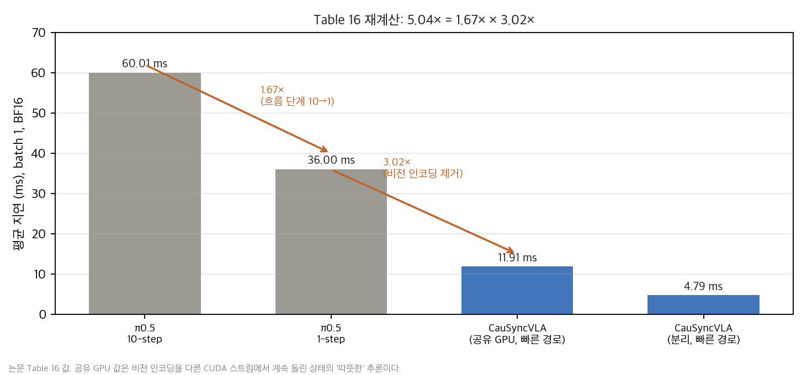
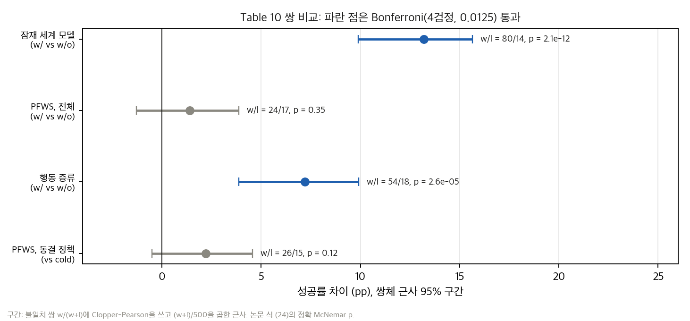
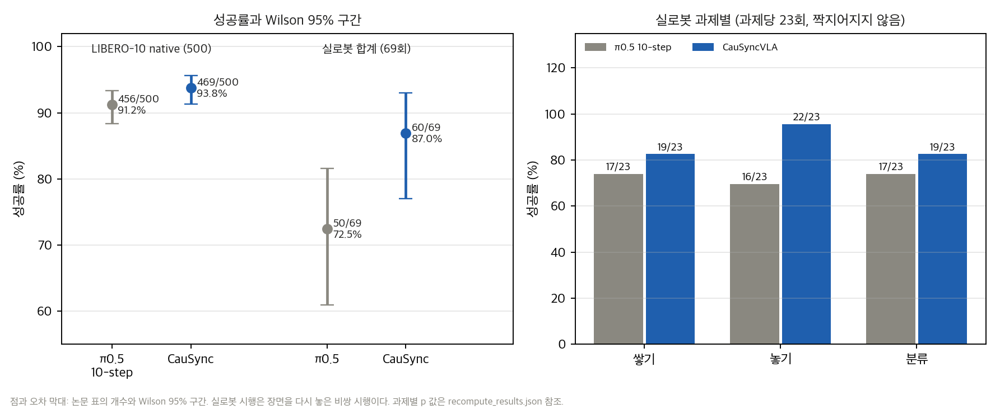

> **논문:** Xu Pan, Chubin Zhang, Xingrui Yu, Runmin Lan, Zihao Wang, Wenkai Guo, Bofang Jia, Bo An, Ziwei Wang. *CauSyncVLA: Causal Latent World Modeling for Asynchronous Robot Control.* arXiv:2611.25667 (v1, 2026-11-19). 학회 표기는 없습니다.
> 공식 코드(Apache-2.0)와 프로젝트 페이지가 있습니다. 이 글의 그래프는 우리가 논문 표 수치로 다시 그린 것이며, 논문 그림은 쓰지 않았습니다.

## 무엇을 풀려는가

VLA 정책은 이미지를 인코딩하는 데 시간이 걸립니다. 그동안 로봇은 기다리거나, 비동기로 움직이면서 오래된 시각 기억과 어긋난 행동 청크를 씁니다. 청크 경계에서 행동이 튀는 문제도 함께 생깁니다.

CauSyncVLA는 두 흐름으로 나눕니다. 느린 흐름은 완료된 프레임의 KV 기억을 발행합니다. 빠른 흐름은 그 뒤에 실제로 실행된 상태와 명령 기록을 써서 현재 KV 기억을 예측하고, 아직 실행하지 않은 행동 꼬리를 한 번의 흐름 스텝으로 보정합니다. 백본과 행동 전문가는 얼려 둡니다. 학습하는 것은 약 2,400만 파라미터의 예측기 하나입니다.

*그래프: 논문 Table 16의 모델 단독 지연. 기준선 10단계 60.01 ms, 1단계 36.00 ms, CauSyncVLA 공유 GPU 11.91 ms. 5.04배는 1.67배(흐름 단계)와 3.02배(시각 인코딩 분리)의 곱입니다.*

## 무엇이 잘 입증되었나

- **기억 예측과 행동 증류.** LIBERO-10 500 starts에서 같은 시작 상태를 쓴 쌍 비교가 있습니다. 잠재 기억 예측이 있을 때만 성공한 시작 상태가 80개, 없을 때만 성공한 시작 상태가 14개입니다(p = 2e-12). 행동 증류도 같은 방식으로 54 대 18입니다(p = 2.6e-5). 행동에 민감한 손실이 KV 오차보다 제어에 중요하다는 주장은 이 자료로 잘 뒷받침됩니다.
- **경계 뒤집힘.** 한 스텝 보정은 청크 경계의 행동 뒤집힘을 2.57%에서 1.36%로 줄입니다. 쌍 검정은 없지만 방향은 일관됩니다.

*그래프: 논문 Table 10의 쌍 비교. 이득(pp)과 쌍체 근사 95% 구간, 정확 McNemar p. 우리가 그렸습니다. 파란 점은 네 검정의 Bonferroni 기준(0.0125)을 통과한 비교입니다.*

## 헤드라인 수치는 어떻게 읽어야 하나

- **LIBERO-10 93.8% 대 91.2%.** 469/500 대 456/500입니다. 두 결과 모두 같은 500 starts이지만, 쌍별 결과가 공개되지 않아 쌍체 검정을 할 수 없습니다. 비쌍 검정으로는 p = 0.15입니다. 체크포인트 12k도 같은 시험 starts에서 6k, 18k와 비교해 고른 값입니다. 차이는 2에서 4 starts이므로 결론을 바꾸지는 않지만, 헤드라인 수치는 낙관적으로 읽어야 합니다.
- **5.04배 추론 처리량.** 모델 단독 빠른 경로의 지연 비입니다. 실제 20 Hz 단일 GPU 실행에서는 재계획이 1.28배 빨라지고, 응답 지연은 2.13배 줄었습니다.
- **실로봇 86.96% 대 72.46%.** 과제당 23회, 세 과제에서 합계 69회입니다. 시행은 장면을 다시 놓은 비쌍 시행이고 운영자가 판정했습니다. 풀링 Fisher p = 0.056이고 과제를 층화한 CMH 검정은 p = 0.036입니다. 성공 한 건만 바뀌어도 카이제곱 검정이 유의하지 않게 됩니다.

*그래프: LIBERO-10 native(500 starts)와 실로봇 합계(69회)의 Wilson 95% 구간, 실로봇 과제별 개수. 우리가 그렸습니다.*

## 저자들도 인정한 부분

- 체크포인트와 평가 시드는 시험 결과를 본 뒤에 골랐다고 적었습니다(부록 B.5).
- PFWS의 성공률 이득은 통계적으로 확정되지 않았다고 적었습니다(부록 B.13). 주된 기여는 연속성입니다.
- LIBERO-Plus의 2,519개 변형에서 CauSyncVLA는 동기 PFWS(80.15%)보다 낮은 78.09%입니다. 큰 시점과 배치 변화에서 이득이 음수가 됩니다. 초록에 언급된 "강건성 개선"은 이 범위에서만 맞습니다.

## 코드와 구현 가능성

- 공식 저장소는 Apache-2.0입니다. 학습과 LIBERO 평가 경로는 CUDA, Linux EGL, Python 3.11을 전제합니다.
- 실로봇 가중치와 학습 기록은 공개되지 않았습니다. 실로봇 실험은 외부에서 재현할 수 없습니다.
- 설정 파일이 체크포인트를 고르는 규칙(검증 지표 최소)을 적용하면 18k가 뽑힙니다. 논문은 12k를 보고합니다. 재현할 때 주의가 필요합니다.
- 논문에서 쓴 "causal"은 과거 정보만 쓴다는 뜻입니다. 인과 관계를 식별했다는 뜻이 아닙니다.

## 한 줄 판단

잠재 기억 예측과 행동 증류는 방향과 크기 모두 강한 근거가 있습니다. 반면 헤드라인 성공률 차이와 실로봇 우위는 아직 확정되지 않았습니다. 다음으로 볼 것은 쌍별 결과 공개와 시험 starts와 분리된 체크포인트 선택입니다.

## 자료

- [통합 리포트 PDF](report/report_public.pdf)
- [01. 논문 분석: CauSyncVLA](analysis/01_paper_analysis.md)
- [02. 선행연구와 관련 자료](analysis/02_prior_work.md)
- [03. 재계산, 일관성 검사, 주장 판정](analysis/03_analysis.md)
- [04. 공식 코드 대조 (정적 읽기)](analysis/04_code_verification.md)
